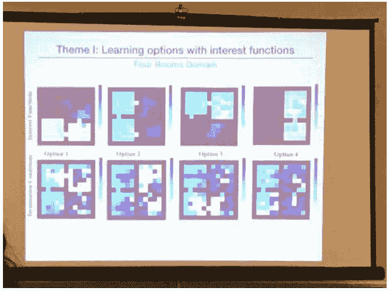

# AAAI 2019 会议笔记

## 美国夏威夷檀香山

大卫·阿贝尔*
[david_abel@brown.edu](mailto:david_abel@brown.edu)
2019年1月和2月

## 目录

- 1 会议亮点
- 2 1月27日星期日：博士论文学术研讨会
    - 2.1 研讨会概述
    - 2.2 Neeti Pokhriyal：多视角学习来自不同来源的贫困地图
    - 2.3 Negar Hassanpour：因果效应估计的反事实推理
    - 2.4 Khimya Khetarpal：学习动作和感知的时间抽象
    - 2.5 Ana Valeria Gonzalez-Garduño：低资源对话系统的强化学习
    - 2.6 AAAI 教程：Eugene Freuder关于如何进行演讲
        - 2.6.1 热情
        - 2.6.2 易于理解
        - 2.6.3 使用示例
        - 2.6.4 表达清晰
        - 2.6.5 通过视觉/动态增强你的演讲
        - 2.6.6 吸引观众
    - 2.7 Aida Rahmattalabi：图上的强大对等监控
    - 2.8 Nikhil Bhargava：不确定通信下的多智能体协调
- 3 星期一，1月28日：博士论文学术研讨会
    - 3.1 Sandhya Saisubramanian：适应性建模用于风险感知决策
    - 3.2 Abhinav Verma：通过程序合成解释和验证强化学习
    - 3.3 Ruohan Zhang：专注力 - 从数据到计算模型
    - 3.4 Faraz Torabi：从观察中进行模仿学习
    - 3.5 Christabel Wayllace：随机目标识别设计
    - 3.6 Sathya Ravi：从AI到数值优化再回到AI
    - 3.7 Atena Tabakhi：基于约束方法的偏好获取
    - 3.8 Emmanuel Johnson：使用自动代理来教授谈判技巧
    - 3.9 Thayne Walker：在复杂领域中的多智能体路径规划
    - 3.10 Christopher Fourie: 基于证据的自适应规划
    - 3.11 AI 路线图小组讨论
        - 3.11.1 综合智能
        - 3.11.2 有意义的互动
        - 3.11.3 自我感知学习
    - 3.12 一个大胆的人工智能研究新时代
        - 3.12.1 问答环节
- 4 星期二, 1月29日
    - 4.1 邀请演讲: Cynthia Breazeal 关于与人工智能共同生活和繁荣
        - 4.1.1 人类参与
        - 4.1.2 联盟参与、个性化和学习
        - 4.1.3 老龄化: 促进社区联系
    - 4.2 学习理论
        - 4.2.1 精确率-召回率 vs. 准确率 [17]
        - 4.2.2 标签分布学习的理论分析
        - 4.2.3 动态学习顺序选择赌博问题
        - 4.2.4 随机偏好完成中的近邻方法 [24]
        - 4.2.5 来自随机投影的无维度误差界 [18]
    - 4.3 牛津风格人工智能辩论
        - 4.3.1 开场陈述
        - 4.3.2 主要陈述
        - 4.3.3 结束陈述
- 5 星期三 1月30日
    - 5.1 邀请演讲: Ian Goodfellow 关于对抗学习
        - 5.1.1 生成建模
        - 5.1.2 最新发展
    - 5.2 强化学习
        - 5.2.1 虚拟淘宝: 在线强化学习环境 [34]
        - 5.2.2 QUOTA: 分位数选项架构 [45]
        - 5.2.3 通过抽象表示组合强化学习 [11]
        - 5.2.4 海报亮点
- 6 星期四 1月31日
    - 6.1 邀请演讲: 郑宇关于智慧城市
        - 6.1.1 挑战1: 城市感知
        - 6.1.2 挑战2: 数据管理
        - 6.1.3 挑战3: 数据分析
        - 6.1.4 挑战4: 提供服务
    - 6.2 不确定性推理
        - 6.2.1 关于均匀采样器的测试 [6]
        - 6.2.2 寻找近乎最优的贝叶斯网络结构 [23]
        - 6.2.3 重新思考强化学习中的折扣因子 [31]
    - 6.3 邀请演讲: Tuomas Sandholm关于解决不完全信息游戏
        - 6.3.1 平衡细化
- 7 星期五 2月1日
    - 7.1 强化学习
        - 7.1.1 多样性驱动的分层强化学习 [36]
        - 7.1.2 在DQN中实现更好的可解释性 [1]
        - 7.1.3 关于全长《星际争霸》游戏的强化学习 [28]
    - 7.2 不确定性推理
        - 7.2.1 在多智能体系统中在线学习高斯过程
        - 7.2.2 使用知识编译的加权模型集成
        - 7.2.3 通过引导变量转移进行离策略深度强化学习
        - 7.2.4 将贝叶斯网络分类器编译成决策图 [35]

本文档包含我在AAAI会议上参加的活动期间所做的笔记，包括博士论坛的会议。如果您发现任何拼写错误或其他需要更正的地方，请随时分发并通过电子邮件联系我：david_abel@brown.edu。

## 1 会议亮点

AAAI非常棒——邀请演讲提供了令人印象深刻的视频，激发了对未来的愿景，并对许多领域进行了全面覆盖，涵盖了游戏玩法、学习、人机交互、数据管理和令人兴奋的应用。我也喜欢两个晚间活动：1）美国人工智能研究的20年路线图，以及2）关于人工智能未来的辩论。这两个活动都提出了引人入胜的问题，对研究人员和从业者都有启发。

我还想强调一下博士生论坛（DC）。这是我参加的第一个DC；简而言之，我强烈鼓励研究生在他们的项目期间至少参加一次DC。你将接触到来自世界各地同行的一些出色工作，并获得关于演讲技巧、写作方式以及研究目标和方法的个性化指导。

AAAI给我留下了深刻的印象，他们很好地将许多不常交流的子领域融合在一起——我遇到了很多从事规划、约束满足、自动定理证明、人工智能与社会以及大量机器学习/强化学习研究的人。

在路线图上提出的最后一个观点是，自然而然，目前研究/工业的很大一部分集中在机器学习上。但是，重要的是我们继续推动知识的前沿在许多不同的领域。所以，如果你考虑很快进入研究生院，要考虑追求其他提供基础性和重要问题的主题/领域（有很多！），而不仅仅是机器学习。

就是这样！让我们开始吧。

## 2 1月27日星期日：博士论文学术研讨会

开始了！今天我将参加博士生论坛 (DC) —— 我的目标是通过笔记让大家了解DC的内容，并分享一些优秀研究生的令人兴奋的研究成果。

### 2.1 研讨会概述

我强烈推荐在研究生期间参加博士生论坛。我从这次经历中学到了很多。对于那些不了解的人，DC包括准备一份简短的摘要总结你的工作，并向你的同行和导师们进行10-20分钟的演讲。每个参与的学生都会被分配一个导师（来自他们的领域），帮助准备演讲并就你的研究提供更一般性的建议。这是一次很棒的经历！我有幸见到了许多优秀的研究生，并听说了他们的工作。

### 2.2 Neeti Pokhriyal: 从不同来源的多视角学习用于贫困映射

- **重点**：从多个不同的数据源学习，应用于可持续发展和生物特征学。
- **具体应用**：贫困映射。对一个国家的经济剥夺进行空间表示。这是政策规划者的重要工具。
- **现状**：目前的方法是家庭调查，存在以下问题：1) 成本高，2) 耗时长，3) 只适用于小样本。
- **研究目标**：为一个国家获得准确、空间详细和诊断性的贫困地图。
- **数据源**：有很多数据可用，包括天气、街道地图、经济数据、手机、卫星图像。但是！这些数据源的结构非常不同。

> **定义1 (多视角学习)**：一种学习风格，将输入的不同语义类型的数据分别处理，并将它们合并成一个因子化表示，用于预测模型。

- **方法**：学习一个与弹性网正则化相结合的高斯过程（GP）回归模型[48]。
- **验证**：使用这个模型得到的地图如图1所示。然后通过与人口普查数据进行比较，进行定量分析和验证他们的模型是否进行了高质量的预测。
- **目标2**：从多个数据源中学习一个分解表示。希望我们能够分解出每个数据源独特的解释因素。

#### 类似EM的方法:
1. **学习步骤**：将视图 $Y$ 和 $Z$ 映射到共享子空间 $X_i, \dots$
2. **推理步骤**：对这些子空间进行推理。

- **问题**：那么，我们如何学习共享子空间？
- **答案**：最大化不同类别之间在不同视图上的分离数据，同时确保每个视图的投影与共享空间对齐。可以使用广义特征值问题或使用核技巧来解决。

### 2.3 Negar Hassanpour: 因果效应估计的反事实推理

- **问题**：考虑史密斯先生，他患有一种疾病并具有一些已知属性（年龄，BMI等）。医生提供治疗X并观察治疗X的效果（但没有关于反事实的数据：如果医生应用治疗Y会发生什么？）。
- **目标**：估计“个体治疗效应”（ITE）—— 治疗X与Y相比如何？

#### 数据集：
- **随机对照试验（RCT）**：看到很多X和Y。但是，这很昂贵（很多试验）并且不道德（当你知道正确的治疗方法时给出安慰剂）。
- **观察研究**：提供首选治疗方法。但是存在样本选择偏差。
    - *例子*：治疗心脏病，医生给年轻患者开刀，给老年患者开药物。比较存活时间——但是，得到什么治疗方法存在明显的偏见。

这是一个非常基本的问题，被称为“样本选择偏差” —— 富人接受昂贵的治疗，而穷人接受廉价的治疗等等。

#### 这项工作的概述：
- 生成逼真的合成数据集，以评估这些方法（因为好的数据很难获得） $\rightarrow$ 使用合成数据增强RCT（随机对照试验）数据。
- 使用表示学习来减少样本选择偏差。 $\rightarrow$ 希望 $Pr(\phi(x) | t = 0) \approx Pr(\phi(x) | t = 1)$，其中 $\phi$ 是学习到的表示，而 $t$ 是治疗。
- 使用生成模型学习潜在的因果机制。 $\rightarrow$ 使用生成模型学习治疗和结果之间的因果关系。我们能否从观察数据集中识别出结果的潜在来源？
- 进行生存预测。 $\rightarrow$ 我们能否预测被审查或在研究结束后发生的结果？
- 超越二元治疗 $\rightarrow$ 许多治疗方法是二元的，但并非所有。我们能否超越这一点，使用分类或实数值治疗方法？
- 提供治疗方案 $\rightarrow$ 调用强化学习。

### 2.4 Khimya Khetarpal: 学习跨动作和感知的时间抽象

- **问**：一个AI代理如何高效地表示、学习和使用世界知识？
- **答**：让我们使用时间抽象！
- **例子**：准备早餐。涉及许多子任务/活动，如（高层）选择鸡蛋、选择吐司类型；（中层）切割蔬菜、取黄油；以及（低层）手腕和手臂运动。

> **定义2（选项[37]）**：选项将技能/时间扩展动作形式化为三元组：$\langle I, \beta, \pi \rangle$，其中 $I \subseteq S$ 是一个初始化集合，$\beta: S \to Pr(S)$ 是一个终止概率，而 $\pi: S \to A$ 是一个策略。

例子：一个机器人在两个房间之间导航。为了做到这一点，它必须打开一扇门。我们用 $I$ 表示门关闭的状态，$\beta$ 在门打开时为 1，否则为 0，而 $\pi$ 表示打开门的动作。然后，这个选项定义了“打开门”的技能。

**主要问题：**我们能否学习有用的时间抽象（Temporal Abstraction）？

**假设：**学习在特定情况下专门化的选项（Options）可以用来获得正确的时间抽象。

**动机：**AI 代理应该能够在时间上持续、分层和逐步地学习和发展技能。

所以，想象一下我们有一个分解成不同房间的房子。然后我们想学习将代理人带到每个房间之间的技能。此外，代理人应该能够从一个环境转移到另一个环境。

**目标 1：**同时学习选项和兴趣函数（Interest Functions）。

**新想法：**打破 Option-Critic（选项-批评者）假设 [2]，即 $I = S$。相反，考虑一个兴趣函数：

> **定义 3（兴趣函数）：**兴趣函数是对选项对状态 $s$ 感兴趣程度的指示。

现在学习关于选项和兴趣函数的策略——我们可以同时优化这两个方面。推导出关于兴趣函数、选项内部策略和终止函数的策略梯度定理。

图 2：学习到的兴趣函数

还探索在连续控制任务中学习兴趣函数，展示了学习选项之间的良好分离。

**目标 2：**考虑一个永不停止的感知数据流。我们希望学习一系列随时间变化的感知和行为。

**挑战：**
- 如何使代理自动学习有意义的伪奖励（Pseudo-reward）特征？
- 任务描述从哪里来？
- 如何在不手动设计任务/奖励的情况下实现最通用的选项？
- 在终身学习任务中的评估与基准测试？

### 2.5 Ana Valeria Gonzalez-Garduño: 低资源对话系统的强化学习

**目标 1：**创建更加明智的对话生成方法。
**目标 2：**在目标导向对话中使用强化学习进行领域适应。

（并且：我们能以一种与语言无关的方式做到这一点吗？因此，引入可以与任何/许多语言一起工作的模型）。

对话系统分为两个子领域：
1. **开放式对话生成：**通常使用编码器-解码器（Encoder-Decoder）架构。
2. **目标导向对话：**主要使用“流水线”方法来解决。因此包含自动语音识别单元，然后是理解单元，依此类推。

**当前重点：**状态跟踪。也就是说，状态跟踪在对话过程中推断用户意图或信念状态。
**限制：**意图通常依赖于定义哪些意图有效的特定本体论（Ontology）。

**项目的当前状态：**弥合目标导向对话中的差距。主要目标：我们能否摆脱注释的需要？

**总体思路：**给定一个机器人的话语（“我能帮你什么忙？”），以及用户的回应（“我想要更改支付方式”），我们希望从之前的对话中找到一个相关的查询来确定用户说了什么，或者用来调节解码器。

**结果：**这个模型效果非常好！在 BLEU 指标上，他们的模型表现得很好，但更重要的是，在人类评估中，他们的回答一直被选择为优于基准线的回答。

**问：**但是，如果我们的领域不在相关对话的范围内怎么办？
**答：**正在进行中！想法是使用强化学习：
1. **阶段 1：**使用现有数据进行状态跟踪，以监督方式预训练模型。通过转换级别的监督，使用词嵌入表示槽位（Slot）和值（Value）。
2. **阶段 2：**使用强化学习对预训练模型进行微调。依赖对话级别的监督（联合目标准确性）作为奖励。通过确定有多少个槽位-值（如“食物-墨西哥菜，价格-便宜”）匹配来确定奖励。

**使用强化学习进行状态跟踪的挑战：**对话很长（信用分配很困难！）、样本效率问题，可能需要利用课程学习。
**主要未来方向：**使对话状态转换模型能够生成新的、未见过的槽位。

### 2.6 AAAI 教程：Eugene Freuder 关于如何进行演讲

从一个例子开始！或者一个反例。这些只是他的结论，所以当然要自己决定。这个演讲并不是要恶意的——他将会谈论人们犯的错误。

**元信息：**演讲是一种可以学习和实践的技能！而且值得做——花几年时间研究，只为了 10 分钟演讲。这 10 分钟应该是精心准备的。

**六个要点：**
1. 传达热情
2. 让人容易理解
3. 使用例子
4. 富有表现力
5. 用视觉/动态材料增强你的演示
6. 吸引观众

#### 2.6.1 热情

一个好演讲的秘诀：热情！如果你对自己的工作不热情，你怎么能指望别人对它感兴趣呢？

**公众演讲的恐惧：**在美国被评为最常见的恐惧症（甚至超过蜘蛛和死亡）。

**问：**你如何克服这种恐惧？
**答：**记住观众是站在你这边的！深呼吸。喝水。

**技巧：**
- 看看他们的头顶（而不是他们的脸部，这可能更容易）。
- 或者，把它变成一个个人对话，或者一堆个人对话。
- 科学很有趣！所以要享受。

有时候感觉就像是我在演讲的同时，我也在监控我自己的演讲。不幸的是，这样可能导致我不在状态。真的很难过于热情。演讲者甚至可以站在椅子上展示热情。

#### 2.6.2 易于理解

演讲的一个主要目标：让人们阅读并建立在你的工作基础上。细节在论文中——演讲的任务是让他们去读论文。

**KISS 原则：**保持简单，傻瓜（Keep It Simple, Stupid）！

**费曼的失落讲座故事：**有人要求费曼准备一个关于粒子自旋的复杂物理概念的讲座。费曼说他会离开一段时间去研究，然后回来做一个新生水平的讲座：“几天后我就能做到！”。但是后来他回来了：“好吧，我做不到。我无法把它变成一个新生水平的讲座。这意味着我们还没有完全理解它。”

观众无法区分研究人员的辛勤工作和解释困难的研究人员。让他们看到整体情况，而不是细节。用视觉和隐喻解释数学/形式化。最小化定义，不要高估观众。

人们通过过快地讲解材料或试图强行塞入太多内容而使演讲变得太难。给自己计时！

#### 2.6.3 使用示例

从一个例子开始！甚至在标题/引言之前。戴夫点评：嗯！大胆的举动。在会议上很难做到这一点，但这是一个好主意。

他播放了一段来自 TED 演讲（Niri G?）的片段，演讲者只是以“两个双圆顶...”开始。这很吸引人。即使你不从一个例子开始，也要使用一个例子。让例子足够简单是很困难的。

**制作你的例子：**
- 说明你所做的事情
- 简单
- 具体
- 稍后再增加复杂性（或使用一个连续的例子！）

#### 2.6.4 表达清晰

利用你的声音和肢体语言来表达自己。

**做与不做：**
- **做：**微笑，事先听自己的声音（寻找“嗯”声、身体摇摆等），尝试将其变成一次对话，变换你的声音（音量、音调），偶尔停顿，清晰地表达，注视着观众的眼睛，关闭手机和电脑。
- **不要：**照着提示念，单调地说话，说得太快或太慢，做出分散注意力的动作（比如玩弄头发，前后摇晃），说太多“嗯”/“啊”，咕哝，坐立不安，转身面对屏幕，过多地看着笔记本电脑。

#### 2.6.5 通过视觉/动态增强你的演讲

**做与不做：**
- **要：**使用视觉效果，最小化文字，为自己保留笔记，记住观众的短期记忆（重复细节，突出重点等），提取重要内容。
- **不要：**使用过多的项目符号列表。

#### 2.6.6 吸引观众

**问：**如何直接吸引观众的注意力？
**答：**提问！

考虑一下你的观众为什么在这里：他们想听听你做了什么。立即告诉他们你将要做什么。一开始就展示重要的结果。

可以将你的演讲变成一个故事：
- 一个需要解决的问题。
- 可能是“2x2 矩阵”的故事：人们已经做过红色的事情和蓝色的事情，也做过小事和大事，但没有人做过大红色的事情！我要做这个。
- 可能与常识相矛盾。
- 强调“旅程”而不仅仅是终点。

让你的演讲有趣！“一勺糖让药片顺利下咽。”使用小道具、播放音乐、使用视频等等。

**假设：**在一个计算机科学会议上，当你演讲到一半的时候，至少有一半的人会不关注。
**所以：**如果这个假设接近正确，想想这是多么浪费！

### 2.7 Aida Rahmattalabi：图上的强大对等监控

**问题：**自杀是美国的一个重大公共健康问题，是学生的第二大死因。
**一种方法：**门卫培训（Gatekeeper Training）。可以识别预警信号，但只能培训有限数量的人。
**主要目标：**通过考虑人群中个体的特征，利用社交网络信息改进门卫培训。

**技术问题（优化）：**
$$\max_{x,y} \sum_{n \in N} y_n, \quad (1)$$
受限于 $x \in \mathcal{X}$ 和 $y \in \mathcal{Y}$ 的约束，这些约束定义了可行的培训师选择集合。

基本上：社交特征在指定门卫时非常重要。因此，对被选择为门卫的人施加限制（基于种族/性别等因素）。但是，新问题是参与的不确定性。并非所有被选择的培训师都会参与。

优化问题的表述为：
$$\max_{x \in \mathcal{X}} \min_{\epsilon \in E} \sum_{n \in N} y_n(x, \epsilon), \quad (2)$$

其中 $x$ 是我们选择的门卫，$nature$ 在选择 $\epsilon$ 时以对抗性方式行动，$\epsilon$ 决定参与率。$y_n(x, \epsilon)$ 表示每个个体的覆盖范围。可以将其转化为多项式大小的混合整数规划问题，这非常可行。

**主要结果：**
**定理 2.1：**对于固定的 $K$ 值，他们的主要优化问题（“$k$-适应性问题”）可以精确地重新表述为一个多项式大小的混合整数规划问题。

**实验：**在一个真实的社交网络上与贪婪的鲁棒方法进行比较。衡量“覆盖率”，这由上述函数 $y$ 捕捉。还根据“公平代价”进行评估。

### 2.8 Nikhil Bhargava: 不确定通信下的多智能体协调

考虑水下滑翔器：它们在水下停留数月，所以我们不能经常与它们进行通信。因此，大多数人通常使用“实时执行器”（RTE），这是一种集中式的实时手段，用于向不同的代理分派动作。

但是：实际上，动作执行中存在太多的不确定性。因此，RTE 通常包括基于动作执行结果的状态更新。关于可以处理高度表达的计划、可以适应不确定性等方面的 RTE 之前有很多相关工作。

回到滑翔机：有很多不同的具有行动和通信不确定性的自主代理。
**目标：**我们能否将这种 RTE 的概念升级为多代理系统？

**对传统 RTE 模型的三个核心思想/变化：**
1. **多代理感知规划：**将具有不确定性的简单时间网络（STNUs）转化为 DTNUs/POSTNUs，类似于将 MDPs 转化为 Dec-POMDPs、POMDPs。
2. **行动调度和通信要求。**
3. **将“即时状态更新”改为延迟和嘈杂的状态更新：**通过缩短了解事件或更早学习信息的窗口，可以提高可控性。

**问：**是否已知 DTNUs 或 POSTNUs 的良好近似方法?

## 3 星期一，1月28日：博士论文学术研讨会

进入第二天！今天我将再次参加博士生学术研讨会。

### 3.1 Sandhya Saisubramanian：适应性建模用于风险感知决策制定

代理人通常使用“简化模型”——世界的简化模型。
**简化的原因：**1）可处理性，2）信息不可用。

为了简化世界，我们可以改变状态空间或行动空间。在这项工作中，我们将重点放在限制行动结果上。使用简化模型进行规划的缺点：
1. 过于乐观
2. 次优的行动选择
3. 过度重新规划
4. 某些/所有状态下无法达到目标

**简化模型文献：**改进规划时间（FF, FF-replan）[42]，有界数量的异常情况 [30]。
**问题：**我们如何选择合适的简化模型？
**答案：**这很困难！1）表示是问题特定的，2）简单性/风险的权衡，3）难以处理不完整的信息。

**论文：**通过考虑不确定性下计划复杂性来改善风险意识。
**当前重点：**
1. **提高模型的准确性以解决过度乐观问题：**通过在选择的状态中考虑风险结果，有选择性地提高模型的准确性。通过基于摊销风险来设定阈值来实现。
2. **在关键状态下重新规划。**

**一个想法：**通过忽略一些随机结果来“确定化” $(s, a)$ 对。这导致了一个更简单的模型。实验展示了不同阈值如何影响确定化，显示出风险的减少。将来希望将这些想法扩展到具有不完全信息的环境中。

**问：**第 24 张幻灯片：相对于什么节省时间？
**问：**为什么使用这个度量来衡量减少的有效性？

### 3.2 Abhinav Verma: 通过程序合成实现可解释和可验证的强化学习

**示例：**一个深度强化学习代理（DDPG）在汽车驾驶的模拟中进行训练。但是，即使在模拟中运行良好，我们也不应该实际部署这个训练好的代理。因此，这项工作的目标是：如何系统地发现方法的失败/弱点/优势？

**运行示例：**开放式赛车模拟器（TORCS）——涉及驾驶赛车在赛道上进行连续控制任务。非常复杂：高维输入，代理控制转向/加速/刹车。

**目标：**将我们的策略表示更改为更易解释的形式。
**问：**这是什么意思？
**答：**以前，我们使用神经网络作为策略。现在，我们将提出一种编程策略。这使我们能够更多地了解代理的逻辑/符号性质。

**主要思想：**在 RL 环境中自动发现高级领域特定语言（DSL）中的表达性策略。方法是使用 DRL 找到一个好的策略，并将其提炼成高级程序。
**主要优点：**1) 可解释性，2) 可验证性（即，我们可以证明鲁棒性等属性），和 3) 泛化能力。

**挑战：**寻找一个好的编程策略很难。搜索空间是非平滑的，需要进行多轮离散优化。可以通过定义一个领域特定语言来解决这个挑战，使策略搜索空间变得更小（不使用图灵完备的语言，而是关注任务特定的概念）。为了处理优化问题，使用一些模仿学习。

在一个转移变体的赛车领域上进行实验，找到平滑的策略，并在训练时在赛道上表现良好。

### 3.3 Ruohan Zhang: 关注力 - 从数据到计算模型

**目标：**在行为和神经水平上理解生物注意机制。如果我们能够足够了解这些机制，我们可以为人工智能/强化学习开辟新的技术门路。

人类具有凹凸视觉：在视野的中心 1-2 度内具有全分辨率视觉。一个人玩 Atari 游戏 Freeway 的例子展示了他们玩游戏时注视点在屏幕上的快速移动。

**研究问题 1：**如何从眼动数据构建视觉注意模型?
收集数据集：1) 玩 Atari 游戏，2) 在崎岖地形上行走并进行全身动作捕捉，3) 在城市地区进行虚拟驾驶。提出一个“注视预测网络”，它以 4 个连续图像作为输入，并输出注视的预测概率分布。结果显示预测的分布与实际情况非常匹配。

**研究问题 2：**我们能否利用注意力的见解更有效地进行模仿学习?
最简单的模仿学习形式被称为“行为克隆”，学习者试图模仿示范者的行为。思路：使用预测的凝视来偏置网络，在行动预测（模仿学习中）和强化学习中起到辅助作用。凝视有助于在各种 Atari 游戏中的学习。

### 3.4 Faraz Torabi: 从观察中进行模仿学习

**例子：**婴儿们在观看皮克斯电影后互相玩耍。
**研究问题：**自主代理如何通过视觉观察学习模仿专家的方式?

**主要贡献：**
- 一种基于模型的从观察中模仿的算法，及该算法在模拟到真实的转移中的应用。

**模仿学习：**通过尝试模仿另一个代理来学习如何做出决策。
**典型假设：**对其他代理的观察包括状态-动作对。
**挑战：**我们通常没有状态-动作对！通常我们只有观察，没有具体的动作数据。

**方法 1：基于模型的方法。**考虑传统的模仿学习 $D_{\text{train}} = \{(s_0, a_0), \dots\}$。但现在：$D_{\text{train}} = \{(s_0), \dots\}$。
**算法：**行为克隆观察（BCO）。在环境中运行一些策略，学习一个逆动力学模型，然后用它来预测训练集中缺失的动作。在 MuJoCo ("Ant") 中进行实验，他们的方法在没有动作数据的情况下表现出很强的竞争力。

**下一个问题：**我们能否通过 BCO 进行模拟到真实的转换?
**答：**是的！模仿学习的绝佳设置，因为物理机器人轨迹成本高，而模拟成本低。
**最终方法：**无模型！从观察中生成对抗性模仿（GAIfO）。实验结果令人鼓舞！

### 3.5 Christabel Wayllace: 随机目标识别设计

**要点：**大多数活动都是目标导向的。

> **定义 4 (目标识别)：**目标识别问题涉及识别给定参与者的目标。

**应用：**安全领域（识别危险参与者）、智能导师（判断学生目标）等。

**问题：**目标识别设计（GRD）。希望尽早找到能够传达代理人目标的行为。
**度量：**最坏情况区分度（WCD）——代理人在不透露其目标的情况下可以采取的最长动作序列。希望通过环境变化来最小化 WCD。

**三个典型假设：**
1. 代理人是最优的。
2. 动作结果是确定性的。
3. 所有代理人都具有完全可观测性。

**研究问题：**放宽 GRD 中的假设有哪些优势和限制？这项工作在此前文献的基础上放宽了确定性假设。
**目标：**GRD 问题，但现在最小化预期情况的区分度。还将此扩展到部分可观测情况，其中动作可以是随机的，我们只接收观测值而非完整状态。

### 3.6 Sathya Ravi: 从 AI 到数值优化再回到 AI

考虑正则化：用来防止学习算法过拟合的方法。
- **显式正则化：**约束，惩罚项。
- **隐式正则化：**算法，先验知识。

**这项工作：**主要关注使用约束。稀疏模型的实验设计：当兴趣函数是线性的时候已经有很多研究。
**问题：**$D$-最优设计，受资源约束：
$$\min_{S \subset N} \log \det \left( \sum_{i \in S} x_i x_i^T \right)^{-1}, \quad \text{s.t. } |S| \leq B.$$
可以将上述问题转化为凸优化问题。在神经影像数据集上进行评估。

接下来：流问题（Flow Problems）——即给定两个图像，跟踪像素之间的移动。目标是开发适用于各种流问题的通用算法。

### 3.7 Atena Tabakhi：基于约束方法的偏好获取

**示例：**智能家居设备调度（SHDS）。我们希望家能够自动推断我们对灯光、温度等的管理偏好。目标是找到能够最小化能耗和居民不适感的调度方案。

引出了一个加权约束满足问题（WCSP）：
> **定义 5 (WCSP)：** $P = \langle X, \mathbf{D}, F \rangle$
> - $X$: 变量集合
> - $D$: 每个变量的有限域集合
> - $F$: 约束集合，为每个约束分配一个成本。
> **解决方案：**最小化所有成本之和的最优分配 $\vec{x}^*$。

**研究方法 1：交替搜索和引导。**
使用暴力搜索（BFS）找到分配。提出了 3 个参数化启发式方法：1）最小未知成本引导（LUC），2）最小已知成本引导（LKC），3）组合（COM）。

**研究方法 2：预处理中的偏好引导。**
将其建模为多主体系统（同一家庭中的多个所有者）。在解决问题之前，提出两种方法来引导问题：最小化后悔（MR）和最大标准差（MS）。

**评估：**对 10 个家庭、每户 10 个设备、时间跨度为 6 的 100 个合成家庭进行平均评估。将启发式算法与随机基准线（RD）进行比较。
**未来工作：**从不完美的反馈或不确定的用户反馈中学习用户偏好。

### 3.8 Emmanuel Johnson: 使用自动代理来教授谈判技巧

例子：智能辅导系统。人工智能在教授数学/计算等“困难”技能方面表现出色。但是！对于谈判等“软性”技能，它们并不那么有效。

事实上，我们大多数人在谈判方面表现不佳。90%的法庭案件通过谈判在法庭外解决 [9]。对于谈判薪资也很重要。这里的“谈判”是指以下情况：两个人，每个人对一组对象有一组偏好。根据这些偏好，他们可以分配这些物品的一种方式。

价值索取和创造之间的重要区别：
- **价值创造**：最大化共同效用的过程，通常被称为“扩大蛋糕”。
- **价值索取**：在谈判中尽可能多地获取利益的过程。

这项工作的重点是为个人提供个性化的教育反馈，以帮助他们改善谈判能力。不同的谈判原则很好地适用于价值创造/索取的范畴，比如不要过早做出承诺，坚持立场等等。

数据集：冲突解决代理测试。共有156个人-代理谈判（Wizard of Oz 风格——有人控制代理）。桌子上有一堆物品，人和机器人在谁得到哪些物品方面进行来回谈判（视频演示：非常棒！）。

指标：根据谈判原则来看交易的预测结果。衡量原则：良好的初始要求，达成协议的时间等。

试验研究：与“奥兹巫师”代理人一起进行。研究谈判的预测质量，从提出的问题中获得的信息量等。主要问题：我们能否让人们在初始报价和整体谈判中要求更多的价值？

现在，转向使用 IAGO [25] 的完全自动化代理人。测试了90个人，分为3个类别：
1. 无反馈
2. 一般反馈
3. 个性化反馈

结果：我们在教授“要求价值”方面做得很好，但在“创造价值”方面做得不好。下一步：也许我们需要重新思考如何捕捉价值创造，可以借鉴对手模型来更好地理解谈判。

### 3.9 Thayne Walker: 在复杂领域中的多智能体路径规划

例如：你想乘坐特定的空中出租车吗？

四种类型的出租车：
1. 有界次优化
2. 分辨率次优化
3. 可以方便地绕过热气球的出租车
4. 可以平稳地绕过障碍物的出租车

所以：我们想要一辆能够快速规划并提出好的解决方案的出租车。目标是：高效且具有有界次优性的多智能体规划算法。

经典的多智能体路径规划 (MAPF) 问题：
> **定义 6 (多智能体路径规划)**：考虑 $k$ 个智能体，每个智能体都有一个独特的目标 $g_1, ..., g_k$，在网格中移动。如果智能体移动到同一个单元格，则会发生碰撞。找到多智能体策略 $\pi: S \to A^k$，尽快将所有智能体送到目标位置。

“复杂领域”指的是非单位成本、可变长度的动作持续时间、具有明确大小和形状的智能体以及具有可变速度的移动。

问：成功的度量很多：时间到目标的方差低、最小值更低、平均值更低等等。

图3展示了多智能体路径规划方法的分类：
- **新方法 1**: CBS + CL，填补了分类图中右下角的位置。
- **新方法 2**: 扩展 ICTS，将“递增成本树搜索”算法扩展到非单位成本，适用于图中右上角的位置。

当前工作：通过添加冲突避免表和冲突优先级，扩展基于冲突的搜索 (CBS) [33]。

假设：一种特定的统计量 “ECAP” 可以预测冲突避免方法的有效性。“ECAP” 表示 “等效成本备选路径” (Equivalent Cost Alternative Paths)，大致上是：$\frac{\text{等效路径中的状态数}}{\text{最优路径中的状态数}}$。

扩展：对时间、路径/边的重叠以及其他维度/规划要素应用约束。

### 3.10 Christopher Fourie: 基于证据的自适应规划

目标：机器人需要在机器人-人员协作活动的背景下理解人员的行为。这涉及活动识别、分割和预测。

想法：如果机器人能够预测人的行为，我们就能减少人/机器人的空闲时间！所以，让我们让机器人预测行为。研究目标是使协作系统适应：
1. 个体行为模式
2. 任务排序和时间的偏好
3. 新出现的行为

重点：重复任务环境 (RTEs)。

技术方法：
1. **建模和活动预测框架**：预测 RTEs 中的活动。
2. **改进流畅性的规划**：在 RTEs 中。
3. **人类实验**：以及在 RTEs 中流畅性/效率的受控演化。

人类研究：尽可能自然地收集人们执行部分有序任务的数据。将高斯模型拟合到每个人所花费的时间上，然后可以评估该模型对其他人所花费时间的预测效果。

发现：我们不确定是否可以期望这样的模型预测新人的排序和所花费的时间。该模型不太适用于所有人，因为个体非常独特。但是，顺序行为是一致的。所以，想法是为每个排序定义一个时间预测器，并使用混合模型来预测给定排序的时间（因此是排序的混合）。下一个想法是学习一种用于轨迹集的活动识别模型，并使用该模型来增强时间预测。

### 3.11 AI 路线图小组讨论

晚上的最后一个环节是由 Yolanda Gil 和 Bart Selman 主持的关于未来20年人工智能研究的小组讨论。

视频链接：https://vimeo.com/313933438

美国国会在11月表示，由于不了解人工智能，不想对人工智能/伦理/社会立法（他们应该向研究人员寻求帮助）。研究路线图由 NSF（美国国家科学基金会）委托，计算机研究协会 (CRA) 和计算机社区协会 (CCC) 是路线图背后的主要机构。

目标：
- 10-20年路线图
- 为资助机构和国会提供指导
- 与工业界的 AI 研究相关
- 国际人工智能倡议

其他参考文件：
- 美国国家人工智能研发战略计划 (2016)
- 美国国家机器人路线图 (2006年修订版)
- 100年人工智能研究 (2016年报告)
- 国外的 AI 战略/投资：https://medium.com/politics-ai/an-overview-of-national-ai-strategy

目前举办了三个研讨会，分别是：1）综合智能，2）有意义的互动，3）自我感知学习。接下来是对研讨会目标的总结。

#### 3.11.1 综合智能

演讲者是 Marie Desjardins。我们考虑了三个重要主题：1）思维，2）知识存储库，3）将 AI 置于背景中。

目标：跨学科领域，专注于具有重大影响的大型交叉领域。确定了四个核心领域：
1. **集成 AI 的科学**：涉及到整合目前研究的许多子领域。我们如何将感知、思考和控制结合在一起？包括元推理、反思以及智能的组成部分。
2. **情境化 AI**：涉及个性化、社会认知、持久性和高度个性化。
3. **开放知识库**：不能为个别机构设立封闭的知识库，这需要成为一个社区资源。
4. **理解人类智能**：统一人类和人工智能的理论，利用人工智能理解人类智能，以及受人类智能启发的人工智能。

#### 3.11.2 有意义的互动

演讲者是 Dan Weld。这个研讨会侧重于合作、信任和责任、多样化的互动渠道、改善内联互动。

一些社会场景的重点包括机器人照料员、机器人维修工作的培训、定制个人设备等等。主要技术领域：
1. **合作**：如何建模人类的心理状态，使 AI 系统更好地理解人类，以及可靠性和道德行为。
2. **多样化的互动渠道**：人类能力的多样性，多模态解释，跨渠道的隐私保护。
3. **信任和责任**：透明度和解释，调试行为，界限和责任。
4. **改善人与人之间的互动**：定制化存在，协作创作，声誉和事实性。

#### 3.11.3 自我感知学习

演讲者是 Tom Dietterich。这个研讨会侧重于强大而可信赖的学习。

主要技术领域：
1. **强大而可信赖的学习**：量化不确定性，识别风险/失败模式，优雅地失败。
2. **挑战性任务的深度学习**：从少量示例中学习，通过交互学习，长期适应。
3. **符号和数值表示的整合**：从数值表示中抽象符号，可解释和可指导的人工智能，表示超越词嵌入的复杂结构。
4. **集成 AI/机器人系统中的学习**：稳健的物体操作，通过演示和指导从人类学习。

### 3.12 一个大胆的人工智能研究新时代

Bart Selman 作为演讲者，提出“大胆”人工智能研究应解决更广泛的目标。我们如何进行大规模的人工智能项目（类似于哈勃望远镜、LHC、人类基因组计划）？

提出的建议：
1. **开放的国家人工智能平台**：共享的生态系统/基础设施用于人工智能研究，包括示例资源、数据存储库、广泛的贡献者、硬件/数据/软件/服务。
2. **拓宽人工智能教育**：需要在各个层次上进行官方学位/认证的人工智能教育，增加研究生奖学金，需要创造性的激励机制。
3. **推动 AI 政策和伦理**：推动以表征和量化 AI 系统为重点的研究，推动新兴的跨学科领域发展。

#### 3.12.1 问答环节

问答环节联系方式：gil@isi.edu, selman@cs.cornell.edu, cccinfo@cra.org

- **问**：你提到了一些公共资源（如数据集/硬件）——谁会建立这样的东西？
- **答**：我们主要是在定义议程，并突出社会以正确方式投资资源可以达到的里程碑。

- **问**：如果我们建立一个共享的知识图谱，如何以无偏的方式进行？
- **答**：社会规范、反事实和虚构世界都是非常具有挑战性的，需要嵌入到图中。世界上不会有“唯一真实”的观点。

- **问**：鉴于各国政府开始对 AI 进行监管，路线图有什么计划？
- **答**：我们支持基础和开放研究。我们没有涉及军事组成部分。路线图是我们开放发展 AI 技术以使整个社会受益的方式。

- **问**：有没有更容易分享工作的想法，像 arXiv 一样？
- **答**：这是一个重要的观点！我们应继续关注开放/可访问的软件、数据和论文。

- **问**：公司/行业如何融入路线图？
- **答**：许多行业人士参与了研讨会，我们欢迎行业更多的参与。

- **问**（来自 Ed Feigenbaum）：要做到这些需要一支 AI 研究“军队”，但人才都去了大厂。你担心教育问题吗？
- **答**：是的，我们必须使学术界成为进行这种大胆研究的有吸引力的环境。虽然无法匹配工业界的高薪，但我们可以提供其他的科研环境和使命感。

- **问**（Lincoln 实验室 CTO）：这让我想起了互联网早期，乐观情绪很高，但后来出现了未预料的问题。你有责任提出这个观点。
- **答**：我们非常广泛地解释智能，包括人类、生物和人工智能。

- **问**：我们如何有效地与政策制定者合作？
- **答**：这是一个需要专业知识应对的领域，我们需要确保有知识的人参与重要决策。

# 4 星期二, 1月29日

正式的会议开始了！我们首先听取了 AAAI 主席 Yolanda Gil 的开幕致辞。会议网站上有新的行为准则。

介绍大会主席：Pascal Van Hentenryck 和 Zhi-Hua Zhou。

**悼念环节：**
- Alan C Schultz (1957-2019)，美国海军研究实验室。
- Zohar Manna (1939-2018)：专注于时间逻辑和自动定理证明。

**致谢：**
- 最佳论文评审委员会：Boi Faltings, Fei Sha 等。
- Eugene Freuder 担任演讲主席。
- 感谢 Sheila McIlraith, Kilian Weinberger 和 Yolanda Gil 的建议。
- Peng Zhao 担任工作流程主席。
- 89 名 AC，322 名 SPC 和 3450 名 PC 成员。
- AAAI 工作人员：Carol Hamilton, Monique Abed 等。

**今年新内容：**
- **摘要拒绝程序**：针对无关、违反双盲、质量太低、抄袭等论文。共“摘要拒绝”了 234 篇（约占 3%）。
- **论文竞标**：只选择一小部分供 PC 成员竞标。
- **匹配系统**：使用多伦多论文匹配系统 (TPMS) 匹配审稿人。
- **严格双盲**：SPC 身份对审稿人不可见，AC 身份对 SPC 和审稿人不可见。
- **资历评估**：添加问题以便 SPC/AC 判断评审人的资历。
- **演示格式**：根据论文质量和 SPC/AC 建议确定口头报告或海报展示。
- **投稿增长**：7095 份投稿，有史以来最多。

**统计数据：**

| 项目 | 数量 |
| :--- | :--- |
| 提交摘要 | 7745 |
| 提交全文 | 7095 |
| 收集评审意见 | 18191 |
| 录取论文 | 1147 |
| 口头报告 (Oral) | 460 |
| 海报论文 (Poster) | 687 |
| 技术会议 | 122 |

IAAI 总结：应用领域多样，5个已部署应用奖项聚焦于编程、人寿保险。Milind Tambe 获得“Robert S. Engelmore 纪念奖”。

**奖项：**
- **蓝天创意轨道 (Blue Sky Ideas)**：4个获奖者，包括 Pat Langley（可解释规范）、Francesca Rossi（道德有限代理）、Barry Smyth（推荐系统）。
- **新院士**：Vince Conitzer, Luc De Raedt, Kirsten Grauman, Charles Isbell, Jiebo Luo, Huan Liu, Peter Stuckey。
- **经典论文奖**：Prem Melville, Raymond J. Mooney 和 Ramadass Nagarajan (AAAI 2002) —— 关于内容增强协同过滤。
- **经典论文荣誉提名**：Sven Koenig 和 Maxim Likhachev 的 $D^*$-Lite (AAAI 2002)。
- **杰出服务奖**：Shlomo Zilberstein。
- **Feigenbaum 奖**：Stuart Russell。
- **AAAI/EAAI 杰出教育家奖**：Ashok Goel。

### 4.1 邀请演讲：Cynthia Breazeal 关于与人工智能共同生活和繁荣

视频链接：https://vimeo.com/313938302

首先考虑到：许多世界领导人并不了解人工智能。尽管如此，我们仍面临挑战，努力朝着积极的未来工作。

人工智能正在改变工作场所和个人生活（Echo、家庭机器人、Siri等）。现在的孩子在互动式 AI 环境中成长。优秀的产品不仅要有功能，体验也需要在情感上提升人类体验。

> **主要问题：人工智能能帮助我们繁荣吗？**

关系型人工智能 (Relational AI)：能够理解和对待人类作为“人”的人工智能。我们需要：
1. 情感参与。
2. 人类和人工智能之间的盟友合作。
3. 个人关系。

为了做到这一点，我们需要从社会情感的角度思考人工智能的：1) 感知，2) 学习，3) 互动和 4) 表达。

下一批具有变革性的产品和服务将来自人工智能和设计的交叉点。目前，这两个领域并没有深度交织在一起。我们应该思考如何将这两个领域结合起来。

主要目标：将这两个领域结合起来。今天我们将看到社交机器人和人工智能中的社交/情感智能的工作。

汽车？巴克斯特（Baxter）？这些都是（或将成为）某种社交形式。使用注视和手势。

三个关键主题：
1. 人类参与。
2. 联盟参与，个性化和学习。
3. 老龄化：培育社区。

#### 4.1.1 人类参与

我们的大脑为社交处理保留了大量的处理能力——因此，我们需要社区中的人工智能来做同样的事情。

我们是一种进化到与他人在物理共存中的物种，我们发现我们的机器/机器人之所以具有这些特征，正是因为这是我们大脑的工作方式。为了看到这一点，让我们看一些像 Alexa 这样的聊天系统。

实验：三个不同的 AI 聊天系统回答问题“告诉我关于你自己”。
- Alexa：我是 Alexa，我可以告诉你天气等等。
- Jibo：我最喜欢的事情是和人们交谈和跳舞。我也喜欢亚伯·林肯。
- 谷歌：我是你的谷歌助手，我们可以玩疯狂填词游戏或者转动轮盘。

“机器人速配会”将家庭带入实验室与 3 个不同的 VUI 代理进行互动。他们向这三个代理提问，然后人们对这些系统的个性进行诊断。

要点：1) 人们在与这些系统进行社交互动时花费大部分时间，2) 系统中越有“个性”，人们越觉得有吸引力。

论题：我们是如此地社交化，因此我们必须关注这些系统的社交方面。

问：这些系统的社交动态应该是什么样的？
答：可以从人类社交互动中获得灵感。它是动态的，我们需要建立信任等等。

三个广泛的类别：1）个人内部环境（微笑检测），2）人际环境（信任），3）意图环境（讲故事）。

通过两个孩子一起阅读故事进行实验。基本上：我们希望将情感理解建模为有意推理。采用贝叶斯心智理论——讲故事将其视为一个规划问题，使用社交线索来监控观众的理解（POMDP）。

#### 4.1.2 联盟参与、个性化和学习

布鲁姆 2 西格玛效应（Bloom's 2 Sigma Problem）：美国 K-12 教育中，许多学生尚未准备好学习，无法迎头赶上。60% 的儿童不上学前教育，37% 的 12 年级学生的阅读水平达到或超过熟练水平。

为儿童和成年人设计辅导系统的方法不同。儿童通过游戏和互动学习！

因此，主要关注点是开发一个通过游戏和社交互动来教授儿童的机器人。将机器人视为类似同伴的学习伴侣。

重要发现：社交影响和情感。如果孩子与机器人建立了良好的关系，通过与机器人一起玩数学游戏，机器人说“你的大脑在你努力尝试的时候会成长！”这将培养一种成长的心态。基本上，如果孩子与机器人建立了良好的关系，他们会想要模仿机器人。

问：一个类似同伴的学习伴侣应该扮演什么角色，以及何时扮演？
答：通过一个帮助孩子们学习词汇的机器人（机器人视频！）探讨了这个问题。机器人有不同的角色：可以是导师或学生。根据“轮到谁”的原则，机器人会有不同的行为。作为导师，机器人可以提供解释、给出定义、纠正演示。作为学生，机器人可以寻求帮助、要求解释、展示好奇心和成长心态。孩子对机器人说：“我相信你！”

> 戴夫：这个视频很有力量！真的给人一种未来的想象。

在这个环境中使用了强化学习。实际上已经将这个系统应用到波士顿公立学校的不同学校中。

发现：实际学生在机器人扮演自适应角色（导师/学生）时学习效果更好，而其他情况则不然。

关于讲故事的最新研究 [29]，今年在 AAAI 上发表了一篇新论文。

问：我们如何促进孩子和机器人导师/同伴之间的积极关系？
答：参考最近的研究 [41]！

#### 4.1.3 老龄化：促进社区联系

我们生活在一个“银色海啸”中——我们无法培训足够的人员或建造足够的设施来帮助老年人。

问：那么，我们如何利用机器人和人工智能来帮助照顾老年人？以尊重和尊严的方式？

老年人的主要困扰：孤独、无助、无聊。

探索的一条途径：使用机器人 Jibo 给老年人带来一些快乐。它可以跳舞、播放收音机、拍照、讲笑话和与人交谈。设计成一个可以帮助人们的智能宠物——那些可能会被技术吓到的人们很容易参与并享受 Jibo 带来的乐趣。

因此，探索了社交机器人来给人们带来快乐。老年人对这些技术最开放。有巨大的积极反应，他们希望拥抱这些技术。

研究问题：社交机器人能否在社区中促进人与人之间的联系？（不仅仅是人与机器人之间）
答：是的！这真的有效。社交机器人成为人们更加开放社交和建立更深层次社交联系的催化剂。

人文和社会设计有巨大的机会在人们的生活中产生影响！

要点：社交参与不仅仅是为了让它变得有趣。希望看到社区关注以下方面：
- 人类因素和人与机器人之间的长期互动。这很困难，但我们需要做到。
- 伦理：教育人们/下一代（包括小学！），适当设计，使人工智能民主化——需要人工智能来缩小繁荣差距，而不是加剧它。

最后：一个（年轻的！）孩子们用 Scratch 玩耍的视频——他们还在小学早期。而且，令人惊奇的是，合适的工具（Scratch）实际上可以给孩子们学习机器学习/人工智能/计算机科学的机会。

要点：“在智能机器的世界中，人性是最重要的应用程序”——设计这些系统以人为中心非常重要。

> 戴夫：我现在有会议，下午会回来学习理论。

### 4.2 学习理论

现在来学习理论！

#### 4.2.1 精确率-召回率 vs. 准确率 [17]

Brendan Juba 和 Hai Le 的论文。

> 定义 7（类别不平衡）：某个数据集中有一个（或几个）类别严重超过其他类别。

因此，从业者发现对于不平衡数据的分类更加困难，但是学习理论表明不平衡不应该有影响。

目标：分析学习理论对数据不平衡和实践之间的脱节。

想法：需要一个新的度量标准。即，学习理论通常建议使用准确率，但我们实际上需要高精确度或召回率。

案例研究：机器翻译——我们发现数百亿个示例可以提高准确率。但是，为什么呢？为什么需要这么多数据？

主要贡献：推导出精确度-召回率和准确率之间的关系。结论：大数据集是解决数据不平衡问题的方法。

主要定理：

**定理 4.1.** 假设 $D$ 是一个具有布尔标签的示例分布，具有基本正率 $\mu = \operatorname{Pr}_D(c=1)$，$h$ 是一个弱学习器，$\varepsilon_{prec}$，$\varepsilon_{rec}$ 和 $\varepsilon_{acc}$ 是 $h$ 在 $D$ 上的精确度、召回率和准确度误差。那么：
$$\varepsilon_{max} = \max[\varepsilon_{prec}, \varepsilon_{rec}],$$
满足：
$$\mu \varepsilon_{max} \le \varepsilon_{acc} \le \mu\left(\varepsilon_{rec} + \frac{1}{1-\varepsilon_{prec}} \varepsilon_{prec}\right)$$ 

进行了比较不同技术修复类别不平衡问题的性能实验。
观察结果：
- 在大型数据集上训练可以提高类别不平衡问题的精确度和召回率。
- 不能依靠预处理来解决这个问题。
- 在严重的类别不平衡情况下，很难实现高精确度和召回率，除非拥有大量的训练数据。
- 纠正类别不平衡的方法通常不会有太大帮助。
- 建议：在领域中明确融入先验知识。

#### 4.2.2 标签分布学习的理论分析

Jing Wang 和 Xin Geng 的论文。

> **定义 8 (标签分布学习 (LDL))**：学习设置，其中每个标签 $y$ 与实例 $x$ 相关，并具有标签描述 $d_x^y$。

基本上：特征空间 $X \in \mathbb{R}^d$，标签空间 $Y$，标签分布函数 $\eta: X \times Y \rightarrow \mathbb{R}$。训练集 $S = \{ (x_1, d_{x_1}^1 \dots d_{x_1}^{y_n} \dots) \}$。仅根据这些描述学习从 $x$ 到 $y$ 的函数。

模型：具有 softmax 输出函数和平方损失的单隐藏层和多输出神经网络。

主要定理限制了 AA-BP 和 SA-ME（LDL 问题的两种不同学习算法）的 Rademacher 复杂度，然后可以用来限制泛化误差：

**定理 4.2.** AA-BP 的 Rademacher 复杂度的上下界：对于具有 Lipschitz 常数 $L$ 的损失函数 $\ell$；
$$\square \le \mathcal{R}(\ell \dots) \le \square$$

> 戴夫：这些界限很复杂，请参阅论文了解详情！

#### 4.2.3 动态学习顺序选择赌博问题

由曹俊宇和孙伟撰写的论文。

例子：你可能收到过你使用的应用程序的应用通知/电子邮件。积极的一面：可能提高参与率，但消极的一面：可能导致营销疲劳并引起不参与。

目标：我们如何解决这个权衡？问题：我们能否，
- 确定最佳消息序列？
- 动态学习用户偏好/耐心？

问题设置：有 $N$ 个不同的消息可供选择。每个消息 $i$ 被用户选择时产生收入 $r_i$。对于在时间 $t$ 到达的用户，平台确定一系列消息 $S=S_i \oplus S_{i+1} \oplus \dots$

用户选择：用户可以接受或拒绝一条消息。

放弃分布：假设用户放弃的概率可以建模为几何分布。因此：在市场疲劳下的顺序选择模型。用户对消息的估值表示为 $u_i \in [0, 1]$。得到一个期望效用优化问题（优化消息序列的选择）：
$$\max_S \mathbb{E}[U(S)] \qquad (3)$$

研究在线和离线变体。贡献：
- 离线：提出一个 $O(N \log N)$ 的高效离线算法。证明更有耐心的客户将带来更高的回报。
- 在线：针对在线 SC-Bandit 设置提出了类似于上限置信区间 (UCB) 的方法。分析这个遗憾，结果为：
$$\text{遗憾 } (T, u, q) = O (N \sqrt{T \log T})$$
其中 $T$ 是时间，$u$ 是估值。戴夫：错过了 $q$。

进一步个性化地针对个体用户使用上下文 SC-Bandits。在上下文环境中采用广义线性赌博机框架，以进行类似于 UCB 的更新。在传统的 SC-Bandit 和上下文 SC-Bandit 中进行实验。

#### 4.2.4 随机偏好完成中的近邻方法 [24]

刘傲，吴琼，陆正明的论文。

考虑推荐系统。数据通常是 1-5 星级等等。但是，在更一般的系统中，我们可以想象排名偏好或成对排名。

问题：我们可以使用近邻方法来完成随机偏好吗？
设置：$y_1, \dots, y_m$ 备选项，和 $x_1, \dots, x_n$ 给定偏好的代理人。

更正式地说，基于 KT-kNN 算法：
$$NK(R_i, R_j) = \frac{\# \text{ 在 } R_i, R_j \text{ 中排名相反的对}}{\# \text{ 在 } R_i \text{ 和 } R_j \text{ 中都排名的对}}$$

然后可以使用所有代理之间的 $NK$ 来找到最近的邻居。

问：在这种情况下，$NK$ 是否是一种有效的度量方法来进行最近邻居搜索？
答：是的！请参阅 Katz-Samuels 和 Scott [20]。

开放问题：在确定性环境下工作的算法通常也在随机环境下工作。为什么？

主要结果 1 表明 KT-kNN 预测的最近邻居与特定噪声模型（Plackett-Luce 噪声）下的期望预测相差很远：

**定理 4.3.** 对于至少有 0.5 概率的 1D 潜在空间：
$$\|x_{KT-kNN} - x^*\| = \Theta(1),$$
其中 $x^*$ 是“期望”的预测。

因此，鉴于这个结果：我们能克服这个困难吗？
答：是的！通过主要结果 2 $\rightarrow$ 锚点-kNN。锚点-kNN 使用其他代理的排名信息。我们现在得到了描述其他代理选择的特征。然后：

**定理 4.4.** 对于至少具有 0.5 概率的 1D 潜在空间，如果所有代理对至少 $\operatorname{poly-log}(m)$ 个备选项进行排名，则概率为 $1-O(n^{-2})$：
$$\|x_{\text{锚点-kNN}} - x^*\| < o(1),$$
其中 $x^*$ 是“期望”的预测。

进一步进行一些数值实验来验证 锚点-kNN 相对于 KT-kNN 的性能。要点是：无论他们使用什么度量标准进行测试，锚点-kNN 都表现出色。在一个真实数据集（Netflix）上进行进一步评估，并取得了巨大的改进。

猜想：他们的定理可以推广到高维空间（而不仅仅是 1D）。

#### 4.2.5 来自随机投影的无维度误差界 [18]

Ata Kaban 的论文。

研究问题：什么使得一些高维学习问题比其他问题更容易？

背景：从高维数据中学习是具有挑战性的。泛化误差在输入维度上以一种重要的方式依赖。我们如何获得更灵活/可用的泛化误差概念？

符号表示：$\ell: \mathcal{Y} \times \mathcal{Y} \rightarrow [0, 1]$，$\mathcal{H}_d : \mathcal{X}_d \rightarrow \mathcal{Y}$ 是假设类，训练集，$E[g]$ 表示泛化误差，$E[\hat{g}]$ 表示训练误差。

主要思想：通过随机投影将一些高维数据转化为易学习的形式。

> **定义 9 (压缩失真)**：取 $R \in \mathbb{R}^{k \times d}$ 为满秩的随机矩阵。将 $R$ 应用于所有输入点。

考虑一个辅助函数类 $\mathcal{G}_R = \ell \circ \mathcal{H}_d$。相对于 $g \in \mathcal{G}$ 的函数 $g_R$ 的压缩失真如下所示：
$$D_R(g, g_R) = |g_R \circ R - g|$$
具有一些良好的性质：如果损失是 Lipschitz 的，则与目标无关的边界；如果 $k$ 足够大，则为 0，选择 $k$ 由我们决定。然后可以定义一个新的复杂度度量：

> **定义 10 (数据复杂度)**：给定函数类 $\mathcal{G}_d$，其复杂度为：
$$C_{2(N,k)}(\mathcal{G}_d) = \mathbb{E} \sup_{g \in \mathcal{G}_d} \inf_{g_R \in \mathcal{G}_k} D_R(g, g_R)$$

**定理 4.5.** 对于任意 $\delta > 0$，以概率 $1-2\delta$ 对于所有 $g \in \mathcal{G}_d$ 成立：泛化误差界限公式请参照论文（原图中包含公式图片）。

应用：可以减少或消除对各种领域的泛化保证的维度依赖。

> 戴夫：我整天都会有会议，直到辩论开始！

### 4.3 牛津风格人工智能辩论

视频链接：https://vimeo.com/313937094

> 命题：“如今的人工智能社区应该继续主要关注机器学习方法。”

辩论者：
- 第一队（反对方）：Oren Etzioni (OE), Michael Littman (ML)
- 第二队（支持方）：Jennifer Neville (JN), Peter Stone (PS)
- 主持人：Kevin Leyton-Brown (KLB)

#### 4.3.1 开场陈述

JN: 让我们先谈谈人工智能研究的目标。目标是理解计算智能的本质和限制。我们还旨在创建能够合理和智能地行为的强大自主代理。观点 1：人工智能的历史！1956 年夏天在达特茅斯，他们认为他们可以在一个夏天内解决计算机视觉问题。原因是：与许多其他人工智能问题不同，视觉问题是可处理的且易于编码的。大致时间线：70 年代的人工智能寒冬。80 年代和 90 年代情况发生了变化，IBM 使用统计模型进行翻译。然后我们开始使用大数据集进行学习，Tesauro 在 90 年代制作了 TD-Gammon，2006 年 Netflix 竞赛开发了一种减少预测误差的机器学习技术（Netflix 表示 75% 的观看内容来自推荐）。Hinton 的团队在 2012 年使用 CNN 在 ImageNet 上取得了巨大成功，AlphaGo 在 2016 年。所有这些突破都是由机器学习带来的。因此，我们应该继续专注于机器学习，因为这是我们取得进展的来源。

OE: 过去五年见证了民粹主义运动的兴起。1) 美国的唐纳德，2) 英国脱欧，3) 对机器学习的民粹主义运动。你可能会问：机器学习有什么问题吗？我们很潮！我们取得了很好的结果。我担心人工智能的冬天。民粹主义运动都很好，因为卷积神经网络、循环神经网络、ABC、HBO 等等带来了 10% 的收益。但是，如果这种情况继续下去会发生什么呢？让我们来看看这些运动中的关键人物：罗杰·斯通穿得像汉尼拔·莱克特，被 FBI 特工逮捕了。机器学习运动中有彼得·斯通！这不是巧合吧？机器学习的民粹主义运动正在策划中。他们试图在机器学习和人工智能之间筑起一面墙！我们更清楚。让我们更加认真地摒弃一些显而易见的观点。机器学习取得了成功：深度学习超出了预期！不过，让我们来定义一下机器学习。我们的对手可能会试图以许多严肃的方式重新定义机器学习。机器学习就是机器学习——它是有监督学习（再加上一个樱桃）。实际上，机器学习是有限的：人们选择架构、数据、正则化、损失函数等等。需要付出努力才能使其工作。机器学习是 99% 的人工工程/艺术。但是机器学习的民粹主义运动声称更多！阿尔法狗——蒙特卡洛树搜索呢？

#### 4.3.2 主要陈述

KLB: 感谢你对英国脱欧和人工智能的精彩评论。

PS: 你被要求评判的不是我们的声音有多深或者我们有多有趣——问题是我们是否应该继续专注于机器学习在人工智能中的应用。而我认为应该！有两个原因：1) 这是我们最薄弱的环节，2) 我们有资源和人才可以快速取得进展。现在专注于机器学习对我们的领域是有益的。人工智能有很多成功案例——几十年来都是基于符号推理。然后我们意识到完美解决感知问题可能是不可能的。现在我们正处于专注于理解机器学习能够识别和理解世界的程度的阶段。这非常有益！我们不对机器学习是否更重要表态。只是我们现在应该专注于它。现在是机器学习在领域中的时刻！AAAI 会议上 60% 的论文都是关于机器学习/自然语言处理的。这种专注会带来什么？我们可能能够回答一些核心问题，比如如何与人类互动扩展、迁移学习、一次学习等等。有很多能量——让我们不要浪费它。总结一下：我们应该继续专注于机器学习，因为 1) 这是我们最薄弱的环节，我们不知道其限制，2) 我们有足够的人员和资源来取得重大进展。

机器学习：对机器学习没有任何偏见！这是我的首字母缩写。话虽如此，彼得希望人工智能的其他部分能够在小型专门社区中得以保留。这令人担忧！60%的论文与机器学习相关的学科？那么，随着时间的推移会发生什么变化！这个趋势实际上可能会成为问题。我们在辩论中处于更容易的一方，部分原因是解决创造智能的问题有很多方法。因此，只要其他任何事物取得进展，我们这一方就是正确的。机器学习做得对的一件事是重新定义问题以适合进行机器学习。我向彼得·诺维格提出了一个观点，即我们应该在机器人技术中使用更多结构——我们没有看到人们通过填字游戏来解决问题。这对于深度学习来说将是一团糟！对我来说，机器学习系统实际上攻击的是认知的不同部分。这有点像卡恩曼和特韦斯基（Kahneman and Tversky）的系统1和系统2——机器学习是系统1。

系统2是反思/结构/一致性。我们需要系统2。没有长期的连贯性。例子（因为你知道，双关语）：双关语生成。双关语谜语：“你怎么称呼一头在田野上的绿色牛？”“隐形牛！”一个深度学习系统被训练成双关语，然后生成了：“你怎么称呼一个幽默感短暂的人？”“一个迷人的茶杯碟！”听起来像个笑话，但是所有的深度/意义/结构都不见了。它非常表面。或者，使用GOFAI（传统人工智能），同样的任务：“你怎么称呼一个有纤维的谋杀犯？”“一个谷物杀手（Cereal Killer）。”那样就更好了！所以，证毕。

KLB：过渡到自由竞技阶段。回应人们创造的东西。

OE：彼得·斯通（Peter Stone）和我绝对同意——就像罗杰·斯通一样，彼得也有一个感知问题。在9000个问题中，AAAI有人参加！最重要的一点是：我们不想把它扔掉。我们想要指出这是一个工具，而不是万灵药。

附言：感谢奥伦（Oren）重申了我的观点！这是工具箱中的一个工具，而且我们对它了解最少。我还想回应奥伦——我们需要保持其他社区的活力。现在继续关注机器学习。迈克尔的论文非常好，使用机器学习进行序列决策的算法！是的，彼得·诺维格应该在这里。是的，我的名字是斯通。

JN：迈克尔说他对彼得和我最初是复杂结构问题的机器学习人员感到失望，现在我们转向了深度学习——当我应用它时，深度学习效果更好！此外，当我们说机器学习时，并不意味着深度学习。我们指的是所有的机器学习。这是一个大的范畴！作为一个社区，我们首先要问的是问题是否难以解决。由于机器学习的发展，我们已经解决了越来越大的问题。像MCTS（蒙特卡洛树搜索）之所以能在AlphaGo中取得成功，是因为学习！

KLB：AAAI主席指出，大多数提交的论文来自机器学习，但大多数人都表示不是这样！

OE：很简单！如果你考虑的是短期内的出版，那这是一种出版方式。昨天在路线图会议上提出了一个问题：“我们如何建立一个智能的通用理论？”这是我们可以提出的最深刻的科学问题之一。我们需要的不仅仅是梯度下降。

ML：在结构/人类环境中进行机器学习非常重要。我想澄清一下。这个命题主要是关于它主要是机器学习。我们不是说完全没有机器学习。让我们不要在价格上讨价还价，而是思考基本问题。争论的焦点是认知架构。什么更复杂？智能还是Chrome浏览器？Chrome有700万行代码。我们真的要学习700万行代码吗？我们需要结构。

大多数机器学习是不够的。

附注：我们并不在意更大的画面上的分歧。我们想要一个智能的普遍理论。我们的重要问题是理解计算智能的本质和限制。而且，从长远来看，我们采取了一个广泛的观点：所有领域都很重要。但是，当我们有符号时，我们已经知道该怎么做。我们不知道如何获得正确的符号，我们不知道机器学习的限制。我们应该专注于机器学习，直到我们确定它们的限制。

JN：我想回到麦卡锡（McCarthy）在达特茅斯夏季会议上的声明——“学习的每个方面或智能的其他特征”。只想指出：他首先指出的是学习。我们对机器学习的关注是AI的核心。

#### 4.3.3 结束陈述

ML：所以这很有趣！当提议时，我有点报名参加另一方。不一样。我不知道我是否相信彼得关于“现在做机器学习”然后“以后做其他事情”的故事。这个陈述有点关于无限地关注机器学习……无论如何。我一直在与许多想要跳过艰难计算并迅速得到结果的科学家合作，这使他们转向深度学习。我真的担心这些系统没有内部一致性。机器生成的音乐不是音乐——它是胡言乱语。担心的是，我们重新定义问题，以便我们可以生成稍微更好的胡言乱语。最终，机器学习肯定会融入更大的画面中。我们需要思考如何将符号/深度集成。事实上，我们需要思考在学习的最新进展下，符号方法可能需要如何改变。

附言：很明显，这个陈述是正确的。在我们目前的知识状态下，机器学习是我们最薄弱的环节，我们现在将大量精力集中在它上面。所以我们应该利用这一点来解决那些问题，现在是机器学习的时刻。

OE：Kevin，我们不要把问题个人化，那是我的工作。我的尊贵对手们并没有就特朗普或脱欧对我的评论进行回应。既然我们所谓的主持人指责我们一方缺乏实质性内容，那么我们就来谈谈：我们正处于一场革命之中。但我们需要超越分类器，思考我们面临的深层问题。这些问题需要与其他方法综合起来，并关注不同的问题，比如运用常识避免脆弱性，选择首先学习什么。Newell和Simon在80年代研究了认知架构！我们偏离了这些问题。现在我们可以用机器学习来研究这些问题，但我们不能只做机器学习。

JN：作为一个小组，我们聚在一起并决定我们都是实用主义者，我们深深关心解决现实世界的问题。因此，我们都关心将机器学习方法与其他人工智能的技术（规划、专家系统、开放世界推理）结合起来。所以我认为作为一个社区，我们不应该把函数逼近作为解决所有这些问题的方法。我同意奥伦在他的英国脱欧演讲中的观点，机器学习独特地设计任务，使得它们的方法能够很好地工作。我们需要找到需要解决的任务，而不是找到我们可以解决的任务。所以从这个意义上说，我有点为另一方辩护。

KLB：谢谢！这很有趣！

图7: 博弈论和优化。

## 5 星期三 1月30日

接下来是Ian Goodfellow的主题演讲，星期三开始!

### 5.1 邀请演讲：Ian Goodfellow 关于对抗学习

视频链接：https://vimeo.com/313941176
主题：对抗性机器学习！以及它与其他主题的关系。

- 传统机器学习：基于优化——选择成本函数 $J(\theta_1, \theta_2)$，找到最小化 $J$ 的 $\theta_1$ 和 $\theta_2$。这对于分类器非常有效！我们可以通过各种技术逐渐最小化 $J$，直到找到合适的参数。
- 但是：我们无法真正优化的其他参数很多。
- 让我们转而回到博弈论。两个玩家玩一个游戏——玩家1希望最小化游戏的得分，玩家2希望最大化。如果它收敛，我们找到一个平衡点。

机器学习研究主题的爆发：
- 曾经是（2007年），让我们让机器学习起作用！→ 然后，有一个起作用的，我们可以进行视觉/自然语言处理等等。
- 现在，有了机器学习的工作，我们可以继续做很多其他事情（神经科学，安全，强化学习，领域适应等等）。→ 所以我们开始看到这种情况发生。

#### 5.1.1 生成建模

主要思想：使用一组训练数据，并学习一个可以生成类似样本的分布[19]。
使用生成对抗网络 (GAN) [15]:
- 训练1) 生成器以随机开始生成图像。
- 训练一个2) 鉴别器，用于识别真实图像和假图像。
- 这两个进行游戏直到收敛。

图像生成方面取得了快速进展（尤其是人脸 - 见图9）。在ImageNet方面也取得了进展，但由于类别更多，所以更难。GAN解决了生成建模问题，也解决了领域转换问题——可以在白天将视频流转换为夜晚的视频流，而不需要配对的白天和夜晚示例。

很酷的例子：CycleGAN [47] 将马转换为斑马。还可以用来诊断一些技术问题——CycleGAN只能进行图像到图像的转换，所以不能保证视频的连贯性。还展示了一个惊人的视频，展示了一个虚假/动画舞者，可以用来改变人们的视频流以跳舞。

应用：一个新公司可以快速生成定制的牙冠，这大大改善了传统制作牙冠的方法。
预测：时尚！应该可以生成合身/满足个人口味的服装。

#### 5.1.2 最新发展

基本上：机器学习现在有效！所以我们可以做各种酷炫的事情，包括：
- 安全性
- 基于模型的优化
- 强化学习
- 公平性和问责制
- 神经科学

首先，GAN中的一些新思想：
- 自注意力[39]: 可以添加到CNN中的注意机制，让网络能够关注先前层次的特征图的其他部分，给定网络刚刚生成的部分。例如，当它生成动物的眼睛时，可以突出显示眼睛并查看它关注的内容。
- 不受注意区域形状的限制——可以突出显示任意区域。
- BigGAN [4]: 大规模TPU实现。可以生成高分辨率的图像，足以欺骗人类观察者。

**安全性：**
对抗性示例！我们认为这是假设独立同分布（IID）数据的结果——攻击者可以违反“i”假设。
- 攻击者可以选择不从相同分布中抽取的示例（例如带有涂鸦的停止标志，将苹果放入网袋中）。
- 攻击者也可以违反独立性，以欺骗模型。
- 这些在物理世界中也完全有效。

对抗训练作为极小极大问题：
$$\theta^* = \arg \min_{\theta} \mathbb{E}_{x,y} \max_{\eta} [J(x, y, \theta) + J(x + \eta, y, \theta)]$$

开放研究方向：改变独立同分布的假设，并在对抗性示例上进行训练。通常可以使分类器对这些示例更加鲁棒。

**基于模型的优化：**
思路：训练一个机器学习模型，而不是训练它来标记新数据，我们使用它来搜索新数据点。例如：DNA序列设计。

**强化学习：**
最近的研究也发现了强化学习的对抗性示例！但是，我们也可以使用生成对抗网络（GANs）来帮助强化学习。考虑到Arthur Samuel在1959年使用自我对弈来改进国际跳棋程序的方法，这种方法现在被广泛使用。

生成对抗网络（GANs）可以用来提供学习到的奖励函数，就像SPIRAL [13]中的方法一样。可以在适当的输入领域（机器人摄像头感知）中生成奖励函数。通常的均方误差（MSE）无法解决问题，但是生成对抗网络（GANs）可以提供一个有用的距离度量，使得机器人可以学会解决机器人问题。

极高的可靠性：我们希望在医学诊断、手术机器人和其他安全关键领域实现极高的可靠性。
- 对抗性机器学习可能能够产生极其可靠的系统，因为它们被明确训练成对攻击具有鲁棒性。
- 虚拟对抗训练[26]：采用一个未标记的示例，但我们知道无论是否有对手干扰，它应该被标记为相同的类别。这种方法在半监督学习中效果非常好（样本高效，正则化效果好）。

**领域适应：**
我们在一个领域进行训练（可能是数据丰富的领域），然后在另一个领域进行测试。
- 这里的“领域”是指训练的特定分布选择，比如ImageNet、人们走在街上的视频等。
- 如果我们能够实现领域适应，那将是可靠/稳健泛化的很好证据。
- 一种主要的方法是领域适应网络[12]。思路是尝试识别领域本身，这迫使鉴别器能够很好地泛化。
- 另一个重要的领域适应实例是从模拟训练数据转移到真实数据。在识别眼睛注视位置以及机器人抓取（从模拟训练转移到真实世界）方面效果很好。

**公平性、问责性、透明度：**
GANs可以学习更公平的表示。
- 公平性：对手试图从表示中推断出敏感变量 $S$。学习者试图在使 $S$ 无法恢复的同时进行学习[8]。
- 透明度：可解释性和对抗性学习应该更多地交流。可解释性意味着得到正确的答案，而对抗性训练意味着学习者得到了“正确”的东西。

**神经科学：**
对抗性示例影响计算机和时间有限的人类视觉。

> 戴夫：我现在有会议，直到强化学习会议。

### 5.2 强化学习

图11：人们也容易受到对抗性示例的影响。

#### 5.2.1 虚拟淘宝：在线强化学习环境 [34]

作者：Jing-Cheng Shi, Yang Yu, Qing Da, Shi-Yong Chen, An-Xiang Zeng。

强化学习样本效率低下——因此，好的虚拟环境可能很有用。淘宝的推荐是一个强化学习问题。行动包括点击浏览、搜索、查看产品/评论等。

- 问题：用户发送搜索请求，淘宝通过排名策略（$\pi$）显示结果。
- 主要贡献：使用GAN-SD学习模拟客户策略。很好地模拟了客户的分布。然后进行多智能体模仿学习（MAIL）来学习动态平台下的客户购物策略。

#### 5.2.2 QUOTA: 分位数选项架构 [45]

分布式强化学习：学习回报的分布而不仅仅是均值。
- 研究问题：为什么需要分布式强化学习？
- 主要答案：可以推导出风险敏感策略以更有效地探索。

分位数编码是对分布进行编码，编码分布的排名统计。Quantile-DQN将每个 $(s, a)$ 映射到该状态-动作对的值分布。
- 动作选择通常基于该分布的均值。在Atari和Roboschool上进行测试，比DQN效果更好。
- 可以通过选择高/低分位数来编码乐观/悲观。
- QUOTA：分层公式，其中每个分位数是一个选项。

#### 5.2.3 通过抽象表示组合强化学习 [11]

由Vincent Francois-Lavet、Yoshua Bengio、Doina Precup和Joelle Pineau撰写的论文。
目标：将基于模型（Model-based）和无模型（Model-free）的强化学习相结合。

思路：通过抽象表示进行组合强化学习（CRAR）。
- 学习：$V$ 使用DDQN，$T$（转移函数）和 $R$（奖励）使用编码器。
- 添加一个鼓励更多状态的正则化器，防止所有状态被抽象为相同的平凡状态。
- 在迷宫任务中进行测试，产生一个有意义的2维空间可视化表示。
- 结论：CRAR可以在高效的同时进行泛化，支持非策略（off-policy）数据，并恢复环境的低维表示。

#### 5.2.4 海报亮点

- **通过共轭策略进行多样化探索**：部署一组多样化的探索策略，每个策略在每个状态下的行为都不同。
- **状态增强转换**：以风险敏感的方式看待MDPs。提供将任何基于转换（transition-based）的MDP转换为基于状态（state-based）的MDP的方法。
- **信任区域进化策略**：使用RL增强黑盒优化的进化策略，通过优化代理目标函数更有效地利用采样数据。
- **预期和分布式RL的比较分析**：探讨分布式RL的优势来源。
- **混合强化学习与专家状态序列**：学习强化学习获取不完整专家演示的情景，提出动力学模型来推断未观察到的动作。
- **自然选项评论家**：通过与自然梯度相结合，在选项评论家（Option-Critic）的基础上进行重新参数化改进。
- **稀疏表示在控制中的效用**：使用神经网络学习稀疏表示（最后一层具有稀疏激活），解决高维输入的可扩展性问题。

## 6 1月31日星期四

接下来是关于智能城市的IAAI/AAAI联合演讲。

### 6.1 邀请演讲：郑宇关于智慧城市

视频链接：https://vimeo.com/313942000
愿景：通过城市计算改善城市居民的生活，包括城市感知、数据管理和数据分析。

#### 6.1.1 挑战1：城市感知

- 1. **资源部署**：如何部署传感器以收集正确的数据？候选选择是一个NP-Hard问题。
- 2. **测量**：难以定义用于评估部署的测量标准。
- 3. **偏倚样本**：例如出租车流量与交通流量。出租车交通对特定路线有偏倚，但我们可以方便地获取出租车数据。

- 4. 数据稀疏性：空气质量传感器有限，但希望在整个城市获得精细的空气质量。
- 5. 数据缺失：通信/传感器错误。

如果我们能够克服这些挑战，我们就可以收集各种数据：空气质量、行人流量、公交使用等等。

$\rightarrow$ 将数据总结成特定的6种本体，基于它们的时空类型（静态的、时态的、动态的，基于点的与基于网络的）。目标是使其可扩展，以便将来可以捕捉到任何新的数据类型。在图13中总结。

图13: 城市计算中数据种类的分类，旨在与新类型的城市/数据/挑战相适应。

时空数据是独特的：

- 空间属性如距离、相关性。我们甚至可以应用三角不等式。
- 空间层次结构：不同的空间/地理粒度，例如建筑物 $\in$ 邻居 $\in$ 区域。
- 时间接近度、周期和趋势给我们进一步的结构可利用。

### 6.1.2 挑战2: 数据管理

问题：大规模（城市级别！）。因此，我们需要高效处理大量数据。

特别是难以处理时空数据：

- 轨迹数据由高度复杂的数据类型序列表示。
- 独特的查询使得搜索数据变得困难。
- 数据分布在不同的领域中，因此需要混合索引来处理多模态数据。

例如：使用自行车共享轨迹检测车辆违法停车。

$\rightarrow$ 解决方案：可以通过观察自行车在道路上的奇怪转弯来估计可能有车辆非法停放的位置[16]。使用分类来检测异常轨迹。

#### 6.1.3 挑战3：数据分析

例如：预测城市中的人群流动。由于影响这种情况的复杂因素，这变得困难——取决于时间、事件、天气、交通等等。

$\rightarrow$ 解决方案：将城市划分为均匀的网格。统计每个网格单元中的人流入流量和流出流量。现在，给定这一系列基于网格的热力图，希望预测下一个时间段的网格。大多数现成的深度学习模型无法捕捉相关的时空结构。相反，开发一种新的架构，寻找与领域相关的特定结构[44]。

问题：空气污染是一个全球关注的问题。监测空气质量非常困难。

解决方案：通过城市推断实时和细粒度的空气质量[46]。为用户提供一个界面，可以放大和缩小城市，以检查城市不同地区的空气质量。甚至可以识别解决方案的来源。

$\rightarrow$ 在中国的300多个城市中部署(!)。甚至提供未来48小时的预测。

#### 6.1.4 挑战4：提供服务

开发了一个城市计算平台，可以容纳先前讨论的6种类型的数据，专门针对时空数据进行调整。为城市共享数据和工具以改进推断和分析提供了机会。

部署：京东iCity，可以在这里体验：http://ucp.jd.com（Dave：提醒一下，它是中文的）。摘要：

- 城市计算框架
- 许多研究挑战，迄今为止一些有效的解决方案
- 城市计算平台作为城市操作系统。

### 6.2 不确定性推理

现在进行一些不确定性推理。

#### 6.2.1 关于均匀采样器的测试 [6]

Sourav Chakraborty和Kuldeep Meel的论文。

> Andrew Ng：“AI是新的电力”

然而，它仍然无法完成基本任务：“我是一个巨大的金属乐迷” $\rightarrow$ （翻译成法语）“我是一个大型通风物体。”

这项工作：验证。给定一个模型 $M$，比如一个用于标记图像的神经网络，和一个规范 $\varphi$，规定了 $M$ 的目标。

验证的思想：我们可以检查是否存在一个 $M$ 的执行违反了 $\varphi$。

问：是的，但是这有什么用？
答：嗯，采样器是现代概率推理技术的核心。可以使用马尔可夫链蒙特卡洛（MCMC）方法。使用统计测试来证明采样分布的质量。

例子：假设我们从1到 $N$ 的域中进行均匀采样。距离是总变差距离 ($\ell_1$)。在发生碰撞之前，我们需要多少个样本？

**定理6.1.** 测试一个分布是否 $\varepsilon$-接近均匀的查询复杂度为 $\Theta(\sqrt{S}/\varepsilon^2)$, 其中 $S$ 是域的大小（Dave: missed citation - from another paper）。

> **定义13 (条件采样):** 给定一个分布 $D$ 在域 $S$ 上, 可以指定:
> - 指定一个集合 $T \subset D$
> - 根据分布进行采样 $D_T$, 也就是在样本属于 $T$ 的条件下的 $D$。

显然，通过将 $T$ 设置为完全支持，这样的采样技术是强大的。但是，我们还能做什么？

采样算法（针对两种“真实”均匀和非均匀情况——我们如何确定我们正在从哪个分布中采样？）：

- 随机选择两个元素 $x, y$。
- 在“远”分布的情况下，其中一个元素的概率为0，另一个元素的概率 $> 0$。
- 现在只需要一个恒定数量的条件样本就足以确定分布不均匀。

问：其他分布怎么样？
答：需要更多的测试，但基本上与上述相同的思路。

考虑：CNF公式的均匀采样器。给定一个CNF公式 $\phi$ 和一个CNF采样器 $A$，输出 $\phi$ 的一个随机解。

> **定义14 (CNF采样器):** 一个CNF采样器 $A$ 是一个随机算法，给定一个 $\phi$，输出集合 $S$ 的一个随机元素，对于任意的 $x \in S$:
> $$Pr(A(\phi) = x) = \frac{1}{|S|}$$

主要问题：设计一个好的CNF采样器。

算法：与之前的类似思路，得到以下主要结果：

**定理6.2.** 给定 $\varepsilon, \eta, \delta$, 上述算法需要接受/拒绝公式的样本数量为 $K = \tilde{O}\left(\frac{1}{(n - \varepsilon)^4}\right)$，对于任何输入公式 $\phi$。

实验：比较不同的CNF采样算法在各种基准测试中的表现。

结论：
- 需要方法论的方法来验证AI系统。
- 需要超越定性验证，进行概率验证。
- 采样是现有概率推理系统的关键组件。
- 本研究：属性测试与验证相结合，具有强大的理论保证。

#### 6.2.2 寻找近乎最优的贝叶斯网络结构 [23]

由Zhenyu Liao, Charupriya Sharma, James Cussens和Peter van Beek撰写的论文。

> **定义15（贝叶斯网络）：** 一个有向无环图 (**DAG**)，用于建模一组随机变量的联合分布。

贝叶斯网络可以建模条件独立性和因果关系，它们可以学习和建模数据中的结构。

结构学习：使用得分和搜索方法从数据中学习贝叶斯网络，给定 $N$ 个实例的训练数据。

$\rightarrow$ 有很多结构学习的方法：1) 考虑所有有向无环图的空间，2) 限制你的结构，或者 3) 只考虑得分最好的 $k$ 个有向无环图。

问题：结构限制过多可能会限制贝叶斯网络的规模，如果不限制则无法扩展。

这项工作：解决了上述两个问题的结构学习。

**主要结果：**
- 提出了一个受近似算法启发的模型平均方法。
- 该方法只考虑得分最优或接近最优的模型。
- 证明了这种方法的效率，并且可以扩展到比现有技术更大的网络。

> **定义16 ($\epsilon$-BNSL):** 给定 $\epsilon > 0$，一个变量 $V$ 上的数据集 $I$ 和一个得分函数 $\sigma$，$\epsilon$-贝叶斯网络结构学习 (BNSL) 问题找到所有网络：
> $$OPT \le score(G) \le OPT + \epsilon,$$
> 其中 $\epsilon = (\rho - 1)OPT$。

问题与贝叶斯因子 (BF) 密切相关，可以解释为模型预测数据相对成功的度量。

其他问题：缩放。
$\rightarrow$ 解决方案：修剪搜索空间。

**定理6.3.** （来自Teyssier和Koller [38]）给定一个顶点和两个父集 $\Pi$ 和 $\Pi'$，如果 $\Pi \subset \Pi'$ 且 $\sigma(\Pi) \le \sigma(\Pi')$，则可以安全地修剪 $\Pi'$。

这项工作将该定理扩展到 $\epsilon$-最优情况：

**定理6.4.** 给定一个顶点和两个父集 $\Pi$ 和 $\Pi'$ 以及 $\epsilon \ge 0$，如果 $\Pi \subset \Pi'$ 且 $\sigma(\Pi) + \epsilon \le \sigma(\Pi')$，则可以安全地修剪 $\Pi'$。

实验表明，他们的方法既具有可扩展性，又能够达到接近最优的分数。

#### 6.2.3 重新思考强化学习中的折扣因子 [31]

Silviu Pitis的论文。原标题: “MDP就是你所需要的一切!” ——我们认为MDP可以充分解释我们所需的建模能力。

通过定义一些公理并在MDP中推导出理性行为，试图证明MDP对于通用智能是足够的。但是，我做不到。所以，我将谈论重新思考折扣因子。

为什么喜欢MDP作为模型?
- 通过折扣价值函数引发的偏好满足几个一致性概念 (我们的公理!)。
- 逆强化学习的基本定理 —— 任何任意行为都可以表示为某个MDP中的最优策略[27]。

问：那么，为什么MDP可能无法建模偏好？
答1：人类的偏好很复杂 —— 也许代理无法学习到“最优策略”。
答2：我们有充分的理由用于模拟对于次优策略的偏好。
答3：本文中的Cliff示例给出了上述问题的一个数值示例。

MDPs无法模拟**任意的**偏好。设 $A$ 和 $B$ 是两个事件。那么：
$$ABAAAA > AAABAAAA > AABAAAA \eqno{(5)}$$
无法捕捉。但是，这样做是不合理的。

$\rightarrow$ 我们关心的是捕捉合理的行为。

> **定义17 (合理性):** 由我们认同的偏好应满足的公理来描述，如冯·诺依曼和莫根斯特恩公理（完备性、传递性、独立性、连续性以及一些时间公理无关性、动态一致性和急迫性）。

本研究：定义了对于行动、状态和策略的合理偏好。MDPs根据以下方式引导偏好：如果 $V^1(s_1) > V^2(s_2)$，则 $(s_1, \pi_1) > (s_2, \pi_2)$。

**主要结果：**

**定理6.5.** 存在 $\mathcal{R}: S \times A \to \mathbb{R}$ 和 $\Gamma: S \times A \to \mathbb{R}^+$ 使得对于所有的 $s, a, \pi$:
$$U(s, a, \pi) = R(s, a) + \Gamma(s, a)\mathbb{E}_{s' \sim T(s, a)}[U(s', \Pi)]. \eqno{(6)}$$

最接近通常的合理结果 —— 基本上，我们需要将折扣因子视为 $(s, a)$ 的函数，而不是固定的。

问：根据观察到的行为，正在优化哪个效用函数（由奖励和折扣参数化）？
答：未来工作的一个好方向！

## 6.3 邀请演讲：Tuomas Sandholm关于解决不完全信息博弈的演讲

注意：大多数现实世界的应用都是不完全信息博弈。最近在不完全信息博弈中实现了超人类的AI表现。

问：我们是如何做到的？
答：完全信息博弈的技术不适用。但是，可以依赖于应用/任务特定的技术！

挑战：1）对其他人和机会的行为存在不确定性，2）存在隐藏状态，因此我们需要解释信号并使用博弈论。

$\rightarrow$ 博弈论至关重要！但是，计算规模很难扩展。因此，主要挑战是扩展博弈论。Libratus概述如图14所示。

> **定义18（广义博弈（EFG））：** 具有一定机会和 $N$ 个玩家的博弈是广义博弈。还定义了一棵游戏树，描述了可能的玩法，并在叶子节点上给出了收益（一般和）。

EFG的策略：行为策略 $\sigma_i$ 与 $I_i$ 信息集，指定了动作的分布。玩家 $i$ 在策略概况 $(\sigma_1, \sigma_2)$ 下的效用。

$\epsilon$-Nash均衡：策略概况，没有玩家可以通过改变策略来改善行为超过 $\epsilon$。

演讲路线图：
- 抽象：游戏抽象的统一框架，具有解决方案质量的界限。
- 寻找纳什均衡：快速解决游戏的算法。
- 均衡细化抽象。

图14: Libratus概述。

开始使用无损抽象 [14]，但发现我们需要转向有损抽象。结果发现游戏中的抽象是非单调的 [40]。

问：我们能否获得解决方案质量的界限？
答：是的！[32]。同样适用于抽象，因为建模只是抽象。

**抽象定理：**

**定理6.6.** 给定一个完美回忆的游戏，一个无环抽象游戏，两个游戏之间满足一些假设的映射，一个抽象游戏中的 $\epsilon$-Nash均衡，那么：任何提升策略都是原始游戏中的 $\epsilon'$-Nash均衡：
$$\epsilon' = \epsilon + 映射误差 + 修正误差。$$

剩下的讲座：定理适用于两人零和游戏，但意图适用于更一般的游戏。

对抗性遗憾最小化（CFR）：过去5年中每个顶级扑克AI都使用。在寻找均衡之前使用CFR和抽象的表格形式。接下来他们引入了一个用于CFR的函数逼近器（导致“Deep CFR”）。

抽象的鸡和蛋问题：在不知道均衡的情况下很难选择一个抽象，但在不使用抽象的情况下很难找到均衡。

$\rightarrow$ **解决方案：同时进行！**

**蒙特卡洛CFR [22]:**
- 行动遗憾是我们在过去的情况中，如果我们总是选择这个行动，我们会做得更好的程度。
- 进行蒙特卡洛模拟，总是选择与积极遗憾成比例的行动。

**寻找纳什均衡**

动机：之前最快的求解器是CFR+，但有一些严重的限制（即：需要大量迭代才能早期选择正确的行动）。

$\rightarrow$ 引出线性CFR，这是一种比CFR更有效的方法（从500,000次迭代到几百次）。

两个想法:
1. 线性CFR：通过最近性对迭代进行加权以获得效率提升。
2. CFR+：将遗憾限制在零以下。

问：我们能够将它们结合起来吗？
答：理论上可以，但实践中不行。但是，较不激进的组合效果不错。这产生了折扣CFR（DCFR），结合了这些方法的优点。在无限制德州扑克中进行了实验，DCFR和LCFR几乎优于所有其他策略。

问：蒙特卡洛变体怎么样？
答：与DCFR不太搭配，但与线性CFR搭配得很好。

**CFR的局限性：**
- 通常适用于两人游戏
- 仅适用于线性损失
- 不支持行为约束

接下来：他们将修复这三个问题。考虑“顺序决策制定”策略空间[10]。思路：在玩家的每个决策点上定义一个局部遗憾 $\hat{R}$。

**定理6.7.** 我们可以得到 $CFR$ 的一个扩展，但基于局部遗憾的任何凸损失函数（不仅仅是线性）：
$$R^T = \dots \leq \max_x \sum_{j \in J} \pi_j(x) \hat{R}_j^T$$
这个新框架更加通用，可以应用于各种新应用。

**最新消息：**
- 遗憾电路：遗憾最小化的组合演算。$\rightarrow$ 可以支持跨“信息集”的策略约束。
- 突破复杂性障碍：新的分解方法得到类似CFR的算法，但收敛速度为 $O\left(\frac{1}{T^{3/4}}\right)$ 而不是 $O\left(\frac{1}{T^{1/2}}\right)$。首次打破这个障碍的CFR类算法！

完全信息游戏和单一代理搜索：先走几步，然后解决剩余的子树。如果树太大，我们会分解成一个小块，并尝试解决该子集。

思路：有限深度求解 (DLS) [5]。在Libratus中，当我们解决一个游戏时，我们会一直解决到游戏的最后。在像“深度堆栈”这样的情况下，他们使用有限深度求解，但以一种昂贵的方式（提前解决随机子游戏）。

$\rightarrow$ 解决DLS的新方法：
- 在深度有限树的叶节点上，我们允许另一位玩家 $P_1$ 选择一个连续策略。
- 使用当前的连续策略解决子游戏。
- 计算 $P_2$ 的最佳反应。
- 将最佳反应添加到叶节点策略集中。

> 戴夫：不确定我在上面的玩家编号是否正确。

**定理6.8.** 上述方法收敛到纳什均衡。此外，上述方法在很少的迭代次数内达到非常低的可利用性。

**主要要点：**
- 在不完全信息游戏中，规划是重要的。
- 在实时规划中，你必须考虑对手如何适应你的策略变化。
- 在不完全信息游戏中，状态没有明确定义的值。
- 在单台计算机上开发的新机器人是继Libratus之后第二好的AI机器人。

#### 6.3.1 平衡细化

主要观点：纳什均衡的一个问题是假设最强大的对手！因此，它不能利用对手的错误。

$\rightarrow$ 输入，细化，可以帮助改进。

想法：要求用户在每个信息集上玩每个动作。这样即使在游戏树的非标准部分，也能计算出合理的策略和信念。实现了细化！

可以将这个问题表述为一个线性规划问题（LP），参数化为 $\epsilon > 0$。理论上存在一个 $\epsilon^* \in \mathbb{R}_{\geq}$，使得可以在多项式时间内计算出LP并获得良好的性能。但是，上述方法会导致一个无法使用的缓慢算法。相反，不要寻找 $\epsilon^*$，而是看一些稍微弱一点的东西 $\rightarrow$ 产生一个实用的算法。

底线：当一些玩家不完全理性时，纳什均衡的细化很重要。考虑斯塔克伯格博弈：具有承诺的广义形式博弈。
- 一个玩家承诺公开的混合策略（“领导者”）。
- 另一个玩家（“追随者”）。

目标是另一个均衡点：强势斯塔克伯格均衡，假设追随者以最佳方式打破领导者的平局。与纳什相同的问题：假设对手完全理性。

问：颤抖手完美在斯塔克伯格博弈中有意义吗？
答：根据以下定理：

**定理6.9.**
- 颤抖手斯塔克伯格均衡是斯塔克伯格均衡。
- 寻找斯塔克伯格均衡是 $NP\text{-}Hard$。
- 寻找 $\tau$-斯塔克伯格均衡是 $NP\text{-}Hard$。

**结论：**
1. 不完全信息博弈很重要但不同。
2. 博弈论技术需要对抗所有对手的鲁棒性。
3. 现代技术（=不完全信息博弈）应该在人工智能课程中教授。
4. 谈到了抽象及其在CFR中的作用。
5. 可以可扩展地找到纳什均衡。
6. 有时可能需要优化平衡。

**未来的工作:**
- 将实用的抽象算法与新的抽象理论相结合。
- 更大的游戏！更深入/无限，更大的分支因子。
- 能够使用对世界的黑盒访问的技术。

那就是星期四！现在进入海报展览。

## 2月1日 星期五

最后一天！我的演讲在今天上午的强化学习会议上，所以我很遗憾地没有参加主题演讲。

### 7.1 强化学习

首先，是一些强化学习的内容。

#### 7.1.1 多样性驱动的分层强化学习 [36]

作者：Yuhang Song, Jianyi Wang, Thomas Lukasiewicz, Zhenghua Xu 和 Mai Xu。

代码地址：github.com/YuhangSong/DEHRL

重点：分层强化学习（HRL）

- 思路：重新组合基本动作序列以形成子策略 [37]。
- HRL 可以加速学习、迁移学习，并增加可解释性。

重点游戏：Overcooked（煮糊了）。这是一个烹饪游戏，代理在网格上移动并将物体放置在不同的位置，受到计时器的限制。需要将食材放在特定的物体上（如面包放在烤面包机中等），目标是根据随机生成的订单制作食物。

任务特征：
- 原始动作
- 抽象目标
- 稀疏外部奖励（只有在代理根据订单收集正确的成分时才会收到）

在 Overcooked 上使用 HRL：可以使用子策略将代理移动到每个方向，然后使用更高级别的策略将代理移动到可以收集/放置成分的每个目的地。

主要思想：利用和学习多样性驱动的策略用于 HRL。基于以下假设：
- 假设1：学习不同的子策略是有益的（在文献中很流行）。
- 他们的扩展：
- 假设2：在能力有限的情况下，学习尽可能远离每个子策略的子策略更好。

因此，根据这个假设，他们的解决方案是：
- 子策略的多样性可以通过子策略产生的状态之间的距离来衡量。
- 多样性驱动的解决方案：
    - 转换模型记住不同子策略的结果状态。
    - 基于子策略是否导致一个远离选择其他子策略的结果状态来生成内在奖励。

形成一个神经网络，训练上述解决方案的许多方面（模型、策略等等）。

实验（在 Overcooked 中）：
- 一级子策略发现进入“五个最多样化/有用的状态”（在大约 600 个中选择）。
- 在二级，子策略在四个角落获取不同的成分。

实验（在 Minecraft 中，没有奖励/监督）：目标是打破一个方块、建造一个方块或者跳上一个方块。
- 随机策略什么都做不了，但他们的 HRL 方法实际上可以建造一些漂亮的结构。

> 戴夫：我来了！

#### 7.1.2 在 DQN 中实现更好的可解释性 [1]

作者：Raghuram Mandyam Annasamy 和 Katia Sycara。

目标：可解释性！
- 对于深度强化学习非常重要，因为大多数使用的神经网络被视为黑盒子，但这些系统很快将在关键领域部署。
- 许多关于在监督学习中寻求可解释性的例子，但在深度强化学习中更加困难。

提出的方法：可解释性-DQN（i-DQN）。通过随机初始化并通过反向传播学习键（Keys）。

四个损失函数：
- 贝尔曼误差（用于 $Q$ 学习）
- 分布误差（强制良好的表示/鲁棒性。戴夫：我认为我错过了这个的细节）
- 重构误差（强制可解释性）
- 多样性误差（强制注意力）

直觉：
- 使用键值对来强制可解释性。
- 键就像聚类中心。
- 然后可以通过 t-SNE 等方法评估/可视化这些聚类中心。
- 将键通过卷积网络传递以生成规范状态。

评估：
- 用于评估方法的“一致性度量”。
- 在图像空间中引入新的分布。
- 随机一致性将大约为 $1/|A|$。
- 在 Pac-Man 中，他们发现与随机情况相比有 30% 的一致性（随机大约为 10%）。

记忆化的例子：对现有状态进行小的排列并测试代理的行为。
为图像进行微小变化时提供可视化重建的接口。发现他们的 i-DQN 在忽略扰动方面做得很好。

问题：很多深度强化学习方法过拟合！[7, 43]。可以使用 i-DQN 来稍微探索一下。

#### 7.1.3 关于全长《星际争霸》游戏的强化学习 [28]

作者：庞振佳, 刘若泽, 孟洲宇, 张毅, 于洋, 陆彤。

为什么选择星际争霸？
- 这个游戏非常适合强化学习。
- 是有史以来最成功的实时战略游戏。
- 对于人类和人工智能来说都非常困难。
- 如果星际争霸被解决，大多数游戏也可以被解决。

> **定义 19（星际争霸）：** 星际争霸是一款你控制基地、单位和资源管理的游戏。你必须建立一个基地和强大的单位来摧毁其他敌人。

困难：星际争霸可以是多智能体的，部分可观察的，并且需要在许多单位上进行宏观推理和低级控制。

主要关注点：庞大的状态-动作空间和长期等待奖励。那么，我们如何解决这个问题呢？

方法：
- 低层抽象：建造建筑物（选择单位 → 建造建筑物 → 返回工作），或者生产单位（选择建筑物等）。可以通过从模仿人类示范中推断出，产生宏观动作。
- 高层抽象：学习关于这些宏观动作（“低层”抽象）的高层策略。

实验：
- 地图：simple64
- 敌人：人族 Terran（内置 AI）
- 代理：星灵 Protoss
- 代理的单位/建筑类型固定（但敌人不固定）。
- 将高层策略分解为：
    1. 一个负责处理基地建设和资源管理的“基地”策略。
    2. 一个负责处理战斗/个体控制的“战斗”策略。

结论：1) 研究 SC 的分层架构；2) 简单而有效的训练算法；3) 在 SC 上取得了 SOTA 的结果。

### 7.2 不确定性推理

接下来是一些不确定性推理的内容。

#### 7.2.1 在多智能体系统中在线学习高斯过程

作者：Nghia Hoang, Quang Minh Hoang, Bryan Kian Hsiang Low 和 Jonathon How。

学习动机：
- 可以上传本地统计数据的本地代理。
- 旧方法：中央服务器组合和广播。但是，典型方法的局限性是：集中式故障风险和通信/计算瓶颈。
- 他们的方法通过去除中央服务器来解决这些缺点。
- 从而没有集中式故障风险，也没有计算/通信瓶颈。

挑战：去中心化！如何在资源限制的情况下实现这一点尚不清楚。

目标：开发用于在线更新数据的高效本地模型表示。

高斯过程（GP 预测不高效）：
- 计算复杂度是立方的。
- 表示复杂度是二次的。
- 更新复杂度是立方的。

解决方案：利用由标准 GP 分布的稀疏编码 $u = u(Z)$。

问：代理如何在不传输原始数据的情况下共享模型？
答：进行本地（贝叶斯/高斯过程）更新，然后共享一个合并了这些更新的表示。主要思想是利用可加性结构，从少量消息中生成这个共享表示。

实验：在真实的交通数据集上进行测试，描述了不同的交通现象。
发现：他们可以更有效地利用更多的数据来减少错误。

#### 7.2.2 使用知识编译的加权模型集成

作者：Pedro Zuidberg Dos Martiers, Anton Dries 和 Luc de Raedt。

背景：概率推理。目标是结合连续和离散推理的优点。

知识编译：将布尔公式进行离线编译，以便可以进行快速的在线推理。

新方法可以处理以下所有情况：1）知识编译，2）密度函数推理，3）精确和近似推理，4）多项式或非线性约束。

贡献：在应用最先进的知识编译技术时可以处理概率密度函数，同时有两个新的求解器：**Symbo** 和 **Sampo**。

Symbo 的功能包括：1）抽象理论，2）编译公式，3）生成算术电路，4）标记叶子节点，5）求值，6）乘以连续变量的权重，7）积分。

Sampo 的功能是：使用线性时间依赖进行近似蒙特卡洛推理，用于进行近似概率推理。这是第一个基于采样的“WMI”算法。

- 两个采样器都超过了最先进的技术。
- 戴夫：回到强化学习。

#### 7.2.3 通过引导协变量转移进行离策略深度强化学习

作者：Carles Gelada 和 Marc Bellemare。

使用线性模型的 TD 策略评估：样本 $s \sim d_\pi, a \sim \pi, r = R(s, a), s' \sim P(\cdot \mid s, a)$。

线性值近似：$V_k(s) = \phi(s) \theta_k$。

权重更新：
$$\theta_{k+1} \leftarrow \theta_k + \alpha(r + \gamma V_k(s') - V_k(s))\phi(s)$$

可以将上述权重更新视为运算符的应用。

思路：也可以用这种方式进行投影运算符：$\Pi_{d_\pi} x$。众所周知的结果是 Bellman 运算符收敛。

离线问题：最终得到一个不收敛的不同运算符。从 Baird 的反例 [3] 可以看出，这是一个众所周知的困难。

> **定义 20（协变量转移）：** 从另一个分布 $\mu$ 中采样，引起协变量转移：$\frac{d_\pi(s)}{d_\mu(s)}$。

通过这个比率得到一个更新规则，给出一个运算符：
$$C_{k+1} = \Pi_{d_\mu} Y c_k$$
它收敛。但是，它可能收敛到不好的行为。

想法：可以将其视为对一个单纯形的投影，这使得他们能够将上述新的更新规则转化为与神经网络合作。

对于这里的折扣的解释：折扣的价值函数使得算子 $P_\pi$ 转化为 $\gamma P_\pi$。类似地，将算子 $Y$ 视为将 $P_\pi$ 放松为 $\gamma P_\pi + (1 - \gamma) e d_\mu$。

结果：在折扣算子 $\gamma Y$ 下的 $N$ 步收缩因子。

定理 7.1：对于任意的 $n$ 和任意的 $\gamma$，可以找到一个收敛到一个固定点的算子 $Y$。

使用 C51 代理（分布式强化学习代理）进行实验。在“极端离线任务”中进行评估，例如 Seaquest。

戴夫：回到不确定性推理。

#### 7.2.4 将贝叶斯网络分类器编译成决策图 [35]

作者：Andy Shih, Arthur Choi 和 Adnan Darwiche。

目标：将（贝叶斯网络）分类器编译成决策图，以更好地解释分类器。

案例研究：win95pts。
- 考虑一个打印机，有一些症状（打印慢，碳粉低等）。
- 两种解释：你可以修复一组特征，使得剩余的特征是无关的，或者我们可以删除错误的特征。

编译过程：
1. 洞察力 1：递归地分解为子分类器。
2. 洞察力 2：识别等效的子分类器以节省计算时间。

问题：如何确定给定两个子分类器 $B_1$ 和 $B_2$，是否对于所有 $v \in V$，$B_1(v) = B_2(v)$。

目标是计算 $Pr(C=1 \mid v) \ge T$，我们可以将其重写为线性不等式。问题变成在一条线上分离点，所以我们可以用二分搜索在时间 $O(|V|)$ 内解决。

实验：使用文献中可以成功编译成小型 ODDs（有序决策图）的分类器。尝试使用 win95pts、Andes、cpcs54 → 它们都可以合并并大大减少规模。将其扩展到具有 40 个以上特征的网络。

要点：
- 分类器具有基础决策函数。
- 决策函数可以编译成 ODD。
- 解释和验证在 ODDs 上是高效的（而在贝叶斯网络分类器上是难以处理的）。

## 参考文献

- [1] Raghuram Mandyam Annasamy and Katia Sycara. 在深度 Q 网络中实现更好的可解释性. AAAI, 2019年.
- [2] Pierre-Luc Bacon, Jean Harb, and Doina Precup. 选项-批评家架构. 在 AAAI, 2017年的1726-1734页.
- [3] Leemon Baird. 带有函数逼近的残差算法：强化学习. 在机器学习会议1995年, 第30-37页. 爱思唯尔, 1995年.
- [4] Andrew Brock, Jeff Donahue, and Karen Simonyan. 用于高保真度自然图像合成的大规模 GAN 训练. arXiv预印本 arXiv:1809.11096, 2018年.
- [5] Noam Brown, Tuomas Sandholm, and Brandon Amos. 用于不完全信息游戏的有限深度求解. NeurIPS, 2018年.
- [6] Sourav Chakraborty and Kuldeep S Meel. 关于均匀采样器的测试. AAAI, 2019年.
- [7] Karl Cobbe, Oleg Klimov, Chris Hesse, Taehoon Kim, and John Schulman. 强化学习中的泛化. arXiv预印本 arXiv:1812.02341, 2018年.
- [8] Harrison Edwards and Amos Storkey. 用于手屏蔽表示. arXiv预印本 arXiv:1511.05897, 2015年.
- [9] Theodore Eisenberg and Charlotte Lanvers. 解决率是什么，为什么我们要关心？《经验法律研究杂志》, 6(1):111-146, 2009年.
- [10] Gabriele Farina, Christian Kroer, and Tuomas Sandholm. 用于顺序决策过程和广义形式游戏的在线凸优化. arXiv预印本 arXiv:1809.03075, 2018年.
- [11] Vincent François-Lavet, Yoshua Bengio, Doina Precup, and Joelle Pineau. 通过抽象表示进行组合强化学习. arXiv预印本 arXiv:1809.04506, 2018年.
- [12] Yaroslav Ganin, Evgeniya Ustinova, Hana Ajakan, Pascal Germain, Hugo Larochelle, François Laviolette, Mario Marchand, and Victor Lempitsky. 领域对抗训练神经网络. 机器学习研究杂志, 17(1):2096-2030, 2016年.
- [13] Yaroslav Ganin, Tejas Kulkarni, Igor Babuschkin, SM Eslami, and Oriol Vinyals. 使用强化对抗学习合成图像程序. arXiv预印本 arXiv:1804.01118, 2018年.
- [14] Andrew Gilpin and Tuomas Sandholm. 无损抽象的不完美信息游戏. ACM 期刊 (JACM), 54(5):25, 2007年.
- [15] Ian Goodfellow, Jean Pouget-Abadie, Mehdi Mirza, Bing Xu, David Warde-Farley, Sherjil Ozair, Aaron Courville, and Yoshua Bengio. 生成对抗网络. 在神经信息处理系统进展, 页码2672-2680, 2014年.
- [16] 何天福，包杰，李瑞元，阮思杰，李艳华，田超和郑宇。使用共享单车轨迹检测车辆违法停车事件。KDD, 2018年。
- [17] Brendan Juba 和 Hai S Le. 精确率-召回率与准确性及大数据集的作用. AAAI, 2019年.
- [18] Ata Kabán. 来自随机投影的无维度误差界限. AAAI, 2019年.
- [19] Tero Karras, Timo Aila, Samuli Laine 和 Jaakko Lehtinen. 渐进式增长的 GANs 以提高质量、稳定性和变化. arXiv 预印本 arXiv:1710.10196, 2017年.
- [20] Julian Katz-Samuels 和 Clayton Scott. 非参数偏好完成. arXiv 预印本 arXiv:1705.08621, 2017年.
- [21] Sarah Keren, Avigdor Gal, and Erez Karpas. 非最优代理目标识别设计. 在 AAAI, 2015年的3298–3304页.
- [22] Marc Lanctot, Kevin Waugh, Martin Zinkevich, and Michael Bowling. 蒙特卡洛采样用于广泛游戏中的遗憾最小化. 在神经信息处理进展系统, 2009年的1078–1086页.
- [23] Zhenyu A Liao, Charupriya Sharma, James Cussens, and Peter van Beek. 在一个最优因子范围内找到所有贝叶斯网络结构. AAAI, 2019年.
- [24] Ao Liu, Qiong Wu, L Zhenming, and Lirong Xia. 随机偏好完成中的近邻方法. 在第33届AAAI人工智能大会论文集 (AAAI-19), 2019年.
- [25] 约翰·梅尔和乔纳森·格拉奇. Iago：在线交互仲裁指南. 在 2016年国际自主代理人与多代理系统会议论文集, 第1510–1512页. 国际自主代理人与多代理系统基金会, 2016年.
- [26] 宫户猛, 前田真一, 石井真, 小山正宪. 虚拟对抗训练：一种用于监督和半监督学习的正则化方法. IEEE模式分析与机器智能交易, 2018年.
- [27] 吴恩达, 斯图尔特·J·拉塞尔等. 逆向强化学习算法. 在 Icml, 第663–670页, 2000年.
- [28] 庞振佳, 刘若泽, 孟周宇, 张毅, 于洋, 陆彤. 关于星际争霸全长游戏的强化学习. AAAI, 2019年.
- [29] Hae Won Park, Mirko Gelsomini, Jin Joo Lee, and Cynthia Breazeal. 向机器人讲故事：回应对孩子讲故事的影响. 在2017年ACM/IEEE国际人机交互会议论文集中, 第100-108页. ACM, 2017年.
- [30] Luis Enrique Pineda 和 Shlomo Zilberstein. 使用简化模型进行不确定性规划：重新审视确定化. 在 ICAPS, 2014年.
- [31] Silviu Pitis. 重新思考强化学习中的折扣因子：一种决策理论方法. AAAI, 2019年.
- [32] Tuomas Sandholm 和 Satinder Singh. 带界限的有损随机博弈抽象. 在第13届ACM电子商务会议论文集中, 第880-897页. ACM, 2012年.
- [33] Guni Sharon, Roni Stern, Ariel Felner, and Nathan R Sturtevant. 元代理冲突基于搜索的最优多智能体路径规划. SoCS, 1:39–40, 2012.
- [34] Jing-Cheng Shi, Yang Yu, Qing Da, Shi-Yong Chen, and An-Xiang Zeng. 虚拟淘宝：为强化学习虚拟真实在线零售环境. arXiv 预印本 arXiv:1805.10000, 2018.
- [35] Andy Shih, Arthur Choi, and Adnan Darwiche. 将贝叶斯网络分类器编译成决策图. AAAI, 2019.
- [36] Yuhang Song, Jianyi Wang, Thomas Lukasiewicz, Zhenghua Xu, and Mai Xu. 多样性驱动的可扩展分层强化学习. AAAI, 2019.
- [37] Richard S Sutton, Doina Precup, and Satinder Singh. 在强化学习中的 MDPs 和半 MDPs 之间：一个时间抽象的框架. 人工智能, 112(1-2): 181-211, 1999年.
- [38] Marc Teyssier 和 Daphne Koller. 基于排序的搜索：一种简单有效的学习贝叶斯网络的算法. arXiv 预印本 arXiv:1207.1429, 2012年.
- [39] Xiaolong Wang, Ross Girshick, Abhinav Gupta 和 Kaiming He. 非局部神经网络. 在计算机视觉和模式识别 IEEE 会议论文集中, 页码7794-7803, 2018年.
- [40] Kevin Waugh, David Schnizlein, Michael Bowling 和 Duane Szafron. 广泛游戏中的抽象病理. 在第8届国际自主代理人和多代理人系统会议论文集第2卷中, 页码781-788. 国际自主代理人和多代理人系统基金会, 2009年.
- [41] Jacqueline M Kory Westlund, Hae Won Park, Randi Williams, and Cynthia Breazeal. 测量年幼儿童与社交机器人的长期关系. 在第17届 ACM 互动设计与儿童会议, 第207-218页. ACM, 2018年.
- [42] Sung Wook Yoon, Alan Fern, and Robert Givan. FF-Replan: 概率规划的基准. 在 ICAPS, 第7卷, 第352-359页, 2007年.
- [43] Amy Zhang, Nicolas Ballas, and Joelle Pineau. 连续强化学习中过拟合和泛化的剖析. arXiv 预印本 arXiv:1806.07937, 2018年.
- [44] Junbo Zhang, Yu Zheng, and Dekang Qi. 用于城市范围人群流量预测的深度时空残差网络. 在 AAAI, 第1655-1661页, 2017年.
- [45] Shangtong Zhang, Borislav Mavrin, Hengshuai Yao, Linglong Kong, and Bo Liu. 强化学习的分位数选项架构：Quota. arXiv 预印本 arXiv:1811.02073, 2018年.
- [46] Yu Zheng, Furui Liu, and Hsun-Ping Hsieh. U-Air: 城市空气质量推断与大数据相遇. 在第19届 ACM SIGKDD 国际知识发现与数据挖掘会议, 第1436-1444页. ACM, 2013年.
- [47] Jun-Yan Zhu, Taesung Park, Phillip Isola, and Alexei A Efros. 无配对图像到图像的转换：循环一致性对抗网络. arXiv 预印本, 2017年.

- [48] Hui Zou and Trevor Hastie. 弹性网络的正则化和变量选择. 统计学会杂志: B系列（统计方法学）, 67(2):301–320, 2005年.