# ICLR 2019 会议笔记
## 美国路易斯安那州新奥尔良
## 大卫·阿贝尔*
david_abel@brown.edu
2019年5月

# 目录
- 1 会议亮点
- 2 5月6日星期一：研讨会
  - 2.1 主题演讲：辛西娅·德沃克关于算法公平性的最新发展
    - 2.1.1 算法公平性
    - 2.1.2 公平性方法
    - 2.1.3 混合群体/个体公平性方法
    - 2.1.4 公平排名
    - 2.1.5 表示学习方法
  - 2.2 SPiRL 研讨会
    - 2.2.1 Pieter Abbeel 关于基于模型的强化学习从元强化学习的视角
    - 2.2.2 投稿演讲：Kate Rakelly 关于通过上下文变量的离线策略强化学习
    - 2.2.3 Matt Botvinick 关于元强化学习的赞赏
    - 2.2.4 Katja Hoffman 关于多任务强化学习的挑战和方向
    - 2.2.5 Tejas Kulkarni 关于面向对象的表示 RL
    - 2.2.6 Tim Lillicrap 关于学习表示和规划模型的演讲
    - 2.2.7 Karthik Narasimhan 关于 RL 的任务无关先验
    - 2.2.8 Contributed Talk: Ben E., Lisa L., Jacob T. 关于探索先验的演讲
    - 2.2.9 Doina Precup 关于时间抽象
    - 2.2.10 Jane Wang 关于学习结构化因果先验
    - 2.2.11 Panel: Matt, Jane, Doina, Sergey, Karthik, Tejas, Tim
- 3 星期二 5月7日：主要会议
  - 3.1 主题演讲：Emily Shuckburgh 关于机器学习进行行星健康检查
    - 3.1.1 气候科学中的机器学习挑战
    - 3.1.2 第一步：监测地球
    - 3.1.3 第二步：治疗症状
    - 3.1.4 第三步：治愈疾病
- 4 星期三 5月8日：主会议
  - 4.1 主题演讲: Pierre-Yves Oudeyer 关于人工智能和教育
    - 4.1.1 内在动机和好奇心
    - 4.1.2 学习进展假设
    - 4.1.3 儿童发展数据模型
    - 4.1.4 在教育技术中的应用
  - 4.2 贡献演讲
    - 4.2.1 Devon Hjelm 关于 Deep InfoMax [17]
  - 4.3 主题演讲: Zeynep Tufekci 关于机器学习的危险
    - 4.3.1 事物出错的例子
    - 4.3.2 机器学习及其挑战
    - 4.3.3 问答环节
  - 4.4 由 Leslie Kaelbling 主持的辩论
- 5 星期四 5月9日：主会议
  - 5.1 投稿演讲
    - 5.1.1 Felix Wu 关于使用序列模型的注意力更少 [36]
    - 5.1.2 Jiyuan Mao 关于神经符号上下文学习器 [29]
    - 5.1.3 Xiang Li 关于平滑盒嵌入的几何 [27]
    - 5.1.4 最佳论文奖演讲: Yiqiang Shen 关于有序神经元 [34]

# 1 会议亮点

这份文件包含我在（我第一次）参加的 ICLR 会议上参加的活动期间所做的笔记，地点在美国路易斯安那州新奥尔良。请随意分发，并在发现任何拼写错误或其他需要更正的地方时给我发送电子邮件至 david_abel@brown.edu。

遗憾的是，我错过了比往常更多的演讲（而且我提前离开了，所以错过了周四的很大一部分）。以下是一些亮点：
- 在最近关于 Rich Sutton 的“苦涩教训”的讨论之后，有很多持续的讨论 [1]。在主会议轨道上举行的辩论（见第 4.4 节）和 SPiRL 研讨会上的小组讨论 [2]（见第 2.2.11 节）都提供了关于这个主题的许多见解——强烈推荐查看！
- SPiRL 研讨会非常出色。演讲嘉宾阵容、贡献演讲和小组讨论都非常出色（见第 2.2 节）。非常感谢组织者举办了这么好的活动。
- 热门话题：1）元学习非常受欢迎（尤其是元强化学习），2）图神经网络。
- 最喜欢的演讲：我喜欢主题演讲！虽然我没有参加所有的演讲，但我听到的都非常棒。如果你能找到视频的话，一定要看看 Zeynep Tufekci 教授的精彩演讲（我的总结在第 4.3 节）。如果我找到录像的话，我会在这里提供链接。
- 在强化学习的抽象/层次学习方面有一些非常好的论文：1）Nachum 等人的“Hierarchical Reinforcement Learning 的近似最优表示学习”[30]；2）Levy 等人的“利用回顾学习多层次层次结构”[26]；以及 3）Koul 等人的“学习有限状态表示的循环策略网络”[23]。
- 虽然是一个小事，但我*非常喜欢*海报的尺寸可以很大（大约 1.5 米（5 英尺）宽）。这鼓励了一些很棒的设计，并且使旁观者可以轻松观看，即使在远处也可以。

[1] http://incompleteideas.net/IncIdeas/BitterLesson.html
[2] http://spirl.info

# 2 5月6日星期一：研讨会

会议开始了！今天我们有一些主题演讲和研讨会。

## 2.1 主题演讲：辛西娅·德沃克关于算法公平性的最新发展

算法公平性领域始于 2010 年左右，但今天我们将讨论全新的发展。

### 2.1.1 算法公平性

要点 1：算法不公平，数据不具代表性，标签可能存在偏见。
要点 2：算法可能具有改变生活的后果。
- 抵押贷款条件。
- 拘留/释放。
- 医疗评估和护理。
- 决定是否将儿童从家中移走。

有很多论文说：“我们对这些算法偏见的例子感到震惊！”但现在我们有能力采取行动了。

算法公平性：
1. 公平性的自然期望相互冲突
2. 一个不公平世界的一部分。部署也可能是不公平的

目标：发展一个关于算法公平性的理论。两组公平性定义：
1. 组公平性
2. 个体公平性

定义 1（组公平性）：关于两个不相交群体的相对待遇的统计要求。
组公平性的例子：被大学录取的学生的人口统计应该是相等的。或者，正/负类的平衡。

定义 2（个体公平性）：在给定分类任务的情况下，相似的人应该被类似地对待。
→ 来自强大的法律基础。

问题：
- 组概念经不起审查
- 个体公平性需要一个任务特定的度量标准。
→ 缺乏关于个体公平性的工作，因为我们需要这样具体的度量标准。

### 2.1.2 公平性方法

度量学习用于算法公平性：
- 裁决者对高维特征向量 (X) 到问题的重要方面 (Z) 有直观的映射。
- 相对查询很容易（A 和 B 中哪个更接近 C？）
- 绝对查询很困难（什么是 d(A,B)?）→ 思路：转向学习理论。
- 在尝试回答上述绝对查询时有三个见解：
  1. 从单个代表元素的距离可以产生对真实度量的有用近似。
  2. 通过聚合从少数代表元素获得的近似可以实现视差。
  3. 可以推广到未见过的元素。
- 另请参阅：弥合群体与个体差距 [16,21]：

### 2.1.3 混合群体/个体公平性方法

考虑个体概率：1) P 会偿还贷款的概率是多少？2) 肿瘤转移的概率是多少？等等。
→ 一个担忧：这些事件只会发生一次。我们应该如何从医学/法律角度思考这些问题？我们如何证明答案的合理性？

Philip Dawid 最近撰写了一篇关于个体公平定义的调查 [7]。

一个想法：校准。考虑天气预报。当我们说有 30% 的降雨几率时，我们的意思是我们预测有 30% 降雨的日子中，有 30% 会下雨，而 70% 不会下雨。

肿瘤示例：期望值是从二元结果数据中获得的。
→ 研究 A 说有 40% 的肿瘤几率，研究 B 说有 70%（但没有训练数据/上下文，只是研究的输出）。

因此，给定 C={S1,S2}，考虑由这两个研究的建议形成的维恩图。我们可以选择元素 P=S1∪S2, Q=S1∩S2, 和 R=S1\S2，以保留给定的期望。这可以帮助我们澄清适当的决策。

但是：有很多多准确的解决方案。然而，如果我们确保了校准，我们可以将期望缩小到准确的范围内。

贷款示例：
- 交叉的人口/种族/年龄/性别等群体。
- 最小化：与每个群体的预期还款率一致的政策。

问题：谁决定哪些群体应该优先考虑？文化上占主导地位的人？被压迫的人？我们如何设置评分函数？非常困难的问题 [19]
答：让我们转向复杂性理论！
→ 所有可以通过对给定数据进行的小电路来识别的群体。

猜想 2.1：捕捉到所有历史上处于劣势的群体 S。

多准确性和多校准：我们可以做到！
- 多准确性：创建评分函数的复杂性取决于学习 C 的困难程度（不可知），但函数是高效的。
- 多校准：f 在每个集合 S ∈ C 上同时进行校准，期望准确。

问题：魔鬼在于 C 的收集。
→ 我们希望捕捉到任务特定的语义上显著的差异。

问：儿童保护服务和呼叫筛选的信息来源有哪些？

### 2.1.4 公平排名

问：为什么？
答 1：排名对许多事情至关重要：是分诊的核心，评分的基础动力，排名在临床试验中转化为政策或分数。
答 2：思考排名可以帮助我们更全面地思考评分函数。

想法：从密码学的角度来思考公平排名。

排名不公平：
- 假设我们有两组人：A 和 B。
- 假设 $\mathbb{E}[A]>\mathbb{E}[B]$。
- 但是！把 A 组的每个人都排在 B 组的每个人之上是愚蠢的。

采用密码学/复杂性理论的方法来解决这个问题！
→ 如果正例和负例在计算上无法区分，那么最好的方法就是根据基本比率为每个人分配概率。

### 2.1.5 表示学习方法

想法：学习一个“公平”的表示（在群体公平性方面）。
- 消除敏感信息（“审查”）
- 保留足够的信息以进行标准训练。

目标：学习将被审查的映射到较低维空间 $Z$ [10]。
- 编码器试图隐藏成员位，允许对 $Z$ 进行预测。
- 解码器试图从 $z = Enc(x)$ 重构 $x$。
- 对手 $(A)$ 试图区分 $Enc(x \in S)$ 和 $Enc(x \in S^c)$。

→ Madras 等人的方法 [28] 将这个目标与评分联系起来，表明转移是可能的。

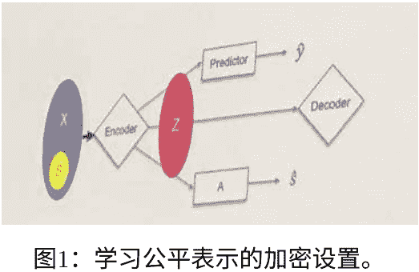

哈佛-斯坦福问题：假设你在斯坦福，你构建了一个非常有效的用于检测肿瘤的算法。假设有人在哈佛做同样的事情。
→ 声明：由于群体和实验室环境的差异，算法在不同人群之间不起作用。

目标是找到一种方法来识别不同/相似的人群，以便这些方法可以在人群之间进行转移。

方法：
- 选择 $y$ 服从伯努利分布（基础率）
- 选择 $x$ 服从 $N(\mu, \Sigma)$
- 如果 $Bernoulli(\sigma(f_1, s_1)) = f_2 = i(x_2) = y$，则保留 $x_0$。

#### 总结：
- 一个公平的算法只是不公平世界的一部分
- 多种公平性：群体、个体、多重 X。
- 个体公平性的度量学习突破
- 个体概率很难理解，但我们可以从公平性方法中学习来改进它们的使用。
- 被审查的表示和超出分布的泛化。

现在去参加结构和先验在强化学习中的研讨会！

## 2.2 SPiRL 研讨会

首先，Pieter Abbeel 关于基于模型的强化学习！

### 2.2.1 Pieter Abbeel 关于基于模型的强化学习从元强化学习的视角

Few-shot RL/Learning to RL：我们有一个环境家族，$M_1, M_2, \dots, M_n$。希望的是，当我们从这些环境中学习时，我们可以在环境 $M_{n+1}$ 上更快地学习。

快速学习：
$$ \max_{\theta} \mathbb{E}_M \mathbb{E}_{\tau_M} \left[ \sum_{i=1}^n R^i_{\tau_M} \mid \text{RLAgent}_{\theta} \right]. \quad (1) $$
目标大致如上，其中我们将 RLAgent $\theta$ 作为 RNN（或其他通用计算架构）进行了基础。

解决这个目标的其他方法，如模型无关元学习（MAML）[11]。

要点：一系列方法可以让您在新环境（新 $R, T$）中快速训练，通过与先前环境的相互作用。

模拟的动机：
- 成本较低（无法破坏机器人）。
- 更快/更可扩展。
- 更容易获得大量标签。

问题：我们如何通过领域随机化利用粗糙的模拟？
→ 想想 Minecraft - 有一些对于学习世界有用的视觉结构，但它并不完美。我们如何在 Minecraft（或类似的领域）中训练并转移到现实世界中？

答：随机化模拟的各个方面，以便更容易训练视觉系统。然后可以将这些经过训练的感知分类器转移到现实世界中，它也有效！（抓取也是如此）

答：抓取也是如此 - 可以在模拟中训练抓取，然后抓取真实物体（成功率约为 80%）。

结果：在模拟中训练一个手控制器（用于操纵手中的方块），实际上可以在真实机器人上使用。

> 定义 3（无模型强化学习）：与世界互动并收集数据 D。然后，使用这些数据来指导 $\pi$ 或 Q，并使用它们来行动。

> 定义 4（基于模型的强化学习）：与世界互动并收集数据 D。然后，使用这些数据来指导世界模拟器 M，进行模拟以行动。

- 规范的基于模型的强化学习：
  1. 对于 iter = 1, 2, ...
  2. 在当前策略下收集数据
  3. 从过去的所有数据中改进学习的模拟器
  4. 使用模拟器进行行动并收集新数据。

问题：学习的模型不完美！
解决方法：学习一个更好的模拟器。但是，这是不够的。学习正确的模拟器非常困难。
→ 模型基础强化学习中的新的过拟合挑战。策略优化倾向于利用模拟器中的规律性，导致灾难性失败。

关键思想：不需要学习准确的模型，只需要学习一组代表真实世界的模型（并进行少样本强化学习）：
1. 对于 iter = 1, 2, ...
2. 在当前自适应策略下收集数据, $\pi_1, \dots, \pi_k$
3. 从过去的数据中学习 k 个模拟器的集合。
4. 集成的元策略优化
新的元策略 $\pi_\theta$
新的自适应策略 $\pi_1, \dots, \pi_k$

实验：
1. *MuJoCo*：与 *MuJoCo* 环境进行约 45 分钟的真实交互，最先进的无模型方法无法学习，而元学习方法可以。
2. 机器人：同样，可以以样本高效的方式训练元模型强化学习来学习执行机器人抓取任务。

→ 相比无模型方法，达到相同渐近性能所需的效率提高了 10-100 倍。

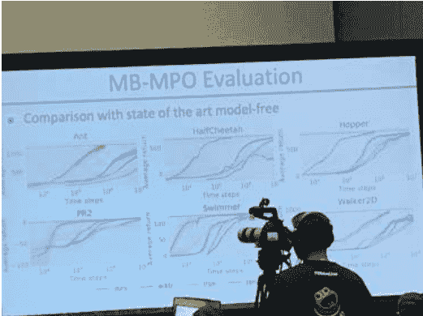
图 2：元模型强化学习的结果（以及相机+人）。

挑战问题：分层强化学习承诺解决长期规划问题。
Q1：无模型和模型为基础的分层强化学习在本质上是不同的方法还是相同的方法？
Q2：你认为有没有办法将这两者结合起来？

Pieter A：当然可以！我们提出的方法确实可以将这些方法结合在一起。但对于 HRL 来说可能会有些不同。从某种意义上说，从高层次来看，人类并不进行强化学习。我们没有足够的“高层次”试验来探索诸如“去参加会议/攻读博士学位”之类的事情。因此，更高层次的方法可能是基于模型的，更多地基于规划而不是强化学习。另一个想到的事情是 HRL 方法似乎只有两个层次。一个有趣的方向是在更深/更多层次上进行泛化，而不仅仅是两个层次。仍然不清楚模型基于方法和模型无关方法之间的分界线在哪里。

Q：寻找端到端方法与更模块化方法（具有更多中间结构，如状态估计）之间的优缺点是什么？
Pieter A：这里没有最终答案-状态估计有时涉及人为提供的信息，可能会丢失进行控制所需的错误数据（例如自动驾驶汽车的状态是什么）。但是，这种方式中的一些先验知识可能会有所帮助！

### 2.2.2 投稿演讲：Kate Rakelly 关于通过上下文变量进行离线策略强化学习

目标：设计能够熟练完成各种不同任务的智能体。

→但是，对智能体进行新任务的训练在统计上/计算上是不可行的，因此我们真正希望利用任务之间的共享结构。

**方法（高层次）：** 元强化学习（Meta-RL）来学习相关任务之间的共享结构。

**问题：** 快速适应需要高效的探索策略，而元训练则需要来自每个任务的数据，加剧了样本效率低下的问题。

**方法（详细视图）：** 通过离线策略强化学习的元强化学习方法。但是，这引发了一个探索问题，因为我们不再控制经验分布。

**“上下文”：** 从任务中学到的任务特定信息 $z$。然后，元训练有两个部分：
- 1. 学习将上下文总结为 $z$。
- 2. 学会根据 $s$ 和 $z$ 采取行动。

**算法：** PEARL。给定一个新任务，主要思想是在我们所处的任务上维护一个概率分布。这使我们能够利用不确定性的知识来高效地适应新任务。

**实验：** 四个不同的 MuJoCo 领域（半猎豹、人形、蚂蚁、行走者）。奖励和动力学在任务之间变化（运动方向、速度、关节参数）。

**总结：**
- PEARL 是第一个离线元强化学习算法。
- 在测试的领域中，样本效率提高了 20-100 倍。
- 在适应过程中进行有效探索的后验采样。

```
代码: github.com/katerakelly/oyster
```

现在是海报展览时间。

## 2.2.3 Matt Botvinick 关于元强化学习的赞赏

**要点：** 我们需要一些结构来扩展强化学习。我心中所想的是类似于关系强化学习、对象、图网络等。

**指导问题：** 元强化学习算法能做什么？不能做什么？

最近的调查总结了一些 Botvinick 等人的想法 [4]。

→这个领域似乎已经超越了元强化学习，但我不能！让我们真正理解这些算法。

倾向：让我们建造一辆更快的赛车。这个演讲：让我们理解快速赛车，或者为什么我们最近制造的东西很快！

在试图理解元强化学习时的观察：
- 考虑两臂赌博机：动物在两个臂之间选择，根据某种支付时间表确定支付。关键是，奖励的来源会定期补充。
- 动物在选择频率上与获得奖励的频率相匹配（概率匹配）。
- 普通的 LSTM 也能找出这个规律！还能找出普通伯努利赌博机的 Gittins 最优解。
- 考虑这个新的赌博任务：支付概率不断变化，但波动性也在变化（长时间间隔内，支付会反复变动等）。
- 聪明的做法是改变你的学习率。事实上，人们确实这样做（如果我们拟合一个预测学习率的模型来预测人们的决策）。
- 元学习的 LSTM 也可以做到这一点！
- 猴子看到两个颜色朝下的杯子，其中一个藏着一颗葡萄干。学会总体上拿起藏着葡萄干的杯子。
- 然后猴子必须转移到一个新的任务，使用新的物体。结果发现猴子也学会了转移；当没有信息可用时，猴子均匀地探索，当有信息可以利用时，猴子学习得非常快。
- LSTM 也可以做到这一点！

清晰地说明了一个基于元模型无模型算法产生基于模型的强化学习的例子，该算法基于 Daw 和 Dayan [6] 为人类/动物设计的基于模型的测试。

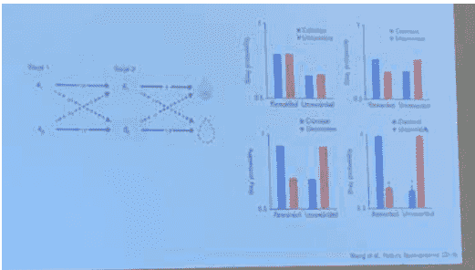

图3：用于确定决策是否使用基于模型的技术的任务（左）和任务上不同方法的结果（右）。

**要点1：** 元强化学习也可以产生能够解决时间信用分配问题的算法。
**要点2：** 对于 LSTM 来解决某些类型的任务，它们还必须在状态中保留一些足够的统计信息（这些统计信息大致与观察者跟踪的相匹配）。

最后：一个疯狂的想法（戴夫：马特的话，不是我的 :)）。我们有一些证据表明，对于普通的 LSTM，无模型强化学习可以导致基于模型的强化学习（在适当的情况下）。

→也许，如果我们以正确的方式设置环境，LSTM 可以找出进行（摊销的？）贝叶斯推断的算法。

**主要观点：** 元强化学习非常令人兴奋，让我们继续提出更快的算法，但也要试图理解它们在做什么。

### 2.2.4 Katja Hoffman 关于多任务强化学习的挑战和方向

**问：** 为什么我们在强化学习中关注结构和先验知识？

Katja A：三件事！
- 1. 提高样本效率。
- 2. 提高样本效率。
- 3. 提高样本效率。

**问：** 当你考虑强化学习中的结构和先验知识时，哪些挑战可以解决？

**答：** 也许在游戏、科学、交通、医学等领域？

→对于这些（可能还有其他）领域，结构至关重要。

**结构的种类：**
- 假设存在多个相关任务，并且可以从数据中学习到任务之间的有用关系
- 问：哪些模型可以学习和利用相关任务结构？
- 问：我们可以在先验假设、灵活性和样本效率之间取得什么样的权衡？

**第一种方法：** 具有潜在变量高斯过程的元强化学习 [33]。思路：
- 问题：假设有相关动力学的任务：
$y_t^p = f(x_t^p, \theta, p) + \varepsilon,$ (2)
- 观察来自训练任务的数据
- 目标：用尽量少的额外数据准确预测保留的测试动态
- 方法：基于模型的强化学习通过潜在变量高斯过程。在全局函数上放置一个高斯过程先验。

• 实验：1) 玩具任务，多任务预测。方法能够区分未见过的任务；2）多任务摆杆。系统可以在质量和摆杆长度上变化，有许多保留的参数设置。

**第二种方法：** CAVIA（快速上下文适应通过元学习）[37]。
- 问题：训练和测试任务的分布。
- 在元训练期间，从训练中采样任务，获取该任务的训练/测试数据。
- 通过将网络分解为：1）任务特定的上下文参数 $\phi$，和 2）共享参数 $\theta$，学习如何快速适应任务。
- 实验：1）监督学习任务；2）多任务半猎豹。

→CAVIA 学习可解释的任务嵌入，以上下文参数捕获。
→通过仅更新上下文参数来适应测试任务，对元学习基准测试提供新的见解。
→非常灵活。

后续：变分任务嵌入用于深度强化学习中的快速适应。在与环境交互时，学习在线平衡探索和利用。VATE 可以在看到任何奖励之前推断出关于任务的信息。

**要点：** 随着强化学习在更困难的领域中的推进，可能存在某种通用结构，在许多领域中表现良好。我们能找到这种统一的结构吗？

→可能需要的一件事是可能导致这种结构的数据集。为此：

→MineRL：使用人类先验知识进行样本高效强化学习的竞赛（即将在今年的 NeurIPS 上举行），构建在 MALMO [18] 之上。

《我的世界》非常复杂，因此在强化学习中探索先验使用的平台非常好。请参见图 4，了解技术树的规模。


图4：《我的世界》技术树的一部分

### 2.2.5 Tejas Kulkarni 关于面向对象的表示RL

**要点：** 强化学习的难题：
- 1. 状态估计。强化学习没有规定详细的状态表示方法。手动指定或学习状态表示。
- 2. 探索。而且，你如何探索取决于你如何表示世界。

本研究：让我们使用自监督深度学习来学习物体结构。

例如：一个从出生开始就失明的人仍然可以画出大致的物体结构，包括透视 [20]——请参见图 5。


特别是，物体是一种基本且重要的抽象。

**问：** 那么，我们能学到它们吗？

以物体为中心的表示在物理领域具有以下三个特性：
- 1. 捕捉自由度的时空特征。
- 2. 长期时间一致性。
- 3. 捕捉环境的基本几何形状。

**答：** 是的！“门控”（Gated）网络（见图 6）。

→门控网络在捕捉图像问题中的显著物体方面表现出色，如 Montezuma。它在统一随机策略上进行训练，结果是一个显示不同物体位置的空间地图。

但是：上述方法只能追踪移动的物体，而不能追踪静止的物体。因此，我们可以将其与基于实例的分割配对，以找到静止的物体。

下一阶段：在高维领域中进行对象中心强化学习和规划，建立在 Diuk 等人的早期工作 [9] 的基础上。

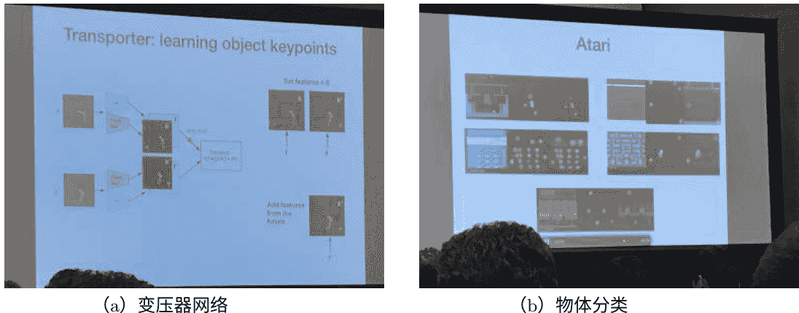

图6：门控网络（左）通过压缩几何表示将源图像映射到目标图像，并在不同的 Atari 游戏中找到一些候选物体（右）。

→关键问题1：在对象和关系空间中进行结构化探索。
→关键问题2：以自动生成任务的形式进行泛化。

对象中心的 HRL 架构 [24, 8]。

**主要前沿：** 在像 Montezuma 这样的困难探索环境中进行数据高效的强化学习。思路：在对象和关系空间中系统地进行探索。

**挑战问题：** 在监督学习中，表示学习和迁移学习在视觉方面的进展主要是由 ImageNet 推动的。NLP 在 GPT-2 和 BERT 方面也有了自己的“ImageNet”时刻。那么，在强化学习中是否会有类似的“ImageNet”时刻，使我们能够学习通用的数据驱动先验知识？

**A：** 是的，当然！我认为我们几乎已经到达了那个时刻。很多人都在朝着这个方向努力，我认为我们就在拐角处。

### 2.2.6 Tim Lillicrap 关于学习表示和规划模型的演讲

**深度强化学习的当前状态和限制：**
- 1. 我们现在几乎可以解决任何单一任务/问题，只要：
  (a) 正式指定和查询奖励函数；
  (b) 进行足够的探索并收集大量数据。
- 2. 仍然具有挑战性的问题：
  - 在奖励函数难以指定时进行学习；
  - 数据效率和多任务迁移学习。

我们通过以下方式来衡量结果：$R(\tau)=\sum_{t=0}^{T} \gamma^{t} r_{t}$，目标函数为：
$$J(\theta)=\int_{\mathbb{T}} p_{\theta}(\tau) R(\tau) d \tau.$$

但是：在无模型强化学习中，我们倾向于抛弃我们对任务的了解来解决它。

**明确的结构引入：** 带有模型的计划。

→棘手！获得这个模型真的很难。如果我们能够获得它，我们知道它可以非常强大（参见 AlphaZero [35]）。

**问题：** 使用学习模型进行规划非常困难。（Tim 说在过去几年里，在 DeepMind 启动一个基于模型的强化学习项目成为一个笑话：没有人预料到它会成功）。

**思路：** 混合无模型和有模型的方法。通过在以前的算法中增加一个学习模型，确实在目标寻找任务上有所帮助。

**使用学习模型进行规划：** PETS [5]，深度规划网络（Planet）[12]。

**实验：** 从图像观察中进行连续控制（手指、猎豹、杯子等）。

→某些版本最终效果良好！在大约 1k-2k 个 episode 之后，它可以解决基于图像的 MuJoCo 问题。

#### 结论：
- 基于模型的算法有望解决数据效率和迁移学习的限制。
- 开始开发在未知环境中使用模型进行规划的工作方法。
- 使用学习模型进行规划的必要和充分条件尚不清楚。
- 还有很多工作要做！

**挑战问题：** 将价值估计和感知融入相同的架构中的权衡是什么？

Tim A：我不知道有人系统地研究过这种事情，但更重要的是要对其进行更多研究。可以从 Alpha Zero、ELO 评级分析中获得一些见解。还有很多事情要做！

### 2.2.7 Karthik Narasimhan 关于RL的任务无关先验

**强化学习的现状：** 模型无关的强化学习方法取得了成功（参见：围棋、DOTA）。

→所有这些成就都需要大量的时间和样本（比如 DOTA 需要玩 45,000 年）。

→几乎没有知识的转移。

#### 最近的方法：
- 多任务策略学习
- 元学习
- 贝叶斯强化学习
- 继承表示

观察结果：所有方法都倾向于学习刚性且难以转移的策略。

**解决方案：** 基于模型的强化学习。

→方法：使用任务无关的先验知识来引导模型学习。该模型具有：1) 更易于转移；2) 学习成本高但可以通过先验知识降低。

**问题：** 是否存在适用于强化学习的通用先验知识？

**答案：** 看看人类如何学习新任务。这些先验知识似乎来自于 1) 直观的物理概念和 2) 语言。

#### 项目1：我们能以任务无关的方式学习物理学吗？此外，这种物理先验知识能否提高强化学习的样本效率？

在这个领域有很多先前的工作，但它们是任务特定的。

→这项工作：从任务无关的数据中学习物理先验知识，解耦模型和策略。

#### 方法概述：
- 在物理视频上预训练一个帧预测器。
- 初始化动力学模型并使用它来学习利用未来状态预测的策略。
- 同时在目标环境上微调动力学模型。

两个关键操作：1）隔离世界中每个实体的动力学，2）准确建模每个实体周围的局部空间。

**实验：** PhysWorld 和 Atari。在这两种情况下，使用包含环境物理演示的视频对动力学模型进行一些预训练（在 Atari 中，预训练仍在 PhysWorld 中进行）。结果表明该方法非常有效，无论是在 10 步预测中还是在其他方面，并且有助于增强强化学习中的样本效率。

#### 项目2：我们能否使用语言作为桥梁，将我们对一个领域的信息连接到另一个新领域？

**方法概述：**
- 将语言视为任务不变且可访问的媒介。
- 目标：使用文本描述来传输环境模型。
- 示例：“蝎子可以追逐你”。可能能够学习一个模型，该模型在蝎子移动到代理位置附近时给出较高的概率。
- 主要技术：从语言中获取的知识来为新环境中的动力学模型提供先验信息。

#### 结论：
- 基于模型的强化学习具有样本效率，但学习模型的成本很高。
- 对模型的任务不可知的先验提供了样本效率和泛化性的解决方案。
- 适用于各种任务的两种常见先验：经典力学和语言。

**挑战问题：** 深度强化学习取得了很多成功。新的推动力是混合方法，如跨领域推理，利用不同任务的知识来辅助学习等。在通往中级智能的道路上最大的障碍是什么？

Karthik A：我强调了分布鲁棒性和迁移的需求——需要研究能够在相似领域之间进行迁移的代理。一些障碍涉及

### 2.2.8 投稿演讲：Ben E., Lisa L., Jacob T. 关于探索的先验知识

**目前强化学习面临的挑战：**
- 探索
- 奖励函数设计
- 泛化
- 安全性

→先验知识是处理这些挑战的强大工具。

**问：** 我们能学到有用的先验知识吗？

**答：** 是的！这项工作是关于学习先验知识的通用算法。思路是将强化学习框架化为一个两玩家博弈，其中一个玩家是选择奖励函数的对手。

#### 项目1：状态边际匹配。
→思路是尝试将策略状态分布最大化到某个目标分布。最小化 $\pi^*$ 和 $\pi$ 之间的 KL 散度。

**实验：** 测试算法的探索和元学习能力。使用 locomotion（全身运动）和操作任务进行测试。该方法效果非常好。

#### 项目2：鲁棒适应的先验知识。
→具有未知奖励的强化学习：假设我们已经得到了奖励函数的分布。然后，采样一个新的奖励函数，并对其进行优化。

**主要方法：** 计算贝叶斯最优策略，然后进行常规强化学习。

### 2.2.9 Doina Precup 关于时间抽象

**引导Q：** 如何将时间抽象注入选项中？

→选项从哪里来？通常来自人们（如机器人）。

→但是，什么构成了一个好的选项集？这是一个表示发现问题。

早期方法：选项应该擅长优化回报，就像 Option-Critic [1] 中那样。Option-Critic 学习产生快速任务学习和有效任务转移的选项表示。

**要点：** 长度折叠发生——选项随时间“溶解”为原始动作。

**假设：** 执行策略是廉价的，决定做什么是昂贵的。因此，可以使用具有明确的决策成本的选项。

也就是说，可以根据决策成本定义一个新的价值函数：
$$Q(s, o) = c(s, o) + \sum_{s'} P(s' \mid s, o) \sum_{o'} \mu(o' \mid s') Q(s', o'),$$
其中 $c(s, o)$ 是一些决策成本。

**实验：** 在 Atari 上，有和没有决策成本（作为正则化项）。事实上发现，在终止之前选项需要更长的时间（这是预期的目标）。

**问：** 所有选项组件都应该优化相同的东西吗？（$\mu$，$\beta$，$\pi$ 都应该朝着最大化奖励的方向吗？）

**答：** 根据决策成本的工作，人们可能认为选项的某些方面应该考虑这些正则化项。例如，最近 Harutyunyan 等人的工作 [14]，或者终止评论家 [15]。

**想法：** 瓶颈状态——我们可能希望选择将我们带到这些瓶颈的选项。

→缺点：在样本数量和计算方面都很昂贵。

#### 讨论：
- 先验可以通过优化准则构建到选项构建中。
- 选项的终止和内部策略可以实现不同的目标。
- **最大的开放问题：我们应该如何经验性地评估终身学习 AI 系统？**

我们如何评估终身代理的能力？
- 1. 不再是单一任务！
- 2. 回报很重要，但太简单了。
- 3. 代理人如何保护和增强其知识？

→提议：对连续系统进行假设驱动的评估。也就是说，从其他领域（例如心理学）汲取灵感。

**挑战问题：** 最近的许多工作将深度强化学习应用于 HRL 和选项发现中的现有算法。深度强化学习带来了什么？它们解决了所有问题还是我们需要一些新的范式转变？

Doina A：神经网络对于 HRL 带来的东西与对于常规 RL 带来的东西大致相同——有效地解决了特征发现问题的一些方面。一方面，这很棒，因为我们有了了解决方案。另一方面，我们在真正进行知识发现的方法上仍然缺乏。深度网络并不是这个过程的真正答案。有一种诱惑，就是将深度网络应用于问题，并在顶部加上一些 HRL 目标。是的，这可能有效，但它不会导致可分解或模块化的知识。我们取得了很多进展，但也许现在是我们退后一步，在状态抽象和选项方面做一些更高级的事情的好时机。

### 2.2.10 Jane Wang 关于学习结构化因果先验

**观点：** 结构化先验能够加快学习速度。

→因果先验尤其能够加快学习速度（通过改善探索、泛化、信用分配等）。

因果推理是一个丰富的领域，所以，一些背景知识：

> **定义5（贝叶斯网络）**：表示一组变量及其条件概率分布的概率图模型，采用有向无环图（DAG）的形式。

**定义6（因果贝叶斯网络）**：箭头表示因果语义的贝叶斯网络。

**定义7（干预）**：固定变量的值，与其父节点断开连接。

**定义8（Do-演算）**：在给定观测数据的情况下进行因果推断的一组工具。

可以提出三个层次的问题：
- 1. 关联性：喝酒和我头痛有关吗？
- 2. 干预：如果我去喝酒，我会头痛吗？
- 3. 反事实：回到过去并问，如果我喝了酒，我会头痛吗？

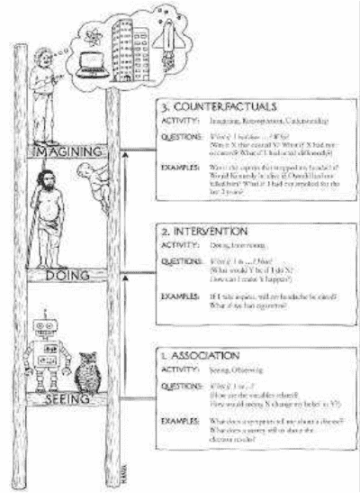

图7：Pearl 的因果推理阶梯。

**问：** 人类如何表现出因果推理？

**A（婴儿）：** 一岁以下的婴儿没有展示出因果知识，但是有一种物理连续性的感觉。

**A（2岁儿童）：** 可以学习事件之间的预测关系，但不能根据因果理解自主进行干预。

**A（3-4岁儿童）：** 可以从观察条件依赖性推断因果地图。

### 2.2.11 Panel: Matt, Jane, Doina, Sergey, Karthik, Tejas, Tim

- Jane（4-5岁儿童）：可以根据因果知识进行有针对性的干预。
- Jane（青少年）：因果学习策略继续改进。
- Jane（成年人）：存在联想偏见，即“富者更富”原则：如果因果模型中的其他变量也存在，则某个变量更有可能出现。

总体而言：证据表明儿童能够从观察中进行因果推断（与贝叶斯推断大致一致）。更复杂的推理形式（进行新颖的有信息的干预）在经验积累后才会出现。

但是：与理性/良好推断存在重大偏差。

→偏差原因：
- 1. 因果推理的形式模型优化了不同的成本函数。
- 2. 人类不会优化特定的因果图，而是一个灵活的因果图。

要点：结构化的任务宇宙 ==> 我们应该使用结构化的先验知识。

思路：元学习因果启发的先验知识。与之前的演讲类似，假设有一组任务的分布，希望学习一些先验知识，以便在新任务中实现高效的样本学习。

实验：1）从因果网络的观察中学习（代理能否从有向无环图中学习一些因果结构？）；2）从干预中学习；3）从实例特定信息中学习。

挑战问题：为什么深度强化学习似乎在样本外泛化方面比其他领域更困难？

Jane：在强化学习中，有很多样本外的方式（与监督学习相比），所以更难。泛化更加困难，因为很多事情都可能发生变化：状态、动作、策略、转移函数、奖励函数、函数等等。强化学习还需要与环境进行持续的交互，输入非常依赖于策略，因此随着策略的更新，输入也会发生变化。

问：结构与数据的作用是什么？

Tim：问题很复杂。取决于你想做什么：如果你想在一个领域变得很好，请更具体地说明。如果你想要一个通用的学习算法：请更少地说明。

Tejas：是的！这篇文章谈到了搜索，但对我来说，重要的问题是使领域“可计算”（可模拟）。这篇文章是误导性的：原语从哪里来？不能依赖数据给你原语。我们应该大胆地增加结构。有一些真理我们可以和应该利用来有效地搜索（对象、代理、物理）。

Karthik：人类随着时间的推移演化出了许多对我们的智能至关重要的东西。肯定具有正确类型的归纳偏见和结构化先验才能使事情正常运行。

Matt：我想对此提出异议，因为我听到心理学家这么说。经常有人断言，因为婴儿具有强烈的归纳偏见，我们的代理也具有归纳偏见。但这显然不是我们在设计代理时需要对抗的约束。我不认同婴儿告诉我们那么多的论点。我喜欢Rich Sutton，但我认为我们必须从结构开始（如CNNs）。还有一个可能是一个形式上的考虑；我们需要学习的抽象将需要任意小的。

Doina：说我们只需要数据是一回事，说我们总是需要从头开始学习是另一回事。现在我们没有整合合适的结构，以便我们不必从头开始学习。我们使用一些想法（CNN，梯度下降），但我们希望避免添加过多的结构。

Jane：Rich的文章中有一点（我大约80%同意），他说我们的大脑/环境是无法挽救的复杂。我不同意这一点。神经科学和认知科学在理解我们的大脑方面取得了巨大进展。

Sergey：这个问题不同，因为涉及到方法论问题。机器学习是一个数学/哲学/科学领域。所以，我们在某些方面做得很好，但并不是全部。我们在计算机视觉系统、语言系统等方面做得很好。在强化学习方面，我们主要关注解决一些问题但这只是我们希望实现的更宏大愿景的一个代理。这就是方法论上的缺陷所在。在小问题中，很容易通过偏见获得改进。

Doina：我认为在机器学习的其他领域也是如此（Sergey：我不想冒犯所有人！Dave：开玩笑 :）). 在自然语言处理中，是的，我们可以完成一些任务，但并不能真正完成所有任务。在所有机器学习中，我们制定的任务是帮助我们改进算法/模型的示例，但最终我们需要进入一个更复杂的环境。

Matt：冒险涉及机器学习的哲学方面。我们不希望构建过于集中在一个领域的归纳偏见。在机器学习中，我们往往对我们的代理人部署的一般领域有一定的了解。我们只需要在哪个本体论中做出选择。

Q：我们不太清楚在强化学习中要训练哪些任务，特别是在终身强化学习/多任务强化学习/元强化学习中。对于以更精确的方式定义问题有什么想法吗？

Doina：模拟显然是必要的。想想人类学习：婴儿有父母，他们扮演着重要的角色。如何构建有趣且丰富的模拟，以用于复杂的强化学习评估任务？好吧，我们可以更认真地研究多模态数据。

Sergey：重要的是考虑强化学习作为一个数据驱动的领域，而不是一个模拟驱动的领域。如果我们不这样做，我们可能会陷入一个不太考虑泛化和其他核心问题的状态。我们可以将强化学习任务视为以数据开始，与真实世界中可能希望存在的强化学习算法更接近的数据。想象一个算法可以从零开始学习复杂任务是有点疯狂的。

Tejas：我同意之前说的一切。只有在数据有限的情况下，泛化才重要。一种思考方式是当代理可以生成自己的任务时。我们应该思考激励研究人员和平台的度量和测量，代理可以在这些任务中创建许多任务，并在这些任务中玩耍以学习更复杂的行为。

Tim：Sergey，关于以数据驱动的方式进行强化学习，需要多少真实世界数据和模拟数据来完成这个任务?

Sergey：我会用一个问题来回答你：如果我们想要制作一个更好的图像分类器会怎样？我们在视觉领域使用真实数据是因为这样更容易取得进展。所以，在强化学习中，也是一样的，因为真实数据中存在着固有的复杂性和多样性。

Doina：这是一个有些不同的问题，因为我们需要轨迹。大量的轨迹。由人生成的轨迹可能也会非常不同。从整个轨迹中理解和学习可能非常困难。

Sergey：也许并不那么困难。可以相对容易地收集到大量的自动驾驶汽车数据、抓取数据等等。

Jane：我倾向于同意你的观点（Sergey）。关于真实数据的一个问题：我们能否保证超越实验室数据的发展?

Sergey：在这一点上，你需要非常小心。

Tejas：从第一原理出发，没有理由我们不能制作一个在图形和物理方面无法区分的模拟器。只是时间问题，我们将拥有一个可以替代真实世界数据的模拟器。

Sergey：当然！但可能会非常慢。为什么要等呢?

问：使用基于模型的学习和无模型的学习有什么主要原因?

Karthik：学习世界的模型可以给你更大的灵活性，可以实现更多的目标。在无模型学习中，你往往只有一个策略/值函数，它不能很好地泛化/转移到其他任务上。可以涵盖大约90%的可能发生的事情，具有（良好的）模型。

Doina：不确定这种区别是否显著。模型可以被看作是广义的值函数，其中事情变得更加模糊。可能最终会得到效率低下的基于模型的强化学习，因为学习从观察到观察的映射非常困难。要做到这一点，需要理解你的行为对结果的影响，而不仅仅是理解其他重要的变量对策略/值函数的影响。后者可能比前者简单得多。可能我们需要重新思考我们模型的本质。我们应该构建小砖块一样的模型。

Matt：我完全同意！对于无模型和基于模型之间的区别非常着迷。在神经科学领域的一段时间里，这种区别被视为非常明确的。但是，我们意识到这种区别要复杂得多。我们专注于能够最大化价值的模型，但是当我们将注意力转向通过教学或交流向其他代理传递知识的代理时，情况就会发生变化。对于这些任务，我们可能需要完全不同的模型。

Sergey：我认为这两种方法是相同的。至少它们是相似的。强化学习通常是关于进行预测的，但是重要的是要意识到一些代理预测中包含了很多知识，比如价值函数。（Dave：Sergey使用的美元纸币的例子非常聪明：想象一下你想预测你面前的美元纸币数量，并最大化这个值。要做到这一点，基本上需要对世界上的一切进行建模。）

Tejas：有很多与奖励或奖励最大化无关的领域，比如数论或可计算性的研究。

Sergey：这不是开发关于世界的知识的唯一方法。但是，如果有一些对你的环境有意义的影响，那么你需要预测它们以估计/最大化你的价值函数。

Jane：从互动中学习这些模型的一件事是，在现实世界中，事物并不一定以你希望的方式解耦。
Dave：我错过了剩下的部分:(

...........................

问：是否有从人类智能中提取理解用于强化学习的通用方法？

Matt：元学习（mic drop）。看看人工智能的历史：AI冬天部分原因是因为试图将所有知识编码到我们的代理程序中失败了。我们肯定要避免通过插入正确的结构来避免这种情况。

Tejas：良好的归纳偏见是永远不会消失的。对于这些的要求是它们是真理。我们如何找到真理？有几种科学的方法可以做到这一点：代理的概念是真实的，对象是真实的。将这些种类的真理放入代理的头脑中，我认为我们将拥有做正确事情的代理。

问：有什么东西真的是“真的”吗？

Tejas：是的，否则它只是汤。没有它就没有存在。代理是具有目标的对象，而对象是真实的。我们可以尝试学习这些不变的真理。

Doina：冒着循环回到原点的风险：我们一次又一次地学到的教训之一是，将太多的东西放入代理的头脑中可能是有害的。参见：AlphaGo。放入一点知识，让它从自己的数据中找到自己的知识。很多结构。我们在深度强化学习中发现有些结构是有益的，但有些可能没有用。

Tejas：如果你不假设任何东西，那怎么办？ 我们可以假设一个代理模型吗？

Sergey：有很多事情是真实和显而易见的。 从数据中学习这些是可以的。 也许这样更好，因为它知道如何将这些真实的东西学习到其它事物上。 对于我的学生来说，自己弄清楚一些事情可能更好，例如。

Tim：倾向于较少的归纳偏见，并且我们会不断回到这一点。 随着我们获得更多的数据，从我们周围的数据中发现基本的归纳偏见可能很容易。 人类/动物的基因组中并不包含那么多位于我们DNA中的位，产生我们的大脑/身体。 重新发现这些归纳偏见可能并不难，所以我们应该只轻微地添加归纳偏见。

Dave：电池没电了：错过了最后一个问题！

## 3 星期二 5月7日: 主要会议

进入第二天!今天完全是主要会议。我今天有很多会议,所以只能参加几个演讲,可惜。

### 3.1 主题演讲: Emily Shuckburgh 关于机器学习进行行星健康检查

记住:2005年卡特里娜飓风后的新奥尔良。我们认为这将是一个警钟。

2005年大气中的CO₂: 每百万分之378；2019年CO₂: 每百万分之415。孟买的飓风和气旋,海平面上升,天空更湿润=由这些事件引起的破坏更加严重。

注意:根据最近一项关于生物多样性的研究,未来几十年内有一百万物种面临灭绝的风险。

→我们对地球产生了巨大的影响。

> 指导问题:我们如何对地球的健康有所了解,并扭转局面?我们能使用机器学习来实现这个吗?

### 3.1.1 气候科学中的机器学习挑战

关键问题、观察和行动项:

- 1. 迫切需要关于气候风险的可行信息
  - 需要了解潜在的风险和结果
    - (a)洪水、热浪和其他灾害。
    - (b)生物多样性变化的影响。
    - (c)对供应链(食物、水等)的影响,以及对自然界(珊瑚礁、森林、北极海冰、永久冻土)的影响。
- 2. 我们拥有描述地球变化的大量数据集
  - 包括来自卫星、水下机器人仪器、网络传感器、大规模计算机模拟、众包的数据。
  - →我们拥有更多的数据,超过我们所知道的用途。
- 3. 主要观点:我们能否利用数据科学和机器学习的进步(来自2.)来应对(1.)中的挑战?

Q:尽管存在挑战(见图8),我们能做些什么?

A:进行行星健康检查的三个步骤:

- 1. 监测地球

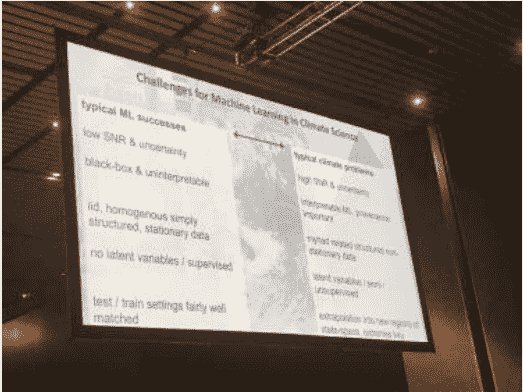

### 图8: 将机器学习工具应用于气候科学问题的挑战。

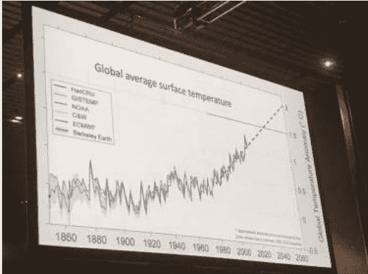

(a) 随时间变化的地表温度

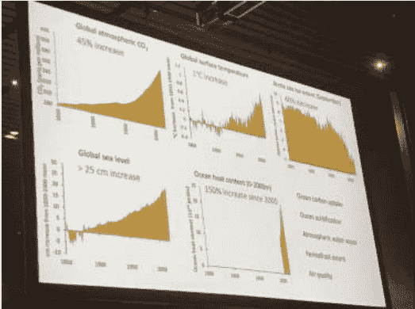

(b) 随时间变化的其他与气候相关的数据

### 图9: 地球健康属性随时间变化的变化。

- 2. 缓解症状
- 3. 治愈疾病

### 3.1.2 第一步: 监测地球

Q: 如何适当地监测地球的健康状况？ 这是一个巨大的挑战！很多重要数据是稀缺的，而不重要的（或信噪比低的）数据则是丰富的。

A: 进行更全面的测试-不仅仅是温度，还有很多其他属性。

### 3.1.3 第二步：治疗症状

标准工具: 协调的国际气候建模项目（CMIP6）: 大约40 PB。大约一百万行代码，用于运行地表辐射模拟、太阳辐射变化等等。

Q:这些模型对我们有什么作用?

A:它们对未来的关键属性进行预测,例如不同干预措施下的温室气体排放等等。

→我们实际上可以非常好地预测全球平均地表温度。

问:世界上的城市和超大城市未来的条件会是什么样?我们如何预测这些事情?

答:气候模型可以预测这些变化多年以后!

但是:1)分辨率较低,2)在局部水平上存在系统偏差,3)不同的气候模型在表示气候系统的不同方面上表现更好/更差。

例子:考虑一个气候模型对伦敦的温度进行预测。

→有时,模型是有系统偏差的。它在长时间内过高,然后过低,依此类推。那么我们该如何解决这个问题?

方法:应用概率机器学习从实际观测的天气数据中构建一个新的预测模型。也就是说,通过大量的天气数据学习 $f: \mathcal{X} \rightarrow \mathcal{Y}_{0}$。

问:我们能走得更远吗?我们能扩展这个模型以考虑相关风险并将其映射到影响数据上吗?

→我们真的希望调节可持续城市排水、建筑物热舒适度,并解决以下问题:特定国家/地区对气候干扰的脆弱程度如何?

类似的方法-考虑一个任务:
- 输入:时间、空间、气候模型输出、气象数据
- 输出:未来特定影响发生的风险
- 任务:合成和插值不同数据集,学习不同变量之间的映射,可能需要找到新的数据来源。

### 3.1.4 第三步: 治愈疾病

主要收获:有许多机会来改进气候变化的未来预测,以便为政策制定提供信息。以下是一些机会:

- 1. 结合数据驱动和基于物理的方法
  - →可以将冰融模型和机器学习模型(使用我们的大型数据集)相结合,以更准确地预测冰融。
- 2. 开发基于数据的关键过程模拟器

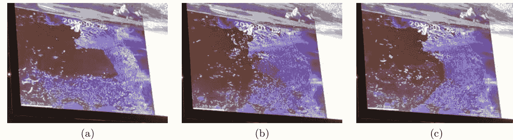

图10：冰川结构随时间变化的变化。

→鉴于大规模的关键过程数据集，例如云形成，我们可以帮助构建更准确的模型。 当前的气候模型不具有良好的可扩展性，因此我们需要找到新的方法来模拟气候变化。

- 3. 使用机器学习来更好地理解涉及关键转变的物理过程，例如冰川的变化（见图10）。

#### 总结：

- 1. 气候变化可能是我们这个时代的决定性问题
- 2. 为了评估对社会和自然界造成的风险，我们需要更多的信息和工具。
- 3. 广泛的数据集涵盖了地球健康的各个方面，但我们缺乏一些处理它们以生成信息的工具。
- 4. 带走问题：我们能否建立驱动气候研究前进的基准任务，就像ImageNet对视觉领域所做的那样？

> 戴夫：今天下午要开会，明天再继续！

## 4 星期三 5月8日: 主会议

今天我应该会参加更多的讲座。一天的开始是一场主题演讲!

### 4.1 主题演讲: Pierre-Yves Oudeyer 关于人工智能和教育

注意：孩子们是非凡的学习者!通常情况下，他们在没有工程师手动调整他们的学习算法和环境的情况下进行学习。

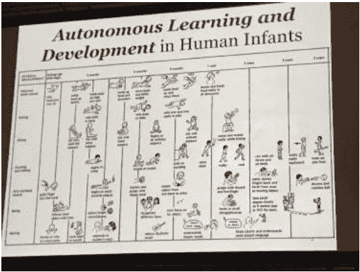

图11: 人类婴儿的学习和发展。

引导领域:

- 1. 认知科学:理解人类的发展和学习。
- 2. 机器人学:关于终身和自主学习的新理论。
- 3. 教育技术应用。

示例1：研究机器人设计中的形态学、身体生长和成熟问题，以及运动和感知基元。

示例2：考虑语言习得。孩子们学习新语言非常快。

示例3：内在动机、游戏和好奇心。

问题：我们如何理解这些实践，并将它们应用于人工智能工具，并围绕它们构建新的教育工具？

### 4.1.1 内在动机和好奇心

考虑主动探索：观察一个婴儿随着时间在房间里玩各种玩具的视频(让我想起了强化学习中的游戏室领域)。

→同样，给一个宝宝几个玩具，还有一个悬挂在地面上的空心圆筒，里面有一个玩具车。随着时间的推移，宝宝倾向于将玩具放入筒中，从而将车弹出筒外（此时父母非常高兴！）。

→但是！当车从筒中弹出时，宝宝也倾向于捡起车并将其放回筒中。

其他孩子以非常不同的方式进行实验；一个孩子拿起积木并敲击圆筒，制造噪音，并对噪音感到非常满意。这在研究中被认为是一种“失败”，但这是相当复杂的探索！

注意：内在动机、好奇心和主动学习的理论旨在减少不确定性、体验新奇、惊喜或挑战。参见Berlyne [2]和Berlyne [3]。

观点：孩子是一个进行感知的有机体：探索以建立对世界的良好预测模型并控制它！

Q: 基于这个观点，为了解释这些行为，需要什么样的建模/算法？

A: 我们在机器人游乐场中放置机器人，鼓励它们玩耍以学习物体模型和可行性。还在游戏室中放置另一个机器人，以对学习机器人的行为做出有条件的反应（如根据行为发出声音或移动）。这反过来让导航机器人扮演父母的角色，鼓励/阻止婴儿的行为。

这些机器人的关键要素包括：

- 动态运动原语
- 基于物体的感知原语（像婴儿一样，建立在先前的感知学习基础上）
- 具有回顾学习的自监督学习正向/逆向模型
- 以好奇心驱动的、自我激励的游戏和探索。

### 4.1.2 学习进展假设

Q: 对于机器人/婴儿来说，进行什么样的有趣的学习实验（以学习）？

文献中有很多答案：高可预测性、高新颖性、高不确定性、知识差距、新颖性、挑战、惊喜、自由能量等等。

这项工作：学习进展假设[31]：

定义9(学习进展假设):实验的“有趣程度”与经验学习进展(误差导数的绝对值)成正比

→对底层学习机制和偏差与现实世界之间的匹配做出少量假设。

框架:假设我们有一些具有运动基元的机器人。采取一系列动作产生一个轨迹:

$\tau = (s_t, a_t, s_{t+1}, \dots)$.

从这个轨迹中,机器人应该学习,假设有一些行为抽象 $\phi$ :

- 1. 前向模型: $F_i: s, \theta \rightarrow \phi_i$, 其中 $\theta$ 是行为策略的参数, $\pi(\theta)$. 
- 2. 反向模型: $I_i: s, \phi_i \rightarrow \arg \min_\theta ||\phi_i - F_i(s, \theta)||$

我们可以使用这些模型来衡量学习进展:

- 1. 测量前向模型的错误变化。
  - →根据这个学习进展,帮助进行预测实验,代理根据参数 $\theta$ 进行采样。
- 2. 测量逆向模型/目标达成的错误变化(称为“能力进展”)。
  - →可以产生目标达成实验,代理根据期望的高能力进展采样目标,并使用模型推断 $\theta$ 并执行。

用于生成自动课程学习的算法:分层多臂赌博机。思路是将空间分割成子区域,代理监视每个子区域的错误。使用这些错误来随时间衡量学习进展。然后,在赌博机设置中,可以根据这些错误的比率随时间进行探索。

→注意:这个算法将成为后续实验中课程学习的核心。

→例子:探索全向运动。通过不同的探索策略在机器人上观察到的结果的多样性(以某个空间中达到的状态的分布为指标)。发现:好奇心驱动的探索比目标探索效率低。

发现:两种类型的好奇心驱动的探索,1)前向模型的探索,2)目标探索(使用逆模型)。结果表明第二种类型更有效地学习到一组多样的技能/可控效果。

例子:通过好奇心驱动的工具使用发现。展示了机器人使用不同工具玩耍的视频(机器人夹爪学会与移动杯子的操纵杆交互)。

3非常感谢Pierre-Yves Oudeyer 对这一点的澄清!
4感谢Pierre-Yves Oudeyer 的有益澄清!

末端执行器）。

→ 焦点：专注于与世界中的物体玩耍和操纵。夹爪机器人学会了操作操纵杆，从而移动可以拾取球的机器人。躯干最终学会了发出光，发出声音，并将球藏在杯子里。

项目：“MUGL：探索学习的模块化目标空间”[25]。主要思想是将这些探索技术扩展到高维输入（上述机器人示例使用的是特征向量，而不是图像）。

→ MUGL可用于发现独立可控的特征（学会控制球等）。

### 4.1.3 儿童发展数据模型

实验：建模语音发展。使用之前完全相同的算法。

→ 目标：利用之前的学习进展思想为婴儿进行实验。

发现：婴儿中存在一定的自组织发展结构。首先学习了声道（非发音的声音），然后学习了发音的声音。

→ 观察：不同个体之间在同一时间发生的规律性，但有些事情发生了巨大变化。学习系统和身体形态之间的相互作用是随机的，探索中的偶然性，令人惊讶的是许多事物保持不变。

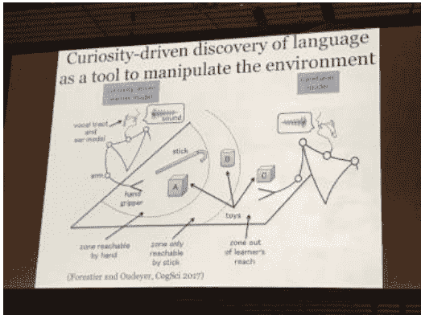

图12：基于好奇心的语言发现

“人形机器人”（与Mikhail Gromov和David Lynch合作，我想是吧？）Dave：Lynch! :o。机器人学习说话和与环境及伙伴互动的超现实视频，点击此处查看示例视频：https://www.youtube.com/watch?v=J0gM5i091JQ。机器人通过探索以有意义的方式使用语言。

→ 使用类似的思想提出学习使用声音轨道的现实模型。参见：语言演化中的自组织[32]。

发现：我们在世界语言中发现的元音分布与这些基于好奇心驱动的学习系统中出现的系统的分布相匹配。这可能解释了语言结构的一些规律性。

问：自由游戏期间的自发探索是如何结构化的？

答：实验！让被试玩一系列的游戏/任务，没有任何指导。尽情做你想做的事情（像《吉他英雄》这样的游戏，可以自由选择任何级别/歌曲）。

→ 人们倾向于专注于中等复杂度的级别；探索遵循一种受个体预测模型主动控制的复杂度增长。

### 4.1.4 在教育技术中的应用

目标：开发促进高效学习和内在动机的技术。

→ 项目：KidLearn - 允许个性化智能辅导系统，基于在30多所学校中对1000多名儿童进行的实验。

原则：图（通常是有向无环图）定义了任务/练习类型的难度。这使得系统可以按照某种顺序抽样练习（但仍然让孩子们在图中的节点之间有一些选择）。

#### 主要研究：

- 根据这些干预措施检查学习影响。
- 与典型的教学专家（与他们的系统）进行比较。
- 发现学生在算法的某些变体下往往能够取得更高的成功率。

要点：自发性发展探索的基本作用，可以用来开发类似人类的机器人并增强学习过程。

## 4.2 贡献演讲

接下来是一些贡献演讲。

### 4.2.1 Devon Hjelm关于Deep InfoMax [17]

总体目标：学习无监督的图像表示。

例子：一只狗接住一个雪球的视频。什么样的注释是有意义的？（“可爱的狗！”，“乖小子！”）。

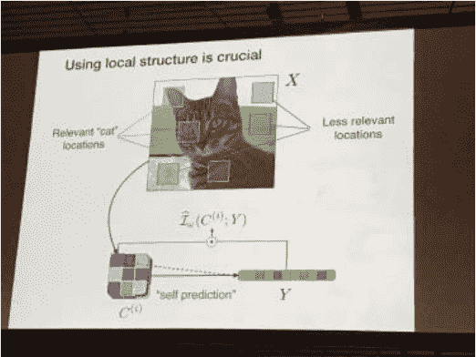

图13：通过局部互信息估计和最大化提取局部特征图

→ 不清楚这些是否是正确/有用的注释。

要点：并不总是希望通过监督学习来获得表示。注释很少能够讲述整个故事，现实世界并不带有标签，而且真正想要找到潜在的结构（注释可能不会增强这一部分）。

预备知识：

- 编码器：$E_{\psi}: \mathcal{X} \rightarrow Y$，其中 $Y$ 是一种表示。
- 互信息：$I(X; Y) = D_{KL}(P(X, Y) \parallel P(x)P(y))$

→ 引入一个互信息估计器：将图像编码成表示。从不相关的图像表示中取出成对的表示，并将其视为负样本。

方法：

1. 通过 $E_{\psi}$ 对输入 $X$ 进行编码，得到 $Y$。
2. 使用输出来估计 $\hat{I}(X; Y)$，并最大化这个估计值。
3. 仅仅这样做还不够。

直觉：你可能无法捕捉到图像的相关位置。考虑一张猫的图片，背景并不像前方的信息那样重要。

4. 因此：不是全局最大化互信息，而是局部最大化互信息。同时在所有位置进行估计/最大化。参见图13。
5. 这样可以得到图像不同区域的局部特征向量，然后将它们拼接成一个全局特征向量。

评估：严重依赖于下游任务。可以测量互信息、分类/回归任务的下游性能等等。

→ 当学习到的表示在分类等下游任务中使用时，Deep InfoMax的性能非常好。

其他研究的任务：先验匹配、坐标预测、相对坐标预测。

戴夫：去开更多的会议了。

## 4.3 主题演讲：Zeynep Tufekci关于机器学习的危险

小时候梦想成为一名物理学家！但是：最终，许多物理学家都会遇到核能问题：科学领域发展面临的巨大伦理问题。

→ 最近在欧洲核子研究中心：巨大的项目！700人参与了希格斯玻色子论文的撰写。他们担心如何分配诺贝尔奖，而与此同时，我们计算机科学界正在担心我们的工具对社会、安全、劳动力、气候、社会基础设施等方面的影响。所以：计算机科学中也存在许多伦理问题！

回到土耳其：没有互联网，对外界文化/电视的接触有限（小时候看《小木屋》长大）。但是，通过在IBM工作获得了互联网连接。

→ 拥有无障碍访问大量信息和与人们建立联系的能力真是太棒了！对这个工具在世界上产生积极影响充满乐观。

这次演讲：我们正在不知不觉地走向巨大的危险。我们最终会陷入一个可怕和不幸的境地，我们最终会建造和贡献其中的一部分。

- 七年前：有一篇关于在YouTube上学会识别猫的“猫”论文。在2012年，很难想象当前领域的现状。
- 我们需要担心的是：如果它起作用了呢？我们真正引入世界的是什么？

主题：

1. 你是这个世界的一部分，你的工具也将如此。
2. 这些工具将不会按照你想象的方式使用。
3. 还有其他可行的路径。

### 4.3.1 事物出错的例子

示例1：公共领域中的社会运动。具体来说，Facebook的新闻动态：

- 优化以保持用户在网站上的参与度。

回顾一下：弗格森，一名非洲裔美国青少年被警察射杀。类似地，在麦当劳，一些顾客被警察强行塞进面包车，没有任何机会说话。

→ 关于这些事件在Twitter上有很多讨论，但在Facebook上没有。

- 要点：朋友们在谈论这个问题，但这些问题对于Facebook来说并不“有吸引力”，因为它试图用会被喜欢/分享的内容填充新闻动态。

→ 当时，ALS冰桶挑战也正在进行中。非常受欢迎/分享，所以它在大部分Facebook的新闻动态中占据主导地位。

→ 令人不安的时刻：冰桶挑战成为媒体/Facebook的主导结果。

社会运动的区别不在于你是否举行抗议活动。运动最有效的事情是引起关注。

→ 但是我们的算法被优化为保持人们的参与度，所以它倾向于不传播某些类型的信息。一种新形式的审查制度。

经典发现：倾向于相信一个阴谋论的人往往也倾向于相信其他阴谋论（来自社会科学）。

→ Instagram会推荐类似的阴谋论，不是因为设计师推荐它们，而是因为算法学到了这个社会科学事实（某人喜欢一个“假登月”帖子，也会被呈现大量其他阴谋论）。

2016年：这些现象很普遍。观看某种类型的视频会立即对未来的视频产生偏见（如果你观看了一个慢跑视频，它会引导你观看更多的马拉松训练视频；如果你观看了一个素食视频，它会引导你观看更多的素食视频）。

要点：YouTube算法倾向于引导个人走向更极端和极端的路线。不是通过手工设计，而是通过这样做来增加参与度。

→ 仇恨言论、极端观点等等，非常“值得分享”，能够提高参与度。

### 4.3.2 机器学习及其挑战

在实施机器学习系统的过程中存在一些核心挑战：

1. 偏见
2. 可解释性
3. 大规模集中权力
4. 监视和隐私
5. 过渡和动荡

例子：假设你在招聘，假设你使用机器学习来招聘。

（修辞）问题：我们有预测抑郁率的方法；如果你的机器学习系统在使用这些信息来进行招聘结果呢？

问题：你甚至都不知道你的系统在使用这些信息！

类似的问题：可以使用“镜像人口”系统（识别相似群体）来针对容易恐惧的个体进行定向广告，以鼓励投票给权威主义者吗？（同样来自社会科学的发现）。

→ 这些系统的构建方式激励了监视，因为个人/群体的数据始终很重要。数据会泄露出去，并被使用。

前进的道路：构建能够实现我们想要的事情，但不让它控制我们并用于我们不想要的事情。

**我们正处于一个非常特殊的历史时刻：所有在这里的公司都在努力招募你。如果这些公司试图招募你，但无法让你做他们想让你做的事情，而你坚持使用保护隐私的方法。**

要点：这个房间里的人才可以做很多好事。

一些想法：

1. 谷歌为机器学习项目提供了资金。其中一个项目是检测社会意识，发现有风险的人，并进行干预。

看起来很棒。

2. 会发生什么：大学会开除有心理健康问题的学生。他们不希望这种情况发生在他们的宿舍里。

3. 看看被警察杀害的人的数据库。许多人处于心理健康危机中。

→ 自杀检测程序可以被用于非常糟糕的方式（比如阻止有风险的个人获得基本需求/商品的法律）。

4. 但是！想象一下一个旨在帮助个人的隐私保护系统。

第一个地球日：照片因雾霾而模糊不清。现在情况不同了！所以，最后一点：真正考虑组织工会。

工会：你会获得大量的法律保护。你会获得一些言论自由。组织你自己的行业机器学习团体。

这个社区中没有人明确地走向这条黑暗的道路。这个社区有很多好人！但是商业模式加上世界的发展导致了错误的系统。

#### 最后的想法：

1. 组织
2. 构建替代方案
3. 坚持发表意见

* 当有人想要拥有一部手机/应用时，我们在监控/监视方面做得很糟糕，目的是为了销售更多的东西，这与中国所做的（监控/监视）目的不同。

→ 我们需要的一个真正的替代方案。我们需要方便和赋权，我们需要一个选项，它尊重我们，给我们提前警告和干预的机会，但不以牺牲我们的隐私为代价。

最后一个例子：在Diffie-Hellman（公钥加密）之前，我们没有办法在不交换秘钥的情况下发送消息。

- 他们认为这是一个很大的问题。需要给人们一种在不事先交换秘钥的情况下进行通信和交换信息的方式。
- 所有的公钥加密都源于此。这是一个非常重要且赋权的工具，它已经极大地改变了世界的状态。
- 所以：股票期权很酷，但我们应该考虑为下一代技术开发这样的工具。

### 4.3.3 问答环节

问：您对军事领域的人工智能有何评论？

答：2019年的战争：任何形式的战争都将是可怕的。任何使其更方便的事物都会使其变得更糟。政府应对我们负责。

问：感觉有点美国中心主义——对更广泛的国际视角有什么想法吗？

答：还记得那篇声称可以检测性取向的论文吗。乌干达政府已经禁止同性恋，所以我们需要记住这些事情。如果我们有更好的医疗保健，这些问题将会减少伤害。解决政治问题会使这些危险变得不那么严重。对硅谷来说，不要陷入这个泡沫很重要。每次我现在去旧金山，我周围的其他桌子都在谈论股票期权何时解禁。即使你赚了很多钱，但是医疗保健不在那里，你的技术被用来阻止人们被雇佣，这是有问题的。

问：关于“解决方案”部分的问题，拒绝构建不道德的软件。通常我们构建一个大项目的小部分，你如何预测什么会有害？

答：首先，这就是为什么我们应该组织和联合起来。其次，拒绝是有力的，但只能持续一段时间。真正的前进道路是另一条道路：没有太阳能/风能就无法摆脱石油。

监控和数据经济是我们的石油经济，而且很廉价。但是我们可以在这里开发太阳能的等效物，并坚持采用这些我们可以接受的替代方案。第三，你们可能都是产品方面的人：我鼓励你们找到安全团队的人并与他们交谈。他们见过最糟糕的情况。他们可以警告你这些东西可能以最糟糕的方式被使用。

> 戴夫：他们一起回答了最后三个问题。

问：美国有很多监控，而且对于告密者也有强烈的文化。ICLR的人应该采取更大的立场吗？

答：是的，绝对要反对这一点。鼓励并支持你自己公司的告密者。

问：真正的问题是什么，我们应该避免什么具体的事情？我们已经看到工程师们对抗军方工作的人。我们已经谈论过那些不惜一切代价销售广告的公司。

答：如果数据存在，它将被出售和使用。巨大的挑战是我们需要找出如何在没有监控的情况下做到这一点。这包括数据的过期日期，对加密数据的操作（对聚合数据进行洞察，而不是个体化）。关键是要终结监控经济。我们不能消灭手机，因为手机使我们更强大，但我们需要一种替代方案。

问：对于医疗保健解决方案有什么评论吗？

答：有很多！皮肤诊断和其他赋能工具。需要找到一种新的全栈可信方法，不参与监控经济。我们不可能收集所有这些数据并在这些数据上工作而不被强大的企业和政府利用。我们需要停止监控经济。

## 4.4 由Leslie Kaelbling主持的辩论

辩论者有：Josh Tenenbaum (JT)、Doina Precup (DP)、Suchi Suresh (SS)、Jeff Clune (JC)，以及Leslie Kaelbling (LPK)。

**LPK：** 我们对观众的问题感兴趣！主题是学习中的结构。每个小组成员都会进行一些介绍：

**DP：** 我抽到了短签。我将主张我们所需的很多东西可以而且应该从数据中学习，而不是来自先验知识。特别是在通用人工智能的背景下，而不是特定应用领域。在特定应用领域，我们应该明确使用结构/先验知识，但在构建通用人工智能时，我们希望系统能够从数据中学习。参考：AlphaGo。首先我们使用了专门的人类版本和一些专家知识，但后来占主导地位的是完全使用数据的方法。

**JT：** 另一个极端！我想强调你可以建立的东西。我和Doina一样，对通用人工智能感兴趣。我不反对学习，但我真的很惊讶AlphaGo等系统不会做多少事情。我们有一个构建特定类型智能的通用工具包，但没有通用智能。例如，转移到不同的棋盘大小几乎需要重新训练。

我对从人类获取知识的方式感兴趣，比如从婴儿阶段学习。在宇宙中，我们唯一有从早期/零基础阶段学习的案例是人类婴儿。我们学到了很多东西，与一些人（苦涩）得出的教训有些相反。我们在认知科学中发现的结果讲述了一个不同的故事：人类儿童有很多归纳偏见。此外：羚羊在草原上学会走路非常快，否则就会被吃掉。或者想想一只鸟：它第一次从巢里掉下来就必须飞。人类婴儿并不是从一开始就会走路，但在他们能做这些事情之前，他们会发展出物体、直觉物理学、定义目标的方案、一些关于空间的概念等等。这是一个令人兴奋的机会，可以利用这些核心系统并学习如何设计和超越它们。我想思考一下我们如何采用正确的机制，包括我们在强化学习和深度学习方面的知识，以及我们对符号推理和经典方法的了解，使它们知道如何在世界中生活。

**JC：** 这个辩论通常被框定为两个极端：1）构建正确的东西，2）从头学习一切。我认为这里有第三个选择，我称之为AI生成算法：能够搜索一个在内循环中非常高效的AI代理的算法（这来自于外循环做正确的事情）。这是两者之间的一个很好的结合。当你面临一个新问题时，你不需要从头学习，而是部署这个新的代理。我们知道这可以行得通（存在证明：地球，这已经发生过！）。算法就是进化，内循环就是人脑。这个研究方向并不是说外循环必须是进化，也可以是其他东西，比如元学习。如果我们想在这方面取得进展：三个支柱：

- 1. 元学习架构
- 2. 元学习学习算法
- 3. 自动化有效的学习环境（脚手架）

我们意识到机器学习中存在一个明显的趋势：手动设计的系统虽然能够正常工作，但会被完全依赖数据驱动/大规模计算的方法所超越。如果你相信这个趋势，你也应该相信它可以应用于发现这种机制本身。那么，有哪些结构可以实现高效的通用学习？这可能是我们追求这些宏伟目标的最快途径。

**SS：** 我要简化一下。其他三位专家提出了解决方案，所以我想先强调一些观察结果：

- 观察1：Josh和Jeff建议，如果我们想要构建类似人类的智能，并且我们知道我们可以在学习过程中实现这一目标。证据是进化。进化非常缓慢。在达到我们这个阶段的过程中，发生了许多灾难。因此，一个重大问题是：我们不能让我们的文明灭绝，也不能犯下社会层面的错误。对于我们来说，找到正确的范式意味着什么，因为我们不能犯错误？
- 观察2：机器学习中我们有哪些杠杆？算法通过与过去数据的交互或学习来学习。所以问题是：如果我们只有数据和交互，我们能学到任何想要的东西吗？不清楚！
- 观察3：作为一个领域，我们非常努力地在解决方案集上进行增量。我很好奇我们是否对这些问题有答案：从一个超智能生物开始，我们能轻松学到什么？我们是否有一个易学和难学的分类法？我们能定义出差距在哪里吗？在这里定义策略可能是个好主意！所以，我们真的想像进化一样慢，还是考虑我们所知道的？肯定是后者。

**LPK：** 对我们每个人来说，定义自己的目标非常重要。我们每个人都有不同的大规模和小规模目标。大规模目标：理解学习的数学，大脑的生物学，使事物在10年或100年内运作。所以，不要把这变成一场毁灭性的辩论的原因之一是，可能没有一个答案适用于每个目标。那么，你们每个人能说一些关于你们目标的更多内容吗？

**DP：** 我有多个目标。想要了解如何构建通用人工智能代理。现在我们做的一些事情与这个目标不一致：我们经常从头开始训练，但不一定需要这样做！我们可以加载一个视觉系统并学习下游方面。更好地强调这种持续学习会很好。我在考虑医学应用的另一部分时间：这是一个我们没有很多数据并且由于伦理考虑不能总是干预的领域。在这里我们经常使用结构/先验知识。概念上的问题：智能的原则是什么？专注于从数据中学习可以帮助我们达到这个目标。人们是美好的，但自然界中还有其他智能的事物。研究这些算法问题可以帮助我们更好地理解自然界。

**SS：** 对我来说，最大的挑战是当我们的目标出现问题时我们如何继续前进？（参见前面的主题演讲！）很多研究都在问正确的问题。谁来定义问题？我们应该如何思考定义正确的目标？

**DP：** 这是真的！我们可以有不同的目标，这没问题。

**JT：** 我会快速说一下：我们都是非常开明的人，但对事物有着自己坚定的观点。我喜欢进化的观点。我们看待我们所见过的学习算法时，进化是主要算法（Pedro Domingos）。羚羊/动物非常有趣。还有文化进化，特别是一旦有了语言，就会开启全新的可能性。AI工具的成功在很大程度上是由于文化进化的发展，让我们能够建立集体知识并分享目标和想法。

**JC：** 我对逐步构建智能很感兴趣。但也对构建能够构建智能系统的过程感兴趣。同时，思考可能的智能实体的集合/空间也很有趣。在某种程度上，我们受到看起来像我们的东西的激励，但我们可能会错过智能/有感知系统的巨大领域。也受到在医疗保健等领域的应用的激励，以及其他领域。对我们所有人来说是个很好的机会！

**LPK：** 好的，现在我们来回答观众的问题。这个问题是匿名的：“什么样的结果会让你改变对结构和学习的必要性的看法？”——如何结构的必要性是一个错误的问题？你可以将这个问题与特定目标联系起来，得到一个非常有趣的问题。很难证明一个否定的观点。我们正处于方法论危机之中，因为我们都在一个空间中放置点。同事们？

JT：我知道一个我觉得有趣的直觉物理学案例研究：能够预测/想象/计划对物体进行因果干预。全部都是关于预测“如果我用这个东西打那个东西会发生什么？”我们构建了一个系统，它没有进行任何学习，只是使用一个游戏引擎进行概率推理。在同一时间，其他人尝试用端到端的学习方法解决同样的问题，取得了一些令人印象深刻的成果。仍然需要大量的数据，并且似乎不能很好地推广。其他人一直在尝试不同的系统。我们已经举办了一些关于这个主题的研讨会，并得出了更广泛的论点：这不是必要性的论证，而是一种经验结果。

在一些可能通过接触/具有紧密空间接近性相互作用的对象模型中构建是非常强大的。我们无法证明它们是必要的，但它们非常有效。并不能改变任何一个人的想法，但这是一个我们学到了一些重要的经验教训并证明是有效的案例。

DP：构建这些东西可能非常有价值，但我并不相信我们不能通过学习来掌握这些东西。主要的抱怨通常是样本复杂性：如果我们有合适的学习算法，它可以学习这些东西。典型的例子是因果关系。如果我们有合适的学习算法，我们可以学习因果模型而不是预测模型。关于方法论的另一个简短的事情，对我们作为一个领域也非常重要。当我们非常关心数字而又不理解我们的系统在做什么时，很难取得进展。所以是的，当我们的算法做得更好时是很好的，但我们也需要理解为什么。我想要争论的是，我们需要通过假设检验来探测我们的系统，而不仅仅是定量/定性地测量我们的系统，而是真正地探测我们的系统。

JC：我同意Doina的观点！只是想问一下Josh：通过在这些领域建立这些东西，可能会给我们带来很大的提升，但也许我们可以学到更好的提升吗？你如何看待HOG和SIFT这样的东西，我们最终学到了更好的东西吗？

JT：是的，HOG和SIFT是一个非常有教育意义的例子。我们在直观物理学中也看到了类似的情况：现在我们拥有的最好模型是物理引擎（例如用于玩视频游戏）。但我们知道它们无法涵盖所有事物。最近的研究开始学习可以改进这些经典物理模拟器概念的物理模拟器。我们不知道这个故事会走到哪里。如果我们看看视觉，不仅仅是HOG和SIFT，你会发现在几代研究中，我们看到了相同的主题/思想重复出现（非线性、层次结构等）。同一个想法的许多版本。HOG和SIFT是一个想法，AlexNet是另一个想法。我们将看到类似的想法再次出现、发展并回到相同的主题。

SS：乔什，我有一个问题问你：你认为我们需要超越学习的原因是因为你认为这些系统不能从零开始学习吗？我们能通过学习来学习物理学吗？

JT：这就是地球上通过进化发生的事情。用于模拟进化的计算量非常大，我们才刚刚开始取得进展。因此，现代深度强化学习的当前路线并不一定能实现学习整个物理模型的承诺。人类孩子是证明其他路径有效的证据。

JC：我认为有很多路径可以达到通用人工智能，但部分问题是哪条路径最快。这是一个开放的问题，手动路径是否比元学习或进化方法更快到达目标。

SS：除非你在途中错过了这一点：在途中发生的一切怎么办？

JC：有趣的问题！关于是否应该构建通用人工智能的一般问题？此外，在构建通用人工智能的过程中我们应该做些什么？非常真实的考虑。到达目标的最快方式是什么：我认为是上面提到的元学习方法。关于伦理学？也有很多开放的问题。

LPK：杰夫没有提到使这项工作成为可能所需的物理基础设施。机器人需要与世界互动，除非我们依赖于一个完美的模拟器。我不确定我们能否实现这一点，我们可能会提出建议。

LPK：下一个问题是“符号操作在深度学习中没有地位。” “改变我的想法”（Yann LeCun）。符号意味着不同的体现；我认为嵌入大致上是符号操作，所以也许你一直在做，但你实际上并不知道。

JT：当然不是我的责任来定义深度学习是什么。它有趣的一个原因是深度学习可以意味着很多事情；它可以意味着并且已经在做随机梯度下降和符号操作。明天有一个很好的演讲。整个社区都在尝试探索有趣的方式，让符号在进行深度表示学习的系统中存在。学习表示的多种方式，可能包括符号或这些符号的组合。我们将看到使用这些不同技术做得比没有这些技术更好的系统。

DP：但是我们会看到从头开始做这个的系统吗？

JT：拥有一个基本的组合性路径，给我们赋予了原本不存在的意义/功能。

DP：意义是指人们赋予的意义吗？还是指机器为自己定义的意义？

JT：无论你指的是什么！... 如果我们想要构建我们信任的系统，我们认为这些系统具有正确的意义，这是构建具有这种结构/符号的人工智能的一个原因。

LPK：来自Yoshua Bengio的问题：“当然，我们需要先验知识，但为了获得最通用的人工智能，我们希望尽量少的先验知识能够为我们提供最多的AI任务，不是吗？”

JC：是的！

SS：也是，对观众的一个新问题：一切都可以学习吗？（一些人举手）不是一切都可以学习（更多人举手）——一些观众举例说明无法学习的事物：因果关系，停机问题，错误的事物。

戴夫：需要出去开会！不过辩论很棒。

## 5 星期四 5月9日:主会议
最后一天！我今天下午要飞走，所以只能参加几个会议。

## 5.1 投稿演讲
现在是一些贡献性演讲。

### 5.1.1 Felix Wu 关于使用序列模型的注意力更少[36]
观察：序列模型几乎无处不在自然语言处理中（已成为视觉中的CNN↔）。

这项工作：
- 1. Q1：自注意力是否对性能有帮助？
- 2. Q2：我们能否在有限的上下文中完成多种自然语言处理任务？

不同的模型在神经机器翻译上表现非常不同（Transformer的BLEU为28，SliceNet为25，基于短语的为22）。
→ 自注意力和卷积模型之间存在较大的性能差距。

背景：编码序列的三种方法
- RNN：循环神经网络。可以表示为 $h_t=f(x_t,h_{t-1})$，其中 $x_i$ 是时间 $i$ 的输入，$h_i$ 是时间 $i$ 的隐藏状态。
- CNN：卷积神经网络。$h_{t}=f\left(x_{t-k}, \cdots, x_{t+k}\right)$ → 查看一个有限窗口。
- 自注意力模型：计算单词之间的两两相似度并进行聚合。$h_{t}=\sum_{i, j} a_{i, j}$。

每种方法的一些优缺点！RNN无法并行化，而CNN和自注意力，时间复杂度对于自注意力较高，等等（详见图X进行全面比较）。

方法：动态卷积，解决CNN的主要缺点（缺乏动态加权）。
但是，动态卷积也面临一些挑战：参数过多，难以优化！
→ 回应：转向轻量级卷积，减少参数数量。

实验：探索推理速度（以每秒句子数衡量）与BLEU分数（一种衡量输出翻译质量的方式）之间的权衡。

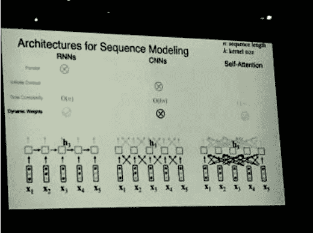
图14：卷积神经网络（CNN）、循环神经网络（RNN）和自注意力（self-attention）在序列建模中的优缺点。

→ 主要发现：动态卷积在推理时间上比自注意力快20%，但达到相同的BLEU分数。

结论：
- 1. 对于几个自然语言处理任务，局部信息已经足够。
- 2. 引入了动态卷积：上下文特定的卷积核。
- 3. 轻量级卷积：较少的卷积权重仍然能够很好地工作。

### 5.1.2 Jiayuan Mao 关于神经符号上下文学习器[29]
重点：视觉概念推理。
→ 给定一张输入图像（包含一些物体），人们可以快速识别物体、纹理、表面等。

视觉问答：给定一张图像和一个问题“红色物体的形状是什么？”，输出问题的答案。
→ 还可以进行图像描述：“有一个绿色的立方体在一个红色的球体后面”，或者实例检索（对特定对象进行边界框标记）。

先前的方法：解决这三个问题的端到端方法。学习的两个方面：1) 概念（颜色，形状），和 2) 推理（计数）。
→ 端到端的缺点：概念学习和推理相互纠缠。不明显如何进行迁移。

这种方法：将概念融入视觉推理中。先前的方法依赖于明确的概念注释。
思路：
- 联合学习概念和语义解析。
- 给定一个场景解析器和一个语义解析器，学习一个能够理解概念的程序，同时解析对象。

示例：给定一张红色球和绿色立方体的图像，首先进行对象检测/特征提取以获得表示。同时，在文本上进行语义解析，输出一个解析程序来预测问题的输出。完整的概述见图15。

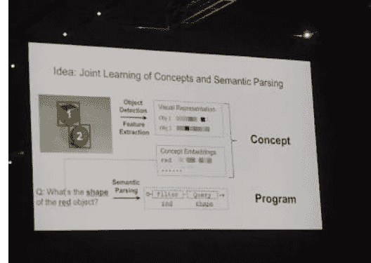
图15：联合语义和场景解析方法的概述。

两种主要方法：
- 学习一个用于理解概念的程序
- 学习一个可以帮助解析新句子的概念

实验：这种方法有几个优点
- 在“CLEVR”数据集上的最新性能，用于视觉问答。
- 扩展到自然图像和自然句子，如VQS数据集中的“消防栓是什么颜色？”给出一个看起来自然的消防栓图像（正确猜测为“黄色”）。
- 模型还支持将低级概念组合成高级概念，并进行边界框检测。

限制和未来方向：
- 考虑一个戴着雨伞帽子的人的例子，以及问题“这个人头上的东西有什么用途”？证明非常具有挑战性！
- 在野外图像和其他目标（如目标）中的识别。
- 解释嘈杂的自然语言
- 以更高效的方式学习概念。

结论：
- 新模型：NSCL从语言中学习视觉概念，无需注释
- 新模型的优势：高准确性和数据效率，将概念转移到其他任务。
- 原则：通过神经符号推理明确概念的显式视觉基础。

### 5.1.3 Xiang Li 关于平滑盒嵌入的几何[27]
要点：在自然语言处理中，学习表示非常重要！这些表示通常是像word2vec或BERT这样的向量。
→ 这些向量在空间中定义了语义相似性（距离较近的词具有相似的含义/用法）。

但是，请考虑：兔子/哺乳动物。它们在空间中靠近，但不能完全捕捉到它们之间的复杂关系（兔子 $\subset$ 哺乳动物）。
→ 一个想法：使用“哺乳动物”等类的高斯表示。优点：1）区域，2）不对称性，3）不相交；但是，一个缺点是：不封闭于交集。最近的研究将这一点扩展为一个概率模型，放弃了不相交性以实现交集的封闭性。

他们的方法：使用盒子表示来扩展这些概率模型，以解释联合概念，从而实现所有四个期望的属性（区域，不对称性等）。图16中显示了盒子表示。

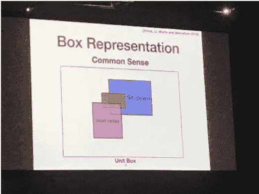
图16：新的概率盒表示法背后的思想

学习问题：盒子表示概率质量，尝试在概念之间进行分布匹配。
初始化随机概念（Pr（鹿），Pr（鹿|哺乳动物））

实验：1）在MovieLens上进行矩阵分解，2）在不平衡的Wordnet上进行分类
- 1. MovieLens市场基础；电影×电影矩阵：p（狮子王|阿拉丁）=0.73），2.86亿对。
- → 回归任务：训练/开发/测试，得到一个矩阵分解问题（确定人们会喜欢哪些电影）。
- →《阿甘正传》最终成为一个大盒子，表示每个人都喜欢它！
- 2. 不平衡的WordNet：展示模型对稀疏、不连续数据的学习能力。

→ 二元分类任务：实现SOTA，即使在稀疏、不连续的数据上也是如此。

### 5.1.4 最佳论文奖演讲：Yiqiang Shen关于有序神经元[34]
假设：语言具有潜在的树状结构
→ 这项工作：关注组成树。
问：为什么？
A1：这些树可以捕捉到逐渐抽象的分层表示！
A2：这些树可以处理语言的组合效应和长期依赖问题。

主要问题：我们能否基于这种树结构提供新的归纳偏差，以实现更高的下游任务性能？

过去有两种回答这个问题的模型：
- 1. 循环模型（SPINN, RL-SPINN, RNN）
- 2. 递归模型（RvNN, ST-Gumbel, DIORA）

→ 对于大多数先前的工作：由外部解析器给出树结构，或者尝试如何设计它做出困难的决策。

这项工作：将树结构直接整合到RNN中。
→ 树结构的定义是：当一个较大的成分结束时，所有嵌套的较小成分也结束。

效果：这产生了一种“有序神经元”的归纳偏差，当一个高排名的神经元被擦除时，所有较低排名的神经元也应该被擦除。

为了建模这种结构，引入了一个新的遗忘门，称为 cumax：
```
cumax(x) = cumsum(softmax(x))
(4)
```

RNN的主控门：
- 主遗忘门： $f_t = cumax(W_f x_t + \dots)$
- 主输入门： $i_t = 1 - cumax(W_f x_t + \dots)$

实验：
- 1. 语言建模：使用PTB数据集进行下一个单词预测。达到接近最先进水平。
- 2. 无监督的成分句法分析：在语言建模任务中使用Penn TreeBank数据集。
- 3. 目标句法评估：在语言建模任务上使用Marvin和Linzen数据集（给定一对相似的句子，一个不符合语法，一个符合语法，看模型的表现）。ON-LSTM能够捕捉到长期依赖关系。

总结：
- 提出了新的有序神经元归纳偏差：
  - 高排名神经元存储长期信息
  - 低排名神经元存储短期信息
- 新的激活函数：cumax()和ON-LSTM
- 归纳结构与人工注释的结构相吻合
- 在许多实验中表现更强

> Dave：这就是全部了！只剩下一个海报展览，然后我就去机场了。

# 编辑
我收到了一些指出拼写错误的消息：
- 感谢Anca-Nicoleta Ciubotaru指出拼写错误。
- 感谢Pierre-Yves Oudeyer提供有用的澄清。

# 参考文献
- [1] Pierre-Luc Bacon, Jean Harb, and Doina Precup. The option-critic architecture. In AAAI, pages 1726-1734, 2017.
- [2] Daniel E Berlyne. 冲突、唤起和好奇心。1960年。
- [3] Daniel E Berlyne. 好奇心和学习。动机和情绪, 2(2): 97-175, 1978年。
- [4] Mathew Botvinick, Sam Ritter, Jane X Wang, Zeb Kurth-Nelson, Charles Blundell和Demis Hassabis。强化学习, 快与慢。认知科学趋势, 2019年。
- [5] Kurtland Chua, Roberto Calandra, Rowan McAllister和Sergey Levine。使用概率动力学模型进行少量试验的深度强化学习。在神经信息处理系统进展, 页4754-4765, 2018年。
- [6] Nathaniel D Daw和Peter Dayan。基于模型的评估的算法解剖学。《英国皇家学会哲学交易B:生物科学》369(1655): 20130478, 2014年。
- [7] Philip Dawid. 关于个体风险。Synthese, 194(9):3445-3474, 2017年。
- [8] Nat Dilkothanakul, Christos Kaplanis, Nick Pawlowski和Murray Shanahan。作为分层强化学习的内在动机的特征控制。IEEE神经网络和学习系统交易, 2019年。
- [9] Carlos Diuk, Andre Cohen和Michael L Littman。用于高效强化学习的面向对象表示。在第25届国际机器学习会议论文集中, 第240-247页。ACM, 2008年。
- [10] Harrison Edwards和Amos Storkey。用对手对表示进行审查。arXiv预印本arXiv:1511.05897, 2015年。
- [11] Chelsea Finn, Pieter Abbeel和Sergey Levine。用于快速适应深度网络的模型无关元学习。在第34届国际机器学习会议-第70卷论文集中, 第1126-1135页。JMLR.org, 2017年。
- [12] Danijar Hafner, Timothy Lillicrap, Ian Fischer, Ruben Villegas, David Ha, Honglak Lee, 和 James Davidson.从像素学习潜在动态规划。arXiv预印本 arXiv:1811.04551, 2018年。
- [13] Jean Harb, Pierre-Luc Bacon, Martin Klissarov, 和 Doina Precup. 当等待不是一个选项时:学习带有思考成本的选项。在第三十二届AAAI人工智能会议上, 2018年。
- [14] Anna Harutyunyan, Peter Vrancx, Pierre-Luc Bacon, Doina Precup, 和 Ann Nowe. 学习具有离线终止选项。在第三十二届AAAI人工智能会议上, 2018年。
- [15] Anna Harutyunyan, Will Dabney, Diana Borsa, Nicolas Heess, Remi Munos, and Doina Precup. 终止评论家。arXiv预印本arXiv:1902.09996, 2019年。
- [16] Ursula Hebert-Johnson, Michael Kim, Omer Reingold, and Guy Rothblum. 多校准: (可计算可识别的)质量校准。在国际机器学习会议上, 第1944-1953页, 2018年。
- [17] R Devon Hjelm, Alex Fedorov, Samuel Lavoie-Marchildon, Karan Grewal, Adam Trischler, and Yoshua Bengio. 通过互信息估计和最大化学习深度表示。arXiv预印本arXiv:1808.06670, 2018年。
- [18] Matthew Johnson, Katja Hofmann, Tim Hutton, and David Bignell. 用于人工智能实验的Malmo平台。在 IJCAI, 2016年的第4246-4247页。
- [19] John T Jost和Mahzarin R Banaji。刻板印象在系统正当化和虚假意识产生中的作用。英国社会心理学杂志, 1994年第33卷第1期, 第1-27页。
- [20] John M Kennedy和Igor Juricevic。盲人使用三维缩小绘制。Psychonomic bulletin & review, 2006年第13卷第3期, 第506-509页。
- [21] Michael Kim, Omer Reingold和Guy Rothblum。通过计算有限意识实现公平。在神经信息处理系统进展, 2018年的第4842-4852页。
- [22] Jon Kleinberg, Sendhil Mullainathan, and Manish Raghavan. 在公平确定风险评分中的固有权衡。arXiv预印本 arXiv:1609.05807, 2016年。
- [23] Anurag Koul, Sam Greydanus, and Alan Fern. 学习有限状态表示的循环策略网络。2019年。
- [24] Tejas D Kulkarni, Karthik Narasimhan, Ardavan Saeedi, and Josh Tenenbaum. 分层深度强化学习: 整合时间抽象和内在动机。在神经信息处理系统进展, 页码3675-3683, 2016年。
- [25] Adrien Laversanne-Finot, Alexandre Perre, and Pierre-Yves Oudeyer. 基于好奇心驱动的学习解缠目标空间。arXiv预印本 arXiv:1807.01521, 2018年。
- [26] Andrew Levy, George Konidaris, Robert Platt, and Kate Saenko. 学习具有远见的多级层次结构。在 ICLR, 2019年.
- [27] Xiang Li, Luke Vilnis, Dongxu Zhang, Michael Boratko, and Andrew McCallum. 平滑概率盒嵌入的几何形状. 在 ICLR, 2019年.
- [28] David Madras, Elliot Creager, Toniann Pitassi, and Richard Zemel. 学习对抗公平和可转移的表示.arXiv预印本 arXiv:1802.06309, 2018年.
- [29] Jiayuan Mao, Chuang Gan, Pushmeet Kohli, Joshua B Tenenbaum, and Jiajun Wu. 神经符号概念学习者: 从自然监督中解释场景、单词和句子. arXiv预印本 arXiv:1904.12584, 2019年.
- [30] Ofir Nachum, Shixiang Gu, Honglak Lee, and Sergey Levine. 近乎最优的层次强化学习表示学习 .在ICLR 2019中.
- [31] P-Y Oudeyer, Jacqueline Gottlieb, and Manuel Lopes. 内在动机、好奇心和学习: 在教育技术中的理论和应用. 在大脑研究进展中,卷229, 页257-284. Elsevier, 2016.

- [32] Pierre-Yves Oudeyer. 语音演化中的自组织, 卷6. OUP Oxford, 2006.

- [33] Steindór Sæmundsson, Katja Hofmann, and Marc Peter Deisenroth. 具有潜在变量高斯过程的元强化学习. arXiv预印本 arXiv:1803.07551, 2018.

- [34] Yikang Shen, Shawn Tan, Alessandro Sordoni, and Aaron Courville. 有序神经元: 将树结构整合到递归神经网络中. ICLR 2019会议论文集.

- [35] David Silver, Thomas Hubert, Julian Schrittwieser, Ioannis Antonoglou, Matthew Lai, Arthur Guez, Marc Lanctot, Laurent Sifre, Dharshan Kumaran, Thore Graepel, 等. 一种通过自我对弈掌握国际象棋、将棋和围棋的通用强化学习算法. 科学, 362(6419): 1140–1144, 2018.

- [36] Felix Wu, Angela Fan, Alexei Baevski, Yann N Dauphin, 和 Michael Auli. 使用轻量级和动态卷积减少注意力. arXiv预印本 arXiv:1901.10430, 2019.

- [37] Luisa M Zintgraf, Kyriacos Shiarlis, Vitaly Kurin, Katja Hofmann, 和 Shimon Whiteson. CAML: 通过元学习实现快速上下文适应. arXiv预印本 arXiv:1810.03642, 2018.