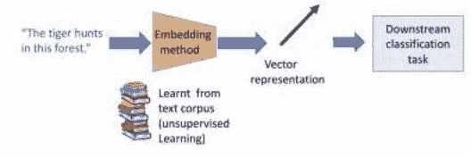
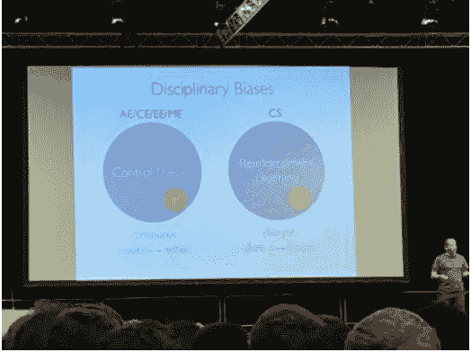
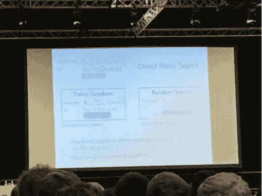
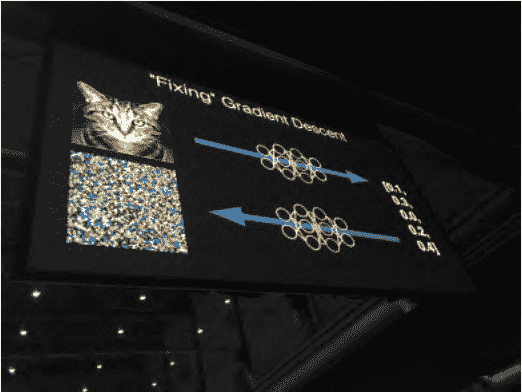
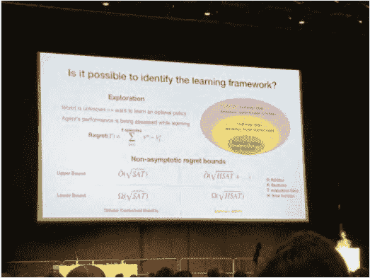
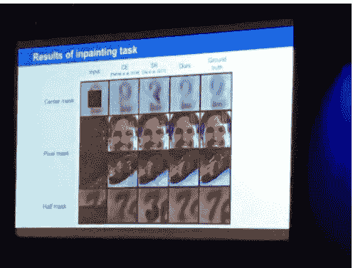
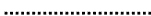
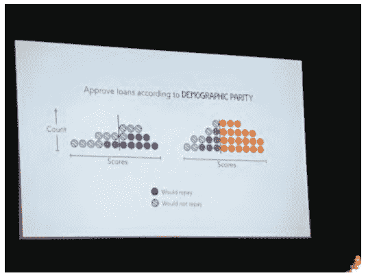

# 2018年国际机器学习大会笔记

## 瑞典斯德哥尔摩

大卫・阿贝尔*
david_abel@brown.edu
2018年7月

## 目录

- 1 会议亮点 3
- 2 7月10日星期二 3
  - 2.1 教程:走向对深度学习的理论理解 4
  - 2.1.1 优化 4
  - 2.1.2 过度参数化和泛化理论 6
  - 2.1.3 深度在深度学习中的作用 8
  - 2.1.4 生成模型和对抗网络的理论 9
  - 2.1.5 深度学习免费 10
  - 2.1.6 结论 11
  - 2.2 教程:优化视角下的学习控制 11
  - 2.2.1 引言:强化学习、优化和控制 11
  - 2.2.2 学习控制的不同方法 14
  - 2.2.3 学习理论 17
  - 2.2.4 基于模型的强化学习拯救 17
- 3 7月11日星期三 20
  - 3.1 最佳论文1:混淆梯度给出了虚假的安全感[7] 20
  - 3.2 强化学习1 22
    - 3.2.1 依赖问题的强化学习界限以识别MDP中的赌徒结构[46] 22
    - 3.2.2 放弃学习[38] 23
    - 3.2.3 模型驱动强化学习中的Lipschitz连续性[6] 24
    - 3.2.4 隐式分位网络用于分布式强化学习[13] 24
    - 3.2.5 更稳健的双重稳健离线策略评估[17] 25
  - 3.3 强化学习2 25
    - 3.3.1 并发强化学习中的协调探索[15] 26
    - 3.3.2 门控路径规划网络[29] 26
  - 3.4 深度学习 27
    - 3.4.1 PredRNN++：解决深度时间困境的方法[42] 27
    - 3.4.2 无监督的分层长期视频预测[43] 27
    - 3.4.3 进化卷积自编码器用于图像恢复[40] 28
    - 3.4.4 模型级双重学习[45] 28
  - 3.5 强化学习3 29
    - 3.5.1 机器心智理论[34] 29
    - 3.5.2 曾经有过这样的经历：具有情节回忆的元学习[36] 30
    - 3.5.3 使用GPI中的继任特征进行深度强化学习的迁移[9] 31
    - 3.5.4 具有复杂突触的持续强化学习[26] 31
* http://david-abel.github.io/

## 7月12日星期四 32
- 4.1 按千瓦时计算的智能 32
  - 4.1.1 自由能、能量和熵 32
  - 4.1.2 能量高效计算 33
- 4.2 最佳论文2：公平机器学习的延迟影响 34
- 4.3 强化学习 36
  - 4.3.1 将梯度类学习规则与表示解耦 36
  - 4.3.2 PIPPS：鲁棒的基于模型的策略搜索，克服混沌的诅咒[33] 36

## 7月13日星期五 36
- 5.1 强化学习 36
  - 5.1.1 分层模仿和强化学习[28] 37
  - 5.1.2 使用奖励机制进行高级任务规范[23] 38
  - 5.1.3 带演示的策略优化[25] 38
- 5.2 语言到行动 39
  - 5.2.1 将动词与感知相结合 39
  - 5.2.2 将语言与计划相结合 40
- 5.3 构建像人一样学习和思考的机器 41

## 7月14日星期六：终身强化学习研讨会 42
- 6.1 基于子任务依赖的零样本泛化多任务强化学习 42
- 6.2 无监督元学习用于强化学习 43

## 7月15日星期日：研讨会 44
- 7.1 研讨会：强化学习中的探索 44
  - 7.1.1 结构化探索策略的元强化学习 44
  - 7.1.2 基于后继表示的计数探索 45
  - 7.1.3 Q学习是否可证明有效 45
  - 7.1.4 上置信度边界动作值 46
- 7.2 研讨会：野生动物保护中的人工智能 47
  - 7.2.1 野生动物保护中的数据创新 47
  - 7.2.2 管理入侵路径的稳健策略计算 49
  - 7.2.3 在天气数据中检测和跟踪鸟类集群栖息地 50
  - 7.2.4 相机陷阱的识别 50
  - 7.2.5 为水资源保护众包山区图像 51
  - 7.2.6 在无人机图像中检测野生动物 51

这份文件包含了我在瑞典斯德哥尔摩参加ICML会议期间所做的笔记。请随意传阅，并在发现任何错别字或其他需要更正的地方时给我发电子邮件：david_abel@brown.edu。

# 1 会议亮点

有些人开玩笑地称今年的ICML为ICRL-强化学习的会议场次在最大的房间里，显然有最多的论文。真是太疯狂了。我在强化学习领域有几个朋友，他们回忆起以前在大型机器学习会议上只有十几个强化学习专家的时光。我的主要研究领域是强化学习，所以我对强化学习的讲座非常关注（但我也非常关心更广泛的社区）。话虽如此，这些笔记在很大程度上偏向于强化学习会场。另外，我花了更多的时间准备我的演讲/海报展示，所以错过了比平时更多的内容。

一些要点：

- 我希望在强化学习领域看到更多解释性论文——也就是说，不仅仅关注于介绍在我们的基准测试上表现更好的新算法，而是回顾我们引入的技术，并进行深入分析（无论是理论上的还是实验上的），以揭示这些方法究竟是做什么的。
- 我将花些时间思考如何在强化学习中取得基础性进展，而不是以MDPs为核心的结果（已经有一些不错的工作了[30]）。
- 现在有很多工具已经足够复杂和稳健，可以产生巨大的影响。如果你对未来的AI有一个乌托邦式的愿景，并且希望用我们正在开发的工具来帮助世界，现在是一个深入思考的好时机。首先，可以看看AI for Wildlife Conservation研讨会（和CompSust community [1]）。
- Sanjeev Arora的深度学习理论教程和Ben Recht的优化教程都非常出色——如果你有时间的话，我建议你看看每个教程。对我来说，主要的想法是（Sanjeev）我们可能想要考虑使用更多与下游任务相关的无监督学习，以及（Ben）强化学习和控制理论有很多共同之处，两个领域的研究者应该更多交流。

# 2 7月10日星期二

开始了！星期二从教程开始（由于时差，我错过了上午的会议）。我将参加深度学习理论教程和学习控制的优化教程。

http://www.compsust.net/

### 2.1 教程:走向对深度学习的理论理解

Sanjeev Arora正在演讲。[2]

一些术语：

- 深度神经网络的参数
- $(x_1, y_1) \ldots, (x_i, y_i)$ iid从分布 $D$ 中训练
- $\ell(\theta, x, y)$: 损失函数
- 目标: $\arg \min_{\theta} \mathbb{E}_i [\ell(\theta, x_i, y_i)]$
- 梯度下降:
$\theta^{t+1} \leftarrow \theta_t - \eta \nabla_\theta \mathbb{E}_i [\ell(\theta_t, x_i, y_i)]$
(1)

要点：优化概念已经塑造了深度学习。

理论目标：通过排序竞争直觉，得出新的见解和概念。为新思想提供数学基础。

演讲概述：

1. 优化：何时/如何找到合理的解决方案。高度非凸。
2. 过度参数化/泛化：当参数数量 $>>$ 训练样本数量时。是否有办法帮助？为什么网络不能泛化？
3. 深度的作用
4. 无监督学习/GANs
5. 替代深度学习的更简单方法

### 2.1.1 优化

要点：优化概念已经帮助塑造了深度学习。

障碍：大多数优化问题是非凸的。因此，我们不指望有多项式时间算法。

优化的可能目标：

- 找到临界点 $\nabla f = 0$。
- 找到局部最优点：$\nabla^2 f$ 是半正定的。
- 找到全局最优点 $\theta^*$。

关于初始化的假设：

- 从所有起始点 $\theta_0$ 证明收敛。
- 证明随机初始点会收敛。
- 证明从特殊初始点初始化。

[2] 视频将在这里提供: https://icml.cc/Conferences/2018/Schedule?type=Tutorial。

注意：如果优化在 $\mathbb{R}^d$ 中，则希望运行时间 $\text{poly}(d, 1 / \varepsilon)$，其中 $\varepsilon=$ 精度。天真的上界是指数级的，$\exp (d / \varepsilon)$。

维度诅咒：在 $\mathbb{R}^d$ 中，存在 $\exp (d)$ 个方向，其两两夹角 $>60^{\circ}$。因此，存在 $\exp (d / \varepsilon)$ 个特殊方向，使得所有方向与其中一个方向的夹角最多为 $\varepsilon$ （一个“ $\varepsilon$-cover”）。

用于深度学习分析的黑盒子。为什么：不了解整个情况，只知道损失函数。我们基本上没有对 $(x, y)$ 进行数学描述，因为 $y$ 通常是 $x$ 的一个复杂函数（想象一下对图像中的对象进行分类：$x$ 是图像，$y$ 是 “狗”）。

相反，我们可以得到： $\theta \rightarrow f \rightarrow f(\theta), \nabla f(\theta)$。仅凭这种黑盒子分析，我们无法得到全局最优解。

梯度下降：

- $\nabla f \neq 0$：因此，存在一个下降方向。
- 但是，如果 $\nabla^{2} f$ 很高，允许 $\nabla f$ 大幅波动！
- 因此，为了确保下降，我们必须采取由平滑性确定的小步骤：

$$\nabla^{2} f(\theta) \leq \beta I$$

声明2.1. 如果 $\eta=1 / 2 \beta$，则我们可以实现 $|\nabla f|<\varepsilon$，在与 $\beta / \varepsilon^2$ 成比例的步骤中。

证明。

$$\begin{aligned} f(\theta_{t})-f(\theta_{t+1}) & \geq \nabla f(\theta_{t})(\theta_{t+1}-\theta_{t})-\frac{1}{2} \beta|\theta_{t}-\theta_{t+1}|^{2} \\ & =\eta|\nabla f_t|^{2}-\frac{1}{2} \beta \eta^{2}|\nabla f_t|^{2}=\frac{1}{2 \beta}|\nabla f_t|^{2} \end{aligned}$$

但是，这里的解只是一个临界点，有点太弱了。改进的一个想法：避免鞍点，就像Ge等人引入的扰动SGD一样。

那么，二阶优化怎么样？像牛顿法一样。所以，我们考虑如下：

$$\theta \rightarrow f \rightarrow f(\theta), \nabla f_{\theta}, \nabla^{2} f_{\theta},$$

这让我们能够在额外计算的代价下提供更强的解决方案保证。

非黑盒分析。许多机器学习问题都是深度为两层的神经网络的子类：

- 对网络的结构、数据分布等进行假设。
- 可能使用不同于SGD的算法。

![图]

问题：矩阵补全。假设我们有一个 $n \times n$ 的秩为 $r$ 的矩阵 $M$，其中有一些缺失的条目：

$$M = U \cdot V^T$$
(4)

目标是预测缺失的条目。→学习深度为两层线性网络的一个子类！将未知网络输入 $1\text{-hot}$，将输出设置为一个随机输出节点。然后，学习这个网络！最近的研究表明，对于这个问题，所有的局部最小值都是全局最小值，由[19]证明（对于任意起始点）。

学习多层网络的定理？是的！但通常只适用于线性网络。整体网络：矩阵变换的乘积。一些新兴的理论：

- 与物理学的联系：自然梯度/拉格朗日方法。
- 对抗性示例及其应对方法。
- 无监督学习的优化。
- 与信息论的联系。

### 2.1.2 过度参数化和泛化理论

引导问题：为什么在CIFAR 10上训练VGG19（2000万参数）是个好主意？

过度参数化可能有助于优化：民间实验[31]。

1. 通过将随机输入向量馈送到具有隐藏层大小为 $n$ 的深度2网络中来生成带标签的数据。
2. 使用具有相同隐藏节点数量的标记数据训练新网络很困难。
3. 但是：使用更大的隐藏层训练新网络要容易得多。
4. （仍然没有定理来解释这个现象！）

但是当然，教科书警告我们：大型模型可能会“过拟合”。但是，最近的研究表明网络的过剩容量仍然存在！[47]：希望：对这些概念的解释将给我们一个更好的“训练良好的网络”的概念。

![图2：来自Zhang等人的过剩容量实验[47]]

有效容量：大致上是 $\log(\#\text{不同的先验模型})$。泛化理论告诉我们：

$$\text{测试损失} - \text{训练损失} \le \sqrt{\frac{N}{m}}$$
(5)

其中 $m = \#\text{训练样本数}$，而 $N = \#\text{参数数}$，VC维度，Rademacher复杂度。

不过要担心的是：对于深度网络来说，$N$占主导地位，以至于这是无意义的。通过证明概要的思路：

- 固定网络的参数 $\theta$。
- 取i.i.d.样本 $S$ of $m$ 数据点：
误差$(\theta) = $ 在 $S$ 上的平均误差。 (6)
- 通过浓度界限，对于固定的网络 $\theta$，我们得到我们通常的浓度不等式：
$\Pr(d(\theta, \theta^*) \le \varepsilon) \ge 1 - \exp(-\varepsilon^2 m)$。 (7)
- 复杂性：网络取决于训练样本 $S$。
- 解决方案：对所有 $\theta$ 进行联合边界。
- 因此，如果可能的 $\theta = \mathcal{W}_{\text{容量}}$，只需让 $m > \mathcal{W}/\varepsilon^2$。但是这对于几乎所有的网络都是一样的。

当前的泛化理论方法：找到只在少数神经网络中出现且与泛化相关良好的属性 $\Phi$。然后，我们可以使用 $\Phi$ 来计算对“非常少量”网络的上界，从而降低有效容量。

冯·诺伊曼：“可靠的机器和不可靠的组件。在人类和动物的大脑中，我们有大量且相对可靠的系统，这些系统由个体组件（神经元）构成，但神经元看起来并不可靠... 在通信理论中，可以通过适当引入冗余来实现这一点”。

### 2.1.3 深度在深度学习中的作用

新想法：基于压缩的方法用于泛化界限，在今年的ICML中引入Arora等人[5]。界限大致如下：

$$\text{容量} \approx \left( \frac{\text{深度} \times \text{激活收缩}}{\text{层缓冲} \times \text{层间缓冲}} \right)^2$$

关于泛化的总结思考：

- 最近的进展！但最终的故事还没有写完。
- 我们不知道为什么训练过的网络是噪声稳定的。
- 定量界限太弱，无法解释为什么具有2000万参数的网络可以在5万个训练数据集上进行泛化。
- 论证需要涉及更多训练算法和/或数据分布的属性。

理想结果：展示出不能使用深度 $d$ 来完成的自然学习问题，但可以使用深度 $d+k$ 来完成。

关键是，我们谈论的是自然学习问题，这些问题往往没有很好的数学形式化。最近的研究表明这对于非自然情况是正确的[16]。

问题：在深度学习中，更深的深度是有益还是有害的？

- 优点：更好的表达能力
- 缺点：更难优化
- 新的结果！Arora等人[4]表明，增加深度有时可以加速优化，包括经典凸问题。

考虑回归，特别是 $\ell_p$ regression:

$$L(w) = \mathbb{E}_{(x,y) \sim D} \left[ \frac{1}{p}(x^T w - y)^p \right]$$

现在，我们将其替换为一个深度为2的线性电路——因此，我们用 $w_1 \cdot w_2$（过度参数化！）替换 $w$：

$$L(w) = \mathbb{E}_{(x,y) \sim D} \left[ \frac{1}{p}(x^T w_1 w_2 - y)^p \right]$$

为什么这样做？嗯，梯度下降可能会选择这条路径，这可能更容易。梯度下降现在等于：

$$w_{t+1} = w_t - \underbrace{\rho_t \nabla_{w_t}}_{\text{自适应学习率}} - \underbrace{\sum_{\tau=1}^{t-1} \mu^{(t,\tau)} \nabla_{w_t}}_{\text{过去梯度的记忆}}$$

### 2.1.4 生成模型和对抗网络

#### 无监督学习的动机：“流形假设”

目标：利用大规模无标签数据集，学习从图像到代码的映射。希望这里的代码在分类任务中可以作为X的良好替代品。

生成对抗网络（GANs）[20]。

- 动机：避免偏向似然目标，例如输出模糊图像。
- 不使用对数似然，而是使用判别学习的力量。新目标：

$$
\min _{u \in \mathcal{U}} \max _{v \in \mathcal{V}} \mathbb{E}_{x \sim \mathcal{D}_{real}}\left[D_{v}(x)\right]-\mathbb{E}_{h}\left[D_{v}\left(G_{u}(h)\right)\right] \quad (12)
$$

如果目标 ≈ 0，生成器“获胜”，如果判别器无法帮助（达到平衡），则进一步训练。

问：什么会破坏GAN训练的前几天？答：模式崩溃！思路：由于鉴别器只从少数样本中学习，它可能无法教导生成器产生具有足够多样性的分布 $D_{syntho}$。

理论上的新见解：问题不在于训练样本的数量，而在于判别器的大小/容量！

定理2.2（Arora等人[3]）：如果判别器的大小 = N，则存在一个生成器，它生成一个支持 $O(N \log N)$ 个输入的分布，并且仍然能够对抗所有可能的判别器。

主要思想：小的判别器本质上无法检测到模式崩溃。理论表明，GAN的训练目标不能保证避免模式崩溃。但是，这真的会发生吗？

A：是的！回想一下生日悖论。如果你把23个人放在一个房间里，他们中有两个人共享生日的概率大于0.5。注意到23约等于 $\sqrt{365}$。因此：如果一个分布支持 N 个图像，那么 Pr(大小为 $\sqrt{N}$ 的样本有一个重复的图像) ≥ 1/2。

简而言之：无监督学习需要新的故事。

无监督学习的动机：流形假设。

可能的问题：为了使学到的代码好，那么 $p(X, Z)$ 需要以非常高的数值精度来学习，因为你将在下游任务中使用该代码。但这并不真正发生！

所以：通常的故事有点不准确。

#### 思考要点：

- 最大化对数似然可能导致对数据的不稳定洞察。
- 我们如何定义GAN的效用？
- 需要使用“效用”方法来定义无监督学习。

### 2.1.5 深度学习去约束

考虑两个人们认为相似的句子：

狮子统治丛林。
老虎在森林中狩猎。

问题：没有共同的词语。那么，我们应该如何捕捉文本/句子的相似性呢？

通常的故事：文本嵌入。



（本·雷希特？）线性化原则：“在承诺使用深度模型之前，先弄清楚线性方法能做什么。”但是，Sanjeev说，本并没有真正说这是他的哲学。

学习表示的重点在于数据的真实结构出现，并且分类变得容易。但是：下游任务并不总是事先知道的！所以，也许表示应该捕捉所有或大部分信息（如词袋）。

恢复算法：

$$
\min |x|_1 \quad \text{s.t. } Ax = b \quad (13)
$$

但是，Calderbank等人[12]表明，对压缩向量 $Ax$ 进行线性分类与对 $x$ 一样好。

与强化学习的关联：在一些简单任务上，强化学习中的简单线性模型可以超越最先进的深度强化学习。线性化原理，应用！请看本的演讲（下一节）。

### 2.1.6 结论

要研究的内容：

- 1. 利用物理/偏微分方程的见解，如变分法（拉格朗日量，哈密顿量）。
- 2. 研究无监督学习！是的，一切都是NP-Hard和新的，这是我们成长的方式。
- 3. 深度强化学习的理论。目前非常缺乏！
- 4. 超越（3.），设计有趣的模型来进行语言/技能的交互式学习。理论和应用工作都缺乏一些基本的思想。
- 5. “最好的理论将从与真实数据和真实深度网络训练的互动中产生。（非凸性和相关复杂性似乎使纸上理论变得不那么有成果。）”
- 6. 希尔伯特：“在数学中没有‘ignorabimus’”

## 2.2 教程：优化视角下的学习控制

演讲者是本杰明·雷希特。

### 2.2.1 引言：强化学习、优化和控制

演讲的前言：如果你在连续控制中成长，你会想要/需要了解关于强化学习的什么？

我们在（Atari，Go，Chess等）上取得成功的游戏太有结构性了。当我们走出游戏进入现实世界时会发生什么？特别是，进入那些与人们互动并对许多人的生活产生重大影响的环境。

> 定义1（强化学习）：RL（或控制理论？）是研究如何利用过去的数据来增强动态系统未来操作的学科？


图5：RL vs. 控制

如果你来自一个带有“E”的系，那么你学习CT，RL是其中的一个子集。如果你来自计算机科学系，那么你学习RL，CT是其中的一个子集。

今天的演讲：试图统一这些阵营，并指出如何融合他们的观点。

主要研究挑战：与环境互动的学习系统的基本限制是什么？

定义2（控制理论）：研究带有输入的动态系统。

例子：$x_{t+1} = f(x_t, u)$。

定义3（强化学习）：研究带有输入的离散动态系统，其中系统被描述为马尔可夫决策过程（MDP）。

例子：$s_{t+1} = p(s_{t+1}|s_t, a)$。

主要区别：我们是离散还是连续的？

#### 最优控制：

$$
\min \mathbb{E}[e] \left[ \sum_{t=1}^{T} C_t(x_t, u_t) \right], \quad \text{s.t. } x_{t+1} = f_t(x_t, u_t, e_t), \quad \text{s.t. } u_t = \pi_t(\tau_t).
$$

其中：

- 所以，$C_t$ 是成本。如果你最大化它，就叫做奖励。
- $e_t$ 是一个噪声过程。
- $f_t$ 是状态转移函数。
- $\tau_t = (u_1, u_2, \dots, u_t)$ 是一条轨迹。
- $\pi_t(\tau_t)$ 是策略。

例子：牛顿定律定义了我们的模型。所以：

$z_{t+1} = z_t + v_t$
$v_{t+1} = v_t + a_t$
$m a_t = u_t$

通过到达特定位置来定义成本：

$$
\text{最小化} \sum_{t=0}^{T} x_t^2 + r u_t^2 \quad (14)
$$

受一些简单的约束（时间、能量等）的限制。通常不给出成本函数，我们假设需要在设计时小心处理。

我们刚刚介绍的例子是“线性二次调节器”：

> 定义4（线性二次调节器（LQR））：在线性动力学条件下最小化二次成本。在某种意义上，这是一个经典的简单问题（类似于强化学习中的网格世界？）

已知动力学的通用解决方案：

- 1. 批量优化
- 2. 动态规划

记住，$f$ 是状态转移函数（来自MDPs的 $f$）。

主要挑战：当系统未知时，我们如何进行最优控制？（当 $f$ 未知时？）

所以，现在：重新创建RL来解决这个挑战。

例子：考虑数据中心冷却的成功案例。在这里，动力学是未知的。我们如何解决这个问题？

- 识别一切：PDE控制，高性能动力学。
- 识别一个粗略模型：模型预测控制。
- 我们不需要模型：RL，PID控制。

PID控制有效：95%的工业控制应用都是PID控制器。

一些问题：为了更高级的控制，需要建模多少？我们能否学习来弥补糟糕的模型或者变化的条件？

#### 学习控制问题：

$$
\mathbb{E}_{e}\left[\sum_{t=1}^{T} C_t\left(x_t, u_t\right)\right]
$$
$$
\begin{aligned} & \text { s.t. } x_{t+1}=f_t\left(x_t, u_t, e_t\right) \\ & \text { s.t. } u_t=\pi_t\left(\tau_t\right) \end{aligned}
$$

Oracle：你可以生成 N 个长度为 T 的轨迹。

挑战：在固定采样预算 (N x T) 下构建具有最小误差的控制器。那么，什么是最优的估计/设计方案？

重要问题：解决上述挑战需要多少样本？

定义5（线性化原理）：“如果一个机器学习算法在线性模型上受限时表现出疯狂的行为，那么在复杂的非线性模型上也会表现出疯狂的行为。”

基本上：如果一个 SAT 求解器不能解决 2-SAT 问题，你会相信它是一个好的 SAT 求解器吗？

### 2.2.2 学习控制的不同方法

再次回顾 LQR 示例。可能有效的三个一般方法：

- 1. 基于模型：从数据中拟合模型。
- 2. 无模型：(a) 近似动态规划：从数据中估计成本。(b) 直接策略搜索：从数据中搜索动作。

#### 基于模型的强化学习：

思路：收集一些仿真数据，应该满足 $x_{t+1} \approx \phi(x_t, u_t) + v_t$。

一个想法是用监督学习来拟合动力学：

$$
\hat{\phi} = \arg \min _{\phi} \sum_{t=0}^{N}\left|x_{t+1}-\phi\left(x_{t}, u_{t}\right)\right|^{2} \quad (15)
$$

- 然后，解决近似问题，与 LQR 相同，但使用 $\hat{\phi}$ 作为模型。

#### 动态规划：

首先假设一切都已知，只考虑 DP 问题。然后，我们可以定义我们通常的 Q 函数作为这个期望成本：

$$
Q_1(x, u) = \mathbb{E}_{e}\left[\sum_{t=1}^{T} C_t(x_t, u_t)\right] \quad (16)
$$

如果我们继续这个过程，我们最终得到 Q 值的真正递归公式：

$$
Q_t(x, u) = \mathbb{E}_{e} \left[ C_t(x_t, u_t) + \min _{u^{\prime}} Q_{t+1}\left(f_t(x, u, e), u^{\prime}\right) \right].
$$

最优策略，然后：

$$
\pi_k\left(\tau_k\right) = \arg \min _{u} Q_k\left(s_k, u\right).
$$

人们喜欢 LQR！再假设最终成本实际上是二次的：

$$
\min \mathbb{E}\left[\sum_{t=1}^{T} x_{t} Q x_{t}+u_{t} R u_{t}+x_{T} P_{T} x_{T}\right]
$$

嗯，二次函数在最小化下是封闭的，所以：

$$
Q_{t}(x, u)=C_{t}(x, u)+\min _{u^{\prime}} \mathbb{E}_{t}\left[Q_{t+1}\left(f_t(x, u, e), u^{\prime}\right)\right].
$$

因为二次函数的行为良好，我们得到了最优动作的闭合形式。有几个好处：

- DP 具有简单的形式，因为二次函数是“神奇”的。
- 解决方案与噪声方差无关。
- 对于有限时间跨度，我们可以使用各种批处理求解器来解决这个问题。
- 注意，解决方案仅相对于一个时间跨度。

#### 近似动态规划

贝尔曼方程：

$$
Q(x, u) = C(x, u) + \gamma \mathbb{E}_{e}\left[\min _{u^{\prime}} Q(f(x, u, e), u^{\prime})\right]
$$

最优策略：

$$
\pi(x) = \arg \min _{u} Q(x, u)
$$

应用梯度下降得到 Q-learning。

#### 直接策略搜索

最终的想法：正确地搜索好的策略。基本上：通过采样进行搜索。

新问题：

$$
\min _{z \in \mathbb{R}^{d}} \Phi(z).
$$

注意，这个问题等价于对概率分布进行优化：

$$
\min _{p(z)} \mathbb{E}[\Phi(z)]
$$


图6：直接寻找策略的不同方法。

值得注意的是，上述问题受条件形式的限制：

$$
\min _{p(z)} \mathbb{E}\left[\Phi(z)\right] \leq \min _{\theta} \mathbb{E}_{p(z ; \theta)}[\Phi(z)] = f(\theta).
$$

然后，我们可以使用函数逼近器，可能无法捕捉到最优分布。可以通过抽样来构建随机梯度估计：

$$
\nabla \theta f(\theta) = \mathbb{E}\left[\Phi(z) \nabla \theta \log \left(p(z ; \theta)\right)\right].
$$

因此，我们引入 REINFORCE [44]：
- 1. 抽样：$z_{k} \sim p(z ; \theta_{k})$
- 2. 计算：$G\left(z_{k} ; \theta_{k}\right) = \Phi\left(z_{k}\right) \nabla \theta \log \left(p\left(z_{k} ; \theta_{k}\right)\right)$
- 3. 更新：$\theta_{k+1} = \theta_{k} - \alpha G\left(z_{k}, \theta_{k}\right)$

REINFORCE 被广泛应用于策略梯度算法和随机搜索算法的核心。
为了进行策略梯度，我们用随机策略替换了确定性策略：

$$
u_{t} \sim p\left(u \mid x_{t} ; \theta\right).
$$

相反地，如果我们扰动策略的参数，我们会得到随机搜索。

REINFORCE 并不是魔法：

- 梯度估计器的方差是多少？
- 近似误差是多少？
- 当你通过样本访问决策变量时，必然变成无导数的。
- 但是！这当然非常容易。

### 2.2.3 学习理论

关于样本复杂度我们能说些什么？特别是，我们能说些什么关于我们在前一节中介绍的三类方法的样本复杂度？（近似DP、基于模型的方法和策略搜索）。

估计样本复杂度的一个想法：进行参数计数。如表1所示。

| 算法类别 | 每次迭代样本数 | 参数 | T次迭代后的最优误差 |
| :--- | :--- | :--- | :--- |
| 基于模型 | 1 | $d^2p$ | $\sqrt{\frac{d^2p}{T}}$ |
| ADP | 1 | $dp$ | $\sqrt{\frac{dp}{T}}$ |
| 策略搜索 | 1 | $dp$ | $\sqrt{\frac{dp}{T}}$ |

表1：离散情况下：基于参数的算法的近似样本复杂度。

上述“误差”列仅基于参数数量的粗略估计。

当我们转向连续情况时呢？见表2。

| 算法类别 | 每次迭代样本数 | 参数 | T次迭代后的最优误差 |
| :--- | :--- | :--- | :--- |
| 基于模型 | 1 | $d^2+dp$ | $C\sqrt{\frac{d+p}{T}}$ |
| ADP | 1 | $\binom{d+p}{2}$ | $C(d+p)/\sqrt{T}$ |
| 策略搜索 | 1 | $dp$ | $C\sqrt{dp/T}$ |

表2：连续情况下：基于参数的算法的近似样本复杂度。

让我们回到 LQR 并思考样本复杂度。Ben 对来自三个算法类别的双积分器任务进行了一些实验，大约经过 10 个样本，ADP 和基于模型的算法解决了问题，而策略梯度表现非常糟糕。

> Lance Armstrong：“非凡的声明需要非凡的证据”（“前提是你的先验正确！”— Ben）。

OpenAI 关于实现强化学习算法的棘手性的引用：“强化学习的结果很难复现，性能非常不稳定，算法有很多移动部分，容易出现微妙的错误，而且很多论文没有报告所有必需的技巧。”还可以参考 Joelle Pineau 在 ICLR 的主题演讲。

Ben 的问题：有没有更好的方法？我们能避免这些陷阱吗？答案是：是的！让我们使用模型。

### 2.2.4 基于模型的强化学习拯救

回顾一下，主要思想是：

- 1. 思路：收集一些模拟数据，应该满足 $x_{t+1} \approx \phi(x_t, u_t) + v_t$。
- 2. 一种想法是用监督学习来拟合动力学模型：

$$
\hat{\phi} = \arg \min_{\phi} \sum_{t=0}^{N} |x_{t+1} - \phi(x_t, u_t)|^2 \quad (28)
$$

- 3. 然后，解决近似问题，与 LQR 相同，但使用 $\hat{\phi}$ 作为模型。

这里的难点是我们要解决什么样的控制问题？我们知道我们的模型并不完美。因此，我们需要类似鲁棒控制/粗糙识别控制的方法。

在粗粒度识别控制中：

- 求解 $\min_u x^T Q x$，使得 $x = Bu + x_0$，其中 $B$ 未知。
- 然后，收集数据：$D = \{(x_1, u_1) \ldots (x_n, u_n)\}$。
- 估计 $B$：

$$
\hat{B} = \min_B \sum_{i=1}^{n} ||(Bu)_i + x_0 - x_i||^2 \quad (29)
$$

- 保证 $||B - \hat{B}|| \leq \varepsilon$，概率为 $1 - \delta$。

然后，我们可以将其转化为一个鲁棒优化问题：

$$
\min_u \sup_{||\Delta_B|| \leq \varepsilon} || \sqrt{Q} (x - \Delta_B u)||, \quad (30)
$$

使得 $x = \hat{B}u + x_0$。然后，我们可以通过三角不等式将其放松为一个凸问题：

$$
|| \sqrt{Q} x|| + \varepsilon \lambda ||u||, \quad (31)
$$

受相同约束条件限制。他们展示了如何将估计误差转化为 LQR 系统中的控制误差（类似于[11]中的仿真引理）。产生了鲁棒的基于模型的控制：展示了一些实验结果，始终表现得非常好（明显优于无模型方法）。

回归到线性化原理：那么当我们去除线性性质时会发生什么？

他们尝试在 MuJoCo 上运行随机搜索算法，并发现它的表现更好（或者至少和）自然梯度方法和 TRPO 相当。

Ben 提出的前进方向：使用模型。特别是，模型预测控制（MPC）：

$$
Q_t(x, u) = \sum_{t=1}^H C_t(x, u) + \mathbb{E} \left[ \min_{u'} Q_{H+1}(f_H(x, u, e), u') \right]. \quad (32)
$$

想法：在短期内制定计划，获得反馈，重新规划。

结论和待完成的事项：

- 粗略 ID 结果是否最优？甚至相对于问题参数而言？

- 我们能否获得各种控制问题的紧密和较低的样本复杂性?
- 自适应和迭代学习控制
- 非线性模型、约束和不适当学习。
- 安全探索,学习不确定环境。

所以,有很多令人兴奋的事情要做!而且不仅仅是强化学习,也不仅仅是控制理论。也许我们需要一个更具包容性的新名称,比如“可行动智能”。所以,总结一下:

> **定义6 (可行动智能)**: 可行动智能是研究如何利用过去的 数据来增强对动态系统的未来操作的学科。

可行动智能与人们进行交互,并且需要可信、可扩展和可预测。

今天就到这里。

........................


图7: 一个典型的对抗性示例: 鳄梨猫!

# 3 7月11日星期三

今天正式会议开始! 上午的会议包括开幕致辞和Dawn Song关于人工智能和安全的主题演讲——由于时差的原因, 我很遗憾错过了这些内容, 但如果有机会的话, 我会观看视频并添加一些笔记。

### 3.1 最佳论文1: 混淆梯度给出了虚假的安全感[7]

演讲者是Nicholas Carlini, 与Anish Athalye和David Wagner合作。

重点: 对抗性示例。

问: 我们为什么要关心对抗性示例?

- 1. AI: 使机器学习具有鲁棒性!
- 2. AI: 使机器学习更好! (即使忽略安全性, 我们仍然希望机器学习不会犯这些错误)

鉴于存在这些示例, 之前的研究已经开始研究对抗性示例的防御方法。

今年的ICLR会议上, 有13篇关于防御方法的论文: 9篇白盒 (无理论) 。在这次演讲中, 我们展示了它们是如何被破解的。

这次演讲: 我们是如何规避这些防御方法的?为什么我们能够规避它们?

如何: ICLR防御的7/9使用了混淆的梯度。

> **定义7 (混淆的梯度)**: 全局梯度明确, 但局部梯度高度随机且无方向性。

因此, 新的攻击方法是“修复”梯度下降。思路: 将图像通过网络运行, 得到一个概率分布。然后, 通过一个新的网络将其反向运行, 几乎与原始网络相同, 但具有混淆的梯度。使用这个方法, 我们仍然可以生成对抗性图像:


图8：使用混淆的梯度生成对抗性示例：橙色层是新的层，用混淆的梯度替换。

为什么：我们能学到什么？之前的论文出了什么问题？

通常的测试：
```
acc, loss = model.eval(x test, y test)
```
不再有效！唯一重要的是对抗攻击的鲁棒性。

相反：防御评估的目的是为了失败，以证明防御是错误的。

问：我们应该优化哪个度量标准？
答：威胁模型：

**定义8（威胁模型）**：我们对对手做出的一组具体假设。

在对抗性示例的背景下，我们应该提到：

- 扰动界限。
- 模型访问和知识。

威胁模型必须假设攻击者已经阅读了论文，并知道防御者正在使用这些技术进行防御。

### 结论

- 1. 一篇论文只能做出有限的评估。
- 2. 我们需要更多的重新评估论文！少一些新的攻击。
- 3. “从最无知的业余爱好者到最好的密码学家，都可以创建一个他[她]无法破解的算法” - 布鲁斯·施奈尔
- 4. 一个有挑战性的建议是对MNIST上的Defense-GAN进行破解[37]。

## 3.2 强化学习 1

现在是第一个强化学习会议（众多会议之一）！今年强化学习是最大的议题！

### 3.2.1 问题相关的强化学习界限, 用于识别MDP中的赌徒结构[46]

演讲者是Andrea Zanette, 与Emma Brunskill合作完成的工作。

主要思想: 我们能否设计出在简单MDP上表现更好的算法?


图9: 各种学习问题的遗憾界限。

> **定义9 (Bandit-MDP)**: 我们将其建模为MDP的赌徒, 其中 $p(s'|s, \mathrm{a}) = \mu(s')$。

但是:
- 代理不知道这一点: 代理看到的是一个情节MDP, 仍然为H步视野优化策略。
- 代理不知道它无法影响系统动态。

探索的乐观主义: 乐观的值函数=经验估计+探索奖励。

希望有一个较小的探索奖励, 从而产生更低的乐观主义。

目标: 构建最小的探索奖励, 尽可能紧密地适应真实的潜在问题。

一个想法: $Q_\pi(s, \mathrm{a}) \approx \hat{Q}(s, \mathrm{a}) + \frac{H}{\sqrt{n}}$. 其他想法包括$\operatorname{range}(V^*)$。

他们的解决方案: $\frac{\operatorname{range}(V^*) + \Delta}{\sqrt{n}}$. 他们之所以能够这样做的原因是Bandit-MDP不是一个“最坏情况”MDP。特别是:

- 1. 在Bandit-MDP中的错误并不是非常昂贵的。基本上, 代理可以很容易地在一次错误之后恢复, 因为下一个状态不受影响。
- 2. Bandit-MDP是一个高度混合的MDP ($\tilde{V} \rightarrow V^*$)。

主要结果：根据底层问题的结构缩小$\Delta$。

总之：

- Bandit不是通过统计检验来识别的。
- Bandit结构是在学习过程中识别的,以加快学习本身的速度。

### 3.2.2 放弃学习[38]

演讲者是Sven Schmit,与Ramesh Johari合作。

设置:一个平台与用户交互,以随时间学习用户的偏好。但是!有一个风险:如果系统让用户不满意,用户将离开平台。

一些应用:新闻通讯、智能能源计量器、通知。

> **定义10(单阈值模型)**: 用户具有阈值$\theta \sim F$,其中F未知。那么:
- 平台选择动作, $x_1, x_2, \ldots$。
- 如果 $x_t < \theta$, 平台获得奖励 $R_i(x_t)$
- 否则,过程停止:

$$\arg \max_{x_t} \mathbb{E}\left[\sum_{t=1}^T R_i(x_i)\right] \quad (33)$$

他们证明了在各种设置的情况下,哪些策略是最优和近似最优的。

问:如果我们跨用户学习怎么办?

新设置:

- 用户按顺序到达,考虑每个用户的恒定策略。
- 假设: $\operatorname{supp}(F) = [0,1]$
- $p(x) = r(x)(1-F(x))$ 是凹的
- 考虑遗憾:

$$\text{Regret}(n) = n p(x^*) - \sum_{u=1}^n p(x_u) \quad (34)$$

方法:将动作空间离散化并运行UCB、KL-UCB,实现继承自UCB的遗憾界限。

### 3.2.3 模型驱动强化学习中的Lipschitz连续性[6]

演讲者是Kavosh Asadi，与Dipendra Misra和Michael Littman合作。

重点：基于模型的强化学习方法。也就是说，我们将估计：

$$\begin{aligned}
\hat{T}\left(s^{\prime} \mid s, a\right) & \approx T\left(s^{\prime} \mid s, a\right) \\
\hat{R}(s, a) & \approx R(s, a)
\end{aligned}$$

使用不准确的模型，会出现两种错误：

- 1. 不准确的模型
- 2. 先前状态的不准确预测

这些错误的组合对于基于模型的强化学习来说是致命的！而且，关键是，我们永远不会拥有一个完美的模型。

主要观点：Lipschitz连续性在克服复合误差问题以及模型驱动的强化学习中起着重要作用。

**定理3.1**. 在Wasserstein度量下，给定一个 $\Delta$ 准确的模型：$W(T(\cdot|s, a), \hat{T}(\cdot|s, a)) \leq \Delta$.

还假设我们有一个近似的模型。 Lipschitz模型 $K(\hat{T})$和一个真实的Lipschitz模型。那么，误差将会是：

$$W\left(T^{n}(\cdot \mid s, a), \hat{T}^{n}(\cdot \mid s, a)\right) \leq \Delta \sum_{i=0}^{n-1} K^{i}$$

还介绍了关于控制神经网络中Lipschitz常数的结果，以及关于值函数和模型的Lipschitz性质。

Q（来自Rich Sutton）：这是否仅限于表格表示？

A：我们的理论适用于非表格情况，并可应用于任意复杂度的模型。

### 3.2.4 隐式分位网络用于分布式强化学习[13]

演讲者是Will Dabney，与George Ostrovitski、David Silver和Remi Munos合作。

在DQN的基础上构建：相同的基本架构/学习设置。在这里，他们引入了隐式分位数网络（IQN），它建立在C51和QR-DQN的基础上，试图放松对返回输出分布离散化的假设。

主要故事:从DQN转向IQN-通过从返回分布中的样本（IQN）中获得的这些样本,将网络的微小变化从均值 (DQN) 解决为量化回归问题。

Q: 你需要多少数据? A: 嗯, 你获取的数据越多, 你的表现就越好。如果你在学习问题的早期增加样本数量, 你会有很大的提升-但是在学习问题的后期, 通过添加样本并不能显著提高表现。

结果: 他们在常规的Atari基准测试上运行它, 并且发现它将DQN和Rainbow之间的差距减少了一半。

### 3.2.5 更稳健的双重稳健离线策略评估[17]

演讲者是Mohammad Ghavamzadeh, 与Mehrdad和Yinlam Chow合作。

主要问题: 离线策略评估:

- $\zeta=\left(x_{0}, a_{0}, r_{0}, \cdots\right)$ 是一条轨迹。
- $R_{0:T-1}(\zeta)$ 是轨迹的回报。
- $\rho^{\pi}$ 是策略 $\pi$ 的性能。
- 如果 $T=O(1 /(1-\gamma))$ ，那么 $\rho^{\pi}$ 是 $\rho_{\infty}^{\pi}$ 的一个很好的近似。

**定义11（离线策略评估）**：问题是在给定行为策略 $\pi^b$ 的情况下评估策略 $\pi_e$。

因此, 目标是在由 $\pi^b$ 生成的数据集的基础上计算出一个良好的 $\hat{\rho}^{\pi}$ 的估计值。

通常, 对于这个问题, 考虑一个估计器 $\hat{\rho}^{\pi_e}$, 通常使用MLE方法。

一种方法是对由行为策略收集的数据进行重要性采样来更新 $\hat{\rho}^{\pi_e}$。

他们介绍了更加鲁棒的双重鲁棒估计器：一种同时适用于上下文推荐和强化学习的估计器。证明了新的界限, 并通过实验将其与现有的估计器进行比较。

## 3.3 强化学习 2

接下来是更多的强化学习 (惊喜!)。

### 3.3.1 并发强化学习中的协调探索[15]

演讲者是Maria Dimakopoulou，与Ben Van Roy合作。

思路：专注于并发学习-一种可以同时运行大量代理的情况。

> **定义12（并发强化学习）**：我们有：
- K个代理与MDP M的不同实例进行交互。
- 多个并发和异步交互。
- 代理对 P和 R存在不确定性，它们共享先验知识。

如果我们只是在所有并发代理上运行 $\epsilon$-贪婪算法，由于缺乏协调，我们不会看到探索方面的太多好处。

主要问题：我们如何在代理之间进行协调？

引入：SeedSAMPLING算法，它可以协调代理之间的探索。

协调探索所需的三个属性：

- 1. 适应性：每个代理需要根据数据进行适当的调整。
- 2. 承诺：保持执行跨多个时期的动作序列的意图。
- 3. 多样性：在代理之间分割和征服学习机会。

SEEDSAMPLING：通过满足上述三个属性来扩展PSRL。每个代理开始时通过抽样一个唯一的随机种子。该种子映射到一个MDP，从而在代理之间分散探索的努力。

### 3.3.2 门控路径规划网络[29]

演讲者是Lisa Lee，与Emilio Parisotto，Devendra Chaplot，Eric Zing和Ruslan Salakhutdinov合作。

路径规划：从起始状态到达目标位置的最短动作序列。

其他方法：(1) $A^*$，但不可微分，和(2) Value Iteration Networks (VIN) $\rightarrow$ 可微分。因此，VINs正在广泛应用。

问题：VINs很难优化。因此，目标是使它们更容易优化。特别是，非门控RNN被认为很难优化。

提议：用门控RNN替换非门控RNN，并允许更大的内核大小，得到门控路径规划网络。

实验：在迷宫环境和3D VizDoom中运行，与VINs进行比较，显示出一致的改进。非常全面的实验分析，研究了泛化性能、随机种子初始化和稳定性。

## 3.4 深度学习

稍微转换一下，进入深度学习会议。

### 3.4.1 PredRNN++: 迈向深度时间困境的解决方案[42]

演讲者是王云霸，与高志峰、龙明生、王建民和Philip S. YU合作。

> **定义13(时空预测学习)**: 接收数据序列, $X_1 \ldots X_t$并预测序列的下一个 $k$:
$$\hat{X}_{t+1} \ldots \hat{X}_{t+k}=\arg \max _{\hat{X}_{t+1} \ldots \hat{X}_{t+k}} p\left(\hat{X}_{t+1} \ldots \hat{X}_{t+k} \mid X_1, \ldots X_t\right) \quad (37)$$

先前的架构: RNNs (Seq2Seq, 卷积LSTMS), CNNs (对抗性2D CNNs, 3D CNNs), 其他(PredRnn, 视频像素).

主要问题：之前的模型（PredRNN）使用了锯齿状的记忆流。但是：对于短期的、时间更深的网络，梯度消失导致了糟糕的长期建模能力。

主要贡献：因果LSTM，对于短期动态使用了更长的路径。

他们在Moving MNIST数据集和KTH动作数据集上进行了实验，发现与相关基线相比有一致的显著改进。

....................................

### 3.4.2 无监督的分层长期视频预测[43]

演讲者是Nevan Whitcher，与Ruben Villegas、Dumitru Erhan和Honglak Lee合作完成。

任务：给定视频的前$n$帧，预测接下来的$k$帧。

之前的工作的主要问题是无法预测较远的未来。

他们引入了一种架构，对当前帧进行编码，并根据编码的预测和原始帧确定损失（据我所知，该架构相对较新且复杂）。还有一个对抗性成分混合在其中 - 我认为是用来鼓励未来的帧与鉴别器无法区分。

实验：（1）形状视频预测问题，非常出色，（2）人体姿势预测数据集，（3）人体视频预测。

...............

### 3.4.3 进化卷积自编码器用于图像恢复 [40]

演讲者是菅沼正則，与Mete Ozay和Takayuki Okatani合作。

目标：使用深度神经网络恢复图像。

问：标准网络架构是否已经足够优化？

答：也许还不够！让我们对可能的架构空间进行一些探索。

这项工作表明，使用进化方法可以演化出用于图像恢复的有用架构，应用于卷积自动编码器。

思路：将CAE架构表示为一个有向无环图（表型），由基因型编码。 然后，使用典型的进化算法优化基因型。

实验：修复图像，去噪任务。


图10：修复图像中的不同结果在修复任务中。

### 3.4.4 模型级双重学习 [45]

演讲者是陶勤，与夏颖策，谭旭，田飞，于能海和刘铁岩合作。

对称是美丽的！参见：阴阳，蝴蝶。

此外,对称在人工智能中很有用(原始任务→对偶任务)。

> **定义14(对偶学习)**: 一种利用人工智能任务的对称(原始-对偶)结构来获得有效反馈或正则化信号以增强学习的学习框架。

这项工作:模型级对偶。对偶不仅存在于数据中,还存在于模型的层面上。例如:神经机器翻译

因此:由于这种模型级别的对称性,我们可以在模型之间共享知识。看起来很酷!他们在几个不同的实验中评估了其中一个实例,包括机器翻译,情感分析和一个不对称的设置(更接近传统分类)。

## 戴夫:休息一下。

## 3.5 强化学习 3

好的,今天最后一场强化学习演讲集合。

### 3.5.1 机器心智理论[34]

演讲者是Nili Rabinowitz,与Frank Pesce、Frances Song、Chiyuan Zhang、Ali Eslami和Matthew Botvinick合作。

前言:我们经常会想——“哇,我的代理在做什么?”

问:我们应该如何看待强化学习代理并诊断它们的行为?

答:嗯,我们经常这样对待别人。我们经常给别人的行为赋予意义。
这通常被认为是“心智理论”(由认知心理学家们称之为?)。

> **定义15(心智理论)**: 根据丹尼特的说法:
它的工作原理如下:首先,你决定将要预测行为的对象视为一个理性的代理;然后,根据它在世界中的位置和目的,确定该代理应该具有的信念。然后,根据相同的考虑,确定它应该具有的欲望,并最终预测该理性代理将如何根据其信念来推动其目标。从所选择的信念和欲望中进行一些实际推理,通常会得出关于代理应该做什么的决策;这就是你预测代理将会做的事情。

–丹尼尔・丹尼特 有意识的立场。

- 两个派别：（1）心智理论，（2）理论理论（也称为“模拟理论”）。

不同复杂性的理论：（简单）无模型，（中等）目的论立场，有意识的立场，以及（复杂）递归立场。

在机器学习中有很多关于建模其他代理的工作：模仿学习，逆强化学习，对手建模，多智能体强化学习等等。

这项工作：从人类心智理论中汲取灵感 - 我们在发展过程中学习人类如何工作。我们建立了这种强大的先验知识，以了解其他代理。

- 期望：
- 1. 一个能够自主学习如何在线建模新代理的系统
- 2. 不仅仅假设其他人是有噪声的理性效用最大化者，具有完美规划能力
- 3. 目标：从过去的行为中预测未来的行为。
- 4. 目标：构建一个学习先验知识的结构，捕捉人群的一般特性。
- 5. 推断一个后验概率，捕捉单个代理的特性。

Sally-Anne 测试 [8]



### 3.5.2 曾经有过这样的经历：具有情节回忆的元学习 [36]

演讲者是 Samuel Rabin，与 Jane Wang 合作。

考虑终身学习设置（他们称之为元学习）- 与 $D$ 采样的 $MDP$ 进行交互，采样自某个分布。

目标：考虑元学习/终身学习中的重复性的作用。

跟踪先前的任务：

$$t_{n} \mid t_{1}, \ldots, t_{n-1} \sim \Omega(\theta, \mathcal{D}) \quad (38)$$
即，下一个采样的任务是在先前采样的任务的条件下进行的。该框架允许您对任务重复性统计进行精确描述。在采样时，还会获得一个上下文 $c$，告诉您是否之前见过该任务。

例如：赌博机！但实际上是上下文赌博机，因为您还会看到 $c$ 。

一般来说，他们使用 LSTM 来解决这些问题。

## 3.5.3 使用GPI中的继任特征进行深度强化学习的迁移 [9]

演讲者是 Andre Barreto，与 Diana Borsa, John Quan, Tom Schaul, David Silver, Matteo Hessel, Daniel Mankowitz, Augustin Zidek, Remi Munos 合作。

看一个迁移设置：希望从一个任务转移到另一个任务。

他们的解决方案：

- 1. 广义策略改进 (GPI)
- 2. 后继特征

广义策略改进以一堆策略作为输入，$\pi_1 \dots \pi_n$，并将它们转化为 $\tilde{\pi}$，使得：

$$\forall_i: V^{\tilde{\pi}} \geq V^{\pi_i}$$

后继特征假设：

$$R_i=\sum_j w_j R_j, \quad Q_j=\sum_j w_j Q_j$$

因此，给定一个新任务，我们可以应用后继特征和GPI快速得到一个好的策略 for the new task.

## 3.5.4 具有复杂突触的持续强化学习 [26]

演讲者是 Christos Kaplanis，与 Murray Shanahan 和 Claudia Clopath 合作。

目标：修复深度强化学习中的灾难性遗忘。

突触巩固模型：Benna Fusi 模型由 Benna 和 Fusi [10] 引入。形式上：

$$u_1 \leftarrow u_1 + \eta/C_1 \Delta w + g_{1,2}(u_1 - u_2)_o$$

摘要：

- 巩固模型在多个时间尺度上减轻了强化学习代理的灾难性遗忘。
- 巩固过程对数据分布的时间尺度是不可知的。

## 7月12日星期四

我今天早上参加了主题演讲！

## 4.1 按千瓦时计算的智能

演讲者是来自高通的 Max Welling。

备选演讲标题：F = E - H。即：

自由能 = 能量 - 熵 $\quad$ (42)

### 4.1.1 自由能、能量和熵

在工业革命中，我们改变了进行物理工作的能力（能量）- 相应地，世界上的组织结构也发生了变化（熵）。

“它来自比特”：

它来自比特象征着这样一个观念，即物质世界的每一个物品在本质上都有一个非物质的来源和解释... 即所有物质都源于信息论，并且这是一个参与性的宇宙。

– 约翰 · 阿奇博尔德 · 惠勒

埃里克 · 维林德：重力实际上是一种熵力。

自由能量：从物理学到信息学：

- 热力学第二定律 $\Delta H \geq 0$.（麦克斯韦的恶魔！）
- 功 $\propto -\Delta F = -(\Delta E - \Delta H)$。能量是不能转化为工作的自由能量的一部分。

E.T. 杰恩斯信息论与统计力学 [24]：

- 自由能量是一种主观量。
- 熵是对系统微观自由度的一种无知程度。
- 兰道尔：计算机内存的微观状态信息需要被覆盖，这增加了熵并消耗能量。（兰道尔极限）

- 要点：建模是一种主观属性。

我们从贝叶斯那里得到了进一步的证实（上述要点）！

Rissanen：通过最短数据描述进行建模。[35]，具有 L(·) 描述长度：

$$L(\text{数据} \mid H) + L(H) = -\mathbb{E}_{p(\theta|X)}[\log p(X \mid \theta)] + \text{KL}[p(\theta \mid x) \parallel p(\theta)]$$
位来编码数据 $\quad$ 位来编码假设 $\quad$ (43)

然后，Hinton 从这些想法中汲取灵感研究了简单的神经网络 [21]。公式最终得到了类似的能量项和熵项。

### 总结一下：


图11：自由能量、能量和熵对话的一些历史。

### 4.1.2 能量高效计算

变分贝叶斯和 MCMC/采样方法之间的钟摆摆动。两者都有 (竞争的) 优势/劣势。

变分贝叶斯：确定性、有偏、局部极小值、易于评估收敛性。

马尔可夫链蒙特卡洛：随机 (采样误差)、无偏、难以在模式之间混合、难以评估收敛性。

“大数据的命运”：任何合理的过程都应该在有限时间内给出答案。

为什么现在要考虑人工智能所需的能量?

- 1. 人工智能创造的价值必须超过运行服务的成本
- 2. 人工智能的功率和热量上限：随着人工智能从云端向终端系统迁移，我们需要更低能耗的人工智能计算。

> 主要观点：我们应该考虑每千瓦时从人工智能算法中获得的智能量。

一个想法：通过贝叶斯深度学习进行模型压缩。

贝叶斯压缩 [32]：我们对神经网络进行了过度参数化-贝叶斯压缩非常有效地稀疏化权重。稀疏化效果非常显著 (某些层的权重从几千个减少到只有几个，同时保持相同的准确性)。可以提供以下优势：

- • 压缩、量化
- • 正则化、泛化
- • 置信度估计
- • 隐私和对抗鲁棒性

展示了一些其他压缩神经网络的方法，例如可微量化，脉冲神经网络。

以史蒂夫·乔布斯的话结束：

> 这场革命，信息革命，也是一场自由能量的革命，但是另一种形式的自由能量：自由知识能量。

## 4.2 最佳论文2：公平机器学习的延迟影响

演讲者是 Lydia T. Liu，与 Sarah Dean, Esther Rolog, Max Simchowitz 和 Moritz Hardt 合作。

公平研究的增长趋势：引起了很多关注，随着时间的推移呈现出显著增长。总共有21个公平定义。

通常的想法是，提出一个公平的定义，以确保受保护的群体得到更好的待遇。也就是说，如果机器学习系统是公平的，我们假设受保护的群体会得到更好的待遇。

这篇论文：上述假设正确吗？公平的机器学习系统实际上如何影响受保护的群体？

例如，贷款：



图12：贷款中的平等性。

因此，公平性标准并不总是在相关意义上有所帮助。

- 引入了结果曲线，一种用于比较公平性标准延迟影响的工具
- 提供了对3个标准延迟影响的表征。
- 表明公平性标准可能并不总是有所帮助。

个体具有得分 $R(X)$，表示给定领域的某个相关值。如果一个个体有一个得分，一组个体将具有得分的分布。

单调性假设：较高的得分意味着更有可能偿还 (在贷款案例中)。

机构通过选择接受阈值得分 $T$ 来对个体进行分类，以最大化他们的预期效用。

失败模式背后的主要思想是：被接受个体的得分会根据他们的成功而改变，有时变得更糟。

> 定义16（延迟影响）：延迟影响是：
$$\Delta \mu-\mathbb{E}\left[R_{old}-R_{new}\right] .$$ (44)

- 引理4.1. $\Delta \mu$ 是接受率 $\beta$ 的凹函数，在温和的假设下。
- 定理4.2. 所有结果制度都是可能的。
- 所以：平等机会和人口统计平衡可能导致相对改善、相对伤害或积极伤害。


图13：公平度量的不同可能结果。

定理4.3. 人口统计平衡可能通过过度接受导致积极或相对伤害，而平等机会则不会。

定理4.4. 平等机会可能通过拒绝过多导致相对伤害，而人口统计平衡从不会拒绝过多。

在 FICO 信用评分实验中运行实验，结果证实了他们的理论，并显示控制组根据公平度量的不同方式受到影响。

戴夫：由于会议和准备演讲，我错过了很多场次。我还尝试进入深度学习理论会议，但是会场已经满了！

## 4.3 强化学习

今天的 RL 会议结束了。

### 4.3.1 将梯度类学习规则与表示解耦

演讲者是 Phil Thomas，与 Christoph Dann 和 Emma Brunskill 合作。

这篇论文：将 Amari 的梯度类似学习规则 [2] 推广为自然化学习规则，包括 TD 类算法、策略梯度算法和加速梯度方法。

### 4.3.2 PIPPS：鲁棒的基于模型的策略搜索方法，克服了混沌的诅咒 [33]

目标：基于 PILCO 的高效模型驱动的 RL 采样。

三个步骤：

- 1. 运行控制策略 $u=\pi(x ; \theta)$，收集数据 $D$
- 2. 训练动力学模型
- 3. 使用模型模拟优化策略：结果看起来非常强大。

## 7月13日星期五

错过了太多 RL 内容！

## 5.1 强化学习

我们开始吧：

### 5.1.1 分层模仿和强化学习 [28]

演讲者是 Hoang Le，与 Nan Jiang、Alekh Agarwal、Miroslav Dudk、Yisong Yue 和 Hal Daume 合作。

众所周知：大多数 RL 方法在学习长期和稀疏奖励任务 (如 Montezuma's Revenge) 时很困难。

> 定义 17 (模仿学习)：老师通过给出演示或反馈来指导学习者如何执行任务 (建议通常以近乎最优的标签 / 演示形式提供)。

问题：获取老师的反馈可能很昂贵 (很难提供大量好的演示)。通常取决于问题的时间跨度。

主要问题：如何最有效地利用有限的老师反馈？

替代类型的反馈：

- 人们喜欢以层次结构为基础的高层反馈。
- 人们喜欢懒惰的评估。

这项工作：

老师提供高层反馈，并在需要时放大到低层 (节省教学工作量)。描述一种混合模仿和强化学习方法，其中老师只提供高层反馈。

激励问题：

- 网格迷宫，状态为网格的图像。
- 原始动作为上 / 下 / 左 / 右，宏动作允许代理直接进入相邻的房间。

关键策略：在选择标记时更加谨慎：

- 如果元控制器选择了错误的宏动作，则不要标记
- 如果子策略完成了正确的宏动作，则不要标记
- 只有在子策略失败时才标记 (即宏动作的低级执行失败)。

总结：教师使用正确的宏动作标记高级轨迹。关键洞察是验证低级轨迹是否成功比标记更便宜。

定理 5.1. 标记工作量 = 高级水平 + 低级水平。

在迷宫任务上的实验结果表明，标记方法相对于平坦的模仿学习方法需要更少的数据才能表现良好。

他们通过将算法扩展到混合 IL/RL 情况来总结，其中他们通过 IL 学习元控制器，通过 RL 学习子策略。他们在蒙特祖玛的第一个房间上测试了这种方法，结果显示相对于基线，这种方法在第一个房间中始终表现良好。

### 5.1.2 使用奖励机制进行高级任务规范 [23]

演讲者是 Rodrigo Toro Icarte，与 Toryn Q. Klassen 合作。

动机：奖励函数非常难以正确构建。

Q：如果向代理展示奖励函数定义，你如何利用它？

这篇论文：

- 1. RMs：一种定义奖励函数的新语言
- 2. QRMs：一种在强化学习中利用 RMs 的新方法。

将奖励函数编码为奖励机器：

定义18（奖励机器）：由以下组成：
- 一个有限状态集合 $U$
- 一个初始状态 $u_0 \in U$
- 一组以以下方式标记的转换
  1. 对状态特征的逻辑条件。
  2. 一个奖励函数。

然后介绍了用于奖励机器的 Q 学习。思路：

- 1. 在奖励机器中为每个状态学习一个策略。
- 2. 使用当前 RM 状态的策略选择动作。
- 3. 在不同的 RM 之间重复使用经验？（戴夫：我想我错过了。）

戴夫：轮到我了！ [1]

### 5.1.3 带演示的策略优化 [25]

主要关注点：探索。

引入了“示范引导探索”这个术语：

```
$L_M \triangleq D_{JS}(\pi_{\theta}, \pi_E).$
```

## 5.2 语言到行动

演讲者是 Joyce Y. Chai。

从杰森家族开始！与当前技术的比较-看起来我们可以做到杰森家族中的大部分事情，但不包括罗西！为什么呢？看起来我们离罗西还很远。

有很多令人兴奋的进展：与机器人的语言交流已经取得了极大的进步。下一个领域：交互式任务学习。

> 定义19(交互式任务学习)：通过自然交互 (演示、语言或动作引导) 或规范 (自然语言规范、基于 GUI 的规范) 来教导机器人新任务。

演示：一个人教机器人制作果汁。目标是无缝地向机器人传达如何执行结构化任务。最终结果是了解任务结构 (如分层任务网络)。

沟通成功的关键：共同基础 (共享的上下文、表示、知识、假设、能力、感知)。我们如何克服这个问题?

演讲的核心问题：

- 问题1：理解和建模动作动词所必需的常识知识是什么？
- 问题2：我们如何获取这样的知识？

### 5.2.1 将动词与感知相结合

首先：我们如何理解动词的语义角色？例子：人类：[拿起]谓词[一个草莓]ARG...

任务：根据人的一些指令，我们希望将这些指令与某种语义表示 (如一个基础图、语法-从语言/传感器输入有效地进行语义解析) 相联系。

例如，给定“她剥皮瓜”，我们可以问：“黄瓜发生了什么？”以确定初始陈述中是否捕捉到相关的语义。

动作动词的物理因果关系：“语言学研究表明，具体的动作动词通常表示某种动作的结果导致了某种状态的改变”[22]。

问：我们能明确地建模物理活动吗？

答：当然可以！他们在类似 MTurk 的研究中收集数据，用因果关系知识注释动词。这样使得机器人系统能够感知环境，观察一些知识，并应用/提取与相关实体的因果知识。

然而，我们关心的最终问题是：“机器人能执行这个动作吗？”→ 不行。因为当我们有高维度的语言/图像输入时，规划变得困难。

### 5.2.2 将语言与计划相结合

问：孩子们是如何习得语言的？

答：受到 Tomasello [41] 引入的社会-语用语言习得理论的吸引。

主要思想：社交互动是促进沟通的关键，包括意图阅读和模式发现的练习。

机器人学习变种：

- 1. 学习阶段：语言指导和演示教学。
- 2. 执行阶段：发出动作命令，检索最佳适应动作计划/执行的表示，评估。
- 3. （可能重复这两个步骤）。

使用强化学习学习交互策略-机器人何时询问哪些问题以最大化长期回报？在 Baxter 机器人中实施了这种学习的交互策略，展示了一个机器人演示，机器人首先要求进行演示，澄清场景，然后要求重置环境并执行相同的动作。

主张：如果机器人要成为我们的合作者，它们必须获得这种进行动作-因果预测的能力。

问题：天真的物理动作-效果预测。例如，给定一个动作描述，如“挤压瓶子”，以及几个显示应用该动作后果的图像 (并尝试相反)。

#### 图像

他们的方法：旨在拥有少量注释示例，然后将这些高质量数据与简单的网络搜索图像配对。使用这种方法展示了一个非常好的演示，展示了有人教机器人制作冰沙的过程。

#### 结论：

- 1. 令人兴奋的旅程！
- 2. 在追求 AGI 和 Rosie 的过程中，我们还有很长的路要走。
- 3. 即将面临的挑战：许多未知因素，需要跨视觉、语言、机器人、学习等多学科的联合努力。

- 4. 愿望清单上的事物：
  - （a）表示：丰富且可解释。
  - （b）算法：交互式且交互式，融入先前知识，处理不确定性，并支持因果推理。
  - （c）常识知识：包括物理、社会和道德的因果关系知识。

## 5.3 构建像人一样学习和思考的机器

演讲者是 Josh Tenenbaum。

第一张幻灯片：AI 技术！我们有很多。但是，我们没有任何“真正的 AI”。我们有机器可以做我们认为只有人类才能做的事情，但不是那种灵活的通用推理器。

我们还需要什么？(这次演讲)：

- 智能不仅仅是关于模式识别 (这是最近的重点)。
- 这是关于对世界进行建模：
  1. 解释和理解我们所看到的
  2. 想象我们可能看到但尚未看到的事物
  3. 解决问题并计划行动以使这些事物成为现实。
  4. 随着我们对世界的了解越来越多，建立新模型。

如果你想了解更多，请查看 Lake 等人的工作 [27]

麻省理工学院追求智能的基础：“想象一下，如果我们能够构建一台像人一样成长并学习的机器，从婴儿开始，像孩子一样学习。”

成功意味着：真正智能的人工智能，真正学习的机器学习。

早期有影响力/经典论文发表在心理学/认知科学期刊上 (玻尔兹曼机器论文，时间结构发现，感知器等)。

现在，儿童学习的科学现在可以为人工智能提供真正的工程指导。特别是，基本问题：

- 1. 起始状态的形式和内容是什么 (归纳偏见)？
- 2. 学习机制是什么？

图灵：“可以假设儿童的大脑就像一个笔记本……”

认知科学论文研究了儿童如何开始获取知识 [39]：从某种意义上说，他们在出生时就已经知道物体的持久性和三维空间。

儿童作为科学家的观点：儿童不仅仅是通过复制事物来学习。他们通过玩耍 (实验) 主动地测试假设。

因此，根本问题是：我们如何在机器学习和人工智能中理解这些思想？

目标：逆向工程“核心认知”，直觉物理学，直觉心理学。那么，我们如何做到这一点？

- 概率编程整合了我们对智能的最佳理解：用于知识表示、组合和抽象的符号语言。例如：Church, Anglican, WebPPL, Pyro, ProbTorch 等。
- 概率推理：在不确定性和灵活的归纳偏见下进行因果推理。
- 用于模式识别的神经网络。

今天剩下的问题：

- 1. Q1：这些系统是如何工作的？（上面）
- 2. Q2：它们是如何学习的？

> 戴夫：我必须离开参加会议，剩下的时间。

## 7月14日星期六：终身强化学习研讨会

以“ICRL”的精神，我将参加终身强化学习研讨会（也是我在 ICML 上两篇论文的主题）。我错过了研讨会的前几部分。首先，关于多任务强化学习和元强化学习的口头报告。

## 6.1 基于子任务依赖的零样本泛化多任务强化学习

演讲者是 Sungryull Sohn，与 Junhyuk Oh 和 Honglak Lee 合作。

具有灵活任务描述的多任务强化学习：使用自然语言提供一种无缝的方式来推广到未见过的复杂任务和组合。以前的任务描述集中在单个句子或指令序列上。

动机示例：家庭机器人做饭。可以将其分解为子任务，如：拿起鸡蛋，搅拌鸡蛋，炒鸡蛋，拿起面包等等。

相反，一个人可以给出高级命令，比如“做一顿饭”。但是有些任务对不同子任务之间的前提关系施加了不同的限制。

这项工作：将子任务分解成一个图，然后解决子任务图执行问题。

定义20(多任务强化学习)：让 G 是从分布 P(G) 中抽取的任务参数。

这里：

- G 被提供给代理器。
- G 指定子任务图和输入观测。
- 任务由 G 作为 MDP 元组定义：$\langle S, A, R_G, T_G, \gamma_G \rangle$。（戴夫：和可能还有其他组件？）

主要思想：构建子任务图的微分表示。通过用近似与和近似或节点替换“AND”和“OR”操作来实现，这些节点是可微分的。

在一个类似 2D Minecraft 的领域中进行评估，有很多前提条件（获取石头，然后制作石头镐-斧头，然后挖铁等等）。

## 6.2 无监督元学习用于强化学习

演讲者是 Abhishek Gupta，与 Benjamin Eysenbach, Chelsea Finn 和 Sergey Levine 合作。

目标：快速强化学习。当前的方法需要太多时间。

问题：文献中存在哪些可以使强化学习更快的方法？

- 1. 模型驱动的强化学习，二阶方法等等。
- 2. 使用额外的监督，塑形，先验等。
- 3. 从相关任务的先前经验中学习。

定义21（元强化学习）：从实验中学习如何进行快速强化学习，并结合先前的经验进行快速学习。代理从一组任务（每个任务都是一个 MDP）中获得先前的经验。

> 戴夫：元强化学习是一个问题还是一个解决方案？

元强化学习需要大量手动指定的任务分布或选择先前的任务进行训练。

本文：去除这种监督。提供了一种无监督元强化学习（UMRL）的通用方法。

UMRL 的优势：

- 元训练不需要手动规定
- 在新任务上快速强化学习

## 7月15日星期日：研讨会

今天我将在探索研讨会和AI野生动物保护之间来回穿梭。

## 7.1 研讨会：强化学习中的探索

三个最佳论文奖演讲：“结构化探索策略的元强化学习”

### 7.1.1 结构化探索策略的元强化学习

探索对于以下两个方面很重要：（1）体验和优化稀疏奖励，以及（2）快速有效地学习。相反，人类进行高度定向的探索。

主要问题：我们能否利用先前的经验来学习更好的探索策略？

问题：给定一些关于任务 $(T_0, \ldots, T_n)$ 的先前经验，每个任务都是一个MDP。然后，在一些新的测试任务 $T_{test}$ 上，我们希望代理能够尽快学习/做出良好的决策。

两个关键见解：
- 1. 在随机但结构化行为空间中进行探索。
- 2. 一旦体验到奖励，快速适应新任务的行为。

问：我们如何生成连贯的探索行为？
思路：使用结构化随机性。具体来说：潜在空间中的噪声会生成有向时间上连贯的行为。在潜在空间中进行探索时加入噪声。

然后，使用“MAESN”进行元训练。也就是说：在多个任务上训练一个潜在策略 $\pi_{\theta}$，每个任务都有一些参数。然后，在约束先前更新的潜在参数的先验条件下优化元目标。

在测试时：根据先验条件初始化潜在分布进行强化学习。

### 7.1.2 基于后继表示的计数探索

演讲者是Marlos Machado，与Marc Bellemare和Michael Bowling合作。

后继表示[14]。
严格来说：
$$\psi_{\pi}\left(s, s^{\prime}\right)=\mathbb{E}_{\pi, p}\left[\sum_{t=0}^{\infty} \gamma^{t} \mathbb{1}\left\{s_{t}=s^{\prime} \mid s_{0}=s\right\}\right]$$

这项工作：随机后继表示。计算随机后继表示的经验模型：
$$\tilde{P}_{\pi}\left(s, s^{\prime}\right)=\frac{n\left(s, s^{\prime}\right)}{n(s)+1}.$$ (48)

想法：让我们计算状态访问次数，这可以用于探索。
类似于回报：
$$\tilde{\psi}_{\pi}\left(s_{1}\right)=\frac{1}{n(s)+1}+\cdots \frac{1}{n\left(s_{k}\right)+1}.$$ (49)

让我们使用这些状态访问次数引入一个探索奖励。
在River Swim中进行一些实验，并与通常的PAC-MDP算法进行比较，与R-Max、$E^{3}$等算法竞争。
然而，这样做的主要原因是后继表示可以很容易地推广到函数逼近器。

### 7.1.3 Q学习是否可证明有效

演讲者是Chi Jin，与Zeyuan Allen-Zhu、Sebastien Bubeck和Michael I. Jordan合作。

主要问题：能否使无模型算法具有样本效率？特别是，Q-Learning是否可以被证明是高效的？

首先，我们对表格MDP中的学习有什么了解？
主要结果表明，具有类似UCB探索策略的Q-Learning具有有界的遗憾：
$$O \sim\left(\sqrt{H^{4} S A T}\right) .(50)$$
这与基于模型的遗憾界限（如UCRL）具有竞争力。

其他一些见解：
- 将学习率设置为 $H / t$，其中 $H$ 是地平线，$t$ 是该状态的访问次数。
- 如果你改变学习率，你可以优先考虑早期更新还是后期更新，这也会带来偏差方差的权衡。

### 7.1.4 上置信度边界动作值

演讲者是Martha White，与她的学生一起（我错过了他们的名字 - 抱歉！）。

目标：讨论UCB在强化学习中的行动值方向，强调一些开放问题和问题。

问题设置：
- 一般的状态/动作空间。
- 代理从交互流中估计行动值。
- 代理如何对 $Q^{*}(\mathrm{s}, \mathrm{a})$ 的估计感到自信。
- 我们的目标：有针对性地探索以高效估计 $Q^{*}(s, a)$。

许多无模型方法使用不确定性估计：(1) 估计 $Q(s, a)$ 的不确定性，以及 (2) 奖励奖励或伪计数。让我们来谈谈(1)。
在随机赌博机中，如何计算我们的UCB更加清晰。在上下文赌博机中，大致相同的情况下，我们仍然可以计算UCB类似的估计值。

问：为什么从上下文赌博机设置中进行强化学习？
答1：时间上的联系。 答2：自举 - 不获取目标的样本，特别是因为策略正在改变。

在强化学习中UCB的思路：针对固定策略的UCB。应用我们通常的集中不等式，以获得相应的上界，针对所选择的固定策略。
要将其扩展到非固定策略 - 使用Ian Osband和Ben Van Roy在随机乐观主义方面的一些思想可以实现正确的保证。

从经验上看，使用这种算法的算法似乎表现得非常好：(1) Bootstrap DQN, (2) Bayesian DQN, (3) Double Uncertain Value Networks, (4) UCLS (本研究中的新算法)。
在River Swim领域的连续变体中进行实验。
UCLS和Bayesian DQNs都可以在神经网络中无缝地融入一些这些思想，通过修改神经网络的最后一层。

未解决的问题：
- 我们是否必须直接估计 $Q^*$ 上的UCB？
- 我们是否可以估计 $Q^*$ 上的UCB并进行迭代？
- 使用为固定策略推导的UCB，但使用膨胀的方差估计来获得随机乐观性是否有用？

## 7.2 研讨会：野生动物保护中的人工智能

重点：生物多样性和物种灭绝的前所未有的变化：
- 1. 人类使物种灭绝率增加了1000倍以上。
- 2. 10-30%的哺乳动物和鸟类正面临灭绝。

人工智能可以帮助！例如：预测物种分布范围、迁徙、偷猎活动、规划护林员巡逻和保护投资、检测物种等等。

### 7.2.1 野生动物保护中的数据创新

演讲者是来自微软研究院AI for Earth团队的Jennifer Marsman。

重点：保护组织面临规模问题。

微软的AI for Earth倡议³：
- 农业：为了满足世界不断增长的人口需求，农民必须在更少的可耕地上以更小的环境影响生产更多的食物。
- 水资源：不到二十年的时间里，对淡水的需求预计将超过供应。
- 生物多样性：物种灭绝的速度超过自然速率几个数量级。
- 气候变化。

今天的主要关注点：大规模数据的创新。

#### 一些例子：
³ www.microsoft.com/AIforEarth

- 1. 标记：卫星标签导致对科学实践的批评。
  → 在试图测量时，我们造成了伤害而不是帮助。
- 2. 保护：偷猎者利用野生动物科学家的数据来瞄准和杀害稀有物种。
  → 数据可以被用于恶意和意想不到的方式。
- 3. （以及更多）

上述总结了一些关于数据的担忧。所以，在这次演讲中：我们如何创新我们对数据的态度？五个建议：(1) 无人机/无人机图像，(2) 相机陷阱，(3) 模拟，(4) 众包，(5) 社交媒体。

#### 无人机/无人机图像

考虑到微软提出的FarmBeats挑战。目标是为农民提供访问微软云和人工智能技术的机会，以帮助农民通过数据驱动的决策来提高农业产量，降低成本和减少环境影响。
→ 挑战：到2050年，对食品的需求预计将超过产量70%以上。
解决方案：FarmBeats使用机器学习将传感器数据与航空影像相结合，以较低成本提供可操作的见解给农民，而不需要现有解决方案的高昂费用。开发了一个应用程序，帮助农民自动化无人机的任务，以增强他们农场的效果。

问：我们如何为偏远地区提供连接？
想法：电视白频道 - 使用未使用的电视频道发送无线数据。电视使用较低的频率，因此可以传输较远的距离（也是FarmBeats项目的一部分）。

#### 相机陷阱数据

挑战：
- 光照、角度、遮挡等等。
- 相对一致的背景可能使学习噪声更容易。
- 不平衡的数据集（动物不会排队拍照）。
- 视频与静态图像
- 基于运动、基于热度还是基于时间？

#### 模拟

例子：在专注于飞行无人机和无人机的研讨会中，使用模拟作为挑战问题的一部分。有很多使用模拟的机会！

#### 众包

AI for Earth一直与iNaturalist合作，通过众包方式收集生物多样性数据。
想法：当你外出散步时，你可以为正在研究生物多样性的人们贡献数据，这些数据将成为一个大型的公开可用数据集。
AI for Earth提供了一些预训练的方法来帮助特定的物种识别，使用现有的动物数据集和地理信息来收集好的数据。避免了初学者需要了解不同物种的瓶颈。

#### 社交媒体用于生物多样性数据

Wildbook系统使用机器学习来找到确切的动物（不仅仅是物种，而是确切的同一只动物）。Wildbook有一个代理程序，扫描社交媒体上的不同动物图像，以跟踪个体动物的位置。因此，他们可以追踪特定鲸鱼的迁徙。（主要的机器学习思想是使用类似SIFT的标记来选择特定的动物）。可在此处找到: https://www.whaleshark.org/

接下来是来自论文的重点演讲。

### 7.2.2 管理入侵路径的稳健策略计算

演讲者是Marek Petrik，与Andreas Luydakis、Jenica Allen和Tim Szewczyk合作。

重点：入侵物种，特别是光滑刺植物。
问题：光滑刺植物在全球范围内造成生态和经济损害。
解决方案：优化光滑刺植物的目标地点、时间和方式（燃烧？剪切？等等）。
重要的是建议具有高置信度/正确性。这些行动既昂贵又具有长期后果。以前的方法是启发式的，只是做出最佳猜测。
更进一步的困难是：生态数据通常非常稀疏和有偏。例如：大多数光滑刺植物的报告出现在道路旁边 - 显然是采样偏差的结果！
目标：为这个问题提供可靠的数据驱动方法。
他们的方法：鲁棒优化。一种可以将置信度纳入预测中的方法。思路：采用一个点估计，并用一组合理的实现替换它，从而得到一个极小极大问题：
$$\begin{aligned} \max _{\text {分配}} \min _{\text {存在}} \text { benefit(分配, 存在). } \end{aligned}$$

基于EDDMaps和WorldClim的真实数据运行模拟。

#### 摘要：
- 1. 在关键领域做决策时，鲁棒性很重要。
- 2. 现实世界的数据是有限的、有偏差的、稀疏的。
- 3. 鲁棒优化是一种可行的方法，可以考虑预测的不确定性。

### 7.2.3 在天气数据中检测和跟踪鸟类集群栖息地

演讲者是Daniel Sheldon。

重点：鸟类迁徙数据。庞大的数据集！特别针对鸟类栖息地，鸟类在特定位置长时间聚集和飞行。
数据集：详细的生物现象，143个雷达站，超过2亿条记录。
目标：开发一个自动化系统，检测和跟踪这个数据集中的鸟类信息。

#### 跟踪系统提供：
- 关于分布、移动的定量信息。
- 关于鸟类及其群体的基本知识。

最终，在美国创建了一个带有树燕栖息地和它们的移动信息的注释数据集。

### 7.2.4 相机陷阱的识别

演讲者是Sara Beery，与Gran Van Horn和Pietro Perona合作。

相机陷阱：通过拍摄野生动物的照片，利用动物的存在和不存在来估计种群数量。甚至可以获得一系列短暂的图像，以揭示动物的移动和深度。
问题：(1)闪光灯可能会影响动物，(2)相机经常被无关因素触发（风、人），(3)数据需要由专家手动排序（成本高昂！），因此即使相机变得更便宜，由于标注的原因我们无法扩展规模。

#### 数据面临巨大挑战：
- 1. 光照
- 2. 模糊
- 3. ROI尺寸
- 4. 遮挡
- 5. 伪装
- 6. 透视

这项工作：按位置、动物类型、边界框等组织数据集。
相机陷阱还能做什么？
- 新颖性检测
- 行进方向
- （等等！）

### 7.2.5 为水资源保护众包山区图像

演讲者是 Darian Frajberg，与 Piero Fraternali和Rocio Nahime Torres合作。

环境监测正在从移动众包中获得巨大推动力（根据之前几次演讲和主题演讲中的方法概述）。
这项工作：“Snow Watch”。创建新颖且低成本的工具，以监测和预测山区干季的水资源可用性。
已经存在用于众包的移动应用程序，但没有用于山区的。
鉴于Pokemon Go的成功，他们使用了增强现实方法。
构建一个名为PeakLens的Android应用程序：一个户外增强现实应用程序，可以实时识别并叠加山峰。
主要技术挑战是从天际线中识别山脉 - 由于遮挡、指南针/GPS误差和低分辨率图像而变得困难。实现极高的准确性（90%以上）。

### 7.2.6 在无人机图像中检测野生动物

演讲者是 Benjamin Kellenberger，与 Diego Marcos和Devis Tuia合作。

数据集：Kuzikus数据集，包含大型动物物种（如犀牛、鸵鸟、库杜鹿、鸟鹤等）的无人机图像。约有650张图片中的1200只动物。
问题：动物所占像素的比例非常小。数据集非常异构，找到动物是一个大海捞针的问题。
工作的核心贡献：对于上述挑战（动物非常小，图像之间背景相似等）提供了鼓励卷积神经网络有效训练的新见解。

上述。
利用：（1）课程学习，（2）边界类别（可以通过动物的阴影等来识别稀有动物），以及其他一些技术。它们相互补充，为这个动物图像数据集提供了一个实用的检测算法。

戴夫：就这样了！

# 参考文献

[1] David Abel, Dilip Arumugam, Lucas Lehnert, and Michael L. Littman. State abstractions for lifelong reinforcement learning. In Proceedings of the International Conference on Machine Learning, 2018.

[2] Shun-Ichi Amari. 自然梯度在学习中的高效性。神经计算, 10(2):251-276, 1998年。

[3] Sanjeev Arora, Rong Ge, Yingyu Liang, Tengyu Ma, and Yi Zhang. 生成对抗网络 (GANs) 中的泛化和平衡。arXiv预印本 arXiv:1703.00573, 2017年。

[4] Sanjeev Arora, Nadav Cohen, and Elad Hazan. 深度网络的优化：通过过参数化隐式加速。arXiv预印本 arXiv:1802.06509, 2018年。

[5] Sanjeev Arora, Rong Ge, Behnam Neyshabur, and Yi Zhang. 通过压缩方法获得深度网络更强的泛化界限。arXiv预印本 arXiv:1802.05296, 2018年。

[6] Kavosh Asadi, Dipendra Misra, and Michael L Littman. 模型驱动的强化学习中的Lipschitz连续性。arXiv预印本 arXiv:1804.07193, 2018年。

[7] Anish Athalye, Nicholas Carlini, and David Wagner. 模糊梯度给人一种虚假的安全感：规避对抗性示例的防御措施。arXiv预印本 arXiv:1802.00420, 2018年。

[8] Simon Baron-Cohen, Alan M Leslie, and Uta Frith. 自闭症儿童是否具有心智理论? 认知, 21(1):37-46, 1985年。

[9] Andre Barreto, Diana Borsa, John Quan, Tom Schaul, David Silver, Matteo Hessel, Daniel Mankowitz, Augustin Zidek, and Remi Munos. 使用继承特征和广义策略改进的深度强化学习中的迁移。在国际机器学习大会上，页码510-519，2018年。

[10] Marcus K Benna和Stefano Fusi. 突触记忆巩固的计算原理。自然神经科学, 19(12):1697, 2016年。

[11] Ronen I Brafman和Moshe Tennenholtz. R-max-一种通用的多项式时间算法，用于近似最优强化学习。机器学习研究杂志, 3(Oct):213-231, 2002年。

[12] Robert Calderbank, Sina Jafarpour和Robert Schapire. 压缩学习: 通用稀疏维度降低和测量域学习。预印本, 2009年。

[13] Will Dabney, Georg Ostrovski, David Silver和R'emi Munos. 隐式分位网络用于分布式强化学习。arXiv预印本arXiv:1806.06923, 2018年。

[14] Peter Dayan. 改进时间差异学习的泛化性能: 后继表示。神经计算, 5(4):613-624, 1993年。

[15] Maria Dimakopoulou和Benjamin Van Roy. 并发强化学习中的协调探索。arXiv预印本arXiv:1802.01282, 2018年。

[16] Ronen Eldan和Ohad Shamir. 前馈神经网络的深度之力。在学习理论会议上, 页码为907-940, 2016年。

[17] Mehrdad Farajtabar, Yinlam Chow和Mohammad Ghavamzadeh. 更强大的双重离线策略评估。arXiv预印本arXiv:1802.03493, 2018年。

[18] Rong Ge, Furong Huang, Chi Jin和Yang Yuan. 逃离在线随机梯度下降的鞍点, 用于张量分解。在学习理论会议上, 页码为797-842, 2015年。

[19] Rong Ge, Jason D Lee和Tengyu Ma. 矩阵补全没有虚假的局部最小值。在 Advances in Neural Information Processing Systems, 2016年的2973-2981页。

[20] Ian Goodfellow, Jean Pouget-Abadie, Mehdi Mirza, Bing Xu, David Warde-Farley, Sherjil Ozair, Aaron Courville, 和 Yoshua Bengio. 生成对抗网络。在 Advances in neural information processing systems, 2014年的2672-2680页。

[21] Geoffrey E Hinton 和 Drew Van Camp. 通过最小化权重的描述长度来保持神经网络简单。在 Proceedings of the sixth annual conference on Computational learning theory, 1993年的5-13页。

[22] Malka Rappaport Hovav 和 Beth Levin. 关于方式/结果互补性的思考。句法、词汇语义和事件结构, 2010年的21-38页。

[23] Rodrigo Toro Icarte, Toryn Klassen, Richard Valenzano, and Sheila McIlraith. 使用奖励机制在强化学习中进行高级任务规范和分解。在2018年的国际机器学习大会上, 页码为2112-2121。

[24] Edwin T Jaynes. 信息论与统计力学。物理评论, 106(4):620, 1957年。

[25] Bingyi Kang, Zequn Jie, and Jiashi Feng. 使用演示进行策略优化。在国际机器学习大会上, 页码为2474-2483, 2018年。

[26] Christos Kaplanis, Murray Shanahan, and Claudia Clopath. 带有复杂突触的持续强化学习。arXiv预印本 arXiv:1802.07239, 2018年。

[27] Brenden M Lake, Tomer D Ullman, Joshua B Tenenbaum, and Samuel J Gershman. 构建像人类学习和思考的机器。行为和脑科学, 40, 2017年。

[28] Hoang M Le, Nan Jiang, Alekh Agarwal, Miroslav Dudík, Yisong Yue, and Hal Daumé III. 分层模仿和强化学习。arXiv预印本arXiv:1803.00590, 2018年。

[29] Lisa Lee, Emilio Parisotto, Devendra Singh Chaplot, Eric Xing, and Ruslan Salakhutdinov. 门控路径规划网络。arXiv预印本arXiv:1806.06408, 2018年。

[30] Jan Leike. 非参数化通用强化学习。arXiv预印本arXiv:1611.08944, 2016年。

[31] Roi Livni, Shai Shalev-Shwartz, and Ohad Shamir. 关于训练神经网络的计算效率的问题。在神经信息处理系统进展, 页码855-863, 2014年。

- [32] Christos Louizos, Karen Ullrich, and Max Welling. 深度学习的贝叶斯压缩. 在《神经信息处理系统进展》中，第3288-3298页，2017年。

- [33] Paavo Parma, Carl Edward Rasmussen, Jan Peters, and Kenji Doya. Pipps: 鲁棒的基于模型的策略搜索方法，克服了混沌的诅咒。在《国际机器学习大会》中，第4062-4071页，2018年。

- [34] Neil C Rabinowitz, Frank Perbet, H Francis Song, Chiyuan Zhang, SM Eslami, and Matthew Botvinick. 机器心智理论. arXiv预印本 arXiv:1802.07740, 2018年。

- [35] Jorma Rissanen. 最短数据描述建模. Automatica，第14卷第5期，第465-471页，1978年。

- [36] Samuel Ritter, Jane X Wang, Zeb Kurth-Nelson, Siddhant M Jayakumar, Charles Blundell, Raz van Pascanu, and Matthew Botvinick. 曾经在那里, 做过那个: 具有情节回忆的元学习。arXiv预印本 arXiv:1805.09692, 2018年。

- [37] Pouya Samangouei, Maya Kabkab, and Rama Chellappa. 防御GAN: 使用生成模型保护分类器免受对抗攻击。arXiv预印本 arXiv:1805.06605, 2018年。

- [38] Sven Schmit and Ramesh Johari. 放弃学习。在国际机器学习大会上，第4516-4524页，2018年。

- [39] Elizabeth S Spelke, Karen Breinlinger, Janet Macomber, and Kristen Jacobson. 知识的起源。心理评论，99(4):605，1992年。

- [40] Masanori Suganuma, Mete Ozay, and Takayuki Okatani. 通过进化搜索利用标准卷积自编码器在图像恢复中的潜力。arXiv预印本 arXiv:1803.00370, 2018年。

- [41] Michael Tomasello. 超越形式: 语言习得的案例。《语言评论》，22(2-4): 183-197, 2005年。

- [42] Yunbo Wang, Zhifeng Gao, Mingsheng Long, Jianmin Wang, and Philip S Yu. Predrnn++: 解决时空预测学习中的深度困境。arXiv预印本 arXiv:1804.06300, 2018年。

- [43] Nevan Wichers, Ruben Villegas, Dumitru Erhan, and Honglak Lee. 无监督的分层长期视频预测。arXiv预印本 arXiv:1806.04768, 2018年。

- [44] Ronald J Williams. 用于连接主义强化学习的简单统计梯度跟踪算法。机器学习，8(3-4): 229-256, 1992年。

- [45] Yingce Xia, Xu Tan, Fei Tian, Qin Tao, Nenghai Yu和Tie-Yan Liu. 模型级双重学习。在国际机器学习大会上，页码5379-5388, 2018年。

- [46] Andrea Zanette和Emma Brunskill. 可以识别MDPS中的赌博结构的问题相关强化学习界限。在国际机器学习大会上，页码5732-5740, 2018年。

- [47] Chiyuan Zhang, Samy Bengio, Moritz Hardt, Benjamin Recht和Oriol Vinyals. 理解深度学习需要重新思考泛化。arXiv预印本 arXiv:1611.03530, 2016年。