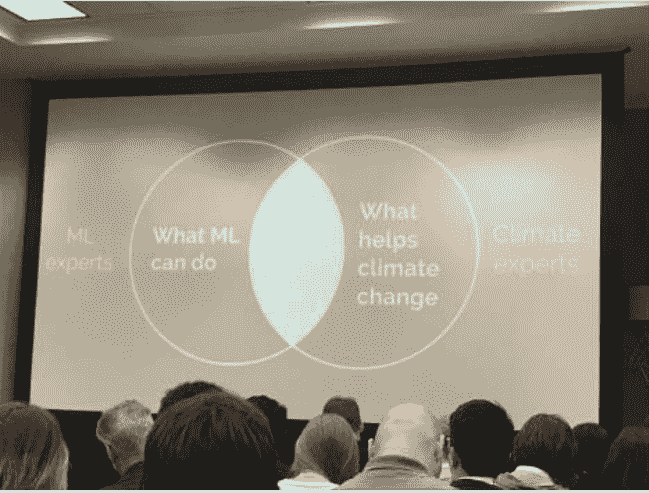

# ICML 2019 会议笔记

## 美国加利福尼亚州长滩

大卫·阿贝尔*  
david_abel@brown.edu  
2019年6月

\*http://david-abel.github.io

## 目录

- 1 会议亮点
- 2 6月10日星期一：教程
- 2.1 教程：PAC-Bayes理论（第二部分）
- 2.1.1 PAC-Bayes理论
- 2.1.2 PAC-Bayes和任务意识
- 2.2 教程：元学习
- 2.2.1 两种视角看待元学习
- 2.2.2 元学习算法
- 2.2.3 元强化学习
- 2.2.4 元学习中的挑战和前沿
- 3 6月11日星期二：主会议
- 3.1 最佳论文报告：挑战学习解耦表示
- 3.2 投稿演讲：深度强化学习
- 3.2.1 DQN和时间离散化 [82]
- 3.2.2 非线性分布梯度TD学习 [67]
- 3.2.3 使用发散校正组合熵策略 [38]
- 3.2.4 TibGM：一种用于强化学习的图模型方法 [2]
- 3.2.5 多智能体对抗逆强化学习 [93]
- 3.2.6 连续强化学习的策略整合 [44]
- 3.2.7 无探索的深度强化学习离线策略评估 [26]
- 3.2.8 随机专家蒸馏 [90]
- 3.2.9 重新审视Softmax Bellman操作符 [79]
- 3.3 贡献演讲：强化学习理论
- 3.3.1 用于高效探索的分布式强化学习 [57]
- 3.3.2 通过重要性采样的乐观策略优化 [62]
- 3.3.3 神经逻辑强化学习 [41]
- 3.3.4 在MDP中学习协作 [68]
- 3.3.5 预测-校正策略优化 [15]
- 3.3.6 通过元逆强化学习学习意图先验 [91]
- 3.3.7 DeepMDP：学习RL的后期空间模型 [30]
- 3.3.8 重要性采样策略评估 [35]
- 3.3.9 从学习者中学习 [40]
- 3.3.10 在时间尺度上分离价值函数 [72]
- 3.3.11 在RL中学习动作表示 [14]
- 3.3.12 贝叶斯对抗风险最小化 [55]
- 3.3.13 每个决策选项计数 [36]
- 3.3.14 RL中问题相关的遗憾界限 [94]
- 3.3.15 正则化MDP的理论 [29]
- 3.3.16 通过最小化覆盖时间来探索选项 [43]
- 3.3.17 策略证书：迈向可追溯的RL [20]
- 3.3.18 行动鲁棒强化学习 [83]
- 3.3.19 值函数多面体 [19]
- 4 6月12日星期三：主会议
- 4.1 投稿演讲：多任务和终身学习
- 4.1.1 领域无关学习与分离表示 [64]
- 4.1.2 强化学习中的值函数组合 [87]
- 4.1.3 CAVIA：快速上下文适应通过元学习 [95]
- 4.1.4 基于梯度的元学习 [45]
- 4.1.5 迈向理解知识蒸馏 [65]
- 4.1.6 可迁移的对抗训练 [53]
- 4.2 贡献演讲：强化学习理论
- 4.2.1 仅通过观察进行可证明高效的模仿学习 [80]
- 4.2.2 死胡同和安全探索 [25]
- 4.2.3 分布式强化学习中的统计和样本 [74]
- 4.2.4 基于Hessian的策略梯度 [78]
- 4.2.5 最大熵探索 [37]
- 4.2.6 结合多个模型进行离线策略评估 [32]
- 4.2.7 使用线性特征的参数化Q学习的样本最优 [92]
- 4.2.8 策略搜索中的样本迁移 [84]
- 4.2.9 探索意识强化学习再探
- 4.2.10 基于核的鲁棒MDP的强化学习 [51]
- 5 6月13日星期四：主会议
- 5.1 贡献演讲：强化学习
- 5.1.1 在约束条件下的批量策略学习 [49]
- 5.1.2 量化强化学习中的泛化能力 [17]
- 5.1.3 从像素中学习潜在动态规划 [34]
- 5.1.4 近似策略迭代的投影 [3]
- 5.1.5 无意识学习结构化决策问题 [39]
- 5.1.6 校准的基于模型的深度强化学习 [56]
- 5.1.7 可配置连续环境中的强化学习 [59]
- 5.1.8 基于目标的时差学习 [50]
- 5.1.9 线性化控制：稳定算法和复杂性保证 [73]
- 5.2 贡献演讲：深度学习理论
- 5.2.1 为什么更大的模型具有更好的泛化能力？[12]
- 5.2.2 关于神经网络的谱偏差 [69]
- 5.2.3 用于模块化深度学习的递归草图 [31]
- 5.2.4 深度网络中的零样本知识蒸馏 [60]
- 5.2.5 通过过度参数化实现深度学习的收敛理论 [4]
- 5.3 最佳论文奖：稀疏高斯过程回归的收敛速度
- 6 6月14日星期五：研讨会
- 6.1 研讨会：人工智能应对气候变化
- 6.1.1 约翰·普拉特关于机器学习如何帮助应对气候变化
- 6.1.2 杰克·凯利：为什么减缓气候变化很困难，如何做得更好
- 6.1.3 安德鲁·吴：通过合作应对气候变化的人工智能方法
- 6.2 研讨会：现实生活中的强化学习
- 6.2.1 小组讨论
- 6.3 研讨会：现实世界的顺序决策
- 6.3.1 Emma Brunskill关于数据成本高昂时的高效强化学习
- 6.3.2 Miro Dudik：通过收缩进行双重稳健的离线策略评估

这份文件包含了我在ICML会议上参加的活动期间所做的笔记，会议地点在美国加利福尼亚州长滩。请随意传阅，并在发现任何拼写错误或其他需要更正的地方时给我发送电子邮件至 david_abel@brown.edu。

## 1 会议亮点

这一轮我大部分时间都在强化学习会议上度过（可惜错过了所有的主题演讲），所以我的反思（和笔记）主要集中在强化学习方面：

- 1. 关于离线策略评估和离线策略学习有很多出色的工作（例如，Hanna 等人的工作[35]，Le 等人的工作[49]，Fujimoto 等人的工作[26]，Gottesman 等人的工作[32]，以及第 6.3 节的演讲）。这些问题设置非常重要，因为我（和许多其他人）预计强化学习应用将会产生大量来自次优策略的数据。
- 2. 探索再次成为热门话题，这是理所当然的（参见 Mavrin 等人的工作[57]，Fatemi 等人的工作[25]，Hazan 等人的工作[37]，Shani 等人的工作[76]）。除了离线评估（和其他一些问题），这是强化学习中的基础问题之一，我们目前正处于一个有望取得重大进展的良好位置。
- 3. 一些非常好的工作继续澄清分布式强化学习[10]（参见[74, 57, 67]的工作）。
- 4. 周五举行的面向气候变化的人工智能研讨会非常棒，参与人数众多（我参加的演讲只有站立空间）。我在之前的会议上也说过这个，但是：众所周知，存在着非常重要的问题，而机器学习的工具在其当前形式下可以非常有效地解决这些问题。
- 5. 我真的认为我们需要在强化学习中标准化评估。并不是说我们只需要一种方法来做评估，或者只需要一个领域，但目前评估协议的差异太大。
- 6. 喜欢 RL for Real Life 研讨会上的小组讨论（见第 6.2.1 节）。

## 2 6月10日星期一：教程

开始了！我来参加 PAC-Bayes 教程的下半场。

### 2.1 教程：PAC-Bayes 理论（第二部分）

演讲者是 Benjamin Guedj 和 John Shawe-Taylor。

第一部分回顾：Shawe-Taylor 和 Williamson [77] 对贝叶斯估计进行了 PAC [86] 分析（也见图 1）。之后不久，McAllester [58] 提出了第一个 PAC-Bayesian 界限：

定理 1（McAllester [58]）：对于任何先验 \(P\)，\(\delta \in (0,1]\)，我们有：

\[
\Pr\left(\forall Q \in \mathcal{H}: R_{out}(Q) \leq R_{in}(Q)+\sqrt{\frac{D_{KL}(Q\|P)+\ln\frac{2\sqrt{m}}{\delta}}{2m}}\right)\geq 1-\delta.
\]

其中 \(\mathcal{H}\) 是假设空间，\(m\) 是样本数量，\(R_{out}\) 是假设在测试数据上的风险，\(R_{in}(h)\) 是假设在训练数据上的风险，\(P\) 是先验概率，\(Q\) 是后验概率。

PAC-Bayes：一个灵活的学习理论框架！与回归、线性分类和支持向量机有紧密联系，用于转导学习，还可以在强化学习中使用[24]，等等。

#### 2.1.1 PAC-Bayes 理论

问：PAC-Bayes 如何推动学习？

答：首先，回顾一下：

\[
R_{out}(Q)\leq R_{in}(Q)+F(Q),
\]

或者：

未见数据上的错误 ≤ 样本上的错误 + 复杂度项。

这定义了一种获得新算法的基本策略：

\[
h\sim Q^*,\quad
Q^*\in \arg\min_{Q\ll P}\{R_{in}(Q)+F(Q)\}.
\]

提出了一个优化问题：可以通过求解或近似求解来找到好的解决方案！

PAC-Bayes 解释了著名算法：

- 使用 sigmoid 损失和 KL 正则化的 AdaBoost 可以重新解释为 PAC-Bayesian 界的最小化器[5]。
- 此外，最小化器为：
\[
\left\{R_{in}(Q)+\frac{KL}{\lambda}\right\}
\]
是著名的 Gibbs 后验分布：
\[
Q_{\lambda}(h)\propto \exp\left(-\lambda R_{in}(h)\right)P(h),\quad \forall h\in\mathcal{H}.
\]

当 \(\lambda\to 0\) 时，我们得到一个平坦的后验分布；当 \(\lambda\to\infty\) 时，我们得到经验风险最小化（ERM）的 Dirac 质量。

定理 2：

\[
\log \int \exp \phi\, dP
=
\sup_{Q\ll P}\left\{\int \phi\, dQ-D_{KL}(Q\|P)\right\}.
\]

证明：首先需要 KL 散度的变分定义[18]：

\[
-D_{KL}(Q\|G)
=
-\int \log\left(\frac{dQ}{dP}\frac{dP}{dG}\right)dQ
=
-D_{KL}(Q\|P)+\int \phi\, dQ-\log\int \exp\phi\, dP.
\]

注意 \(KL>0\)，\(Q\mapsto -D_{KL}(Q\|P)\) 在 \(Q=G\) 时达到最大值。因此，取 \(\phi=-\lambda R_{in}\)：

\[
Q_{\lambda}(h)\propto \exp\left(-\lambda R_{in}(h)\right)P(h),\quad \forall h\in\mathcal{H}.\quad \square
\]

问：非独立同分布数据怎么办？

答：当然！我们放弃独立同分布和有界损失的假设。首先，需要矩：

定义 1（矩）：分布的 \(p\) 阶矩为：
\[
M_p:=\int \mathbb{E}\left[\left|R_{in}(h)-R_{out}(h)\right|^p\right]dP(h).
\]

还可以利用 \(f\)-散度，它是 KL 散度的一般化。

定理 3：对于任意分布 \(Q\)，固定 \(\phi_p:x\mapsto x^p\)，当 \(p>1\)、\(q\) 与 \(p\) 共轭时，以至少 \(1-\delta\) 的概率，对于任意分布 \(Q\)：

\[
|R_{out}(Q)-R_{in}(Q)|
\leq
\left(\frac{M_q}{\delta}\right)^{1/q}
\left(D_{\phi_{p-1}}(Q,P)+1\right)^{1/p}.
\]

要点：我们可以使用 \(f\)-散度（\(D_\phi\)）来限制泛化误差和矩（\(M_q\)）。

证明策略需要：1）Jensen 不等式，2）测度变换，3）Hölder 不等式，和 4）Markov 不等式。

Oracle Bounds：Catoni [13] 推导了 Gibbs 后验的 PAC-Bayesian 界限。

#### 2.1.2 PAC-Bayes 和任务意识

注意：PAC-Bayesian 界限表达了经验准确性和复杂度度量之间的权衡。

问：那么，我们如何改进我们得到的界限呢？我们如何选择合适的先验分布，以便我们可以 1）控制复杂度，和 2）确保良好的性能？

→ 所以：我们能选择一个“更好”的先验分布吗？（不查看测试数据本身？）

主要思想：使用部分数据来学习如何选择先验分布。

可以在支持向量机中使用 PAC-Bayes：

- 假设先验和后验都是球形高斯分布（先验以原点为中心，后验以单位 SVM 权重向量的缩放 \(\mu\) 为中心）。
- 这意味着泛化误差界中的 KL 项为 \(\mu^2/2\)（参见定理 1）。
- 可以计算后验分布的随机误差，它的行为类似于软间隔，缩放 \(\mu\) 在边缘损失和 KL 之间进行权衡。
- 该界对所有 \(\mu\) 都成立，因此选择 \(\mu\) 来优化界限。

问：但是我们如何学习 SVM 的先验知识？

- 界限取决于先验和后验之间的距离。
- 更好的先验意味着更紧的界限。
- 思路：用部分数据学习先验 \(P\)。
- 将学习到的先验引入界限。
- 用剩余数据计算随机误差：PrPAC。
- 可以进一步进行：1）在选择的方向上缩放先验 \(\tau\)-PrPAC，或者 2）调整 SVM 以优化新的界限：\(\eta\)-Prior SVM。

| Problem | Metric | SVM 2FCV | SVM 10FCV | PAC | PrPAC | η-Prior SVM PrPAC | τ-PrPAC |
|---|---|---:|---:|---:|---:|---:|---:|
| digits | Bound | - | - | 0.175 | 0.107 | 0.050 | 0.047 |
| digits | TE | 0.007 | 0.007 | 0.007 | 0.014 | 0.010 | 0.009 |
| waveform | Bound | - | - | 0.203 | 0.185 | 0.178 | 0.176 |
| waveform | TE | 0.099 | 0.086 | 0.084 | 0.088 | 0.087 | 0.086 |
| pima | Bound | - | - | 0.424 | 0.420 | 0.428 | 0.416 |
| pima | TE | 0.244 | 0.245 | 0.229 | 0.229 | 0.233 | 0.233 |
| ringnorm | Bound | - | - | 0.203 | 0.110 | 0.053 | 0.050 |
| ringnorm | TE | 0.016 | 0.016 | 0.018 | 0.018 | 0.016 | 0.016 |
| spam | Bound | - | - | 0.254 | 0.198 | 0.186 | 0.176 |
| spam | TE | 0.066 | 0.063 | 0.067 | 0.077 | 0.070 | 0.072 |

图 2：应用不同的 PAC-Bayes 先验选择方法进行实验的结果。

上述方法收紧边界的结果：见图 2。

结果要点：

- 1. 边界非常紧！
- 2. 通过这些新边界进行模型选择与 10 折交叉验证一样好。
- 3. 最佳边界不一定意味着最佳模型选择。

→ 我们没有完全捕捉到正确的东西（但肯定捕捉到了一些正确的东西）。

接下来是：分布定义的先验：

- 考虑 \(P\) 和 \(Q\) 是 Gibbs-Boltzmann 分布：
\[
P_{\gamma}(h)=\frac{1}{Z}\exp(-\gamma R_{out}(h)),\quad
Q_{\gamma}(h)=\frac{1}{Z}\exp(-\gamma R_{in}(h)).
\]
- 由于我们无法将其应用于单个权重向量，因此这些分布很难处理。

根据 Catoni [13] 的研究，我们可以得出：

\[
D_{KL}\!\left(R_{in}(Q_{\lambda}) \parallel R_{out}(Q_{\lambda})\right)
\lesssim
\frac{1}{m}\left(\gamma/\sqrt{m}+\gamma^2/4m\right),
\]

其中 \(\lesssim\) 忽略了右侧的对数项（Dave：这是我（糟糕的）缩写方式，不是他们的）。关于稳定性：

- 如果样本大小为 \(m\) 时，算法 \(A\) 的敏感性为 \(\beta\)，则可以限制泛化误差[11]。
- 问：算法输出高度集中，是否意味着结果更强大？

→ 是的！我们可以推导出（更紧密的）界限，这取决于分布敏感先验和精心选择的后验之间的 KL 散度。

开放领域！有很大的空间来探索一种新的泛化误差分析方法。

（a）过拟合的经典观点  
（b）新范式？

图 3：过拟合的经典观点（左），以及深度神经网络可能避免过拟合的新提议（右），来自 Belkin 等人[9]。

最后的案例研究：我们能否利用这些来分析深度神经网络？

问：深度学习是否打破了我们所知的统计范式？

→ 在大规模数据集上训练的神经网络实现了零训练误差，这对它们的性能来说并不乐观。然而！它们在测试集上的误差也往往非常低。

思路：也许我们可以使用 PAC-Bayes 来解释这种现象。

Dziugaite 和 Roy [22] 以这种方式推导出了极其紧密的深度学习泛化误差界限；

- 基于扩大“吸引盆地”的训练；
- 因此，不能衡量正常训练的良好泛化。

问：训练集中包含多少信息？

A1：Achille 和 Soatto [1] 研究了深度神经网络权重中存储的信息量。过拟合可能与存储在权重中的编码训练集的信息有关，而不是数据生成分布。

A2：信息瓶颈准则[]可能控制这些信息，并可能导致更紧密的 PAC-Bayes 界限。

## 结论

- PAC-Bayes 起源于两个领域：1）统计学习理论，和 2）贝叶斯学习。
- 广泛推广了这两个领域，并指出了有希望的方向。
- PAC-Bayes 理论可以激发新的理论分析灵感，也可以推动算法设计（特别是当理论证明困难时）。

### 2.2 教程：元学习

演讲者是 Chelsea Finn 和 Sergey Levine。

动机：从少量数据中学习。

→ 最近的进展在大规模多样化的数据集中蓬勃发展，因为它允许广泛的泛化（参见：BERT，AlexNet）。

→ 现有方法需要大量数据集。但是，有一些问题：

- 1. 如果我们没有大型数据集怎么办？
- 2. 如果我们想要一个通用的人工智能系统在世界上怎么办？
- 3. 如果我们的数据呈现长尾分布怎么办？

要点：这些设置开始违反了标准的监督学习设置。

例子：用绘画进行少样本学习，观众能够“推测”出新绘画的画家。

问题：我们如何实现这一点？

回答：嗯，之前的经验！我们并不是没有先前的经验就做到这一点的。我们之前遇到过类似的问题/任务/图像。

问题：我们如何让机器完成这个任务？

回答：嗯，我们可以通过以下方式对结构进行编码：{建模图像形成、几何、任务特定特征、超参数选择} 等等。

要点：我们能否从先前的经验中明确学习到导致有效的下游学习的先验知识？

大纲：

- 问题陈述
- 元学习算法
- 元学习应用
- 元强化学习

#### 2.2.1 两种视角看待元学习

问题：我们如何形式化元学习问题？

A1：机械观点！模型读取整个数据集并对新数据点进行预测。训练这个网络使用一个“元”数据集，它本身由许多数据集组成。

A2：概率观点：从一组（元训练）任务中提取先验信息，以便有效学习任务。学习一个新任务使用这个先验训练集来推断最可能的后验参数。

→ A1 对于实现更方便，A2 对于理解更方便。

定义 2（监督学习）：给定数据 \(D\)，找到参数 \(\phi\)：

\[
\arg\max_{\phi}\Pr(\phi\mid D),
\]

应用贝叶斯规则，得到：

\[
\arg\max_{\phi}\ \log \Pr(D\mid \phi)+\Pr(\phi).
\]

定义 3（元学习）：找到参数 \(\theta\)，使我们能够快速解决新的任务，给定一堆数据集 \(D_{\text{元训练}}\)：

\[
\arg\max_{\phi}\log \Pr\!\left(\phi\mid D,D_{\text{元训练}}\right)
=
\arg\max_{\theta}\log\int_{\Theta}\Pr(\phi\mid D,\theta)\Pr\!\left(\theta\mid D_{\text{元训练}}\right).
\]

也就是说，我们假设 \(\theta\) 是 \(\phi\) 的充分统计量。

通常很难在一般情况下进行这种分解：通常采用最大后验概率（MAP）方法。

元学习的目标：找到一个适当的参数集 \(\theta\)，给定元数据集，使其最大可能性最大化。所以：

\[
\theta^*=\arg\max_{\theta}\log\Pr\!\left(\theta\mid D_{\text{元训练}}\right).
\]

值得注意的是，\(D_{\text{元训练}}\) 可能包含不同的任务（具有相关结构）。

示例：想要对新的数据集进行分类。首先，进行元学习：

\[
\theta^*=\arg\max_{\theta}\log\Pr\!\left(\theta\mid D_{\text{元训练}}\right).
\]

图 4：元学习范式

然后，调整并找到一些附近的参数，\(\phi^*\)：

\[
\phi^*=\arg\max_{\phi}\log\Pr\!\left(\phi\mid D,\theta^*\right).
\]

关键思想：我们的训练过程基于一个简单的机器学习原则：测试和训练条件必须匹配（参见 Vinyals 等人的工作[88]）。

因此，为了使我们上述的元学习概念有意义，我们还需要保留每个训练任务的测试条件。

因此，元学习可以写成：

\[
\theta^*=\max_{\theta}\sum_{i=1}^{n}\log \Pr\!\left(\theta_i\mid D_i^{\text{test}}\right).
\]

密切相关的问题设置：

- 1. 多任务学习：元学习的特殊情况，其中 \(\theta=\phi\)。
- 2. 超参数优化：也可以看作是具有 \(\theta=\) 超参数和 \(\phi=\) 网络权重的元学习。

#### 2.2.2 元学习算法

在讨论算法之前，让我们讨论一下评估。

主要思想：参考 Lake 等人的研究[48]，介绍了 Omniglot 数据集。思路：大量的类别，每个类别只有少量的示例。包含来自 50 个不同字母表的 1623 个字符，每个字符有 20 个实例。

→ 提出了 few-shot 判别和 few-shot 生成问题。最初的 few-shot 学习方法采用贝叶斯模型和非参数方法。其他类似的数据集：CIFAR，CUB，Mini-ImageNet。

## 问题：如何评估元学习算法？

答案：进行常规的元训练，并确定生成的模型是否能够在不同（保留）任务上进行快速泛化。

## 元学习算法的一般步骤

- 1. 选择 \(Pr(\phi_i|D_i^{train},\theta)\) 的形式。
- 2. 选择如何使用 \(D_{\text{meta-train}}\) 来优化 \(\theta\) 的最大似然目标。

方法1：黑盒适应。关键思想是训练一个神经网络来表示 \(Pr(\phi_i|D_i^{train},\theta)\)。

例如，可以使用 RNN 来表示 \(f_\theta\)，给定一组元训练数据集。

然后，我们可以使用标准的监督学习进行训练：

\[
\max_{\theta}\sum_{T_i} L\left(f_\theta\left(D_i^{train},D_i^{test}\right)\right)。
\]

挑战：输出所有神经网络参数似乎不可扩展。但是，我们不需要输出神经网络的所有参数，只需要输出足够的统计信息。

问题：我们如何将其构建为优化过程？

方法2：通过优化获取 \(\phi_i\)：

\[
\max_{\phi_i}\log Pr\left(D_i^{train}\mid \phi_i\right)+\log Pr\left(\phi_i\mid \theta\right)。
\]

元参数 \(\theta\) 作为先验。什么形式的先验？一个成功的形式：从其他任务中学习 \(\theta\)。

目标：学习一个参数向量 \(\theta\)，能够有效地迁移，即使在新任务上进行微调也容易/有用。为此，解决以下问题：

\[
\min_{\theta}\sum_i L\left(\theta-\alpha \nabla_\theta L\left(\theta,D_i^{train}\right),D_i^{test}\right)。
\]

通用算法：

- 1. 采样任务 \(T_i\)。
- 2. 从 \(D_i\) 中采样不相交的数据集。
- 3. 优化 \(\phi_i \leftarrow \theta-\alpha \nabla_\theta L\left(\theta,D_i^{train}\right)\)。
- 4. 使用 \(\nabla_\theta L(\theta,D_i^{test})\) 更新 \(\theta\)。

因此，我们剩下两种方法：优化与黑盒适应。

图5：模型无关元学习。

模型无关元学习（MAML）在优化中可以看作是一个带有嵌入梯度算子的计算图（见图5）：

\[
y^{ts}=f_{\mathrm{MAML}}\left(D_i^{train},x^{test}\right)\tag{8}
\]
\[
=f_{\phi_i}(x^{ts})。\tag{9}
\]

其中
\[
\phi_i=\theta-\alpha \nabla_\theta L\left(\theta,D_i^{train}\right)。
\]

实验：比较 MAML 与黑盒方法（SNAIL、MetaNetworks）。MAML 倾向于在领域适应/外推任务中获得更高性能。

任务是对 Omniglot 数据集中的字符进行一定程度的裁剪，并检查性能衰减。MAML 的性能很少衰减。

问：这种学习结构是否有代价？

答：实际上没有。MAML 函数可以近似任何 \(D_i^{train},x^{test}\) 的函数。假设：\(\alpha\neq 0\)，损失函数不会丢失关于标签的信息，且 \(D_i^{train}\) 中数据点是唯一的。

因此，MAML 具有归纳偏置的好处，而不损失表达能力。

另一种方法：基于概率的优化推理解释。发现：MAML 是一种隐式先验，大致相当于“梯度下降 + 提前停止”，得到一个隐式高斯先验。

Q：可以使用其他形式的先验知识来表达元学习吗？

A：当然可以。可以在学习到的特征上进行贝叶斯线性回归，或者进行闭式/凸优化（如岭回归或逻辑回归）。

挑战：

- 我们如何选择对内部梯度步骤有效的架构？但可以通过渐进式神经架构搜索（使用 MAML）克服这个问题。
- 二阶元优化可能会出现不稳定性。可用解决方案很多：1）仅优化内部子集；2）解耦学习率；3）引入上下文变量。

方法3：非参数方法。在低数据情况下，非参数方法简单且往往效果良好。

在元测试时：少样本学习 \(\equiv\) 低数据情况。在元训练期间，仍希望是参数化的。

Q：我们可以使用产生有效非参数学习器的参数化元学习器吗？

A：可以。通过将测试数据与训练图像进行比较，使用非参数学习器。

关键思想：学习一个度量空间，以便在测试时进行更有效的比较和预测。

要点：每种方法都有一些优点/缺点，详见图6。

图6：不同元学习方法的优点和缺点。

方法4：贝叶斯元学习。

假设我们有参数先验分布 \(Pr(\theta),Pr(\phi_i)\)，我们能够采样 \(\phi_i\sim Pr(\phi_i|x_i^{train},y_i^{train})\) 吗？

简单想法：使用神经网络对 \(h\) 产生一个高斯分布，其中 \(h\) 是网络中的一些相关权重（如最后一层）。

Q：好的，但贝叶斯优化的元学习呢？

A：当然。有很多方法可以实现。一种想法是将 \(Pr(\phi_i|\theta)\) 建模为高斯分布，在训练时进行变分推断（参见 Ravi 和 Beatson [70]）。另一种方法：仅对最后一层进行基于梯度的推断，使用 SVGD 来避免高斯建模假设（参见 Liu 和 Wang [54]）。

关键思想：通过 MAP 推理近似计算
\[
Pr(\phi_i|\theta,x_i^{train},y_i^{train})。
\]
非常粗糙，但非常方便。

进一步阅读：Garnelo 等 [28]，Kim 等 [46]，Ravi 和 Beatson [70]。

应用：

- 视觉：少样本图像生成、图像到图像转换、生成新视角。
- 模仿学习/强化学习：单次逆向强化学习、基于演示的优化推理。
- 语言：适应新程序、适应新语言、适应对话代理的新角色。

## 2.2.3 元强化学习

问：为什么期望元强化学习有用？

答：强化学习的主要挑战几乎都与现有方法的样本低效有关。对于真实机器人，应用 TRPO 可能需要几天或几周才能开始取得进展（如学会行走）。先给一些背景知识。

定义4（马尔可夫决策过程，MDP）：MDP 是一个四元组
\[
\langle\mathcal{S},\mathcal{A},R,P\rangle
\]
其中 \(\mathcal{S}\) 是状态集合，\(\mathcal{A}\) 是动作集合，\(P:\mathcal{S}\times\mathcal{A}\rightarrow Pr(\mathcal{S})\) 表示转移函数，\(R:\mathcal{S}\times\mathcal{A}\times\mathcal{S}\rightarrow \mathbb{R}\) 表示奖励函数。

目标是让代理学习策略 \(\pi:\mathcal{S}\rightarrow\mathcal{A}\)，以最大化长期期望奖励：

\[
\theta^*=\arg\max_\theta \mathbb{E}_{\pi_\theta}\left[R(\tau\mid\pi_\theta)\right]\tag{10}
\]

其中 \(\tau\) 是 \(\pi_\theta\) 产生的轨迹，\(R(\tau\mid\pi_\theta)\) 表示 \(\pi_\theta\) 获得的奖励。

“每个强化学习算法简介”：通过以下方式之一找到 \(\pi_\theta\)：1）直接学习一个好的策略；2）学习一个值函数；3）学习一个模型并用它找到好策略。

迄今为止的元学习：学习 \(\theta\) 使得 \(\phi_i=f_\theta(D_i^{train})\) 在测试 \(D_i^{test}\) 上表现良好。

因此，元强化学习问题如下。

定义5（元强化学习）：具有强化学习目标的元学习问题。即学习
\[
\theta^*=\arg\max_\theta \sum_{i=1}^n\mathbb{E}_{\pi_{\phi_i}}\left[R(\tau\mid\pi_{\phi_i})\right],
\]
其中 \(\phi_i=f_\theta(M_i)\)。

问：那么我们如何生成元训练 MDP \(M_i\)？

答：一个想法是只选择相关任务（比如想要家务机器人，就把 \(M_i\) 定义为小而简单的相关任务）。

现在，一些元强化学习算法：类似监督元学习，也可以基于黑盒方法（这里称为“循环策略”）。

主要问题：我们如何实现 \(f_\theta(M_i)\)，其中 \(M_i\) 是一个 MDP？\(f_\theta(M_i)\) 应该做什么？

A：有几件事：1）通过 \(M_i\) 的经验改进策略；2）选择如何交互（即元强化学习必须决定如何探索）。

这基本上就是运行带 RNN 的元强化学习。

Q：但元强化学习算法如何有效探索？

在这种情况下，这几乎是“免费”的：在训练中优化所有使用轨迹的奖励会导向良好探索。Dave：我个人不认同这一点，需要多读一些。

下一个观点：将元强化学习视为优化问题。标准强化学习将其表述为策略梯度问题：

\[
\theta^*=\arg\max_\theta \mathbb{E}[R(\tau)](\theta),
\]

然后：
\[
\theta^{k+1}\leftarrow \theta_k+\alpha \nabla_{\theta_k}J(\theta)。
\]

下一个方法：部分可观测强化学习的元学习。需要更丰富的环境模型。

定义6（部分可观测马尔可夫决策过程，POMDP）：POMDP 是六元组
\[
\langle S,A,O,P,E,r\rangle
\]
本质上是 MDP，但函数 \(E\) 根据当前状态生成来自 \(O\) 的观测。代理只能感知 \(o\in O\)，而不是状态。

也就是说，代理看不到关于世界的所有相关信息，只能看到基于状态生成的一些观测 \(o\)。

关键思想：解决 POMDP 非常困难，但它类似元学习。寻找策略 \(\pi_\theta(a|s,z)\)，其中我们不知道 \(s\)，只知道 \(z\)。流程如下：1）从 \(\hat p(z_t|s_{1:t},a_{1:t},r_{1:t})\) 采样 \(z\)；2）根据 \(\pi_\theta(a|s,z)\) 行动，假设 \(z\) 是正确的。

关于元强化学习的三个观点：

- 1. 只用 RNN：概念简单易懂，但容易过拟合且难优化。
- 2. MAML 方法：外推能力好，但复杂（需要大量样本）。
- 3. POMDP 方法：简单有效，但也容易过拟合。

但它们并没有那么不同。POMDP 方法实际上只是在 RNN 方法中增加了一个额外隐藏变量，而 MAML 方法只是对 \(f_\theta\) 设计的一种特定选择。

## 2.2.4 元学习中的挑战和前沿

有许多令人兴奋的前进方向，但也面临许多挑战。

- 挑战1：元过拟合。元学习需要任务分布，一些方法可能会对这些任务分布过拟合。
- 挑战2：任务设计。任务分布通常需要手动选择，或不足以鼓励正确行为。很难正确选择任务分布。
- 挑战3：了解哪些算法过拟合。有很多不同方法（黑盒、基于优化、非参数化），但我们不知道哪种最容易受元过拟合影响。

问：我们还能用元学习做什么？

答：可以自动提出用于生成适当任务分布的任务。

“无监督元学习”：指在元训练期间不使用手工指定的任务分布或标签，也能高效解决任务的算法。

- 挑战4：记忆。有些算法可能只会记住相关测试任务的解。
- 挑战5：如何确定哪些任务信息应在输入中、哪些应在数据中？任务分布太广会使探索困难；太窄则不够有代表性。

戴夫：今天必须离开一会儿！

## 3 6月11日星期二：主会议

我今天到了，准备参加最佳论文奖演讲。

### 3.1 最佳论文演讲：挑战学习中的无监督解缠表示

弗朗西斯科·奥利维尔·巴赫姆的演讲。

> 核心问题：我们能否以纯无监督的方式学习解缠表示？

背景：表示学习。考虑一幅风景图像。表示学习目标是学习函数 \(f:X\rightarrow\Phi\)，将每个感兴趣对象（如图像）映射为一组捕捉重要特征的表示。

问题：我们希望表示具备什么性质？

答案：很多。但一个关键想法是解缠表示。

> 定义7（解缠表示）：因素的单一变化应导致表示的单一变化。

例子：场景中放置几何形状，每个形状有不同颜色/形状/大小。如果我们改变原图一个关键方面（如正方形颜色或大小），表示也应以唯一方式改变。

重点：无监督学习来解缠表示（关键在于不能观察到真实变化因素）。

> 贡献：
- 1. 理论结果：对任意数据，无监督学习解缠表示是不可能的。
- 2. 大规模实验研究：我们能否在不看标签情况下学习解缠表示？

可以调和且仍然有效：定理是关于最坏情况数据。真实数据可能具有合适结构，仍可学习这些解缠表示。

实验：6 种方法，7 个数据集，6 个度量，产生 10,000 个训练模型和 150,000 个分数。

需要关注的问题：

Q1：应该使用哪种方法？

Q2：如何选择超参数？

Q3：如何从一组训练模型中选择最佳模型？

### 实验结果

- 1.（回答 Q1 的方向）随机种子和超参数似乎比目标函数的选择更重要。
- 2.（回答 Q2 的方向）无法确定可作经验法则的明显趋势（但任务间迁移似乎有帮助）。超参数在不同数据集和度量间迁移似乎并无显著影响。
- 3.（回答 Q3 的方向）无监督模型选择仍是关键挑战。

含义：来自糟糕超参数设置的“好运行”很容易超过来自良好超参数设置的“差运行”。

### 主要要点

- 归纳偏置和监督的作用应明确说明。
- 应展示解缠的具体实际好处。
- 具有多个数据集的可靠、可复现实验设置至关重要。
- 代码：https://github.com/google-research/disentanglement_lib/ 。还发布了 10,000 个预训练模型。

### 3.2 投稿演讲：深度强化学习

接下来是 5 分钟贡献演讲。它们非常短，所以我猜我会更难转录。

#### 3.2.1 DQN 和时间离散化 [82]

演讲者：Corentin Tallec。

要点：在深度强化学习中，时间离散化确实很重要。

常规强化学习算法在高帧率下会失败。可扩展性通常受算法限制；更好的硬件、传感器、执行器会带来新的超参数问题。

问：为什么近似连续的 Q-learning 会失败？

答：随着 \(\delta_t\)（时间离散化）变化，\(Q^\pi(s,a)\rightarrow V^\pi(s)\)。因此在极限情况下，\(Q\) 不再依赖动作，无法进行策略改进。

问：能解决吗？

答：可以。可以重新审视这些量并形成新算法（详见论文）。

#### 3.2.2 非线性分布梯度 TD 学习 [67]

演讲者：Chao Qu。

背景：分布式强化学习考虑长期回报的随机性 \(Z(s,a)\)。

这项工作：考虑梯度 TD 学习的分布对应。性质：

- 在离策略（off-policy）下收敛。
- 在非线性函数逼近下收敛。

新算法：分布式 GTD2。使用“分布时序差分”替代 GTD2 的时序差分。

定理4：在温和假设下，分布式 GTD2（D-GTD2）在极限中收敛。

实验：证明 D-GTD2 的确收敛。

#### 3.2.3 使用发散校正组合熵策略 [38]

演讲者：Jonathan Hunt。

问：人们如何同时解决像杂耍和独轮车这样的复杂运动控制任务？

答：也许我们倾向于独立学习每个任务，然后将它们组合。

注意：不是像 options 那样先做 A 再做 B，而是一个新的 \(A\circ B\) 任务。

问题：给定训练任务 \(T_1\) 和 \(T_2\)，我们想解决组合任务 \(T_b=T_1+T_2\)。

先前工作：广义策略改进 [8] 和组合乐观主义 [?]。

将现有思想应用于这种迁移设置：

- 1. 后继特征
- 2. 广义策略改进
- 3. 发散校正

在连续动作空间中组合任务的新算法。

#### 3.2.4 TibGM：一种用于强化学习的图模型方法 [2]

演讲者：Tameem Adel。

起源：使用图模型方法增强可迁移泛化，并提供精确目标与清晰解释。

通过提出信息论目标实现：最大化“局部”奖励和更全局度量（与迁移相关）。

贡献：

- 基于图模型。
- 证明了新目标与典型奖励最大化目标之间的对应关系。
- 基于信息论的预训练过程，重点在探索。
- 在 16 个基准任务上取得 SOTA 结果。

#### 3.2.5 多智能体对抗逆强化学习 [93]

演讲者：Lantao Yu。

动机：强化学习代理性能依赖奖励函数质量。

但设计正确奖励函数很困难。

一个解决方案：从专家示范学习奖励函数（如模仿学习）。

问：为什么要关心奖励学习？

答：一些优势：1）科学探究（理解动物行为）；2）奖励函数是任务最简洁、最稳健、最可迁移的描述；3）若要在新环境重新优化策略，它很有帮助。

在多智能体环境中，这些特性更可取。

> **定义8（单智能体逆强化学习）**：找到一个解释专家行为的奖励函数。

但是这很难：太多奖励函数可以解释同一行为。

将该设定推广到多智能体，使用马尔可夫博弈：

> **定义9（马尔可夫博弈）**：MDP 的多智能体推广 [52]。

马尔可夫博弈的解概念是纳什均衡：

> **定义10（纳什均衡）**：当没有代理能通过改变自身策略而获得更高期望回报时。

方法：引入逻辑随机最优响应均衡（LSBRE），优化伪似然目标。

实验：策略模仿性能。新方法在合作/沟通和竞争任务中达到 SOTA。

总结：马尔可夫博弈的新解概念，引发了新的兴趣度量。提出了首个多智能体最大熵逆强化学习框架。

#### 3.2.6 连续强化学习的策略整合 [44]

动机：神经网络中的灾难性遗忘。网络倾向于忘记先前任务信息。

即使在连续学习中，RL 也会发生该问题，因为探索/策略变化导致观测状态分布随时间改变。

代理需要应对：数据分布的离散与连续变化。

贡献：策略整合代理。一组代理通过 PPO 训练，并通过 KL 教师强化损失连接。

最终存储策略是对其他所有训练策略蒸馏后的结果，确保其不会偏离先前性能过多。

实验：通过交替任务探索遗忘影响，发现其算法优于所有其他 PPO 变体。

未来工作：

- 1）研究如何在训练中优先保留重要记忆；
- 2）适应离线学习。

#### 3.2.7 无探索的深度强化学习离线策略评估 [26]

考虑：使用相同的离线策略算法（DDPG）在相同的数据集上采用两种不同的方法（橙色和蓝色）。

代理：1）橙色——与环境交互（标准强化学习循环）；2）蓝色——仅使用环境数据但不实际交互！然而，它们的性能是不同的。

问：为什么它们会有所不同？

答：外推误差：\(Q(s,a)\leftarrow r+\gamma Q(s',a')\)，其中 \((s,a,r,s')\) 来自数据集。基本上，你可能会有一个糟糕的目标 \(Q(s',a')\)。

> 定义11（外推误差）：试图在没有足够访问 \((s,a)\) 对的情况下评估 \(\pi\)。

解决方案：批量约束强化学习：只选择 \(\pi\)，以便选择数据集中的 \((s,a)\) 对并最大化性能。

→ 新算法：批量约束深度Q学习（BCQ）。

- 1. 通过生成模型模仿数据集  
- 2. \(\pi(s)=\arg\max_a Q(s,a)\)  
- 3. 加入一些额外的魔法

发现BCQ在性能上大大优于一些现有方法（DDPG），而且非常稳定。

#### 3.2.8 随机专家蒸馏 [90]

王若涵的演讲。

> 定义12（模仿学习）：从有限的专家演示中进行策略学习。

有用的原因：直观且高效的技能转移，可以捕捉个体演示者的风格/偏好。

→ 最近的IRL框架：生成对抗模仿学习（GAIL）。

但是，优化挑战有：1）训练不稳定性，和2）样本效率低。

主要贡献：随机专家蒸馏（RED）。使用专家策略的估计支持作为奖励的模仿学习框架。

基于新的奖励函数优化新的轨迹损失，并证明在极限情况下它近似正确。

实验1：在MuJoCo中，相比于GAIL等其他方法，找到高训练稳定性和良好的样本效率。

实验2：使用人类行为作为训练数据的自动驾驶任务。代理学习跟随训练者的偏好（速度、车道偏好等）。

#### 3.2.9 重新审视 Softmax Bellman 操作符 [79]

演讲者是赵松。

回想一下，贝尔曼算子是一个收缩映射。

→ Mellowmax算子[7]也是一个收缩映射：

\[
\max_{a'}Q(s',a') \rightarrow \sum_{a'} \frac{\exp(\tau Q(s',a'))}{\sum_b \exp(\tau Q(s',b))}
\]

问题：softmax真的像酸牛奶一样糟糕吗？（感谢Ron Parr）。

思路：将DDQN的目标网络中的max函数与softmax相结合。

→ 导致SQDN的出现，在大多数Atari游戏中获得比DQN更高的分数。

因此：有必要对softmax进行分析！

定理5：分析表明，良好的性能、收敛保证、较小的误差、降低边界，以及过高估计误差与 \(\tau\)（逆温度）单调增加。

### 3.3 贡献演讲：强化学习理论

更多强化学习！

#### 3.3.1 用于高效探索的分布式强化学习 [57]

由Hengshuai Yao演讲。

要点：强化学习中存在许多不确定性来源——估计（在有限数据情况下），但也有其他因素，如环境随机性、游戏中对手的玩法等。

→ 基于不确定性的探索策略：不确定性下的乐观主义。在多臂赌博机中，根据以下选择臂：

\[
a=\arg\max_k \hat{\mu}_k+c_k,
\]

其中 \(\hat{\mu}_k\) 是估计的平均回报，而 \(c_k\) 是对该估计不确定性的某种度量（类似于UCB）。

但是，使用天真的探索奖励并不总是有效：永远偏爱具有高内在不确定性的动作。

新的想法：在面对不确定性时使用乐观主义，在不确定性的权重上执行衰减计划。这确保随着收集到更多证据，代理开始更多地进行利用。

#### 3.3.2 通过重要性采样的乐观策略优化 [62]

Matteo Papini的演讲。

问题：策略优化。

- 参数空间 \(\Theta \subseteq \mathbb{R}^d\)
- 每个 \(\theta\in\Theta\) 对应一个参数化策略
- 每个策略引发一种分布。关于轨迹的 \(R(\tau)\) 回报。
- 目标是找到最大化预期回报的参数：

\[
\max_{\theta\in\Theta}\mathbb{E}[R(p_\tau\mid \theta)].
\]

然而，挑战在于探索是困难的！

问：如果我们将其视为多臂赌博机怎么办？

那么：

- 臂：参数 \(\theta\)
- 回报：预期回报 \(J(\theta)\)
- 实际上是连续多臂赌博机
- 通过轨迹分布利用臂之间的相关性
- 使用重要抽样更新候选策略的回报

主要结果：新算法“OPtimist”具有次线性遗憾：

\[
\text{Regret}(T)=\tilde{O}(\sqrt{dT}).
\]

代码：https://github.com/wolfLo/optimist

#### 3.3.3 神经逻辑强化学习 [41]

演讲由Shan Luo主持。

深度强化学习的两个主要挑战：1）我们如何将从一个任务中学到的策略推广到另一个任务？2）我们如何解释这些学到的策略？

方法：使用背景知识来学习概念和关系，例如 \(grandfather(x,y)\)。为此，使用可微分的归纳逻辑编程。

\(\rightarrow\) 思路：使用策略梯度学习逻辑规则（一种新的架构，DILP，使用REINFORCE进行训练）。

实验：对于许多设置，与MLP代理（基准）相比，获得高奖励。

#### 3.3.4 在 MDP 中学习协作 [68]

演讲由Goran Radanovic进行。

动机：人工智能与人类的合作——考虑一个辅助AI帮助人们解决某个任务。

\(\rightarrow\) 这些代理可能有共同的目标，但在某种程度上以不同的方式看待任务。

形式化模型：双代理MDP，代理有承诺。

\(\rightarrow\) 目标是设计一个学习算法（对于第一个非人类AI），以实现次线性遗憾。

挑战：从A1的角度来看，由于A2（人）的存在，世界看起来像是一个非平稳的MDP。

主要贡献：基于最新性偏见的“双专家”算法，针对这种情况进行了改进。

定理6（主要结果）：该算法的遗憾值以 \(O(T^{\frac{1}{4}})\) 的速度衰减。

## 3.3.5 预测-校正策略优化 [15]

由Ching-An Cheng发表的演讲。

问题：情节式策略优化。因此，代理人试图优化某个策略 \(\pi(a\mid s)\)，以实现高回报。

→ 一个目标：样本效率。在任何真实交互之前，我们应该花时间进行规划/思考。

问：为什么我们应该使用模型？

答：可以总结过去的经验，可以更加样本高效，并且可以在没有真实世界交互的情况下高效优化策略。

问：为什么不使用模型？

答：嗯，模型总是不精确的！模型的弱点可以被利用来优化策略。

问：我们能否调和这两个阵营？

答：当然！这篇论文：PicCoLO（见演讲标题）。基于“不应完全信任模型，而只利用正确的部分”的思想，提出了一种元算法。

→ 如何实现这一目标？

- 将策略优化框架化为可预测的在线学习（POLL）
- 设计了一种基于规约的算法来重用已知算法
- 将其翻译回来后，得到了一种策略优化的元算法

在线学习：考虑一个学习者和一个对手，学习者每隔一段时间选择一个决策 \(\pi_n\in\Pi\)。对手选择一个损失函数来最小化性能，反复进行。

→ 常见的性能度量是遗憾。思路：将策略优化定义为在线学习过程。

→ 算法上：可以尝试典型的无遗憾算法（镜像下降），但不是最优的！希望学得更快。因此，将可预测性视为预测未来梯度的能力。引入以下模型：

定义13（预测模型）：一个估计未来损失梯度的函数  
\[
\Phi_n(\pi)\approx \nabla \ell_n(\pi)
\]

现在，基于这个可预测性模型开发一个算法。

→ 希望从可预测性转向在线学习。这就是PicCoLO！

假设我们有一个可预测的学习问题，思路是将其转化为对抗性问题。所以：

\[
\ell_n(\cdot)=\hat{\ell}_n(\cdot)+\Delta_n(\cdot),
\]

这是一个预测损失（第一项）和误差（第二项）的组合。戴夫：我没听清楚第二个误差来源是什么。

PicCoLO：两个步骤——1）预测步骤（\(\pi_n=\hat{\pi}_n-\eta_n\hat{g}_n\)），2）修正步骤（\(\pi_{n+1}=\eta_n(g_n-\hat{g}_n)\)），其中 \(g\) 是回报。

实验：在MuJoCo任务上将PicCoLO与其他各种算法进行比较。

总结：

- PicCoLO可以使无模型算法更快，但没有偏差
- 预测模型可以被视为注入先验的统一接口
- 由于PicCoLO是为一般可预测的在线学习而设计的，我们期望将其应用于其他问题和领域

#### 3.3.6 通过元逆强化学习学习意图先验 [91]

Kelvin Xu的演讲。

动机：我们经常假设我们有一个明确定义的奖励函数！

问：一个代理如何从一个或少数几个演示中推断奖励？

→ 这项工作：使用以前任务的演示来引导可以在新任务中使用的任务先验。

主要思想：利用先前任务的信息加速逆向强化学习。

→ 建立在MAML的基础上（参见元学习教程！）。

实验：Sprite世界环境和第一人称导航任务。在这两种情况下，从元训练任务中学习任务先验，并在测试任务中快速学习。

→ 结果：即使只给出少量示范，表现也非常好。

## 3.3.7 DeepMDP：学习RL的潜在空间模型 [30]

Carles Gelada的演讲。

目标：为强化学习找到简单的表示。

方法：学习一个潜在空间模型 \(M=\langle\mathcal{S},\mathcal{A},R,\mathcal{T}\rangle\)。基于两个损失函数：

\[
R(s,a)\approx R(s,a),\ \forall s,a
\]
\[
T(s' \mid s,a)\approx T(s' \mid s,a),\ \forall s,a,s'
\]

利用这些损失函数，确保 \(\phi\) 是一个好的表示，即只丢弃坏/无用的策略。

实验1：甜甜圈世界。一个圆的图像。嵌入函数最终找到了一个类似的表示。

实验2：Atari与C51，找到超越基准的改进。

#### 3.3.8 重要性采样策略评估 [35]

Josiah Hanna的演讲。

注意：最近有很多实证强化学习的成功案例！

但是：要使强化学习成功，我们必须问：“强化学习代理如何从少量经验中获得最大收益？”

核心贡献：研究强化学习策略评估子问题中的重要采样。更具体地说：用估计值替换重要采样的分母，并通过实证和理论证明这是合理的。

强化学习中的典型重要采样：

\[
\text{OIS}(\pi,D)=\frac{1}{m}\sum_{i=1}^{n}\prod_{t=0}^{L}\frac{\pi(a_t\mid s_t)}{\pi_D(a_t\mid s_t)}\sum_{t=0}^{L}\gamma^t R_t
\]

他们用行为策略性能的MLE估计值替换了分母：

\[
\text{New-IS}(\pi,D)=\frac{1}{m}\sum_{i=1}^{n}\prod_{t=0}^{L}\frac{\pi(a_t\mid s_t)}{\hat{\pi}_D(a_t\mid s_t)}\sum_{t=0}^{L}\gamma^t R_t
\]

论文提供了理论和实验证明这是一件好事。

#### 3.3.9 从学习者中学习 [40]

Alexis Jacq的演讲。

目标：通过观察他人学习来学习最佳行为。

假设：学习是优化一个正则化目标函数：

\[
J(\pi)=\mathbb{E}_{\pi}\left[\sum_t \gamma^t\left(r(s_t,a_t)+\alpha H(\pi(\cdot\mid s_t))\right)\right].
\]

状态动作对的值由正则化贝尔曼方程的不动点给出。

此外，softmax是策略的改进（参见Haarnoja等人[33]）。

实验：在MuJoCo上找到改进。

#### 3.3.10 在时间尺度上分离价值函数 [72]

Joshua Romoff的演讲。

多步回报：

\[
G_t^k=\sum_{i=0}^{k-1}\gamma^i r_{t+1}+\gamma^k V(s_{t+k}).
\]

可以选择 \(k\) 在偏差-方差之间进行权衡。或者，\(\lambda\) 返回值：

\[
G_t^\lambda:=(1-\lambda)\sum_{k=1}^{\infty}\lambda^{k-1}G_t^k.
\]

许多任务都是折扣的：当 \(\gamma\rightarrow 1\) 时，训练 \(V_\gamma\) 很难。

问：为什么使用折扣因子？

答：嗯，这使问题变得更简单。只考虑未来几个奖励，所以代理可以更容易地学会做出决策。

\(\rightarrow\) 但是，会增加很多偏差！有时我们并不真正关心早期奖励。

退一步：理想的强化学习代理应该怎么做？它会快速学会做得好！理想情况下：希望1）使用一个大的折扣因子进行学习，但是2）建立在计算和样本效率高的方法之上。

解决方案：定义一系列 \(\gamma\) 值：

\[
\Delta:=\{\gamma_0,\gamma_1,\ldots,\gamma_Z\},
\]

其中 \(\gamma_i\le \gamma_{i+1},\forall i\)。

然后，使用这个 \(\gamma\) 序列形成一系列贝尔曼方程：

\[
W_0:\ r_t+\gamma_0 W_0(s_{t+1}) \qquad (13)
\]

\[
W_{i>0}:\ (\gamma_i-\gamma_{i-1})V_{\gamma_{i-1}}(s_{t+1})+\gamma_i W_i(s_{t+1}) \qquad (14)
\]

算法：TD(\(\Delta\))，等同于标准的TD(\(\lambda\))。

分析：在一些条件下，等同于标准的TD(\(\lambda\))。

- 那么，为什么要做这个新的、有序的事情呢？
- 嗯，使用线性函数逼近时是等价的。并且：1）每个 \(W\) 使用相同的学习率，2）每个 \(W\) 使用相同的 \(k\) 步长、\(\gamma\) 和 \(\lambda\)。
- 当然，不必以相同的方式设置这些参数。

可以将TD(\(\Delta\))扩展到深度强化学习：1）共享网络多个输出，2）按照描述训练 \(W\)，3）使用 \(W\) 的相同值而不是 \(V\) 的值。

实验：在Atari上进行测试，将TD(\(\Delta\))与PPO和PPO+（PPO加上额外参数）进行对比。

\(\rightarrow\) 通过绘制值函数进一步探索TD(\(\Delta\))的学习内容。

他们没有尝试的事情（但我们应该尝试！）：

- 添加更多 \(W\)
- Q-learning扩展（他们尝试的都是on-policy方法）
- 值函数的模型架构：可以尝试使用更少的参数等
- 分布式变体

#### 总结

- 1. 基于 \(\gamma\) 分解价值函数
- 2. 使用贝尔曼方程进行训练
- 3. 提高样本效率

## 3.3.11 在RL中学习动作表示 [14]

Yash Chandak的演讲。

问题：考虑具有数千个可能动作的强化学习问题！（应用可能是医疗治疗、广告或投资组合管理）。

→ 可能通过学习选项[81]来捕捉这一点，但通常会导致学习太多的选项。

问：我们如何学习良好的动作表示，而不是学习太多？

关键见解：

- 动作不是独立的离散量
- 它们的行为具有低维结构
- 可以独立于奖励学习这种结构
- 因此，代理可以在这种新的行为空间中行动，行为可以推广到类似的动作

新算法：1）监督学习动作表示；2）使用策略梯度学习这些表示的内部策略。

实验：将算法应用于各种具有丰富行动空间的领域（例如Photoshop中的推荐），获得一致良好的性能。

#### 3.3.12 贝叶斯对抗风险最小化 [55]

本次演讲由本·伦敦（Ben London）进行。

问题：从已记录的数据中学习以推荐音乐。

挑战：

- 反馈是强盗反馈，因此只能从选择的行动中学习
- 数据基于选择的记录策略存在偏差

→ 一种抵消这种偏差的方法是使用倒数倾向性评分：

\[
\arg\min_{\pi}\frac{1}{n}\sum_{i=1}^{n}-r_i\frac{\pi(a_i\mid x_i)}{p_i}.
\]

还可以使用方差正则化，从而产生反事实风险最小化（CRM）原则：

\[
\arg\min_{\pi}\frac{1}{n}\sum_{i=1}^{n}-r_i\frac{\pi(a_i\mid x_i)}{p_i}+\lambda\sqrt{Var(\pi,S)}.
\]

→ 受PAC分析启发，确保低泛化误差。

本研究：CRM的贝叶斯视角（受PAC-Bayes分析启发），得出了一个很好的泛化误差界限。

→ 应用于混合逻辑。

#### 3.3.13 每个决策选项计数 [36]

本次演讲由安娜·哈拉图尼安（Anna Harutyunyan）进行。

动机：能够在长时间范围内进行推理的智能体。但是：时间范围取决于 \(\gamma\) 的选择。

问：也许我们可以用选项[81]来做到这一点吗？

答：但是，它并不能真正处理不同的时间范围。

主要贡献：将选项框架推广到允许每个选项折扣。

→ 也就是说，添加每个决策选项的折扣 \((\gamma^r,\gamma^p)\)。

在这个框架中，他们确定了由这些新折扣捕捉到的偏差-方差权衡。

## 3.3.14 RL中问题相关的遗憾界限 [94]

Andrea Zanette的演讲。

重点：在情节式的表格强化学习中进行探索。

→ 最先进的遗憾界限：

- 没有智能探索：\(\tilde{O}(T)\)
- 高效探索：\(\tilde{O}(HSA T)\)
- 下界以下：问题相关！

主要结果（需要价值的方差和奖励的缩放）：

定理7：高概率下，可以实现遗憾为问题相关界（含 \(Q^*\) 项）。

其中 \(Q^*\) 是一个问题相关的项。

回答了Jiang和Agarwal 2018年（COLT）的一个开放猜想：任何算法在目标驱动的MDP中都必须遭受遗憾。

→ 还探讨了随机性对遗憾的影响。

#### 3.3.15 正则化 MDP 的理论 [29]

Matthieu Geist 的演讲。

动机：许多深度强化学习算法使用正则化，但没有关于如何在强化学习中进行正则化的通用理论。

→ 这项工作以两种方式推广了强化学习中的正则化：

- 更大的正则化类别
- 一般的修改策略迭代方案

设 \(\Omega: \Delta_A \to \mathbb{R}\) 为一个强凸函数。凸共轭是一个平滑的最大值：

\[
\forall q_s \in \mathbb{R}^A,\ \Omega^*(q_s)=\max_{\pi_s\in\Delta_A}\langle \pi_s,q_s\rangle-\Omega(\pi_s).
\]

因此，我们可以对贝尔曼方程进行正则化：

\[
T_{\pi,\Omega}[V]=T_\pi[V]-\Omega(\pi). \quad (15)
\]

正则化贝尔曼算子具有与原始算子相同的性质：1）\(T_{\pi,\Omega}\) 是仿射的，2）单调性、分配性和 \(\gamma\)-收缩性。

→ 引入一种新的算法方案：正则化策略改进，并证明以下结果：

定理 8：经过 \(k\) 次 reg-MPI 迭代，损失是有界的。

→ 还可以使用这个理论来描述 RL 中现有的正则化方法（如 TRPO、DPP 等）。

#### 总结

- 弥合了动态规划和优化之间的一些差距
- 引入了时间一致性方程，与熵一样
- 可以将现有的正则化方法推广到正则化策略梯度

#### 3.3.16 通过最小化覆盖时间来发现探索选项 [43]

Dave：现在，我们的论文！演讲由 Yuu Jinnai 进行。

目标：选择对探索有效的选项。

#### 贡献

- 引入了一种称为覆盖时间的探索目标函数（见下文）
- 通过最小化覆盖时间上界来发现选项的算法

→ 基于 MDP 图，计算图拉普拉斯诱导图的 Fiedler 向量，使用它来最小化覆盖时间。

定义 14（覆盖时间）：访问每个状态所需的预期步数。

定理 9：覆盖时间的上界得到改进。

通过对不同类型选项的学习性能进行实证比较，进行了对比实验。

#### 3.3.17 策略证书：迈向可追溯的 RL [20]

Christoph Dann 的演讲。

主要贡献：针对情节式表格 MDP 的新算法，具有以下特点：

定理 10：PAC 界限；以及相应的匹配后悔界限。

然而，动机是问责制，而不一定是样本效率。

问：我的治疗效果如何？它是最好的吗？

→ 什么样的方法可以回答这些问题？

主要思想：引入策略证书以增加问责制。

定义 15（策略证书）：最优和算法性能的置信区间。

→ 模型基于乐观算法的自然扩展。

挑战：\(Q^\pi\) 是随机的，因此很难计算其置信区间。但是，从乐观主义中我们知道 \(Q^\pi \to Q^*\) 以已知速率收敛，因此可以对这个量进行界定。

两个主要好处：

- 通过准确的策略证书实现更可靠的算法
- 更好的探索奖励可以得到最小化的 PAC 和遗憾界限

#### 3.3.18 行动鲁棒强化学习 [83]

陈特斯勒的演讲。

目标：在强化学习/马尔可夫决策过程中实现鲁棒性。考虑突然中断、高度随机的问题等情况。

→ 因此，研究鲁棒 MDP，将算法引入为两个玩家的对抗性游戏中的一方，并保证收敛到纳什均衡。

→ 基于这个鲁棒 MDP 算法提出了一种深度强化学习变体，在 MuJoCo 上进行实验。

#### 3.3.19 值函数多面体 [19]

罗伯特·达达什的演讲。

核心问题：我们能否描述给定 MDP 的可能价值函数空间的几何特征？

为什么要问这个问题？

- 策略空间和价值函数空间之间的关系
- 更好地理解现有算法的动态
- 强化学习中表示学习的新形式

主要结果：给定 MDP 的值函数空间的几何结构是什么？

定理 11：值函数的集合是（可能非凸的）值多面体。

构建模块：1）线定理（类似策略混合的值函数描述值函数空间中的一条线），以及 2）边界定理（Dave：错过了解释）。

未来的工作：RL 的新表示学习方案，新的 Actor-Critic 算法。

Dave：周二就到这里吧！

## 6月12日星期三：主会议

白天（实际上是下午）以多任务/终身学习的贡献演讲开始。

### 4.1 投稿演讲：多任务和终身学习

大多数演讲将再次是五分钟，有几个是 20 分钟。

#### 4.1.1 领域无关学习与解缠表示 [64]

Xingchao Peng 的演讲。

思路：在领域发生变化时进行监督学习。

→ 在应用中有很好的动机（许多情况下，训练数据与真实任务不同）。

定义 16（领域自适应）：在一些源领域上进行训练 \(P_S(X_S,Y_S)\)，使用大量标记数据，然后在目标领域上进行测试 \(P_T(X_T,Y_T)\)。

例子：在经典全彩图像上进行图像识别，然后迁移到草图识别，其中一些可能是黑白的。

许多相关工作 [75,27,85]。

新方法：深度对抗解缠自编码器（DADA）。

- 类解缠：将特征解缠为与类别无关且领域不变的特征
- 领域解缠：将特征解缠为领域特定且领域不变的特征

例子：类别不变性 vs. 领域不变性。

→ 领域不变性：给定两个图像，一个是真实汽车图像，一个是汽车绘画图，将它们都输入某个神经网络会产生一些特征。原则上，这些特征应该是领域不变的，因为它们在这两种汽车表现中都存在。

→ 类不变性：看看汽车的背景，这将产生类不变特征，因为它们可以识别不同类别。

类解缠：使用以下损失训练类别识别器：

\[
L_{ce}=\mathbb{E}_{x,y}\left[\sum_{k=1}^{K}\mathbf{1}\{k=y\}\log C(f_D)\right].
\]

为域解缠创建类似的损失（和架构部分）：

\[
L_{vae}=\|\hat f_G-f_G\|^2+D_{KL}(q(z\mid f_G)\|p(z)).
\]

实验：三个基准测试：1）5 位数数据集，2）Office 领域，3）DomainNet。每个数据集都包含各种领域和类别。

→ 发现：新模型（DADA）在这些数据集上的平均性能比 SOTA 提高了 6%。

#### 4.1.2 强化学习中的值函数组合 [87]

Steve James 的演讲。

核心问题：我们能否将来自不同任务的价值函数相结合，在无需进一步学习的情况下解决有趣的任务组合？

一般来说，考虑技能 \(Q_1\) 和 \(Q_2\)。通常，我们看到 \(Q_1\oplus Q_2=\ominus\)。

这项工作：考虑熵正则化强化学习：

\[
r_{ent}(r,s)=r(s,a)-r\,D_{KL}(\pi_s\mid \bar\pi_s).
\]

通过熵正则化强化学习，我们证明了：\(Q_1\oplus Q_2=\prec\)。

思路：OR 任务组合。可以最优地组合 \(Q(\square)\) 和 \(Q(\circ)\) 来解决收集 \(\square\) OR \(\circ\) 的任务。

推论：在极限情况下，证明
\[
Q(\circ\ \mathrm{OR}\ \square)=\max\{Q(\circ),Q(\square)\}.
\]

实验：智能体应拾取一些物体，在只需要拾取一种类型的任务中训练，然后在“任意一种类型都可以”的情况下测试。

#### 总结

- 可以进行零样本组合，以确保找到 OR 任务的解决方案
- 在实验中表现良好

#### 4.1.3 CAVIA：通过元学习实现快速上下文适应 [95]

Luisa Zintgraf 的演讲。

思路：元学习用于快速适应——学习如何将 \(x\) 映射到新任务上的 \(y\)，快速且数据量少。

→ 早期方法：MAML（参见元学习教程）。

新算法：CAVIA（通过元学习实现快速上下文适应）——1）不易过拟合，2）可解释。

→ 许多任务和当前基准只需要任务识别。许多参数和少量数据点可能导致过拟合。

实验 1：正弦曲线实验。任务由学习振幅和相位定义。MAML 需要 1500 个参数，而 CAVIA 只需要 2 个上下文参数。

→ 上下文参数可解释，并且可以在任务之间重复使用。

实验 2：mini-ImageNet 实验。随着网络变得更加复杂，MAML 需要 30000 个参数，而 CAVIA 只需要几百个。

#### 4.1.4 基于梯度的元学习 [45]

Mikhail Khodak 的演讲。

Q1：元学习算法可以利用哪些任务关系？

Q2：使用如此简单的方法是否限制了我们自己？

Q3：元学习与经典多任务方法有什么关系？

这项工作：在凸情况下回答这些问题。答案：

- 如果最优任务参数彼此接近，则每个任务的平均性能更好
- 在没有更强任务相似性假设的情况下，GBML 是我们能做的最好的
- GBML 与正则化多任务学习之间存在自然联系

主要策略：与在线凸优化的联系。

→ 考虑标准的基于梯度的方法。选择第一个初始化 \(\phi_1\in\Phi\)，然后对于任务 \(t=1,\dots,T\)：1）运行 \(m\) 步 SGD；2）Dave：错过了。

然后可以从在线凸优化中导入保证，具体来说是从初始化距离编码的遗憾保证。

主要结果：

定理 12：GBML 的平均遗憾为
\[
O\left(D+\frac{\log T}{T}\sqrt{m}\right),
\]
其中 \(T\) 是任务数量，\(D\) 是半径。Dave：没听清 \(m\)，可能是样本数量。

#### 4.1.5 迈向理解知识蒸馏 [65]

玛丽·芳的演讲。

思路：知识蒸馏。一位教师（训练好的神经网络）表示一个函数
\[
f_\theta:\mathcal{X}\rightarrow\mathcal{Y}.
\]
然后希望将这个函数压缩成一个更小/更简单的网络（学生）。

问题：知识蒸馏有多有效？通过研究一个称为“转移风险”的量来具体化，该量度衡量蒸馏过程可能有多糟糕。

设置：线性蒸馏：1）线性教师，2）学生是一个深度神经网络。

结果：

- 可以准确计算学生将学到的内容。若教师是 \(f_t(x)=w^\top x\)，则学生会完全跟随教师（取决于数据量）
- 还可以界定转移风险：
\[
\begin{aligned}
& n_{data}\ge d \Longrightarrow risk=0 \quad (16)\\
& n_{data}<d \Longrightarrow risk\le\left(\frac{\log n_{data}}{n_{data}}\right)^\kappa \quad (17)
\end{aligned}
\]
其中 \(\kappa\in[0,\infty)\) 表示分布的“容易程度”。

#### 4.1.6 可迁移的对抗训练 [53]

刘洪的演讲。

典型假设：训练数据和测试数据来自同一分布。

→ 如果我们改变这个假设呢？

这项工作：如何将学习器推广到不同分布 \(P\) 和 \(Q\) 上。

目标：用训练误差（在分布 \(P\) 上）来界定目标误差（在分布 \(Q\) 上）。

→ 基于领域适应的现有理论。

之前的工作（对抗性特征适应）：

- 最小化源风险
- 最小化差异项：学习一些特征表示，使差异最小化
- 定义为一个双人游戏：领域鉴别器试图区分源领域和目标领域，而特征提取器试图混淆它

但是，进行领域适应的先决条件是通过 \(\lambda\) 来量化可适应性。如果 \(\lambda\) 很大，我们无法期望将学习器适应到源领域。

问题：我们如何修正这个问题？

答案：一种方法是固定特征表示，防止可适应性变差。

但是：现在需要弄清楚如何适应目标领域。

新模型：可转移对抗训练（TAT）。

主要思想：

- 不再进行特征适应，而是将源领域和目标领域与可转移示例关联
- 生成可转移示例来弥合两个领域之间的差距

→ 具体来说：训练一个分类器和一个领域鉴别器。

整体优化问题：

- 四个损失项，带有固定的特征表示
- 无需特征适应（轻量级计算）
- 比对抗特征适应快一个数量级

分析：考虑旋转的 two-moons 问题。目标领域相对源领域旋转了 \(30^\circ\)。

实验：领域适应基准（Office31、Image-CLEF、Office-Home、VisDA）。

→ 发现：达到与 SOTA 相当的性能。

代码：https://github.com/thuml/Transferable-Adversarial-Training

### 4.2 贡献演讲：强化学习理论

现在，更多强化学习理论。

#### 4.2.1 仅从观察中可证明高效的模仿学习 [80]

Wen Sun 的演讲。

之前的工作可实现样本复杂度：
\[
\mathrm{poly}(\text{Horizon}, |A|, |S|, 1/(1-\gamma)).
\]

这个设置：从观察中进行模仿学习。

- 给定：观察轨迹
- 从观察中学习
- 没有交互式专家、没有专家动作、没有重置、也没有成本信号

新算法：前向对抗模仿学习（FAIL），无模型方法。

→ 思路：学习一系列策略 \(\pi_1,\ldots,\pi_{T-1}\)。为学习每个策略，将其视为一个双人博弈。

→ 为解决这个博弈，将其视为极小极大博弈，并作为最小化积分概率度量（IPM）来解：

\[
\max_{f\in\mathcal{F}} \mathbb{E}_{x\sim P}[f(x)]-\mathbb{E}_{x\sim Q}[f(x)].
\]

其中 \(\mathcal{F}\) 是一组判别器。\(\pi_0\) 与动态模型一起定义一个代理（生成器），而 \(\pi_1\) 作为专家分布。然后希望：

\[
\max_{\pi_0\in\Pi}\max_{f\in\mathcal{F}} f(\pi_1^*)-f(\pi_0).
\]

通过解决上述问题，得到下一个策略 \(\pi_1\)，并重复这个过程。

问：这种方法的样本复杂度是多少？

答：如果判别器非常强，我们会过拟合；如果太弱，就无法很好地区分。

→ 因此，引入“内在贝尔曼误差”。

定义 17（内在贝尔曼误差）：函数类 \(\mathcal{F}\) 的内在贝尔曼误差为
\[
\Gamma^* f(x)\triangleq \mathbb{E}_{a\sim\pi^*,\,x'\sim P(\cdot\mid s,a)}[f(x')].
\]

FAIL 的结果：

定理 13：在可实现性假设下，即 \(\pi^*\in\Pi\) 且 \(V^*\in\mathcal{F}\)，为了学习一个接近最优的策略，我们需要
\[
\mathrm{poly}(T,A,1/\varepsilon,SC(\Pi),SC(\mathcal{F})),
\]
其中 \(SC\) 是函数族的统计复杂度。

但是，上述情况迫使我们承受这种内在贝尔曼误差。

问：在“从观察中模仿学习”的情况下，这种内在贝尔曼误差可以避免吗？

答：可以，但需要基于模型的强化学习。

- 从一个可实现的模型类开始，即 \(P\in\mathcal{P}\)
- 则存在一个算法，以 \(\mathcal{P},\mathcal{F}\) 为输入，在上述样本界限下输出 \(\varepsilon\)-最优策略

实验：在模拟环境（FetchReach 和 Reacher）上实施这种模仿学习算法，表现相当好（参数调整有限）。

#### 要点

- 仅通过专家观察，我们可以学习到最优策略
- 接近最优的保证
- 类似于监督学习的样本复杂度
- 开箱即用性能非常好

#### 4.2.2 死胡同和安全探索 [25]

Mehdi Fatemi 的演讲。

问：什么是死胡同？

→ 如果一个终止状态是不希望的，它会阻止达到最大回报。

定义 18（死胡同状态）：如果从状态 \(s\) 开始的所有轨迹都以概率 1 在某个有限（可能随机）步数内到达不希望的终止状态，则状态 \(s\) 是死胡同。

问：为什么我们应该关心死胡同？

答：大多数算法只在无限 \((s,a)\) 访问假设下收敛，即 \(\forall s,a\)。

→ 新的想法：

定义 19（策略安全性）：如果对于任意 \(\lambda\in[0,1]\)，有
\[
\sum_{s'}T(s,a,s')\ge 1-\lambda \implies \eta(s,a)\le \lambda,
\]
则策略是安全的。

解决方案：创建一个名为“探索”MDP 的新 MDP，与原始 MDP 相似，但有一些细微变化。结果：

定理 14：设 \(\eta\) 为任意策略，使得 \(\eta(s,a)\le 1+Q^*(s,a)\)，其中 \(Q^*(s,a)=-1\) 至少对一个动作成立。

那么，\(\eta\) 是安全的。

（还进行了实验。）

#### 4.2.3 分布式强化学习中的统计和样本 [74]

马克·罗兰的演讲。

回顾：分布式强化学习旨在学习完整的回报分布：
\[
Z^\pi(s,a)=\sum_{t=0}^{\infty}\gamma^t R_t.
\]

主要贡献：新方法——直接学习回报分布的函数，如矩、尾部概率、期望等。

新框架可以在新领域取得进展：

- 理论：从动态规划中可以学到回报分布的哪些属性
- 算法：近似学习回报分布统计的框架

应用：期望分位数。新的深度强化学习智能体“期望回归 DQN”（ER-DQN）相对于 QR-DQN（分位数回归 DQN）具有改进的平均性能。

#### 4.2.4 基于 Hessian 的策略梯度 [78]

沈泽邦的演讲。

思路：将策略优化形式化为轨迹优化。

→ 旧方法：使用 REINFORCE/SGD 通过策略梯度缓慢改进策略。

新方法：“无悔”策略优化。可以提高现有策略梯度在这种“无悔”情况下的样本效率。

但是：在“无悔”情况下，策略梯度算法会产生偏差，所以需要进行修正。

总结：第一个能够通过策略优化将样本复杂度从 \(O(1/\varepsilon^4)\) 降低到 \(O(1/\varepsilon^3)\) 以达到 \(\varepsilon\)-最优的可证明方法。

#### 4.2.5 最大熵探索 [37]

Elad Hazan 的演讲。

背景：智能体在没有奖励信号的马尔可夫决策过程中，如何进行探索？

现有方法：任务无关的探索、好奇心和探索奖励。

主要问题：我们能否高效地解决没有奖励的探索问题？

背景设定：

- 每个 \(\pi\) 都会产生一个状态分布。
- 给定一个策略类 \(\Pi\) 和一个凹函数 \(H\)（作用于状态分布），我们能否找到：
\[
\max_{\pi\in\Pi} H(d_\pi),
\]
其中 \(d_\pi\) 是由 \(\pi\) 引起的状态稳态分布。

命题 1：\(H(d_\pi)\) 关于 \(\pi\) 不是凹的。

新算法：最大熵算法。采用策略的均匀混合概念 \(C=(\pi_1,\ldots,\pi_k)\circ\)。

- 密度估计器
- ……

定理 15：在有限（小）的迭代次数内，算法保证
\[
H(d_{\pi_x}) \ge \max_{\pi\in\Pi} H(d_\pi)-\varepsilon
\]
（有效地解决了这个问题）。

#### 4.2.6 结合多个模型进行离线策略评估 [32]

Omer Gottesman 的演讲。

> 定义 20（离线策略评估）：假设我们有一批由某个我们无法控制的策略 \(\pi\) 收集的数据，并使用这些数据来评估其他策略 \(\pi'\)。

两种常见的方法：

- 基于模型：使用数据学习环境模型，然后使用该模型评估新策略。
- 重要性采样：根据策略差异重新加权回报/状态访问。  
  问题：方差很大！（即使其他统计性质良好）

问：如果我们有多个具有不同优势的模型，我们能否将它们组合以获得更好的估计？

答：是的，这是该工作的主要思想！

直观例子：MDP 的两个区域——1）顶部，建模良好；2）底部，建模不良。假设我们有能够进入顶部/底部区域的模型：我们知道顶部的轨迹会更好！因此，坚持使用在该区域表现良好的模型。

想法：可能需要在短期和长期准确性之间进行权衡。模型误差的上界：
\[
|g_T-\hat g_T|
\le
\sum_{t=0}^{T}\gamma^t\sum_{t'=0}^{T}L_t^{t'}\varepsilon_t(t-t'-1)
+\sum_{t=0}^{T}\gamma^t\varepsilon_r(t),
\]
其中 \(\varepsilon_r\) 和 \(\varepsilon_t\) 是误差界，\(g_T\) 是回报（\(\hat g_T\) 是估计值），\(L_t\) 是 Lipschitz 常数。

> 戴夫：（关于转换，我想是这样的吧？）

想法：使用 MCTS 来最小化整个轨迹上的回报误差界。

##### 两种类型的模型

- 非参数模型：根据与邻居的相似性预测给定状态-动作对的动态。  
  优势：在数据丰富的状态空间区域可以非常准确。
- 参数模型：任何参数回归模型或手工编码模型，包含领域知识。  
  优势：倾向于更好地推广到与数据观测不同的情况。

这两种模型的好处在于：它们具有不同优势，所以可以结合起来。

实验：医学模拟器（模拟癌细胞和 HIV 的生长），对不同的行为策略进行离线策略评估。

#### 总结

- 提供一个将多个模型结合以改进离线策略评估的通用框架。
- 通过个体模型、误差估计或多个模型组合来改进效果。

#### 4.2.7 使用线性特征的样本最优参数化 Q-Learning [92]

由林 F. Yang 发表的演讲。

考虑：维度诅咒！最优样本复杂度为
\[
\tilde{\Theta}\big((1-\gamma)^{-3}|\mathcal S||\mathcal A|\big).
\]

状态和动作太多了。那么，如何最优地降低维度？

答：利用结构。

方法：基于特征的马尔可夫决策过程。分解转移模型：
\[
P(s'|s,a)=\sum_{k\in[K]}\phi_k(s,a)^\top\psi_k(s').
\]
这将 MDP 分解为一些因子，其中 \(\phi\) 已知，\(\psi\) 未知。

玩具例子：股票价格。某些金融模型中，股票价格可分解为一组代表性股票的线性组合。若如此，可用模拟该线性关系的 \(Q\) 参数化求解 RL 问题。

思路：可从生成模型采样（任意 \(s,a\)）。用参数 \(w\in\mathbb R^k\) 表示 \(Q\) 函数，因此：
\[
Q_w=r(s,a)+\gamma\,\phi(s,a)^\top w.
\]

然后，用改进的 Q-Learning 学习可实现样本复杂度：
\[
\tilde O\left(\frac{K}{\varepsilon(1-\gamma)^7}\right).
\]

问：这是最优的吗？

答：不是。可证明在“锚定条件”下，可收敛为：
\[
\tilde\Theta\left(\frac{K}{\varepsilon^2(1-\gamma)^3}\right).
\]

#### 4.2.8 策略搜索中的样本迁移 [84]

André Tirinzoni 的演讲。

策略搜索：连续控制任务中的有效强化学习技术。

高样本复杂度仍是主要限制；来自多个来源的样本被丢弃。

形式化：给定一些源任务（具有不同模型的 MDP），重用这些任务中收集的数据来帮助一个新的相关任务。

贡献 1：一种新的重要性采样技术，可实现更有效的梯度估计。

该估计器的良好性质：

- 无偏且有界的权重。
- 易于与其他方差降低技术结合使用。
- 有效样本大小 \(\equiv\) 可迁移知识（自适应批量大小）。
- 对负迁移具有可证明鲁棒性。

问题：\(P\) 通常未知，因此无法计算重要性权重。  
解决方案：在线上界最小化。

实证结果：在已知和未知模型（cartpole, minigolf）上表现良好；可非常有效地在不同策略但相同环境中重用样本。

#### 4.2.9 探索意识强化学习再探

问：为什么要考虑探索意识？

答：为了学习好策略，强化学习代理必须探索。

新目标：在给定探索机制下寻找最优策略，即已知会进行探索。

主要方法：考虑固定探索方案（\(\varepsilon\)-贪婪等）。然后：1）选择贪婪动作，2）选择探索动作，3）执行，4）接收 \(r,s'\)。

利用关于探索意识问题的信息。

两种方法：

- 预期法：更新实际采取动作的 \(Q\) 值，同时预期代理在下一状态可能探索，因此据此自举（但期望计算可能困难）。
- 替代法（主要贡献）：直接将探索性并入环境。

结论：探索意识强化学习，尤其是替代法，可以较容易地改进多种强化学习算法。

#### 4.2.10 基于核的鲁棒 MDP 的强化学习 [51]

Shiau Hong Lim 的演讲。

> 定义 21（鲁棒 MDP）：通过考虑模型失配和参数不确定性来扩展 MDP。

对于状态聚合，鲁棒策略可改进 \(\|V^{\pi}_{R}-V^*\|\) 的性能界：

\[
O\!\left(\frac{1}{(1-\gamma)^2}\right)\to O\!\left(\frac{1}{1-\gamma}\right).
\]

贡献：

- 通过扩展到核平均器设定，改进鲁棒性能界。
- 提出一个实用的基于核的鲁棒算法，并在基准任务上给出实证结果。

定理 16：将状态聚合的值损失界扩展到基于计数的设定。

实用算法：用核平均器近似 MDP 模型，再用近似鲁棒 Bellman 算子求解该近似模型。

结论：

- 为鲁棒核方法强化学习提供性能保证。
- 展示该方法显著的实证收益。

戴夫：周三就到这里了！

## 6月13日星期四：主会议

常规会议最后一天！

### 5.1 贡献演讲：强化学习

我们开始最后的强化学习会议。

#### 5.1.1 在约束条件下的批量策略学习 [49]

由 Hoang M. Le 发表的演讲。

##### 动机

- 改变强化学习目标：通常目标为
\[
\min_x C(\pi)=\mathbb E\Big[\sum cost(s,a)\Big].
\]
但现实中常不可行，很难定义单一成本函数，因此增加约束是自然的。
- 样本高效批强化学习：若改变成本目标，需要解决新问题，可能更困难。  
  在批强化学习中，通常有现成数据集（来自先前策略 \(\pi_D\)，可能次优）。

问题 1：能否利用丰富数据学习更好新策略？  
问题 2：若改变约束条件，仍能学习出新策略吗？

符号说明：

- 数据集包含 \(n\) 个元组，\(D=\{(s,a,r,s'),\ldots\}\)，由 \(\pi_D\) 生成。
- 目标是找到 \(\pi\)，使 \(\min_\pi C(\pi)\)，且满足约束 \(G(\pi)\le0\)。

例子：  
1）反事实与安全策略学习（约束指定避开某些状态）；  
2）多准则价值约束（如驾驶中最小化行驶时间，同时满足特定车道约束）。

##### 问题：拉格朗日函数

\[
L(\pi,\lambda)=C(\pi)+\lambda^\top G(\pi),
\]
原问题：
\[
\min_\pi\max_{\lambda\ge0}L(\pi,\lambda),
\]
对偶问题：
\[
\max_{\lambda\ge0}\min_\pi L(\pi,\lambda).
\]

因此：扩展策略类以处理非凸成本下的随机策略。  
方法：归约到监督学习和在线学习。

- \(\pi \leftarrow\) 最佳响应\((\lambda)\)，通常来自拟合 Q 迭代 [23]。
- \(L_{\max}=\) 评估（对偶）固定 \(\pi\)。
- \(L_{\min}=\) 评估（原始）固定 \(\lambda\)。
- 若 \(L_{\max}-L_{\min}\le\omega\)，停止。
- 否则 \(\lambda\leftarrow\) 在线算法（基于所有先前 \(\pi\)）。

为处理评估步骤，依赖离线策略评估。即：给定 \(D\)，估计 \(\hat C(\pi)\approx C(\pi)\)。

- 选择函数类，然后进行 \(k\) 次迭代。
- 求解 \(Q\)：\((s,a)\mapsto y=c+\gamma Q_{prev}(s',\pi(s'))\)。
- \(Q_{prev}\leftarrow Q\)。

定理 17：FQE 的端到端保证。对于
\(n=poly(1/\varepsilon,\log(1/\delta),\log K,\dots)\)，以 \(1-\delta\) 的概率有：
\[
|C(\pi)-\hat C(\pi)|\le O(\omega+\sqrt{\beta\varepsilon}),
\]
其中 \(\omega\) 是 FQE 停止条件。

实验：俯视驾驶任务，目标最小化行驶时间，同时满足平稳驾驶、保持车道中心等约束；训练数据来自忽略这些约束的 \(\pi_D\)。

发现：算法输出策略可满足新约束，同时保持较高性能（旅行时间）。

#### 5.1.2 量化强化学习中的泛化能力 [17]

Karl Cobbe 的演讲。

注意：许多深度强化学习算法在训练和测试中使用相同任务。

因此，该工作引入新环境，专门用于明确研究深度强化学习中的泛化。更好基准 \(\Rightarrow\) 更好研究，更好算法。

图 7：PLaNET 潜在动力学模型。

主要发现：许多深度强化学习算法在该环境中过拟合（该环境明确要求代理具备良好泛化能力）。

硬币收集领域：

- 2D 平台游戏，代理必须收集硬币。
- 按难度生成关卡。
- 可构建任意大小训练集。

基准结果：在硬币收集领域多任务上测试多种架构（训练/测试集分离）。

发现：

- 过拟合是重要问题。
- 更深架构往往泛化更好（3 层卷积 vs 15 层卷积）。
- 不同正则化方案（L2、dropout、批归一化、数据增强）效果相近。

代码：https://github.com/openai/coinrun

#### 5.1.3 从像素中学习潜在动态规划 [34]

Danijar Hafner 的演讲。

问题：世界模型已知时（如 AlphaGo），规划很有效；但在复杂或未知转移下效果不佳。

考虑视觉控制任务：MuJoCo，但输入是图像。

该工作：PLaNet  
1）大规模、基于模型的 RL 规划方法；  
2）在潜在空间高效规划，使用大批量数据；  
3）比无模型方法更具样本效率。

实验：在 MuJoCo 视觉任务上与无模型代理比较，以更少样本获得有竞争力表现。

因此：一种可扩展的图像空间模型化强化学习方法。

代码：https://danijar.com/planet

#### 5.1.4 近似策略迭代的投影 [3]

Riad Akrour 的演讲。

考虑：强化学习中常用带熵正则的 actor-critic（SAC、NAC、PPO、A3C、REPS、ACER、ACKTR、TRPO）。

软约束：
\[
\max_\pi J(\pi)+\alpha H(\pi).
\]

其中 \(J\) 为回报目标，\(H\) 为熵。相对地，硬约束：
\[
\max_\pi J(\pi)\ \text{s.t.}\ H(\pi)\ge\beta.
\]

硬约束更难优化，但更易调参。

贡献：

- 对高斯或 softmax 策略的 Shannon 熵做硬约束投影。
- 基于硬约束投影得到可用于深度强化学习的优化方案。

实验：比较多种 actor-critic / 策略优化算法中“熵奖励”与“基于投影方法”。

发现：熵奖励在早期常无效，但严格熵约束可带来更好探索和更优策略；方案简单，可并入任意 RL 算法。

#### 5.1.5 无意识学习结构化决策问题 [39]

Craig Innes 的演讲。

重点：决策中的“无知”。

例子：农业。代理可能学习到什么？粮食蛋白水平动态关系、何时及哪些粮食需施肥等。

问：若在求解过程中发现新的状态变量和行动对最优性能至关重要怎么办？

答：若不显式建模这种无知，代理可能无法解决许多问题。

贡献：代理通过领域试验和专家建议的证据，逐步学习一个可解释的决策问题模型。

方法：若代理在最近 \(k\) 次试验中的表现低于真实策略 \(\pi_+\) 的阈值 \(\beta\)，专家给出反馈：“在时间 \(t\)，你应选择 \(a'\) 而不是 \(a_t\)。”代理可从中学到：  
1）新动作；2）\(a'\) 比 \(a_t\) 更有价值；等等。

实验：一组随机生成的决策问题。

发现：

- 新代理能学习到真正最优策略，尽管初始时对状态变量和行动一无所知。
- 专家对干预时机的容忍度差异，会深刻影响代理学习能力。

#### 5.1.6 校准的基于模型的深度强化学习 [56]

Ali Malik 的演讲。

考虑：现实世界普遍存在不确定性。若要设计有效 RL 系统，必须正视不确定性。

因此，准确建模不确定性非常重要。

问：RL 中哪种不确定性重要？  
答：借鉴统计学，例如“适当评分规则”（当预测分布与真实分布匹配时成立）。

> 定义 22（适当评分规则）：从两方面评估模型刻画不确定性的能力：  
> 1）尖锐度：预测分布应集中（方差小）；  
> 2）校准度：不确定性经验上准确（若预测概率为 \(p\)，则约 \(p\%\) 的时间应正确）。

论断：对基于模型 RL，校准度尤为关键。

为什么？

- 用于规划：校准不确定性可获得更好期望估计。  
  定理 18：在真实动力学下，MDP 的 \(\pi\) 值等于在校准动力学模型 \(T\) 下的策略值。
- 用于探索：许多探索-利用算法使用 UCB 指导选择，例如 LinUCB：
\[
\arg\max_{a\in\mathcal A}\left(x\hat\theta_a+\alpha\sqrt{x\hat\Sigma_a x}\right).
\]
校准可自然改进 UCB，从而改善探索。

问：如何保证系统具有校准不确定性？（深度网络不确定性常未校准）  
答：参考 Kuleshov 等 [47] 的重校准方法。

新算法：

- 探索：使用当前模型收集观测数据。
- 学习模型：用新观测重训转移模型。
- 学习校准：在保留子集上学习重校准器 \(R\)。
- 重校准：用 \(R\) 重校准转移模型。

实验 1：上下文强化学习中研究校准对探索影响。  
发现：校准显著改善探索。

实验 2：MuJoCo 连续控制任务中研究校准影响；将校准加入 Chua 等 [16] 算法（MuJoCo 上强方法）。  
发现：可改善样本复杂度。

实验 3：库存规划——校准贝叶斯 DenseNet。

#### 5.1.7 可配置连续环境中的强化学习 [59]

Alberto Maria Metelli 的演讲。

回顾：传统 RL 假设环境是固定 MDP。

但现实中，环境某些方面可被部分控制。

例子：赛车比赛中，离线时可调整车辆某些方面以提升比赛效果。

> 定义 23（可配置 MDP）：代理在环境配置 \(\omega\) 下优化策略参数 \(\theta\)，其中 \(\omega\) 影响转移模型的某些方面。

假设（相对已有技术）：有限状态-动作空间，且完全已知环境动力学。

算法：相对熵模型策略搜索（REMPS），两阶段：  
1）优化（在信任域中找到新稳态分布 \(d'\)）；  
2）投影（找到策略 \(\pi_\theta\) 与配置分布 \(p_\omega\)，产生目标稳态分布）。

实验：

- 链式领域
- 倒立摆

代码：https://github.com/albertometelli/remps

#### 5.1.8 基于目标的时差学习 [50]

Niao He 的演讲。

回顾：在 DQN 类算法中，目标网络很常见。思路是在 Q 更新中使用单独网络进行引导。

但我们对目标网络为何有效仍缺乏理解。

问题：能否理解使用目标变量时 TD 学习的收敛性？

答案：可以。研究三种变体：  
1）平均（A-TD），2）双重（D-TD），3）周期（P-TD）TD 学习。

经典 TD 学习：
\[
\theta_{t+1}\leftarrow\theta_t-\alpha_t\nabla_\theta L(\theta;\theta_t',e), \tag{19}
\]
然后每隔一段时间更新目标变量：
\[
\theta_{t+1}'=\theta_{t+1}.
\]

主要结果：

定理 19：  
1）目标扩展 TD 学习（A-TD 与 D-TD）渐近收敛到正确解；  
2）给出这些方法收敛速度的样本复杂度分析。

实验：在模拟中比较 A-TD、D-TD 和 P-TD 的性能。

#### 5.1.9 线性化控制：稳定算法和复杂性保证 [73]

Vincent Roulet 的演讲。

问题：系统由一些非线性动力学描述的非线性控制问题。

- **Q1：** ILQR（用于解决这些问题的经典算法）是否收敛？能否加速？
- **Q2：** 如何刻画非线性控制的复杂性？

**贡献：**

- 1. ILQR 是高斯 - 牛顿方法：正则化 ILQR 收敛到一个稳定点
- 2. 通过外推步骤进行潜在加速：加速 ILQR 类似于 Catalyst 加速。
- 3. Oracle 复杂性分析

代码：https://github.com/vroulet/ilqc。

> Dave：现在，我们的其他选项论文。

寻找最小化规划时间的选项 [42]

由 Yuu Jinnai 演讲。

贡献：寻找最小化规划时间的最优选项的问题是 NP-Hard。

问：为什么要使用选项？

答：嗯，选项可以帮助强化学习和规划。

问：好的，但是我们如何获得好的选项？更一般地说：什么构成了一个好的选项？

答：规划！

**贡献：**

- 1. 通过价值迭代算法正式定义寻找规划的最优选项的问题。
- 2. 证明这个问题是 NP-Hard。
- 3. 还证明这个问题很难近似解决：难以近似。近似比的下界是：$2^{\log^{1-\epsilon}(n)}$。
- 4. 在某些条件下确定计算最优选项的近似算法。
- 5. 对这些选项进行实验评估。

主要结论：只有当我们有结构、先验知识或假设时，选项发现对规划才有用。

### 5.2 贡献演讲：深度学习理论

接下来是深度学习理论。

#### 5.2.1 为什么更大的模型具有更好的泛化能力？ [12]

由 Alon Brutzkus 发表的演讲。

目标：理解大型网络的泛化奥秘。

- 经验观察：大型和小型模型都可以达到零训练误差，但大型模型的泛化能力更好。

两个主要挑战：

- 1. 证明泛化差距（需要超出样本复杂度的东西）
- 2. 分析神经网络上梯度下降的收敛性。

方法：分析一个简化的学习任务，该任务在经验上表现出相同的特征，并与实际问题共享特征。

主要结果：

- 研究了 XOR 问题的高维变体（XOR“检测”问题）
- 在某些假设下证明了过度参数化可以改善泛化能力

学习问题：地面真实卷积网络的二维滤波器。

问题：当你尝试使用少量通道和大量通道学习这个函数时会发生什么？

实证发现：收敛时，大型网络能够准确找到真实函数，而小型网络（理论上也能找到真实函数）却找到了一个训练误差为 0 但测试误差不为 0 的函数。

这项工作是关于解释上述内容的。

**定义 24（异或检测问题）：** 四个 2 维二进制模式，输入为 $x = (x_1, ..., x_d) \in \{-1, 1\}^{2d}$。

异或检测器：
$$f^*(x) = \left\{\begin{array}{cc} 1 & \exists x_i \text{ 使得 } x_i=1 \text{ 或 } x_i=3 \\ -1 & \text{ 否则 }\end{array}\right.$$

考虑一个网络：三层 CNN（卷积→最大池化→全连接），使用 2 维滤波器：

```
$$\sum_{i=1}^{n}\left[\max _{j}\left\{\sigma\left(w^{i} x_{j}\right)\right\}-\max _{j}\left\{\sigma\left(u^{i} x_{j}\right)\right\}\right] .$$
```

使用：稍微修改的合页损失，随机梯度下降。

**定义 25（多样化训练集）：** 如果一个训练集 $S$ 包含正负样本，则称其为多样化训练集，其中每个正/负样本都包含所有模式（对于正样本，$p_1, p_2, p_3, p_4$，对于负样本，$p_2, p_4$）。

训练：

- 假设有一个多样化训练集 $S$。
- 对于 $k=2$（网络中的通道数），存在多个训练误差解（全局最小值）。→因此，只需检测到其中一个即可。

问题：

- 1. 对于 $k=2$，SGD 是否收敛到全局最小值？
- 2. 如果是，是哪一个？
- 3. 当 $k>2$ 时会发生什么？

理论上说：对于一个小网络，SGD 会收敛到一个不能恢复 $f^*$ 的全局最小值，而一个大网络可以（以很高的概率）。→（也将上述内容翻译为 PAC 保证）。

实验：XOR 检测。研究网络大小、收敛速度和探索效果的影响。

→发现：对于不同的训练规模，大网络的表现优于小网络。

#### 5.2.2 关于神经网络的谱偏差 [69]

Nasim Rahaman 的演讲。

问：当大规模神经网络可以学习随机标签时，为什么它们能够泛化？（参见 Arpit 等人的工作 [6]）。

A（本研究）：神经网络首先学习简单的函数（随着训练的进行逐渐构建更复杂的函数）。

问：但是如何量化简单性？

答：使用傅里叶谱！网络首先学习低频函数。

问：我为什么要在意呢？

答：嗯，考虑标签噪声。我们通常认为是独立同分布的噪声（白噪声）。但是，白噪声是具有平坦频谱的噪声的特例（形式在期望中是恒定的）。

→例如，高频噪声会导致验证分数大幅上升，而低频噪声则不会获得相同的好处。

#### 5.2.3 用于模块化深度学习的递归草图 [31]

Joshua R. Wang 的演讲。

问题：物体识别。训练一个神经网络，学习在图像中识别物体。

→想法：对这个任务进行改进：输出图像中物体的简洁表示/嵌入。

要点：可以使用这个模型来解决原始的物体识别问题。

> **定义 26（模块化网络）：** 模块化网络由模块组成，这些模块是独立的神经网络组件，可以通过输出与其他模块的输入进行通信。

→使用模块化网络输出包含网络检测到的每个物体的草图。

可证明的属性：1）属性恢复，2）草图相似性，3）摘要统计，4）优雅的擦除。

#### 5.2.4 深度网络中的零样本知识蒸馏 [60]

Gaurav Kumar Nayak 的演讲。

核心问题：我们能否在没有训练数据的情况下进行零样本知识蒸馏？

答案：是的！（这项工作）。

思路：伪数据合成。通过 Reddy Mopuri 等人引入的技术，通过创建伪图像来构建类印象（CI）[71]。

→但是：CI 有限，因为 1）生成的样本不多样化，2）学生不具有很好的泛化能力。

这项工作：通过“数据印象”扩展类印象，克服这些问题（不是类特定的）。

在 MNIST 和 CIFAR-10 上进行实验，发现数据印象增强了学习效果。

总结：基于数据印象的零样本知识蒸馏方法。

#### 5.2.5 深度学习的过参数化收敛理论 [4]

考虑：给定 L 层的深度网络，给定 n 个训练点。

→假设网络是过度参数化的（因此参数的数量是训练数据的多项式）。

**主要结果 1：**

**定理 20.** 如果数据不是退化的，则使用 SGD 的过度参数化网络将在以下情况下找到全局最小值：

$$T = \frac{\text{poly}(n, L)}{\delta} \log \frac{1}{\varepsilon}.$$

关键信息：对于足够大的随机初始化邻域，该邻域几乎是凸的。如果目标函数是光滑的，则可以通过正确的梯度步骤来降低目标值。

**主要结果 2：**

**定理 21.** 如果神经元的数量足够大 $m \geq \text{poly}(n, L)$，则对于足够大的初始邻域，神经网络的行为类似于神经切向核（NTK）。也就是说：

过度参数化的深度网络 = NTK

因此：

网络基本上是凸的和平滑的 $\Longrightarrow$ 训练很容易。

> Dave：出去吃午饭

### 5.3 最佳论文奖：稀疏高斯过程回归的收敛速度

David Burt 的演讲。

本文：获得良好近似的计算复杂度

背景：稀疏高斯过程 (GP) 回归。

- 优点：可以明确表示不确定性作为数据集大小的函数。
- 缺点：计算复杂度高：核方法，需要存储核矩阵 $O(N^2)$ 空间，并且需要求逆该矩阵，因此需要 $O(N^3)$ 时间。

伪观测近似：基于 $M \ll N$ 个引导点的近似。

→时间复杂度为 $O(N M^2 + M^3)$，内存复杂度为 $O(N M)$（远远小于之前的方法！）。

本研究：变分稀疏高斯推断。优点：

- 我们可以通过最大化 ELBO 来同时学习超参数。
- 在没有太多数据的区域，后验的近似仍然不确定。

> 核心问题：对于这个工作，我们真正需要多少个感应点 $(M)$？

边界的起点：对于一个固定的数据集：

$D_{\mathrm{KL}}(Q \| P) \le$ 上界 $-\mathrm{ELBO}$。

随着数据集大小的增加，上界和下界在 KL 上趋于一致。特别地，一个后验边界导致：

$$D_{\mathrm{KL}}(Q \| P) \quad \frac{\le \text{降低矩阵近似的质量}}{2 \sigma_{n}^{2}}\left(1+\frac{\|y\|^{2}}{\sigma_{n}^{2}}\right)$$

为了证明先验边界，需要：1) 选择感应点的高效过程，和 2) 关于训练数据分布的假设。

→近似核矩阵：

$$K_{f f} \approx K_{u f}^{\top} K_{u u}^{-1} K_{u f}$$

可以限制上述近似的偏差，但需要：1) 了解特征值衰减的知识，以及 2) 由于初始化方案而产生的额外误差。

目标：限制 $Q$ 和 $P$ 之间的 KL 散度。现在他们有：1) 消除了对诱导点位置的依赖，2) 对训练数据的分布做出直观假设。

主要结果：

**定理 22。** 使用 $k-DPP$ 初始化并假设 $x_i \sim p(x)$：

$$D_{KL}(Q \parallel P) \quad \leq \frac{NM + \text{Dave：有些我错过的项}}{2 \sigma_{n}^{2}}\left(1+\frac{\|y\|^{2}}{\sigma_{n}^{2}}\right)$$

- **要点：**
- GP 回归的稀疏逼近快速收敛
- 平滑先验，密集输入数据⇒非常稀疏的逼近可能。

> Dave：今天剩下的时间都是会议

## 6 6 月 14 日星期五：研讨会

今天有研讨会！

### 6.1 研讨会：人工智能应对气候变化

首先，约翰・普拉特（对他几年前的精彩演讲的跟进！）

#### 6.1.1 约翰・普拉特关于机器学习如何帮助应对气候变化

> **主要观点：** 能源研究不同于应对气候变化。

→气候危机：我们的碳预算即将耗尽！如果没有干预，我们最好的模型预测

事实证明，我们无法停止能源基础设施（投资数万亿美元）。我们能做的最好的办法是逐渐停止使用它们：可能实现 3% 的减少（能源使用），或者如果我们假设某种奇迹般的速率，也许是 10%。

→假设快速脱碳（10%），为了实现我们的目标（根据巴黎协定的定义），我们必须立即开始！

→好吧，但如果不是激进的呢？更保守的估计：3.3%。测量指标：最终温度上升（°）。需要发生什么？：

- 快速脱碳以避免温度上升超过 2°。
- 零碳能源技术必须随时可用
- 可再生能源现在已经准备就绪，相对可扩展。
- 2040 年后的零碳技术仍然有用。→避免绝对最糟糕的气候变化的后备措施
- 每个人都能够实现和希望拥有充足能源的情景仍然可行和可取。

想法：假设我们想要部署可再生能源技术（太阳能、风能等）。

→问题：需求和供应波动剧烈，因此在我们有能源和需要能源之间可能会存在差距（考虑到多云天气！）。

有关可再生能源成本的可用代码/工作称为 DOSCOE [66]。代码：https://bit.ly/DOSCOE。

问题：机器学习能帮助解决这个问题吗？

- 最有价值的零碳源是可调度的（如水电）
- 也可以调度需求（在供应的碳强度低时开启）

#### 6.1.2 杰克・凯利：为什么减缓气候变化很困难，如何做得更好

目标：帮助我们尽快减少排放。

> **核心问题：** 为什么减少碳排放很困难？

图示：工业在左侧，中间是一座“痛苦之山”，研究人员和初创公司在右侧。这座山是什么，我们如何减轻它？

杰克最近创办了 Open Climate Fix，这是一个非营利组织，基于两个直觉：

- 1. 开放科学，共享数据，帮助研究人员和公司在应对气候变化方面取得成功，
- 2. 开发更好的预测工具，以帮助预测可用太阳能的数量。
→在全球开发一个太阳能板的开放平台。通过更好的预测，减少旋转备用电力。

**挑战：**

- 1. 激励措施：世界上存在错误的激励措施 - 公司优化以最大化利润，科学家优化 h 指数，这两者都与气候挑战不太吻合。
- 2. 数据：这里有很多挑战：
    - (a) 组织不愿意共享（公司认为数据具有商业价值，数据是新的石油等），(b) 大小
    - (c) 未被诊断的系统
    - (d) 质量：经常非常嘈杂，缺少标签等。
    - (e) 访问：有时以不同/不寻常的物理形式存在，没有标准化。
    - (f) 没有完美的模拟器。
- 但是，一些解决方案：1) 为数据工程预算充足的时间！2) 提早提问，3) 找到可以帮助的人，4) 保持灵活性，5) 使用简单的模型。
- 3. 知识产权：大部分事情都是闭门造车的。
→但是，有一些解决方案：1) 开源一切，2) 与商业化团队（大学/实验室）交流。
- 4. 行业不太可能阅读你的论文：你需要与行业人员坐下来，解决他们的问题。. 帮助行业使用你的算法！建立一个生产服务，提供咨询等。
- 5. 展示性能：没有标准数据集、度量标准或基准测试。

**要点：**

1. 尽可能多地与你所针对的行业人员交流。
2. 精简，构建一个最小可行产品，快速测试你的想法。失败，并快速失败，然后继续下一个事情。

听众问题：你能提到为什么花时间与行业人员交流是如此有用吗？有没有具体的例子？

杰克 A：当然！很好的观点。考虑与云预测合作。我们需要做的一件事是估计云的三维结构。这很困难，但通过与气象学家的交流，我们可以从降雨和数值天气预报中估计体积信息。与行业人员交流非常有价值，无法想象在线上做这件事。

听众问题：你认为碳税能更好地传达并付诸实施吗？

杰克：好问题！也许我们需要改变术语（人们不喜欢“税”这个词）。找到更好的沟通方式非常重要。

#### 6.1.3 安德鲁・吴：通过合作应对人工智能在气候变化中的作用

背景：我们已经看到气候变化带来了巨大的影响（参见：更多的火灾、洪水和其他灾害）。

→我们的许多孩子将在 2100 年还活着。我们今天所做的决策将直接塑造他们生活的世界。

有很多事情要做：1) 减缓（能源、工业、建筑、森林），2) 适应（灾害预防、社会/生态），3) 改变（封存），4) 气候科学。

**项目一：甲烷预测（第二重要的温室气体）。**

- 甲烷的来源一半来自人为，一半来自自然。
- 甲烷的最大来源是湿地。
- 与二氧化碳不同：全球范围内探测甲烷的传感器数量有限。
→安德鲁和同事参观了一个甲烷传感器：每隔几周，研究人员之一必须去收集数据。

Ng 等现在可以访问全球 37 个甲烷传感器。

想法：利用这些数据进行预测世界其他地方的甲烷排放！利用这些传感器的数据，现在可以预测全球范围内的甲烷。

**项目二：风力涡轮机检测**

- 世界正在向可再生能源转变

但是，存在一个问题：随着太阳能和风能发电场的建设，我们通常不知道它们的位置。

→为了促进可再生能源的增长和整合，我们需要找到可再生能源的位置。

- 可以通过以下方式改进美国地质调查局的可再生能源位置数据库：1）自动整理，2）频繁更新。
- 为了找到风力涡轮机：
数据包括 10 万张风力涡轮机位置的图像。
在 180 万张图像上进行检测
基准模型：DenseNet-121
弱监督定位：GradCAM。
- 估计风能：通过这些模型，可以很好地估计风力发电机的位置和美国的风力估计（参见：http://hint.fm/wind/）。
→结合他们的工作 DeepWind，可以预测美国风力发电机的能量输出。

**其他项目：**

- 用于建模大气对流的机器学习 [61]
- 时空全球气候模型跟踪
- 减缓：优化可再生能源。DeepMind 提前 36 小时预测风力发电量。
- GasNet：使用深度学习从实时视频中自动检测天然气电厂的甲烷泄漏 [89]。
- 经济影响：更好地了解气候变化对不同国家的经济影响 [21]。

---

---

---

---

---

---

---

---

---

**总结：**

1. 气候和能源是一个巨大的问题
2. 主要观点：多个时间尺度 1）机器学习/人工智能可以帮助长期技术（2040 年后）2）但是，现在需要立即和彻底的碳化。
3. 温室气体有许多来源/汇。但是，没有单一的万能方法，必须同时在许多方面努力。
4. 没有纯技术解决方案。

**行动呼吁：**

1. 找到一个机器学习应用（从最近的论文中获得灵感）
2. 与领域专家合作，3) 开始工作并不停止！
3. 不要满足于节省 1 万吨二氧化碳。→这是一个巨大的问题：目标是百万吨！
→此外：这是一个非常困难的问题。大多数方法都不起作用。

### 6.2 研讨会：现实生活中的强化学习



图 8：呼吁机器学习和气候科学之间的合作。

回应杰克的观点：我们需要与气候科学家、生态学家、气象学家等合作！请参见图 8。

总结思考：在技术颠覆的时代，合作很重要。一起工作！共享数据！这个问题比我们自己更大。

#### 6.2.1 小组讨论

我刚好赶上了小组讨论。

小组成员包括 Craig Boutilier (CB), Emma Brunskill (EB), Chelsea Finn (CF), Mohammad Ghavamzadeh (MG), John Langford (JL), David Silver (DS), 和 Peter Stone (PS)。我将用他们的首字母缩写。

由 Alborz Geramifard (AG) 主持。

问：哪些应用领域对强化学习最有前景？为什么？

JL: 个性化是基本线，包括新闻报道、建议、布局等等。

CB: 对我来说，我对能够代表用户行动的代理人感兴趣，但有很多问题（多智能体、偏好引导等）。推荐系统有前景但也具有挑战性。短期内我们看不到胜利，但长期而言，推荐系统在长时间内应该作为一个非常有价值的测试平台和压力测试强化学习算法的方式。

附言：我们需要一个有前途的定义来回答这个问题。对于机器人和操作的强化学习的潜力感到兴奋，就像我的同事们一样，通过提示/影响人们的行为以有益的方式进行用户参与的一般类别（虽然也有隐秘的方式）。帮助人们康复或服药；强化学习非常适合。我们必须考虑现实世界中哪些环境是安全/适合的。

CF：强化学习的最佳适应并不是社区关注的问题。例如，MuJoCo 在一段时间内发挥了作用，但现在我们需要扩展到部分可观察性、迁移、连续状态/动作。机器人学非常适合。

JL：超越目前部署的基本应用，我认为系统优化是强化学习应用的自然领域。这些系统大部分都有很好的时间记录，因此有很多数据（不必担心不确定性）。

EB：个性化是一个原始的术语，世界上很多事情正在发生变化。之前的应用（当我还在读研究生时）是机器人和游戏。鉴于当前的世界，个性化现在有着巨大的责任和令人兴奋的机会。

DS：关于约翰在他的演讲中提到的一点——如果我们打好基础，将会有应用无处不在。如果我们找到一个有效的算法，我们应该期望在各种场合看到强化学习的应用。谁知道还有什么方法/方法论存在？让我们继续推动基础研究。当然，我们应该继续努力并尝试部署它，但我认为我们也可以期待一些意外的发现。展望未来，一个开放的领域是个性化医疗保健，这里有巨大的潜力可以实现强化学习。可以改变许多人的生活。

MG：运筹学应用无处不在——想想系统优化，对强化学习来说是巨大的机会。亚马逊的存储设施正在发生什么。还有一个关于推荐系统的事情。推荐系统无处不在，我们有大量的数据。我们行动的后果是明确的，需要考虑安全性和鲁棒性。尽管推荐系统的行动后果不会灾难性，但我们仍然重视正确性。

AG Q: 这是一个很好的过渡到下一个问题。我们应该如何在这些问题中进行探索？

数据科学：每个框架的一部分，甚至在模拟中也是如此。我们总是需要处理探索（代理死亡，我们不会获得更多的奖励/数据）。如果它有机会回来并学到更多，那么我们仍然可以从缺乏经验中学到更多。在推荐系统中也很好，因为我们获得了“并行生命周期”，如果一段经验流停止了，我们仍然可以从中学习。这是有人停止使用系统的信号。

是的，除了在某些轨迹中死亡的人。也许在推荐系统中不是这样，但在广泛的多用户系统中是如此。在多用户系统中，您可以分配这些决策/探索。可以以分布式方式从个别用户中学习，以确保安全性（没有个别行动会太糟糕）。在临床环境中，在推荐系统中，可以分布式地进行探索以避免这种情况对任何个体的损害。

EB: 我认为这是一个非常有趣的问题，在许多情况下都是如此——这是使用策略梯度、模仿学习或具有单调改进方法的原因。一些研究表明，我们也可以是最优的（根据我们目前所拥有的信息贪婪地做得很好）。这些方法帮助我们避免了探索的主要负担。有很多工具和方向可以取得进展。

附言：对我来说，这是一个非常有趣的元学习问题。当我们拥有一个庞大的用户群体时，我们应该选择一个小的子集并进行探索，还是应该在所有用户之间进行一些探索（或其他策略）？元目标：让人们对你的工作感到满意，那么我们应该如何实现这一点呢？

CB：快速回应。如果我们有一个探索成本模型，所有这些都会得到解决。

JL：这是一个理论非常重要的地方。如果我们只为效率进行优化，你会远离ε-贪婪算法，如果我们想考虑安全性，我们可以使用界限来安全地进行决策。

MG：使探索更加保守的方法。我们可以有多保守呢？嗯，这取决于个别任务/产品/环境。如果我们了解用户/领域的信息，我们可以适当地设置探索。另一个重要的问题是：如何填补模拟和现实世界之间的差距？非常困难。但是拥有这些模拟器将帮助我们在现实世界中进行探索。

DS: 即使在现实世界中，有时用户离开，我们仍然可以从这些环境中继续学习。如果我们做得对，一切都在框架中：我们应该如何最大化奖励？有时我们会采取行动来保持人们的参与度，有时不会，这是可以接受的。

EB: 我们一直在思考如何确保探索的安全性。想法：策略证书。可以明确承诺特定方法将如何探索/行为。我们可以拥有工具，可以让我们何时进行探索和何时不进行探索时进行暴露。

AG-Q: 将 RL 引入现实世界的关键一般原则是什么？

JL: 第一个原则是问题的框架比任何其他东西都更重要。第二个原则是：如果我给你一个比模拟世界更重要的事情的长长的清单。

CF: 安全性的一个重要原则是识别可以安全探索的情况。也许你先买一个小机器人，然后将它学到的东西转移过来（就像孩子学习时摔倒是可以接受的）。识别可以安全探索的情况，然后可以在新情况下进行探索。

附注：最大的教训是——模拟器永远不完美！它们非常吸引人，因为它们安全且我们可以获得大量数据。我们应该使用模拟器，但我们永远无法使它们完美。努力使模拟器完美是错误的，我们应该开发新的方法。

CF：完全同意！如果你能制作一个完美的模拟器，那么你已经解决了问题。在现实世界中需要进行学习。

CB：我想提出另一个原则——奖励函数和目标函数的设计。你指定的第一个奖励函数永远不是正确的！我们离开并说“这是最好的策略”，但显然它不基于行为，我们的奖励函数是错误的。人在环路中的方法对于纠正/设计正确的目标/奖励函数非常重要。

EB：我想重申一下——我的实验室在教育和医疗保健方面做了很多工作。将这项工作（和这些奖励函数的选择）与领域专家结合起来非常重要。RL 在教育领域的第一个已知应用是在 1999 年用于了解学生在问题上表现良好的情况。
例子：给学生提供问题，直到学生答对为止，然后一遍又一遍地给学生同样的问题（利用！）。

DS：在我的工作中，最重要的原则是可扩展性。我们应该只追求能够随着资源的增加而扩展的方法（三个方面：1）计算能力，2）经验，3）内存）。如果我们能够实现这种可扩展性，我们只需要增加资源。如果我们设计的方法本身有一个上限（停止探索，停止学习，或其他限制），那个上限会对我们造成伤害。目标应该始终是可扩展性。如果你看一下深度学习的成功，我认为它之所以成功是因为它与这三个资源（计算能力，经验，内存）一起扩展。它在这些资源的支持下越来越好。所以我们应该寻找能够扩展的强化学习方法。

MG：第一个原则是确保强化学习是解决你问题的正确方法。第二，确保我们有可用于强化学习的数据。想想一下监督学习，如果你的一半数据是错误的，你仍然可以做得很好。但是对于强化学习来说，我们做不好。重申克雷格所说的：奖励函数非常重要。奖励函数的一部分可能是公司的利润（而不是顾客的幸福感）。

JL：我想提到我同意 David 的观点。教育人们了解强化学习的现实过程总是很有趣的。

PS：Cogitai 平台的设计原则是一个两部分的假设：1）强化学习已经准备好应对现实世界的问题（也就是说，我们在这个房间里已经准备好解决现实世界的问题），2）现实世界已经准备好接受强化学习。这是 John 提到的第二部分。我们知道强化学习已经准备好解决世界上很多问题，但是与 RL/ML 以外的人合作，帮助他们识别哪些问题是强化学习问题，并帮助他们使用强化学习工具来解决问题，这是一个很大的挑战。第一个方面很容易（我们找到强化学习问题），而第二个方面很困难（说服他人）。David 提到的重要观点是：我们将会感到惊讶！制造智能手机的不是那些建造应用程序的人。我们构建技术和工具，使得这个房间外的人能够使用这些想法。这就是目标。使其足够稳定，以至于我们可以感到惊讶。

CB: RL 的广泛接受最终是一个重要目标。几年前我们可能在讨论工业中的机器学习时也是这样。不久之前，让机器学习在大规模生产系统中被接受还是很困难的，但现在我们已经实现了。

观众提问：（由 PS 改述）我们能否将监督学习和强化学习的方法应用于实际问题进行比较？

PS: 嗯，我认为这个测试并不合适。强化学习问题和监督学习问题是不同的。

JL: 考虑推荐系统。有大量的行动可供选择。将强化学习应用于大量事物通常不起作用。如果你有一个不受相同样本复杂性问题困扰的监督信号源。可以在其上应用强化学习以获得个性化，而这是无法从监督学习中获得的。强化学习没有表示限制，可以适用于监督学习的表示方法也适用于强化学习。我们已经在这两者之间进行了转化，并且取得了成功。

CB: 你可以将强化学习问题视为推荐系统中的监督学习问题。进行预测，存储结果。不同之处在于我们是短视还是着眼于长远。
问题是，如果你学习用户在长期和短期内的行为表示，是否会有一些好处？我不知道。

DS: 关于 A-B 测试的评论。你提到它好像它是强化学习之外的，但你可以将其视为一种糟糕的强化学习算法。做一件事并坚持下去，做另一件事，然后比较试验后它们的表现。这是强化学习的一部分，但我们也可以像上下文臂带一样做得更好。

观众提问：关于时间跨度/奖励设计。未来，算法可能更加利用人类的弱点，很多机器学习算法的行为可能是由于它们的短视性质。
能够提前多个时间步骤进行展望可能会有更好的奖励函数。你有什么想法？
其次，当我们在 RL 中使用人类参与的问题时，我们实际上可以使用的最长视野是多久。

JL: 目前，通常视野相对较短（几小时、几分钟、几天）。随着视野的增加，数据变得更难获得。如果我们在 RL 方面取得成功，没有理由它不能持续一生。

EB: 这取决于您使用的粒度级别：分层可以在这方面有所帮助！这两种观点绝对是可能的。我们正在开发的技术是双重用途和放大器。将受到人们的限制，而不是技术本身。

CB: 完全同意 John 和 Emma 的观点。我仍然认为我们手头没有技术来进行多尺度规划，但我们会实现的。关于为用户做正确的事情。

一个重要的事情是：我们确实没有好的方法来理解用户的偏好和效用，以及他们的行为如何揭示这些。应用 RL 在长期视野上的真正限制因素是开发能够快速了解用户效用函数的技术。RL 也涉及规划，但我们离实现这一点还有很长的路要走。

CF: 关于奖励设计和 David 关于可扩展性的评论 - 我们应该考虑可扩展的算法，但如果我们处于现实世界中，奖励函数监督不是可扩展的反馈来源。在这些情况下，重要的是考虑如何构建问题，使其可扩展。不应该害怕改变问题陈述。例如，如果你想要一个可扩展的算法，设计一个能够与所涉及的资源一起扩展的环境和算法。如果你的问题与经典的强化学习陈述不符，不要受到限制。

观众提问：首先，何时可以安全地部署策略？

PS: 诱人但错误的做法：在最优时部署！这肯定取决于领域。测试应该是经验性的 - 我们能比人类驾驶得更好吗？

EB: 通过观察验证（在强化学习和深度学习中）可以学到很多东西。对于这些例子，有时人们无法参与验证。可以利用这些来避免最坏情况的发生（例如：使飞机避免碰撞）。一些安全保证。

JL: 实用的答案是：将问题框架化，使得没有特别糟糕/灾难性的行动。然后，在此基础上进行强化学习。

PS: 强化学习有一些是艺术的组成部分，也有一些是科学的组成部分。我们一直试图使其 100% 科学化，但我们需要接受其中的一部分是艺术。

### 闭幕辞

李宏杰在闭幕辞中说：

- 研讨会的目标：汇集来自工业界和学术界的研究人员和实践者，共同解决将强化学习应用于实际场景中的实际和/或理论问题。
- 现实生活中的强化学习：游戏、机器人技术、交通运输、资源分配。
- 挑战：部分可观测性、多智能体系统、随机性、大动作集、模拟器、评估、泛化。
- 通过 slack 进行研讨会后的讨论（在研讨会网站上：https://sites.google.com/view/RL4RealLife）。

接下来是一个相关研讨会的下午会议。

### 6.3 研讨会：现实世界的顺序决策

研讨会以 Emma Brunskill 的邀请演讲开始。

#### 6.3.1 Emma Brunskill 关于数据成本高昂时的高效强化学习

问题：教学生编程的最佳方法是什么？这个病人应该如何治疗癌症？职业培训会增加未来的收入吗？

→我们希望以基于证据的方式回答这些问题！参见：干预科学。

问题：目前我们进行干预科学的方式存在缺陷。例子：开办一个集训营。看看哪种干预措施导致更高的毕业率。一个想法：动态调整我们将学生分配到条件的方式。===> 使用强化学习！

→可以使用强化学习来理解干预科学。

历史上的测试平台：视频游戏和机器人。然而，现在有了新的测试平台。

最近的变化：大规模计算、大规模传感器和与人动态互动的能力。

出现了应用强化学习的机会！这也有很多负面影响，但也有很多机会。

目标：学会更快地做出好决策（以统计效率的方式），造福更多人。

问：我们如何创建能够帮助学生的人工智能？

答：项目 - 强化学习辅助可以实现 1.3×更快的学习、更长的学习时间和更多的学习。

关键技术：

- 1. 探索！
- 2. 反事实/批量离线强化学习（今天的重点）。

→美丽的数学与影响社会之间的紧张关系。但是！这个领域可以兼顾两者。

→对因果推断和机器学习的兴趣日益增长。参见：《为什么的书》（Pearl 和 Mackenzie [63] 著）。

问：我们如何从历史序列数据中学习？

答：这真的很难！许多挑战：数据生成过程本质上不同。也就是说：

不同的策略 → 不同的行动 → 不同的状态

也就是说：决策复合。

→此外：我们甚至不知道行为策略。

经典挑战：批量离线策略评估。我们有一组由某个策略 $\pi_D$ 收集的轨迹数据集 $D$，我们想要计算一些新策略 $\pi'$ 的价值。

→一个方面：批量离线策略优化。只想知道如何根据先前的数据行动。

例如：我们应该何时治疗患者？实际上，我们如何制定一个个性化策略来干预（例如，拔掉呼吸机）。

→一种特定的干预策略：绝大多数决策都是“无干预”，然后突然我们不得不干预。让我们称这样的决策为何时治疗策略。

问题：何时开始 HIV 治疗？何时停止某种治疗？

→这些情况可以通过与相关背景条件化的参数化策略很好地捕捉到。

两种解决方案：重要性加权（也称为“倒数倾向性加权”）。目标是估计新何时治疗策略的预期值。

→优势：简单一致→但是：只使用与数据匹配的轨迹，不够稳健，方差较高。

新思路：优势分解：$\tau_\pi$ 是某个过滤器下的停止时间根据策略 $\pi$ 决定何时开始治疗。然后：

$$ \mu_{\pi}(S_{1:t}) = \mathbb{E}[\text{回报}] $$

如果我们可以确定 $\Delta_\pi := V^\pi - V^{\pi_0}$，其中 $\pi_0$ 是从不治疗的策略，我们可以确定特定治疗的优势。

→具体来说：想要从数据中估计 $\Delta_\pi$，即使没有 $\pi_0$。

在何时治疗的背景下，得到了优势双重稳健 (ADR) 评估器。也得到了遗憾界限。更多差异可在图 9 中可视化。

实验：保持健康度指标大于 0，在状态随时间以随机方式演变（具有布朗运动）。使用治疗方法来尝试改善结果。

→根据临床观察数据，希望找到选择有效治疗方法的方式。

另一个重要问题：我们如何估计 $V^*$？（也许，特别是为了帮助人机协同）

问题：如果存在一个期望值超过阈值 $b$ 的线性阈值策略，我们能否通过 $<O(d)$ 个样本来确定？

答案：对于某些上下文分布，是的！这是在我们能够返回任何策略之前。

#### 6.3.2 Miro Dudik：通过收缩进行双重稳健的离线策略评估


问题设置：上下文多臂赌博机。在从交互数据中学习时出现。

> 定义 27（上下文多臂赌博机）：一种交互协议，用户访问服务，服务向用户呈现对象，用户根据给定的对象做出一些决策。

也就是说，我们遵循以下步骤：1) 观察上下文 $x$，2) 选择动作 $a$，3) 接收奖励 $r$，然后独立同分布地采样一个新的上下文。

→有很多上下文强化学习的应用。

运行示例：将新闻推荐视为上下文强化学习的典型实例。算法反复感知上下文（用户数据），向用户推荐一些文章，并观察一些数据来指示推荐文章的质量（点击率）。

→具有挑战性，因为奖励模型通常是在先前数据上训练的，$(x_1, a_1, r_1), \ldots, (x_n, a_n, r_n)$（通常对应不同的策略）。此外，策略可能是随机的。
基本任务：离线策略评估。如果我们遵循其他策略，点击率会是多少？

标准方法：重要性加权估计。根据以下方式重新加权先前的经验：

$$ \frac{\pi_{\text{新}}(a_i \mid x_i)}{\pi_{\text{旧}}(a_i \mid x_i)} $$

→无偏，但方差较高。

关键问题：我们能否利用奖励估计器来改进这些方法？

两个技巧：

- 1. 双重稳健估计：将直接估计用作基线，对离基线的偏差应用重要性加权估计。

→仍然无偏！

- 2. 权重收缩（见下面的理论依据）。思路是使用参数 $\lambda$ 来剪裁估计器：

$$ \hat{w}(x, a) = \begin{cases} w(x, a) & \text{if } w(x, a) < \lambda \\ \lambda & \text{if } w(x, a) \ge \lambda \end{cases} $$

允许 $\lambda$ 明确控制偏差 - 方差权衡，同时确保权重较小。

> 定义 28（双重稳健估计）：双重稳健估计如下所示：
$$ \hat{V}_{direct} + \frac{1}{n} w(x, a)(r - \hat{r}(x, a))^2. $$

关键是：双重稳健估计在渐近情况下是最优的，但在有限样本中，其他估计量往往更准确。

→关键是：

均方误差 = 偏差² + 方差。

但是：IPS 和 DR 是无偏的，所以误差完全是方差。它们的方差是：

$$ IPS: \frac{1}{n}\mathbb{E}[w^2(x, a)r^2] + O(1/n) \quad (22) $$

$$ DR: \frac{1}{n}\mathbb{E}[w^2(x, a)(r - \hat{r}(x, a))^2] + O(1/n) \quad (23) $$

(24)

即使 $\hat{r}(x, a) = \mathbb{E}[r |x, a]$，所以 $\hat{V}_{\text{direct}}$ 是无偏的，但如果奖励本身有噪声，我们会受到较大的权重影响。因此：权重收缩（见上文）。

问：有很多种方式可以收缩权重，我应该选择哪一种？

答 1：悲观收缩！只假设

$$ |r - \hat{r}(x, a)| \le 1 $$

这会引入偏差 $\mathbb{E}[(\hat{w}(x, a) - w(x, a))(r - \hat{r}(x, a))]$.

新的方差 $\le \mathbb{E}[\hat{w}(x, a)]$.

$\therefore$ 可以提出正确的权重收缩方法。

答2：乐观收缩！假设 $\hat{r}$ 是通过优化加权平方误差来拟合的，其中加权函数为 $z(x, a)$：

$$\frac{1}{n}\sum_{i=1}^{n} z(x_i, a_i)\big(r_i-\hat{r}(x_i,a_i)\big)^2$$

然后我们可以再次限制偏差和方差（使用类似的帕累托优化技巧）。基于 $\lambda$ 的新估计器：

$$\hat{w}(x, a)=\frac{\lambda}{w^2(x, a)+\lambda}w(x, a).$$

当 $\lambda\to\infty$ 时，主导系数变为 1，恢复 DR 估计器；当 $\lambda\to 0$ 时，恢复了：错过了。

实验1：我们是否需要乐观和悲观收缩？在 108 个条件下，每个条件更好的频率是多少？（对于三种不同的奖励预测器）。

→ 发现：在所有三个奖励预测器下，悲观收缩往往比乐观收缩更好（但也有条件下乐观收缩更好或两者并列）。

实验2：我们是否需要所有这些奖励预测器？

→ 发现：再次出现了一些情况，每个预测器都优于其他预测器（使用直接估计器时）。

→ 当使用 DR 时，几乎总是在不同估计器之间达成平局。  
→ 此外，当使用 DR 与收缩时，其中一个奖励估计器（$z=w^2$）突然变得占主导地位。所以：如果使用收缩，可能需要重新思考如何使用奖励估计器。

#### 总结

为了获得最佳的有限样本性能：  
→ 重要考虑奖励预测器和权重收缩  
→ 不同的奖励预测器适用于不同的情境  
→ 模型选择很重要，需要进一步研究

下一步：结构化动作、连续动作。

> 戴夫：就这样结束了！遗憾的是我明天要错过研讨会（以及今天剩下的会议）。很快就要离开长滩了。

## 编辑

非常感谢以下个人提供有用的编辑/捕捉到的拼写错误：

- Zeno Zantner 捕捉到的拼写错误。
- Brandon Amos 捕捉到的拼写错误。

## 参考文献

- [1] Alessandro Achille 和 Stefano Soatto. 信息丢失：通过嘈杂计算学习最佳表示。IEEE 模式分析与机器智能汇刊，40(12):2897-2905, 2018.
- [2] Tameem Adel 和 Adrian Weller. Tibgm：一种可转移和基于信息的图模型方法用于强化学习。在国际机器学习大会上，页码 71-81, 2019.
- [3] Riad Akrour, Joni Pajarinen, Jan Peters, 和 Gerhard Neumann. 近似策略迭代算法的投影。在国际机器学习大会上，页码 181-190, 2019.
- [4] Zeyuan Allen-Zhu, Yuanshi Li, 和 Zhao Song. 通过超参数化的深度学习收敛理论。arXiv 预印本 arXiv:1811.03962, 2018.
- [5] Amiran Ambroladze, Emilio Parrado-Hernández, 和 John S. Shawe-Taylor. 更紧密的 PAC-Bayes 界限。在神经信息处理系统进展，2007 年，第 9-16 页。
- [6] Devansh Arpit, Stanislaw Jastrzebski, Nicolas Ballas, David Krueger, Emmanuel Bengio, Maxinder S. Kanwal, Tegan Maharaj, Asja Fischer, Aaron Courville, Yoshua Bengio 等。深度网络中记忆化的更深入研究。在第 34 届国际机器学习大会（Vol. 70），2017 年，第 233-242 页。JMLR.org。
- [7] Kavosh Asadi 和 Michael L. Littman. 强化学习的另一种 softmax 运算符。在第 34 届国际机器学习大会（Vol. 70），2017 年，第 243-252 页。JMLR.org。
- [8] André Barreto, Will Dabney, Rémi Munos, Jonathan J. Hunt, Tom Schaul, Hado P. van Hasselt, and David Silver. 强化学习中的迁移后继特征。在神经信息处理系统进展，2017 年，第 4055-4065 页。
- [9] Mikhail Belkin, Daniel J. Hsu, and Partha Mitra. 过拟合还是完美拟合？分类和回归规则在插值下的风险界限。在神经信息处理系统进展，2018 年，第 2300-2311 页。
- [10] Marc G. Bellemare, Will Dabney, and Rémi Munos. 强化学习的分布视角。arXiv 预印本 arXiv:1707.06887, 2017.
- [11] Olivier Bousquet and André Elisseeff. 稳定性和泛化。机器学习研究杂志, 2(Mar):499-526, 2002.
- [12] Alon Brutzkus 和 Amir Globerson. 为什么更大的模型更好地泛化？通过异或问题的理论视角。在 2019 年国际机器学习大会上，页 822-830。
- [13] Olivier Catoni. PAC-Bayesian 监督分类：统计学习的热力学。arXiv 预印本 arXiv:0712.0248, 2007.
- [14] Yash Chandak, Georgios Theocharous, James Kostas, Scott Jordan 和 Philip S. Thomas. 学习强化学习的动作表示。arXiv 预印本 arXiv:1902.00183, 2019.
- [15] Ching-An Cheng, Xinyan Yan, Nathan Ratliff 和 Byron Boots. 预测器-校正器策略优化。arXiv 预印本 arXiv:1810.06509, 2018.
- [16] Kurtland Chua, Roberto Calandra, Rowan McAllister, and Sergey Levine. 使用概率动力学模型在少数试验中进行深度强化学习。在 Advances in Neural Information Processing Systems, 2018 年，第 4754-4765 页。
- [17] Karl Cobbe, Oleg Klimov, Chris Hesse, Taehoon Kim, and John Schulman. 量化强化学习中的泛化能力。arXiv 预印本 arXiv:1812.02341, 2018.
- [18] Imre Csiszár. 概率分布的 I-散度几何和最小化问题。概率论年鉴，1975 年，第 146-158 页。
- [19] Robert Dadashi, Adrien Ali Taiga, Nicolas Le Roux, Dale Schuurmans, and Marc G. Bellemare. 强化学习中的价值函数多面体。arXiv 预印本 arXiv:1901.11524, 2019.
- [20] Christoph Dann, Lihong Li, Wei Wei, and Emma Brunskill. 策略证书：迈向可追溯的强化学习。arXiv 预印本 arXiv:1811.03056, 2018.
- [21] Noah S. Diffenbaugh 和 Marshall Burke. 全球变暖导致全球经济不平等加剧。美国国家科学院院刊, 116(20):9808-9813, 2019.
- [22] Gintare Karolina Dziugaite 和 Daniel M. Roy. 熵-SGD 优化 PAC-Bayes 界的先验：熵-SGD 和数据相关先验的泛化性质。arXiv 预印本 arXiv:1712.09376, 2017.
- [23] Damien Ernst, Pierre Geurts 和 Louis Wehenkel. 基于树的批量模式强化学习。机器学习研究杂志, 6(Apr):503-556, 2005.
- [24] Mahdi M. Fard 和 Joelle Pineau. 强化学习的 PAC-Bayesian 模型选择。在 Advances in Neural Information Processing Systems, 2010 年，第 1624-1632 页。
- [25] Mehdi Fatemi, Shikhar Sharma, Harm van Seijen 和 Samira Ebrahimi Kahou. 强化学习中的死胡同和安全探索。在国际机器学习大会，2019 年，第 1873-1881 页。
- [26] Scott Fujimoto, David Meger 和 Doina Precup. 无需探索的离线深度强化学习。arXiv 预印本 arXiv:1812.02900, 2018.
- [27] Yaroslav Ganin, Evgeniya Ustinova, Hana Ajakan, Pascal Germain, Hugo Larochelle, François Laviolette, Mario Marchand 和 Victor Lempitsky. 神经网络的领域对抗训练。机器学习研究杂志, 17(1):2096-2030, 2016.
- [28] Marta Garnelo, Dan Rosenbaum, Chris J. Maddison, Tiago Ramalho, David Saxton, Murray Shanahan, Yee Whye Teh, Danilo J. Rezende, and S. M. Eslami. 条件神经过程。arXiv 预印本 arXiv:1807.01613, 2018.
- [29] Matthieu Geist, Bruno Scherrer, and Olivier Pietquin. 正则化马尔可夫决策过程的理论。arXiv 预印本 arXiv:1901.11275, 2019.
- [30] Carles Gelada, Saurabh Kumar, Jacob Buckman, Ofir Nachum, and Marc G. Bellemare. DeepMDP：学习连续潜在空间模型进行表示学习。arXiv 预印本 arXiv:1906.02736, 2019.
- [31] Badih Ghazi, Rina Panigrahy, and Joshua R. Wang. 递归草图用于模块化深度学习。arXiv 预印本 arXiv:1905.12730, 2019.
- [32] Omer Gottesman, Yao Liu, Scott Sussex, Emma Brunskill, and Finale Doshi-Velez. 组合参数化和非参数化模型进行离线策略评估。arXiv 预印本 arXiv:1905.05787, 2019.
- [33] Tuomas Haarnoja, Aurick Zhou, Pieter Abbeel, and Sergey Levine. 软演员-评论家：具有随机演员的离策略最大熵深度强化学习。arXiv 预印本 arXiv:1801.01290, 2018.
- [34] Danijar Hafner, Timothy Lillicrap, Ian Fischer, Ruben Villegas, David Ha, Honglak Lee, and James Davidson. 从像素中学习潜在动态规划。arXiv 预印本 arXiv:1811.04551, 2018.
- [35] Josiah Hanna, Scott Niekum, and Peter Stone. 使用估计的行为策略进行重要性采样策略评估。arXiv 预印本 arXiv:1806.01347, 2018.
- [36] Anna Harutyunyan, Peter Vrancx, Philippe Hamel, Ann Nowé, and Doina Precup. 每个决策的选项折扣。在国际机器学习大会上，2019 年，第 2644-2652 页。
- [37] Elad Hazan, Sham M. Kakade, Karan Singh, and Abby Van Soest. 可证明高效的最大熵探索。arXiv 预印本 arXiv:1812.02690, 2018.
- [38] Jonathan J. Hunt, André Barreto, Timothy P. Lillicrap, and Nicolas Heess. 使用差异校正组合熵策略。2018.
- [39] Craig Innes and Alex Lascarides. 学习具有无意识的结构化决策问题。在国际机器学习大会上，2019 年，第 2941-2950 页。
- [40] Alexis Jacq, Matthieu Geist, Ana Paiva, and Olivier Pietquin. 从学习者中学习。在 2019 年国际机器学习大会上，第 2990-2999 页。
- [41] 郑耀江和罗山。神经逻辑强化学习。arXiv 预印本 arXiv:1904.10729, 2019.
- [42] Yuu Jinnai, David Abel, Michael Littman, and George Konidaris. 寻找最小化规划时间的选项。在 2019 年国际机器学习大会上，2019 年。
- [43] Yuu Jinnai, Jee Won Park, David Abel, and George Konidaris. 通过最小化覆盖时间来发现探索选项。在 2019 年国际机器学习大会上，2019 年。
- [44] Christos Kaplanis, Murray Shanahan, and Claudia Clopath. 持续强化学习的策略整合。arXiv 预印本 arXiv:1902.00255, 2019.
- [45] Mikhail Khodak, Maria-Florina Balcan, and Ameet Talwalkar. 自适应基于梯度的元学习方法。arXiv 预印本 arXiv:1906.02717, 2019.
- [46] Taesup Kim, Jaesik Yoon, Ousmane Dia, Sungwoong Kim, Yoshua Bengio, and Sungjin Ahn. 贝叶斯模型无关元学习。arXiv 预印本 arXiv:1806.03836, 2018.
- [47] Volodymyr Kuleshov, Nathan Fenner, and Stefano Ermon. 使用校准回归进行深度学习的准确不确定性。arXiv 预印本 arXiv:1807.00263, 2018.
- [48] Brenden M. Lake, Ruslan Salakhutdinov, and Joshua B. Tenenbaum. 通过概率程序归纳实现人类级概念学习。Science, 350(6266):1332-1338, 2015.
- [49] Hoang M. Le, Cameron Voloshin, and Yisong Yue. 在约束条件下的批量策略学习。arXiv 预印本 arXiv:1903.08738, 2019.
- [50] Donghwan Lee 和 Niao He. 基于目标的时序差分学习。arXiv 预印本 arXiv:1904.10945, 2019.
- [51] Shiau Hong Lim 和 Arnaud Doucet. 基于核的强化学习在鲁棒马尔可夫决策过程中的应用。在国际机器学习大会上，第 3973-3981 页，2019 年。
- [52] Michael L. Littman. 马尔可夫博弈作为多智能体强化学习的框架。在 1994 年机器学习会议论文集上，第 157-163 页。Elsevier，1994 年。
- [53] Hong Liu, Mingsheng Long, Jianmin Wang, 和 Michael Jordan. 可迁移的对抗训练：一种适应深度分类器的通用方法。在国际机器学习大会上，第 4013-4022 页，2019 年。
- [54] Qiang Liu 和 Dilin Wang. Stein 变分梯度下降：一种通用的贝叶斯推断算法。在 Advances in Neural Information Processing Systems, 第 2378-2386 页，2016 年。
- [55] Ben London 和 Ted Sandler. 贝叶斯反事实风险最小化。arXiv 预印本 arXiv:1806.11500, 2018.
- [56] Ali Malik, Volodymyr Kuleshov, Jiaming Song, Danny Nemer, Harlan Seymour 和 Stefano Ermon. 校准的基于模型的深度强化学习。在国际机器学习大会，第 4314-4323 页，2019 年。
- [57] Borislav Mavrin, Shangtong Zhang, Hengshuai Yao, Linglong Kong, Kaiwen Wu 和 Yaoliang Yu. 分布式强化学习用于高效探索。arXiv 预印本 arXiv:1905.06125, 2019.
- [58] David A. McAllester. 一些 PAC-Bayesian 定理。Machine Learning, 37(3):355-363, 1999.
- [59] Alberto Maria Metelli, Emanuele Ghelfi 和 Marcello Restelli. 可配置连续环境中的强化学习。在国际机器学习大会上，页码 4546-4555，2019 年。
- [60] Gaurav Kumar Nayak, Konda Reddy Mopuri, Vaisakh Shaj, R. Venkatesh Babu 和 Anirban Chakraborty. 深度网络中的零样本知识蒸馏。arXiv 预印本 arXiv:1905.08114, 2019.
- [61] Paul A. O’Gorman 和 John G. Dwyer. 使用机器学习参数化湿对流：在气候、气候变化和极端事件建模方面的潜力。Journal of Advances in Modeling Earth Systems, 10(10):2548-2563, 2018.
- [62] Matteo Papini, Alberto Maria Metelli, Lorenzo Lupo, and Marcello Restelli. 通过多重重要性采样的乐观策略优化。在 2019 年国际机器学习大会上，页码 4989-4999。
- [63] Judea Pearl 和 Dana Mackenzie. 为什么：因果关系新科学。Basic Books, 2018.
- [64] Xingchao Peng, Zijun Huang, Ximeng Sun 和 Kate Saenko. 具有解缠表示的领域不可知学习。arXiv 预印本 arXiv:1904.12347, 2019.
- [65] Mary Phuong 和 Christoph Lampert. 走向理解知识蒸馏。在 2019 年国际机器学习大会上，页码 5142-5151。
- [66] John Platt, J. Pritchard 和 Drew Bryant. 使用 DOSCOE 分析能源技术和政策。2017.
- [67] Chao Qu, Shie Mannor, and Huan Xu. 非线性分布梯度时差学习。arXiv 预印本 arXiv:1805.07732, 2018.
- [68] Goran Radanovic, Rati Devidze, David Parkes, and Adish Singla. 在马尔可夫决策过程中学习合作。arXiv 预印本 arXiv:1901.08029, 2019.
- [69] Nasim Rahaman, Aristide Baratin, Devansh Arpit, Felix Draxler, Min Lin, Fred Hamprecht, Yoshua Bengio, and Aaron Courville. 关于神经网络的谱偏差。2018.
- [70] Sachin Ravi and Alex Beatson. 分摊贝叶斯元学习。2018.
- [71] Konda Reddy Mopuri, Phani Krishna Uppala, and R. Venkatesh Babu. 提问、获取和攻击：使用类印象生成无数据的 UAP。在欧洲计算机视觉会议（ECCV）论文集，第 19-34 页，2018.
- [72] Joshua Romoff, Peter Henderson, Ahmed Touati, Yann Ollivier, Emma Brunskill, and Joelle Pineau. 在时间尺度上分离价值函数。arXiv 预印本 arXiv:1902.01883, 2019.
- [73] Vincent Roulet, Dmitriy Drusvyatskiy, Siddhartha Srinivasa, and Zaid Harchaoui. 迭代线性化控制：稳定算法和复杂性保证。在国际机器学习大会上，页码 5518-5527，2019 年。
- [74] Mark Rowland, Robert Dadashi, Saurabh Kumar, Rémi Munos, Marc G. Bellemare, and Will Dabney. 分布式强化学习中的统计和样本。arXiv 预印本 arXiv:1902.08102, 2019.
- [75] Kuniaki Saito, Kohei Watanabe, Yoshitaka Ushiku, and Tatsuya Harada. 无监督领域自适应的最大分类器差异。在 IEEE 计算机视觉与模式识别会议上，页码 3723-3732，2018.

## 参考文献

- [76] Lior Shani, Yonathan Efroni, and Shie Mannor. 探索意识强化学习再探讨。 在2019年国际机器学习大会上，第5680-5689页。

- [77] John Shawe-Taylor 和 Robert C. Williamson. 贝叶斯估计器的PAC分析。 在第十届计算学习理论年会研讨会，第6卷，第2-9页，1997年。

- [78] Zebang Shen, Alejandro Ribeiro, Hamed Hassani, Hui Qian 和 Chao Mi. Hessian辅助策略梯度。 在2019年国际机器学习大会上，第5729-5738页。

- [79] Zhao Song, Ron Parr 和 Lawrence Carin. 重新审视Softmax Bellman算子：新的好处和新的视角。 在2019年国际机器学习大会上，第5916-5925页。

- [80] Wen Sun, Anirudh Vemula, Byron Boots, and J. Andrew Bagnell. 仅通过观察进行的可证明高效的模仿学习。 arXiv预印本 arXiv:1905.10948，2019年。

- [81] Richard S. Sutton, Doina Precup, and Satinder Singh. 在强化学习中介于MDPs和半MDPs之间的时间抽象框架。 人工智能，112(1-2):181-211，1999年。

- [82] Corentin Tallec, Léonard Blier, and Yann Ollivier. 使深度Q学习方法对时间离散化具有鲁棒性。 arXiv预印本 arXiv:1901.09732，2019年。

- [83] Chen Tessler, Yonathan Efroni, and Shie Mannor. 动作鲁棒性强化学习及在连续控制中的应用。 arXiv预印本 arXiv:1901.09184，2019年。

- [84] Andrea Tirinzoni, Mattia Salvini, and Marcello Restelli. 通过多重重要性采样在策略搜索中传输样本。 在2019年国际机器学习大会上，第6264-6274页。

- [85] Eric Tzeng, Judy Hoffman, Kate Saenko, and Trevor Darrell. 对抗性鉴别领域适应。 在2017年IEEE计算机视觉和模式识别大会上，第7167-7176页。

- [86] Leslie G. Valiant. 可学习性理论。 在1984年ACM理论计算年会上，第436-445页。

- [87] Benjamin Van Niekerk, Steven James, Adam Earle, and Benjamin Rosman. 强化学习中的价值函数组合。 在2019年国际机器学习大会上，第6401-6409页。

- [88] Oriol Vinyals, Charles Blundell, Timothy Lillicrap, Daan Wierstra 等。 匹配网络用于一次性学习。 在神经信息处理系统进展，第3630-3638页，2016年。

- [89] Jingfan Wang, Lyne P. Tchapmi, Arvind P. Ravikumar, Mike McGuire, Clay S. Bell, Daniel Zimmerle, Silvio Savarese 和 Adam R. Brandt. 使用红外相机的天然气甲烷排放检测的机器视觉。 arXiv预印本 arXiv:1904.08500，2019年。

- [90] Ruohan Wang, Carlo Ciliberto, Pierluigi Amadori 和 Yiannis Demiris. 随机经验-专家蒸馏：通过专家策略支持估计进行模仿学习。 arXiv预印本 arXiv:1905.06750，2019年。

- [91] Kelvin Xu, Ellis Ratner, Anca Dragan, Sergey Levine, and Chelsea Finn. 通过元逆强化学习学习先验意图。 arXiv预印本 arXiv:1805.12573，2018年。

- [92] Lin Yang 和 Mengdi Wang. 使用线性可加特征的参数化Q学习的样本最优解。 在国际机器学习大会上，2019年，第6995-7004页。

- [93] Lantao Yu, Jiaming Song 和 Stefano Ermon. 多智能体对抗逆强化学习。 在国际机器学习大会上，2019年，第7194-7201页。

- [94] Andrea Zanette 和 Emma Brunskill. 在没有领域知识的情况下使用值函数界限在强化学习中获得更紧密的问题相关遗憾界限。 arXiv预印本 arXiv:1901.00210，2019年。

- [95] Luisa Zintgraf, Kyriacos Shiarli, Vitaly Kurin, Katja Hofmann, 和 Shimon Whiteson. 通过元学习实现快速上下文适应。 在2019年国际机器学习大会上，第7693-7702页。