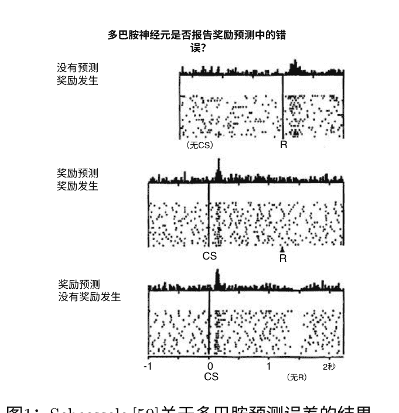
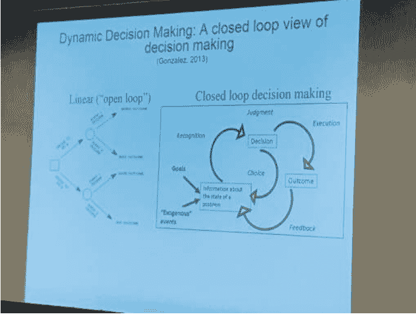
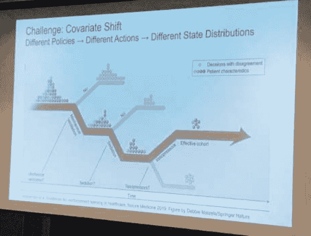
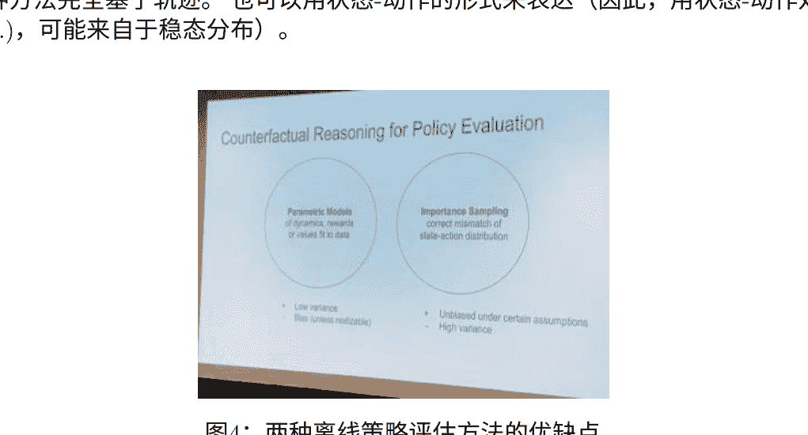
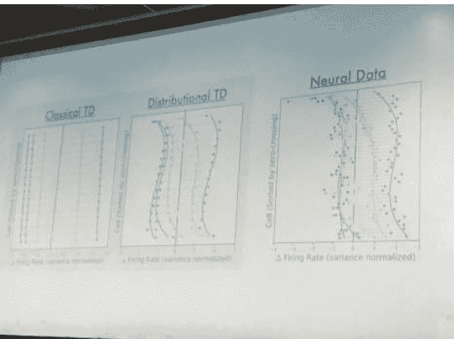
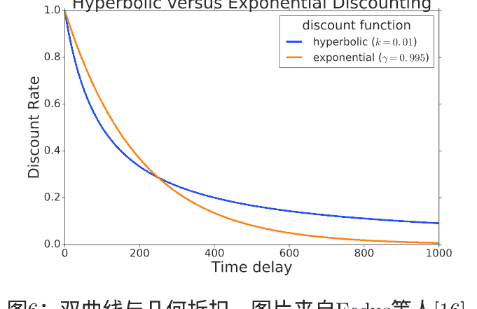
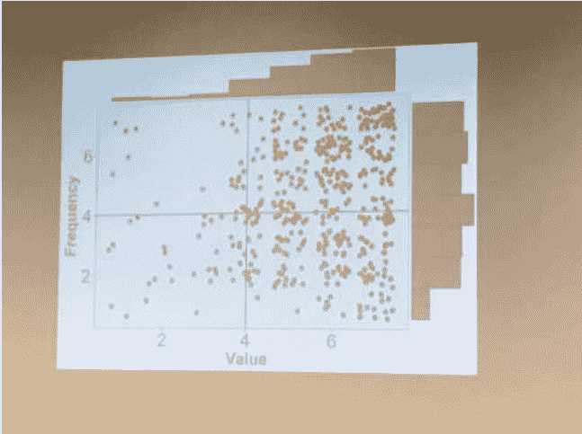
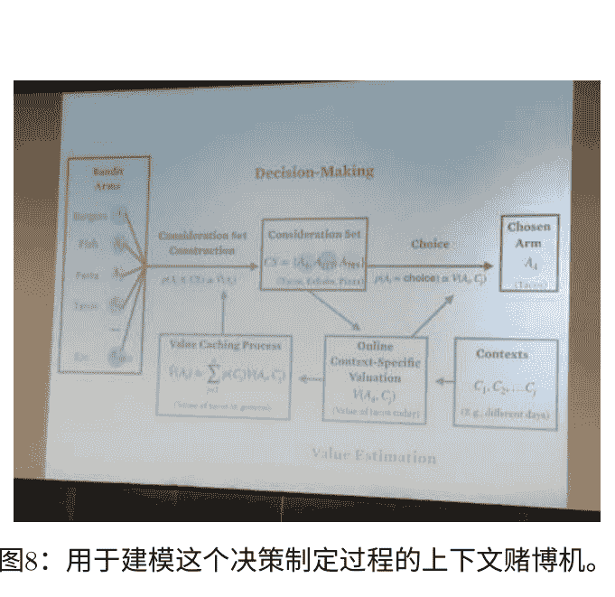

# 2019年强化学习与决策会议笔记
加拿大蒙特利尔

大卫·阿贝尔*
david_abel@brown.edu
2019年7月

# 目录

- 1 会议亮点 . . . . . . . . . . . . . . . . . . . . . . . . . . . . . . . . . . . . . . . . . . . . . . . . . . . . . . . . . . 3
- 2 7月7日星期日：教程 . . . . . . . . . . . . . . . . . . . . . . . . . . . . . . . . . . . . . . . . . . . . . . . . . . . . . . . 4
  - 2.1 Melissa Sharpe的教程：通过联想任务测试计算问题 . . . . . . . . . . . . . . . . . . . . . . . . . . . . . . . 4
    - 2.1.1 概述：联想学习 . . . . . . . . . . . . . . . . . . . . . . . . . . . . . . . . . . . . . . . . . . . . . . . . . . . . . . . . 4
    - 2.1.2 用于理解学习的计算理论 . . . . . . . . . . . . . . . . . . . . . . . . . . . . . . . . . . . . . . . . . . . . . . . . . 5
    - 2.1.3 关于多巴胺的实验 . . . . . . . . . . . . . . . . . . . . . . . . . . . . . . . . . . . . . . . . . . . . . . . . . . . . . . . 6
  - 2.2 Cleotilde Gonzalez的教程：人类的动态决策 . . . . . . . . . . . . . . . . . . . . . . . . . . . . . . . . . . . . . . . 8
    - 2.2.1 一个极端：经典决策理论 . . . . . . . . . . . . . . . . . . . . . . . . . . . . . . . . . . . . . . . . . . . . . . . . . . . 8
    - 2.2.2 另一个极端：自然决策 [56] . . . . . . . . . . . . . . . . . . . . . . . . . . . . . . . . . . . . . . . . . . . . . . . . 9
    - 2.2.3 动态决策制定 . . . . . . . . . . . . . . . . . . . . . . . . . . . . . . . . . . . . . . . . . . . . . . . . . . . . . . . . . 10
    - 2.2.4 我们如何在动态环境中做决策？ . . . . . . . . . . . . . . . . . . . . . . . . . . . . . . . . . . . . . . . . . . . . 11
  - 2.3 Emma Brunskill的教程：反事实和强化学习 . . . . . . . . . . . . . . . . . . . . . . . . . . . . . . . . . . . . . 12
    - 2.3.1 教育中的强化学习 . . . . . . . . . . . . . . . . . . . . . . . . . . . . . . . . . . . . . . . . . . . . . . . . . . . . . . . . 12
    - 2.3.2 策略评估 . . . . . . . . . . . . . . . . . . . . . . . . . . . . . . . . . . . . . . . . . . . . . . . . . . . . . . . . . . . . . . 13
    - 2.3.3 策略优化 . . . . . . . . . . . . . . . . . . . . . . . . . . . . . . . . . . . . . . . . . . . . . . . . . . . . . . . . . . . . . . 16
- 3 7月8日星期一：主要会议 . . . . . . . . . . . . . . . . . . . . . . . . . . . . . . . . . . . . . . . . . . . . . . . . . . . . . . . . . 18
  - 3.1 汤姆・格里菲斯关于认知资源的合理使用 . . . . . . . . . . . . . . . . . . . . . . . . . . . . . . . . . . . . . . . . 18
    - 3.1.1 一个悖论：人类认知既启发人工智能又令心理学尴尬 (18) . . . . . . . . . . . . . . . . . . . . . . . . . 18
    - 3.1.2 解决悖论的方法：资源合理性 . . . . . . . . . . . . . . . . . . . . . . . . . . . . . . . . . . . . . . . . . . . . . . . . 18
    - 3.1.3 人工智能和心理学中的资源合理性 . . . . . . . . . . . . . . . . . . . . . . . . . . . . . . . . . . . . . . . . . . . 20
  - 3.2 最佳论文：威尔・达布尼关于基于多巴胺的强化学习中的分布式编码 . . . . . . . . . . . . . . . . . . . 21
  - 3.3 马洛斯・马查多关于基于后继表示的计数探索 . . . . . . . . . . . . . . . . . . . . . . . . . . . . . . . . . . . . 22
  - 3.4 威尔・达布尼关于分布式强化学习的方向 . . . . . . . . . . . . . . . . . . . . . . . . . . . . . . . . . . . . . . . . 23
    - 3.4.1 分布式强化学习为什么有帮助？ . . . . . . . . . . . . . . . . . . . . . . . . . . . . . . . . . . . . . . . . . . . . . 24
    - 3.4.2 我们可以用分布式强化学习做什么？ . . . . . . . . . . . . . . . . . . . . . . . . . . . . . . . . . . . . . . . . . 25
  - 3.5 安娜・科诺娃关于临床决策神经科学 . . . . . . . . . . . . . . . . . . . . . . . . . . . . . . . . . . . . . . . . . . . 26
  - 3.6 最佳论文：利亚姆·费杜斯关于超几何贴现和多次学习地平线 . . . . . . . . . . . . . . . . . . . . . . . . . . . 27
  - 3.7 Susan Murphy关于移动健康的强化学习 . . . . . . . . . . . . . . . . . . . . . . . . . . . . . . . . . . . . . . . . . 28
  - 3.8 Liyu Xia关于人类选项转移 . . . . . . . . . . . . . . . . . . . . . . . . . . . . . . . . . . . . . . . . . . . . . . . . . . 29
  - 3.9 Yash Chandak关于改善大动作集的泛化能力 . . . . . . . . . . . . . . . . . . . . . . . . . . . . . . . . . . . . . 30
  - 3.10 Sheila McIlraith关于奖励机制 . . . . . . . . . . . . . . . . . . . . . . . . . . . . . . . . . . . . . . . . . . . . . . . 31
    - 3.10.1 使用奖励机制进行学习 . . . . . . . . . . . . . . . . . . . . . . . . . . . . . . . . . . . . . . . . . . . . . . . . . . . 31
    - 3.10.2 创建奖励机制 . . . . . . . . . . . . . . . . . . . . . . . . . . . . . . . . . . . . . . . . . . . . . . . . . . . . . . . . . 32
  - 3.11 海报亮点 . . . . . . . . . . . . . . . . . . . . . . . . . . . . . . . . . . . . . . . . . . . . . . . . . . . . . . . . . . . . 33
- 4 7月9日星期二：主要会议 . . . . . . . . . . . . . . . . . . . . . . . . . . . . . . . . . . . . . . . . . . . . . . . . . . . . . . . . . 34
  - 4.1 Anna Harutyunyan关于终止评论家 . . . . . . . . . . . . . . . . . . . . . . . . . . . . . . . . . . . . . . . . . . . . . 34
  - 4.2 Pierre-Yves Oudeyer关于内在动机的目标探索 . . . . . . . . . . . . . . . . . . . . . . . . . . . . . . . . . . . . 35
  - 4.3 Marcelo Mattar关于记忆机制预测抽样偏差 . . . . . . . . . . . . . . . . . . . . . . . . . . . . . . . . . . . . . 36
  - 4.4 Katja Hofmann关于多任务强化学习和MineRL竞赛 . . . . . . . . . . . . . . . . . . . . . . . . . . . . . . 37
    - 4.4.1 多任务强化学习中的快速适应 . . . . . . . . . . . . . . . . . . . . . . . . . . . . . . . . . . . . . . . . . . . . . 37
    - 4.4.2 CAVIA：通过元学习实现快速上下文适应 . . . . . . . . . . . . . . . . . . . . . . . . . . . . . . . . . . . . 38
    - 4.4.3 VATE：完全在线适应和探索 . . . . . . . . . . . . . . . . . . . . . . . . . . . . . . . . . . . . . . . . . . . . . 39
    - 4.4.4 MineRL：基于人类先验知识的样本高效强化学习竞赛 . . . . . . . . . . . . . . . . . . . . . . . . . 40
  - 4.5 迈克·鲍灵：一个游戏能展示心智理论吗？ . . . . . . . . . . . . . . . . . . . . . . . . . . . . . . . . . . . . . 41
- 5 7月10日星期三：主会议和研讨会 . . . . . . . . . . . . . . . . . . . . . . . . . . . . . . . . . . . . . . . . . . . . . . . . 42
  - 5.1 Fiery Cushman：我们如何知道什么不该想 . . . . . . . . . . . . . . . . . . . . . . . . . . . . . . . . . . . . . . 42
    - 5.1.1 理解可想象空间的实验方法论 . . . . . . . . . . . . . . . . . . . . . . . . . . . . . . . . . . . . . . . . . . . . 42
    - 5.1.2 用于构思的两个系统 . . . . . . . . . . . . . . . . . . . . . . . . . . . . . . . . . . . . . . . . . . . . . . . . . . . . 43
    - 5.1.3 什么是“可能的”？ . . . . . . . . . . . . . . . . . . . . . . . . . . . . . . . . . . . . . . . . . . . . . . . . . . . . . 44
    - 5.1.4 为什么道德在可想象性中不同？ . . . . . . . . . . . . . . . . . . . . . . . . . . . . . . . . . . . . . . . . . . . 45
  - 5.2 Amy Zhang：关于学习部分可观察环境的因果状态 . . . . . . . . . . . . . . . . . . . . . . . . . . . . . . . . 46
  - 5.3 Rich Sutton关于游戏 . . . . . . . . . . . . . . . . . . . . . . . . . . . . . . . . . . . . . . . . . . . . . . . . . . . . . 47
    - 5.3.1 综合心理科学 . . . . . . . . . . . . . . . . . . . . . . . . . . . . . . . . . . . . . . . . . . . . . . . . . . . . . . . . . 47
    - 5.3.2 什么是游戏？ . . . . . . . . . . . . . . . . . . . . . . . . . . . . . . . . . . . . . . . . . . . . . . . . . . . . . . . . . 48
    - 5.3.3 子问题 . . . . . . . . . . . . . . . . . . . . . . . . . . . . . . . . . . . . . . . . . . . . . . . . . . . . . . . . . . . . . . 49
    - 5.3.4 关于子问题的三个开放性问题的一些答案 . . . . . . . . . . . . . . . . . . . . . . . . . . . . . . . . . . 50

这个文档包含我在RLDM 2019会议上参加的活动期间所做的笔记，地点在加拿大蒙特利尔。如果你发现任何错别字或其他需要更正的地方，请随时分发并给我发送电子邮件至david_abel@brown.edu。

## 1 会议亮点

我喜欢RLDM。它的规模很好，演讲内容多样化，发人深省且有趣，我总是能带走一份长长的论文列表，结交新朋友，并有很多事情可以思考。
非常期待2021年的RLDM（也在布朗大学）！

有几件事要提一下：

- 1. 热门话题：关于重新思考强化学习中的时间的一些好的工作，例如重新思考折扣（Fedus等人的工作[16]）或重新思考时间抽象（Harutyunyan等人的工作[24]）。此外，有几个很棒的演讲建议我们重新思考我们的目标：Sheila McIlraith的演讲（第3.10节）和Tom Griffiths的演讲（第3.1节）。
- 2. Will Dabney的两个演讲都很棒！请参阅第3.2节和第3.4节。
- 3. 模型基于和模型无关之间的相互作用在讨论中经常出现。我特别喜欢Fiery Cushman在这个领域的演讲！（见第5.1节）。
- 4. 非常期待MineRL竞赛的结果-更多细节请参阅Katja Hofmann的演讲（第4.4节）。
- 5. Rich Sutton以一场名为“play”的演讲结束了会议，其中包含了许多有价值的见解。
- 6. Emma Brunskill关于批量强化学习的教程非常棒（有很多指向最近优秀文献的指引，我打算阅读）。

## 2 7月7日星期日：教程

RLDM开始了！今天我们有人工智能/神经学的教程，然后在一天后有一个联合讲座。

### 2.1 Melissa Sharpe的教程：通过联想任务测试计算问题

> 主要观点：我们可以使用联想任务来测试计算问题。

一些免责声明：1）我不是计算神经科学家，而是行为神经科学家！2）不是该领域第一个提出这一观点的人。

大纲：

- 1. 一些联想学习的基本原则。
- 2. 多巴胺预测误差的计算模型。
- 3. 一些联想测试的计算模型。
- 4. 迈向一个新的理论。

#### 2.1.1 概述：联想学习

> 定义1（联想学习）：我们在环境中形成刺激/经验之间关联的方式。

如果我们能更好地理解这个过程，我们就可以开始揭示我们进行更复杂的推理、推断和建模的方式。

→ 主要从大鼠的角度寻求这种理解（如经典的巴甫洛夫条件反射研究）。

思路：提供不同的刺激（不同长度/音高的听觉音调），然后提供不同的食物（大鼠喜欢的）。

→ 随着时间的推移，大鼠将学会将食物与不同的音调联系起来，他们的行为将反映出这一点。

关键发现：预测误差是学习的催化剂。当出现光线（一种新的刺激）时，不会去放置食物的地方。

问：那么，当有一个音符出现时，动物学到了什么样的定性特征？
为什么大鼠会去食物杯？

A：如果我们提前给动物喂食并播放声音，它们不会去找食物[50]。所以：不仅仅是基于价值的决策，而是一种将声音的刺激与食物联系起来的感官特定表示（不仅仅是奖励）。

但是！仍然存在一种更纯粹基于价值的反应。一只老鼠会高兴地拉动一个产生声音的杠杆（即使它不会导致食物）。

#### 两种学习形式：

- 1. 发展声音和特定食物之间的关联。
- 2. 声音还会积累独立于对食物的渴望的一般价值。

→强大的二分法！药物成瘾的人显示出这些关联之间平衡的变化[15]。

#### 中性关联：即使没有与动机（奖励学习）相关联，也能了解环境的一般结构。

→一只老鼠可能会学会声音和光同时出现。然后，如果只播放声音并给予食物，老鼠也会将食物与光联系起来！

→了解大鼠/动物如何学习这些中性联想的好方法。

#### 基本原则摘要：

- • 巴甫洛夫式条件反射有两种学习形式：1) 联想学习，2) 价值积累
- • 任务设计的微小变化对底层联想有重大影响
- • 感觉预处理：隔离事件之间的联想关系。
- • 二阶条件反射：隔离提示的价值。→让我们探索哪些脑区对特定学习方面有贡献。

### 2.1.2 用于理解学习的计算理论

#### 多巴胺预测误差（DPE）：

- • Schultz等人的早期实验[60]发现了DPE的存在 →多巴胺神经元的错误信号预测。

  →旧实验：动物在接收到美味果汁后，多巴胺神经元会立即发放。然后，如果动物期望信号但没有得到，就会有一种撤回（错误预测）。请参见图1的结果。

- • 广泛存在于不同种类的动物中，与许多物种中的奖励学习密切相关。

#### 多巴胺神经元是否报告奖励预测中的错误？



图1：Scheeselle [59]关于多巴胺预测误差的结果。

#### 计算模型：时间差分误差

$\Delta V = \alpha \delta(t),$

其中 $\delta(t)$是值预测的误差：

$\delta(t) = r_t + \gamma V(s_t) - V(s_{t_1}).$

多巴胺：被认为在为刺激赋予价值方面起作用。

+   总结：
1) 多巴胺神经元在期望误差时激活，
2) 用于为奖励前的提示分配价值，
3) 不用于产生与奖励提示的关联。

但是！新理论：光遗传学革命[51]。

### 2.1.3 关于多巴胺的实验

→ 一个想法：刺激多巴胺可以解除阻塞（避免被意外惊扰）学习[64]。

测试：对比大鼠在感官刺激（如光/声音）期间是否进行多巴胺刺激时寻找食物所花费的时间。

结论：多巴胺推动学习！但是，我们还不知道具体机制。

→ 下一个实验将探索具体机制。

#### 主要研究问题：多巴胺在学习中的作用是什么？

#### 实验[33]：

- - （对照组）在呈现刺激时不可预测地增加奖励，与可预测的多巴胺刺激形成对比。→ 对照组：A比B产生更多蔗糖。但是，然后A和AX产生相同的奖励，而B和BY有差异（BY比B产生更多蔗糖）
  → 多巴胺刺激组：用相同的奖励强度训练A和B。因此，学习第二组中的Y应该被阻断。不会学习关于Y的知识，因为它与B的预测相同。
- - 因此，研究多巴胺是否解除学习阻断。
- - 然后：通过将老鼠带到实验室外让它们自由进食（并给它们一小剂锂使它们稍微不舒服）来贬值结果。
  → 结论：多巴胺是学习解除阻断过程中的一个重要组成部分，不仅仅是价值学习。

#### 对基于模型的学习进行实验[61]

- - 引入A→X的关联（其中X是有奖励的），然后AC→X的关联。→ 如果先学习A→X，则与C相关的关联被阻断！
- - 甚至可以添加EF→X的关联，老鼠应该学会，因为它们从未见过E或F。同时，老鼠将被给予AD→X和AC→X的关联。
- - 发现：动物学习x导致奖励（去找食物），但不学习C或D，但在没有多巴胺刺激时学习EF。
  → 当多巴胺被刺激时，它们会学习C（多巴胺解除C）。

主要观点：多巴胺推动了提示和事件之间的关联学习。

下一个实验：在一个没有任何作用的提示期间刺激多巴胺[57]。对比在灯光关闭后立即刺激多巴胺的成对/不成对组与一分钟后刺激多巴胺（与大鼠无关）的组。

问：成对组会拉动杠杆使灯光亮起吗？

→ 发现：是的！这表明多巴胺也可以将价值与刺激相关联。但是，来自同一实验室的进一步发现表明，在适当的条件下，相反的情况也可能成立。

留下的问题：为什么在某些条件下，多巴胺可以给提示分配价值，而在其他条件下却不能？

A：这对我们理解心理病理学非常重要！精神分裂症和药物成瘾都表现为中脑多巴胺系统的紊乱，但它们是非常不同的疾病。

→ 精神分裂症可能是一种在学习过程中多巴胺功能紊乱的疾病（而成瘾则不是）。

总结：

- - 揭示了多巴胺误差对学习的因果贡献
- - 任务中微小的变化可能对其底层关联产生巨大的影响！

### 2.2 Cleotilde Gonzalez的教程：人类的动态决策

让我们考虑两个极端情况：决策理论和现实世界的决策制定。请参见图2中的对比。

#### 2.2.1 一个极端：经典决策理论

经典选择观点：一次性决策。常见假设：

- 1. 已知备选方案：所有结果都是已知的或易于计算/观察/想象的。
- 2. 环境是静态的。
- 3. 人脑可以最优地估计、感知和反应
- 4. 时间和资源无限。

例如：决定是否带伞。如果下雨/不下雨，会改变结果的可取性（最差=0；没有伞和下雨-最好=100；没有雨，没有伞）。

→典型的解决策略（理性的定义）：最大化预期价值（在对世界结果的期望中）。

问：什么是非理性行为？

答：任何不能最大化预期效用的行为！未能做出能够实现最佳预期结果的决策。

> **通常由决策中的偏见引起：心理快捷方式、认知错觉或其他社会影响导致次优决策。**

> 定义2（框架偏见）：人们的思维受到信息呈现方式的影响。

例如：美国正在准备应对一种不寻常的疾病爆发，预计会导致600人死亡。有两个方案来对抗这种疾病。结果估计如下：

A 如果采用方案A，将能够拯救200人。

B 如果采用方案B，有三分之一的概率能够拯救600人，有三分之二的概率没有人能够被拯救。

问：你选择A还是B？

→如果问题的框架不同会怎样？也就是说，A会杀死400人，而B有1/3的概率拯救所有人。预期价值在这里是相同的，但我们仍然会做出不同的选择。

所以：当问题以负面方式框定时，我们倾向于更冒险，而当问题以正面方式框定时，我们倾向于更保守。

#### 启发式和偏见放宽了经典效用理论的假设：

- • 人脑可能无法估计/感知/反应最优性
- • 人们可能基于情绪状态而不是最大化 E[Q(s, a)]来做出决策。
- • 等等...

问：但是！这并不能解释为什么会出现这些偏见。这些偏见是如何产生的？

#### 2.2.2 另一个极端：自然决策 [56]

例子：森林火灾！消防员需要去扑灭它。

- • 有很多不同的路径可选：打电话叫直升机，开车，叫援军等等。
- • 决策环境正在发生变化！
- • 时间有限，要做出正确的决策。

> 自然决策制定的核心问题是：人们在混乱、不确定、快速变化的现实环境中如何做出决策？

主要观点是，人们是专门针对特定内容在现实世界中做出决策的专家决策者。

→ Klein和Klinger [56]的一个观点是，专家实际上并不做出决策，他们只是“知道”该做什么和如何行动，即使在时间压力下。
因此：我们需要在现实的假设/约束下研究动态决策制定。依赖于对专家在其环境中的观察，软数据；编码可能很困难，很难得出一般性结论。



图2：决策制定的两个极端派别：经典决策理论（左）和自然决策制定/动态决策制定（右）

#### 2.2.3 动态决策制定

在动态决策制定（DDM）问题中：

- 一系列随时间变化的决策
- 决策在时间上是相互依赖的
- 环境会发生变化
- 决策的效用是时间相关的
- 资源和时间是有限的。

两种类型的DDM：

1. 选择：在不确定性下进行一系列选择，目标是在长期内最大化总奖励。
   - 一种方式是在线做出决策，不能回头重新做决策。
   - 另一种方式是尝试多次，采样不同的策略（就像在购买之前尝试不同的衣服）。
2. 控制：在不确定性下进行一系列选择，目标是通过减少目标与实际系统状态之间的差距来保持系统平衡。

→在实验任务中产生连续的动态：简单的动态任务 —————— 复杂的动态任务（1）

有很多关于用于研究决策制定的微观世界的实验研究[13]。最近，还有用于研究消防、医学诊断、气候变化、实时资源分配等微观世界[20, 22]。

现场演示！展示了一个微观世界模拟的软件：通过复杂网络泵送水来最大化送水量。强调决策必须在实时、噪声、延迟等条件下迅速做出。关键问题是人们如何在这种情况下做出决策。

### 2003年的研究[21]

探讨了关于DDM中的人的三个问题：

1. 练习是否能提高表现？
2. 在时间限制下练习是否有助于表现良好？
3. 人类的能力（智力、记忆）如何影响在动态任务中做出决策？

实验结果：在时间限制下，人们倾向于更加密切地遵循启发式方法，而给予更多时间的人则逐渐远离启发式方法，而是选择基于任务的上下文知识（输入-输出关系）做出决策。

### 调查/实验结果总结

- 在时间压力下进行更多练习并不能达到最佳表现
- 在同一任务的未来时间限制下，没有时间压力的练习可能更有益
- 模式匹配能力（通过Raven渐进矩阵测量）可以很好地预测表现
- 人们在任务中的练习中减少使用简单的启发式方法

#### 2.2.4 我们如何在动态环境中做决策？

### 两个关键要素

1. 识别：我以前见过这个吗？
2. 经验：在任务中通过实践获得特定上下文的知识产生输入-输出关联（大致是基于模型的预测）

Dienes和Fahey [12]、Gonzalez等人[21]和Gibson等人[19]还有ACT-R [1]提出了更多的决策制定中的学习理论。

→ 探索DDM的计算模型（参见Gonzalez等人[21]）。

问：这些理论有多普遍？还是它们适用于特定任务？

答：声称这些理论是真正决策制定过程的通用理论。

→ 因此，从更复杂的任务回到简单的动态任务。 从水管理式的微观世界到一个更简单的“啤酒游戏”[7]。

问题：描述与经验之间的差距[26]。考虑以下情况：

- 以0.8的概率获得4美元，否则为0，或者确定获得3美元。
- 问：人们如何在只有这个描述的情况下做出决策，而不是已经做出一堆选择并学到这些概率？

→ 当从描述中阅读到罕见事件的概率时，人们倾向于过高估计，而从经验中学到的概率则倾向于低估。

问：人们如何对待罕见事件？

答：根据前景理论，我们对事件概率有一些不准确的函数在脑海中（过高估计罕见事件，低估可能事件，从描述中）。但是：“理论是为具有货币结果和状态概率的简单前景而发展的” Kahneman和Tversky [31]。

因此，激发了一个新的问题：当决策者仅通过经验了解任务时，是否会出现相同的现象？

总结：DDM是理解人们如何在现实世界中解决问题的重要前沿。

### 2.3 Emma Brunskill的教程：反事实和强化学习

例子：两个汉堡的简短故事！考虑两个汉堡，一个是1/4磅的，另一个是1/3磅的。 营销公司认为1/3磅的汉堡会做得很好。

→ 但是它失败了！因为3小于4，所以人们认为他们被欺骗了。

#### 2.3.1 教育中的强化学习

问题：我们可以使用强化学习方法来弄清楚如何教人们分数吗？

答案：是的！设计了一个使用强化学习的游戏，在合适的时间提供正确的活动。 这是强化学习，因为我们跟踪学生的知识状态，并根据状态做出决策（下一个提供哪个活动）。

→ 有500,000人玩过这个游戏。 强化学习问题是给定了11,000个学习者的轨迹，以学习更有效的最大化学生坚持性的策略。

注意：强化学习有着悠久的历史，造福于人类。 从20世纪40年代的赌博理论到临床试验。

在机器人和游戏中有效的方法有：1) 我们通常有一个好的模拟器，2) 大量的数据用于训练，3) 可以在领域中尝试新的策略。

相反，在与人类合作时：1) 没有人体生理学的好模拟器，2) 收集真实数据涉及真实的人和真实的决策！

大局观：我们对于最小化和理解学习良好决策所需的数据的技术感兴趣。

### 背景

通常的故事是：一个代理$\mathscr{A}: D \rightarrow \Pi$根据与$MDP \ M = \langle S, \mathcal{A}, R, T, \gamma \rangle$交互时收集的一些数据$D \in \mathcal{D}$的历史输出一个策略。

### 反事实/批量强化学习

我们收集一个数据集$D$的$n$个轨迹$D_n \sim M(\pi)$。

想要思考基于这个数据集的决策的替代方式。所以，真的：“如果”推理给出过去的数据。

### 具有挑战性！有两个原因

1. 数据被屏蔽：我们不知道其他宇宙中存在什么（如果我没有来到这个宇宙呢？）
2. 需要泛化能力：几乎总是在一个指数级大的空间中搜索$|\Pi| = |S|^{|\mathcal{A}|}$，甚至是无限大的空间。

对因果推断和机器学习的兴趣日益增长：参见Pearl和Mackenzie [46]

### 批量策略优化

找到一个在未来表现良好的好策略：

```
$$\underset{\pi \in \mathcal{H}_i}{\text{arg max}}\ \underset{\mathcal{H}_i \in \{\mathcal{H}_1, \mathcal{H}_2, ...\}}{\text{max}} \int_{s \in S_0} \hat{V}^{\pi}(s, D) ds$$
```

外部argmax和max大致上是策略优化，内部积分大致上是策略评估。

问：我们的假设类是什么？

答：可能有很多种！ $\mathcal{H} = \mathcal{M}$? $\mathcal{H} = \Pi$? $\mathcal{H} = \mathcal{V}$?

#### 2.3.2 策略评估

问：在给定从先前策略$\pi'$收集的数据的情况下，某种替代策略$\pi$有多好？

答：有很多文献，通常来自其他领域！请参阅经济计量学和生物统计学中的旧数据处理效应估计[53]。

问：为什么这个问题很难？

答：协变量偏移！在任何策略下，我们只能看到状态-动作空间的一小部分，所以很难从单个策略中了解领域的其余部分。请参见图3。



### 思路1：基于模型的策略评估

$P^{\pi}(s' \mid s) = p(s' \mid s, \pi(s)) \quad \quad \quad \quad \quad \quad \quad \quad \quad \quad \quad \quad \quad (2)$ 
$V^{\pi} \approx (I - \gamma \hat{P}^{\pi})^{-1} \hat{R}^{\pi}. \quad \quad \quad \quad \quad \quad \quad \quad \quad \quad \quad \quad \quad \quad \quad \quad \quad (3)$

但是：我们的模型和奖励函数可能是1) 错误的，2) 错误的规定，3) 难以估计。在任何这些情况下，这些错误都可能累积并导致使用基于模型的方法的根本困难。

### 想法2：无模型策略评估

$D = (s_i, a_i, r_i, s_{i+1}), \quad \forall_i \quad \quad \quad \quad \quad \quad \quad \quad \quad \quad \quad \quad \quad \quad (4)$ 
$\hat{Q}^{\pi}(s_i, a_i) = r_i + \gamma V_{\theta}^{\pi}(s_{i+1}) \quad \quad \quad \quad \quad \quad \quad \quad \quad \quad \quad \quad \quad \quad \quad (5)$

根据所选择的假设类的可实现性，存在偏差/方差权衡。

→可以通过重要性采样来克服这个问题：

```
$V^{\pi}(s) = \sum_{\tau} p(\tau \mid \pi, s) R(\tau) = \sum_{\tau} p(\tau, \pi_b, s) \frac{p(\tau, \pi, s)}{p(\tau \mid \pi_b, s)} R(\tau) \quad \quad \quad \quad \quad \quad \quad \quad (6)$ 
$\approx \sum_{i=1}^{n} \frac{p(\tau_i, \pi, s)}{p(\tau_i \mid \pi_b, s)} \quad \quad \quad \quad \quad \quad \quad \quad \quad \quad \quad \quad \quad \quad \quad \quad \quad \quad \quad (7)$ 
$= \sum_{i=1}^{n} R(\tau_i) \prod_{t=1}^{H_i} \frac{p(a_{it} \mid \pi, s_{it})}{p(a_{it} \mid \pi_b, s_{it})}. \quad \quad \quad \quad \quad \quad \quad \quad \quad \quad \quad \quad \quad \quad \quad \quad \quad \quad (8)$
```

但是，这种方法完全基于轨迹。 也可以用状态-动作的形式来表达（因此，用状态-动作对的分布来替换$p(\tau \dots)$，可能来自于稳态分布）。



图4：两种离线策略评估方法的优缺点

因此，两种方法（参见图4进行比较）。 我们能够将这两个优点结合起来吗？

A：是的！在赌博机领域中有一个双重稳健估计器[14]，然后扩展到强化学习领域[29]：

```
$$DR(D) := \sum_{i=1}^{n} \sum_{t=0}^{\infty} \gamma^t w_r^i R_t^{H_i} + \dots \quad (9)$$
```

注意：大多数这些估计器都是关于进行不同的偏差/方差权衡的。

两个新的离线策略评估估计器；

1. 强化学习的加权双重稳健估计[68]：加权重要性采样可以降低方差。
2. 模型和引导重要性采样：我们应该如何权衡每种估计器的重要性？通过二次规划来解决这个问题，得到一个合理的偏差/方差权衡。

但是！我们不知道目标值：如果我们能够实际评估偏差，我们已经知道真实值了。 那么，我们如何近似偏差？

→总的来说，非常困难。 但是，我们可能能够得到对偏差的保守估计 →使用置信区间来限制重要性采样估计的偏差。

然而，将这些想法应用于医疗应用时有一个巨大的限制：我们实际上并不知道医疗从业者的真实行为策略！几乎所有的观察性健康数据都存在这个问题（以及其他问题：我们无法访问的状态数据等）。

### 总结

- 基于模型的方法和基于模型的方法，但每种方法都有权衡
- 重要性采样至关重要！
- 双重稳健方法试图从两方面取得最佳效果。

#### 2.3.3 策略优化

Q: 现在，鉴于我们可以评估一个策略，我们如何改进策略？

A: 有很多方法！ Mandel等人提出的一个早期想法是：发现最好的决策模型与最好的预测模型不同。有很多混淆因素（近似模型、有限数据、过拟合等等）。

考虑这些估计器的公平性：如果一个估计器在超过1/2的时间中选择了错误的策略，那么它就是不公平的。

→ 可以证明，即使重要性采样是无偏的，使用它们进行策略选择也可能是不公平的。问题在于不同估计器之间存在不同的方差！

强化学习的重大问题：我们如何对强化学习进行结构风险最小化？我们还没有答案。

例如，我们希望能够包含一个假设类复杂度项，以捕捉我们的泛化误差，比如VC维度：

```
\arg \max_{\pi \in \mathcal{H}_i} \underbrace{\max_{\mathcal{H}_i \in \{\mathcal{H}_1, \mathcal{H}_2, ...\}} \int_{s \in \mathcal{S}_0} \hat{V}^\pi(s, D) ds}_{\text{策略优化}} - \underbrace{\sqrt{\frac{f(VC(\mathcal{H}_i) ...)}{n}}}_{\text{误差界}}
```

一些想法：可以参考FQI，无模型批量强化学习，重要性采样界限，原始对偶方法，虽然倾向于假设可实现性。

目标：对策略性能提供强大的泛化保证。

非常困难！我们可以先专注于在策略类中找到一个好的策略。

新结果：可能可以通过离线策略梯度[39]收敛到局部解。

→ 对在线学习也有影响。 （基本上：我们可以更好地利用我们的数据。）

接下来：我们能否保证从给定类别中找到最佳策略，并保证我们离最佳解决方案有多远：

```
\max_{\pi \in \Pi} \int_s V^\pi ds - \int_s V^{\hat{\pi}}(s)ds \leq \sqrt{\frac{f(...)}{m}},
```

其中假设类的复杂性项是基于熵的项。详细信息请参阅Nie等人的工作[44]。

主要思想：使用优势分解。所以：

```
\Delta_{\pi} := V_{\pi} - V_0 = \mathbb{E}_0\left[\sum_{i=1}^{n} \mathbb{1}\{\mu_{\text{now}}(s_i) - \mu_{\text{next}}(s_i)\}\right].
```

来自Kakade等人[32]，Murphy [43]。

问：这在实证上有效吗？

答：在医疗任务中，是的！对于大量数据，相对于其他估计器，达到了极低的遗憾。

### 总结

- 开放和积极追求具有泛化保证的Bath策略优化。 我们需要一个SRM理论来解决强化学习问题！
- 总的来说，这是一个非常非常困难的问题！但是，有一些乐观的地方：从一开始的教育案例（教人们分数），它实际上起作用了！
- 问：这与探索有什么关系？
Tu和Recht [69]以及Sun等人[65]给出了一些早期答案。

## 7月8日星期一: 主要会议

主要会议开始了！

### 3.1 汤姆·格里菲斯关于认知资源的合理使用

与Falk Lieder，Fred Callaway和Michael Chang合作的项目。

这个群体：人工智能/神经科学/心理学，为智能和认知提供了多样的观点。

### 3.1.1一个悖论：人类认知是启发（AI）和尴尬（心理学）

最近的趋势：计算需求呈指数增长，用于重大突破（从AlexNet到AlphaGo Zero，参见OpenAI博客文章的图表）

→回想一下深蓝对卡斯帕罗夫的比赛。基本计算差异：卡斯帕罗夫每秒评估1步棋，而深蓝每秒评估100,000个位置。

**人们可以用更少的东西做更多的事情。**

从人工智能的角度来看，结论是：人类是了不起的！我们可以解决各种认知挑战，而且都是用同一个系统。

从心理学的角度来看，结论是：人类令人尴尬！看看这些书：《可预测的非理性》、《不可避免的错觉》、《我们如何知道什么是真的》和《人类思维的偶然构建》。

悖论：我们如何能够激发人工智能研究人员对我们感到兴奋，同时又让心理学家对我们感到尴尬。

### 3.1.2 解决悖论的方法: 资源合理性

解决这个悖论的方法：

1. 人类的认知资源有限[62]。
2. 我们很好地利用了这些资源[35]。

> 定义3 (理性决策理论)：选择具有最高预期效用的行动:
$$\arg \max_a \mathbb{E}[U(a)]$$

但是，忽略了计算成本。所以：例子2：相同的思想可以扩展到规划中。现在，一个代理必须通过加权图进行导航，找到最低成本的路径。

- 人们必须学习图的边缘权重（即，他们必须进行探索）。
- 思路：可以再次将这个问题转化为元级MDP。
- 发现：人们在决定何时以及如何进行探索时是适应性的。由人们展示和元级MDP的最优策略（但在大多数搜索算法中找不到，如BFS/DFS）。

#### 3.1.3 人工智能和心理学中的资源合理性

### 资源合理性和心理学：

- **认知心理学关注的是过程**，现在我们可以从问题中推导出来（通过将其转化为这个元级MDP）。
- 为强化学习提出了一个问题，提出了引人入胜的问题和答案：
  - 策略学习作为强化学习的一种形式（基于模型和无模型）
  - 通过塑造来改善认知能力
  - 关于认知与行动的神经科学假设

### 资源合理性和人工智能：

- 考虑如何分配认知资源意味着考虑如何重复使用资源
- 创建能够执行异构任务的学习者的关键部分。
- 看起来不像元推理的问题可以表达为元级MDP。
  例如：学习深度神经网络的结构[47]

通常，学习结构会导致组合泛化[8]。

例如：从英语翻译成西班牙语。但是，已经知道如何从英语翻译成法语和法语翻译成西班牙语，可以利用这一点将英语翻译成西班牙语（通过法语）。Chang等人[8]研究了通过捕捉相关组合结构来将pig latin翻译成西班牙语。

> 结论：
1. 寻找计算效率高的策略是人类智能的关键组成部分。
2. 将这种能力应用于机器中可以实现具有灵活性的普适性和更高效的学习。
3. 制定关于认知资源使用的合理模型为强化学习和决策制定开辟了新的方向。

### 3.2 最佳论文：Will Dabney关于基于多巴胺的强化学习中的分布式价值编码

与Zeb Kurth-Nelson、Nao Uchida、Clara Starkweather、Demis Hassabis、Remi Munos和Matthew Botvinick合作。

首先，回想一下我们在时序差分学习方面的共同根源（神经科学/人工智能）。

```
$$V(s) \leftarrow V(s) + \alpha(r + \gamma V(s') - V(s))$$。
```

该模型是两个领域的基准。

该模型的提议：全局价值估计$\hat{V}$。在神经科学中，神经元报告与全局估计的预测误差。神经元朝着估计未来回报的均值移动。

→关键点：多巴胺神经元在正向和负向上缩放其值。这使得它们能够估计均值。

这项工作：新的想法，“分布式”TD学习。多巴胺神经元实际上在整个群体中以不同的方式缩放其预测。

→不同的神经元正在学习关于这些错误/值预测的不同统计信息。

人工智能的观点：分布式强化学习在复杂环境中往往有所帮助！[5]。

> 核心问题：这种分布式视角能否帮助我们理解大脑中的多巴胺预测误差？



实验1：

- 动物被给予刺激（气味），然后给予不同程度的果汁[1: 7]（越多越好）。在第二个任务中，有一定的概率获得奖励/果汁。
- 经典发现：当给予的奖励低于平均水平时，TD误差为正（预测误差）。当奖励高于平均水平时，TD误差（在神经元中发现）为负。
- 主要比较：分布式接受（不同神经元预测奖励分布的不同统计量）与经典TD（所有多巴胺神经元应具有相同的发放率）。
- 新发现：实际发放率非常好地由分布式视角而非经典视角预测。见图5。

实验2：进一步探索多巴胺神经元在其预测中是否一致（因此都负责监测相同的信号），或者是否存在不一致（因此捕捉到分布的不同统计量）。

→ 进一步发现在应用DPEs的缩放中存在多样性。

### 3.3 Marlos Machado关于基于计数的后继表示的探索

与Marc G. Bellemare和Michael Bowling合作。

重点：计算强化学习中的探索问题。也就是说，只通过观察每个选择的行动的结果来了解世界。

→ 典型趋势：使用随机探索，例如：

```
$$\pi_{\hat{Q}, \varepsilon}(s) = \begin{cases} \arg \max_a \hat{Q}(s, a) & 1-\varepsilon \\ \ \mathrm{Unif}(\mathcal{A}) & \varepsilon \end{cases}$$
```

但是：随机行动导致非常低效的探索。在一个简单的网格世界中，平均需要大约800-900步。

主要结果：在学习过程中，继任者表示的范数隐含地编码了状态访问次数。 因此，它可以用作探索奖励。

> 定义6（继任者表示[11]）：捕捉状态之间随时间接近的状态的表示。更正式地说；

$$\psi_{\pi}(s, s') = \mathbb{E}_{\pi} \left[ \sum_{t=0}^{\infty} \gamma^{t} \mathbf{1} \{s_{t} = s' \mid s_{0} = s\} \right]$$

此外：对函数逼近的良好概括，与DP的良好联系[71]，SR的特征向量等同于慢特征分析，等等。

问：这些想法是从哪里来的？

答：嗯，最初是从学习MDP图的连接性的角度来看的。在仅仅几个回合之后（在网格世界中大约100个回合），就已经掌握了足够的结构来用于探索。

可以通过探索奖励与Sarsa相结合：

```
$$Q(s, a) \leftarrow Q(s, a) + \alpha \left[ \left( r + \frac{1}{\|\psi(s)\|_2} \right) + \gamma Q(s', a') \right].$$
```

无模型强化学习：SR范数可以用作探索奖励（在类似河流游泳的问题中实现更高效的探索）

基于模型的强化学习：还可以与高效探索算法（如$E^3$、R-Max [6]等）结合使用。

→ 但也可以与函数逼近结合使用。

- 思路：使用深度网络生成一些状态特征，$\phi$。
- 使用$\phi$来预测$\hat{Q}$和$\psi$。

Atari游戏中的探索：DQN在难度较高的探索游戏中得分较低，而将SR添加到DQN中在大多数情况下都能提升得分。

→ 声称这并不是比其他探索方法更优越，而是一个简单的通用思路，可以增强探索能力。

### 3.4 威尔·达布尼关于分布式强化学习的方向

让我们从分布式强化学习的高级定义开始：

> > 定义7 (分布式强化学习[5])：进行强化学习！但是，使用更多的统计数据。

也就是说：假设世界上存在一个回报分布，我们想要估计关于这个分布的一些统计数据。常用工具：贝尔曼方程（$V = R + \gamma V'$）。

但是，当我们超越均值估计时会发生什么？

问：有多少分布与我正在估计的均值一致？

答：嗯，有无限多个！

问：但是如果我们添加更多统计数据呢？（比如其他矩！）

答：那么这将将分布空间减少到更可处理/合理的范围内。

分布式强化学习更新，假设回报分布是一个随机变量：

```
$$ Z^\pi(x, a) := R(x, a) + \gamma Z^\pi(X_1, A_1) $$
```

许多感兴趣的统计数据！

- 均值：常规强化学习！只是估计均值。 $E[Z^\pi(x)]$
- 分类分布式强化学习：通过回归来估计分布的传统机器学习方法（但实际上将其转化为分类问题）。 $\Pr(Z^\pi(x) \leq z_k)$ → 告诉我们：我的分布中的回报是否大于某个值？
- 分位数回归分布强化学习：考虑绝对损失的最小化器 → 中位数！如果我们倾斜损失，我们强制解决方案不是中位数。 $F_{Z^\pi(x)}^{-1}(\tau_k)$
- 其他：单峰高斯/拉普拉斯分布，其他分布。

#### 3.4.1 分布式强化学习为什么有帮助？

Q: 为什么分布式强化学习有帮助？

A1: 根据Lyle等人的工作[40]，在许多情况下，经典/分布式强化学习之间的更新实际上是相同的。

A2: 如果分布偏斜，它也可能导致得出错误答案[52]。

→ 所以，看起来它不应该有帮助。但是，有很多证据表明它确实有帮助！例如，参见Rainbow [27]。

主要挑战：

1. 优化稳定性：很难保持优化过程的稳定性。

2. 表示学习：学习正确的表示很困难！

→ 这两种情况似乎都可以通过分布式强化学习来解决！

Imani和White [28]表明，在回归中使用分布损失并不总是有助于监督学习！但是，在强化学习中，存在一些特殊属性可能会导致更好的表示学习。

van Hasselt等人[70]介绍了Pop-Art算法。研究当数据呈现在多个数量级上时，优化变得非常不稳定。Pop-Art能够克服这个问题并产生更稳定的更新。

→ 思路是意识到错误的大小可以产生更稳定的更新。

因此，为了稳定优化：1) 分布损失对错误的大小不太敏感，2) 强化学习作为一个非稳态回归问题，对于基于采样的算法来说，看起来很像随机性。

这是一种思考方式：值函数是一个过渡阶段，作为迈向下一个更好策略的手段。

→我们经常过度拟合当前的步骤，而不是在合适的时候继续前进。

应该问：我的价值函数能有多好地适应未来的价值函数，而不仅仅是当前的价值函数？假设：分布式强化学习正在做一些事情来塑造表示，使其对未来的价值函数具有鲁棒性！它通过提供支持来塑造未来和过去的价值函数。

实验来探索这个观点：不同的学习表示对未来的价值函数有多好的泛化能力？

→发现：你能多好地适应未来的价值函数与你在一组任务上的表现有很强的相关性。

#### 3.4.2 我们可以用分布式强化学习做什么？

现在，让我们回到最初的问题：我们能用它做什么？

一些方向：

- 风险敏感行为：使用对回报分布的估计可能对适应风险配置很重要。
- 从经济悖论（阿利亚斯、圣彼得堡、埃尔斯伯格）中可以理解会导致这些决策的统计学吗？
- 双曲折扣：如果折扣是一个概率而不是一个缩放比例。

强化学习的良性循环：在人工智能/神经科学/心理学（和其他领域）之间有很大的重叠，带来巨大的好处。一个古老的故事：盲人研究大象[58]。

→但是，我们更有可能理解我们正在研究的实体的本质。

### 分布式强化学习的方向：

- 对于人工智能：改善稳定性/学习的技术，改善强化学习中表示学习的理解。
- 对于神经科学：分布式强化学习能否帮助解释多巴胺活动的变异性？如何结合无模型和有模型的分布估计？
- 对于心理学：一类广泛的风险敏感策略，但分析起来具有挑战性。风险敏感行为中的错误告诉我们底层机制。

### 3.5 安娜·科诺娃关于临床决策神经科学

目标：突出决策神经科学的工作与其他领域的相关性！

→重点：理解药物成瘾。

> > 定义8（DSM-5标准）：物质滥用障碍的11个步骤（1.使用时间超过预期，2.尝试戒断超过一次，等等）。

实验：尝试通过让受试者玩游戏来捕捉风险倾向。

- 受试者被呈现两个袋子。第一个袋子里保证有5美元，另一个袋子有50%的机会给予0美元或10美元。

- 建模风险偏好：金钱对不同的人有不同的价值。因此，对于每个人，有一个将“客观价值”映射到“主观价值”的函数（每增加一美元带来的满足度相对增加）。

→这个函数就是效用函数 U(v) = v^α。

- 带有风险的预期效用理论，然后：

```
E[U(v)] = p v^α
```

但是风险怎么办？嗯，α可以捕捉到这一点。

- 假设：吸毒者比非吸毒者更容易承受风险。

→ 研究结果：可卡因使用者具有更高的风险容忍度，精神分裂症患者具有正常的风险容忍度，而焦虑症患者具有较低的风险容忍度。

成瘾的特征是循环模式：

问：支撑这种循环过程的认知机制是什么？

答：为了回答这个问题，我们需要更好地理解这些认知机制。

> → 专注于阿片类药物流行病，特别是最近进入康复类计划的阿片类药物使用者。

### 实验：

- 设置：再次考虑一组具有不同风险特征的袋子。
- 使用一个新的参数β修改模型，该参数表示主体的模糊容忍度：
  
  E[U] = (p - βA/2) v^α
  
- 研究了七个月前的阿片类药物使用者的风险和模糊容忍度，并测试了他们是否恢复使用药物（还进行了MRI扫描和其他一些数据）。
- 数据使得这些容忍度与实际行为之间建立了联系。
- 研究结果：
  - 作为一个群体，阿片类药物使用者比对照组更具风险容忍度。
  - 那么关于波动的药物使用易感性呢？（之前的循环）事实证明，风险/模糊容忍度的变化与药物使用的变化没有关系。
  - 独立地，模糊容忍度预测了临床状态变化之外的使用情况。
    → 此外：效果的大小与渴望的效果相似（即具有临床意义）。
  - 可以绘制/研究模糊容忍度对海洛因使用的影响。
  - 模糊容忍度随时间的波动很大。

对上述数据的解释：对模糊容忍度结果的更多容忍可能会导致对药物使用潜在结果的更多容忍。

> → 这种解释要求发现的效果具有很好的泛化能力。因此，进行了后续研究：这次是对来自不同背景的阿片类药物使用者进行的非结构化研究。

发现：出现了类似的模式。模糊容忍度的增加继续正向预测未来的持续使用，即使考虑了许多其他变量。

问：大脑如何反映增加的模糊容忍度？

答：在试验过程中收集了许多受试者的功能磁共振成像数据。根据他们的选择历史，可以获得每个受试者随时间变化的α、β值。此外，可以通过功能磁共振成像将神经数据与α、β关联起来。

→ 发现：在所有受试者中，观察到我们预期的主观价值信号。因此，很明显，大脑特定区域的价值编码与β或阿片类药物使用风险无关。

接下来：可能会出现受试者之间的差异，以及这些大脑区域如何对不确定性做出反应。

→ 新模型：有多少不确定性存在？以及试验的其他客观特征（奖励、风险等）。发现对不确定性的更强反应表明更高的不确定性容忍度。

数据表明：大脑的估值系统（以及不确定性水平）可能最终驱动一个人对药物使用的倾向。

问：什么是“不确定性容忍度”？不确定性容忍度的认知过程是什么？

答：在一项纵向研究中研究乐观主义。

- 从一项自我报告研究开始：你对自己的生活是否乐观？总体上，我是否期望更多好事还是坏事发生在我身上？等等。
- 平均而言，群体非常乐观，即使随着时间的推移。
- 乐观程度与受试者相信他们现在能够戒除毒瘾的信念有关。
- 乐观度测量似乎与模糊容忍度无关。

总结：

- 决策神经科学可以让我们更好地理解成瘾问题。
- 风险和模糊容忍度反映了成瘾的不同方面。
- 只有模糊容忍度与波动的药物使用易感性有关。
  →可能源于模糊性如何影响估值过程的变化，而不是价值编码的一般变化。
  →重要的是确定潜在的神经计算机制。

### 3.6 最佳论文：Liam Fedus关于超几何贴现和多个时间视角的学习

与Carles Gelada， Yoshua Bengio， Marc Bellemare和Hugo Larochelle的合作。

贡献：

1. 实用且高效的方法，用于训练具有超几何和其他非指数时间偏好的深度强化学习代理。

### Hyperbolic versus Exponential Discounting



图6：双曲线与几何折扣，图片来自Fedus等人[16]

2. 在多个时间范围内对世界进行建模可以改善学习（作为有用的辅助任务）。

折扣的作用：γ∈[0,1)，产生一个折扣效用模型：

```
$$r_0 + γ r_1 + γ^2 r_2 + \ldots$$
```

给出了价值函数的理论收敛性质，并可以稳定训练动态并将其视为超参数。

### 指数：

```
$$d(t) = γ t$$
```

### 双曲线：

```
$$d(t) = \frac{1}{1 + k t}$$
```

人类和动物似乎按照双曲线的时间表进行折扣！参见图??中的差异。

建议：未来的奖励根据生存收集它们的概率进行折扣：

```
$$v(r_t) = s(t) r_t,$$
```

带有存活概率的s。来自：

> 定义9（存活率）：存活s是代理在时间t之前存活的概率：

$$s(t) = \Pr(\text{代理在时间t仍然存活}).$$

基本上，危险率先验意味着一个折扣函数[63]。

→ 让我们利用这些见解来理解危险环境中的强化学习：

```
$$s(t) = e^{-\lambda t} = (\gamma)^t$$
```

代理每个时间步骤有死亡的概率，或者继续的概率为gamma。

> 定义10 (危险MDP)：危险MDP是一个分集式POMDP：从危险分布中采样危险率
$$ \lambda \sim H, $$
具有修改后的模型：
$$ P_{\lambda} (s' \mid s, a) = e^{-\lambda} P (s' \mid s, a) . $$

产出危害 Q: $$ Q_{\pi}^{H, d}(s, a) = \mathbb{E}_{\lambda} \mathbb{E}_{\pi} [\ldots] . $$

贡献 1: 引理 1. 如果存在一个函数 \( w: [0, 1] \to \mathbb{R} \) such that:
$$ d(t) = \int_{\gamma=0}^{1} w(\gamma) \gamma^{t} d\gamma, $$
那么就存在一个良好定义的 \( Q \) 函数:
$$ Q_{\pi}^{H, d}(s, a) = \int_{\gamma=0}^{1} w(\gamma) \gamma^{t} Q_{\pi}^{H, \gamma}(s, a) d\gamma, $$
实际上：对于给定的状态，我们对多个时间范围建模价值。

贡献 2: 多时间范围辅助任务。

- Atari 实验。
- 一个发现：比较使用折扣的双曲线和使用大 \(\gamma\) 的情况，在这两种情况下，在某些子任务中都有改进。
- 消融研究：使用 Bellemare 等人的 C51 [5]，具有多时间跨度辅助任务。
  \(\rightarrow\) 辅助任务与优先回放缓冲区不良地接口。

结论：强化学习中时间偏好的紧张关系不断增长！参见 Pitis [48]，White [72]的工作。

1. 使用双曲线和其他非指数时间偏好的实用高效训练深度强化学习代理的方法。
2. 在多时间跨度上建模世界可以改善学习动态（作为有用的辅助任务）。

### 3.7 Susan Murphy关于移动健康的强化学习

- 移动健康的目标：
1. 促进行为改变和维持这种改变（帮助用户实现长期目标，管理慢性疾病等）。
2. 测试、评估、发展因果科学。

移动健康中的两种行动：1) 推送和2) 拉取。

> →拉取：当你去资源中寻找信息/帮助时。需要个人意识到他们需要帮助并采取行动。

> →推送：应用程序本身采取行动来帮助或干预。尽管可能令人恼火。

重点在于：推送！因为从长远来看，有更多的影响机会。

- 实验性味道：微随机化试验：
* 每个用户都被随机多次：顺序实验
* 顺序实验可能使用在线预测以及强化学习

- 研究1：
* 想要戒烟的人戴着一堆烟。
* 目标是在压力大时提供不经常的信号，可以帮助个体。假设你每天只能得到一次干预。
* 设置：将其视为强化学习问题！
* 数据：采取的轨迹的时间序列（s， a， r， s'），其中动作a是治疗推送，s是用户数据的上下文。

- 强化学习中的两个（众多！）移动挑战：
1. 高度可变的上下文/奖励和潜在复杂的奖励函数
2. 治疗方法往往对即时奖励有积极影响（相对于无治疗），但对未来奖励产生负面影响，因为用户习惯化/负担。

→延迟效应很多！

- 移动应用程序：HeartSteps：
* 目标：为高危心脏事件个体开发移动活动教练
* 来自V1的结果：微随机化研究以确定人们如何被随机分配。
  - 有很多不同的治疗方法，操作时间尺度不同。
  - 侧重于个体的日程安排、环境等。

### 3.8 Liyu Xia关于人类选项转移

与安妮·科林斯合作。

主题：分层人类行为。人们非常擅长将复杂的任务分解成简单的任务。

→这项工作：我们能否以定量的方式理解这个过程？

选项框架：通过添加一组称为选项的高级动作来增强代理的动作空间 \(A\) [66]。

定义11 (选项)：一个选项是一个三元组：\(o = \langle \mathcal{I}, \beta, \pi \rangle\)分别表示启动条件、终止条件和策略。

问题：选项如何适应人类行为？

答案：考虑制作咖啡/烤面包的任务。这两个任务都可以分解为更简单的子问题，如切面包、煮水等。

→可以在多个抽象层次上进行转移。选项可以为我们提供一个支持子任务结构转移的理论框架。

这项工作研究的问题：

- 作为人类，我们是否通过强化学习使用选项？选项的选项如何？
- 我们能在任何层次上转移选项吗？
- 选项是否改善了探索并加快了人类学习的速度？

为了回答这些问题 → 一个新的实验设计。思路是：

- 两个阶段：1) 给定一个刺激 (圆形的图片)，必须按下某个键以响应进展 (向上箭头)，然后2) 下一个阶段，看到一个不同的形状，需要按下不同的按钮。
- 第二阶段是随机的，以排除纯序列学习，第二阶段依赖于第一阶段。
- 以上两个阶段的60次试验构成一个“块”。

- 设计的关键方面：行动分配。未标记的上下文，创建两组高级选项，然后在后续块中使用反应性高级选项。
- 测试：受试者能够积极转移低级选项吗？转移高级选项是否会导致负面转移？

一般行为：计算每个“块”平均按键次数，以衡量参与者学习任务的程度。

→在后续的块（5-8，学习的后期阶段）中：有证据表明参与者实际上正在学习和转移选项（在某些情况下积极和消极地）。

建模：使用中国餐馆过程（CRP）-大致上，新顾客在餐馆最终坐在特定桌子上的概率是多少？

实验：选项模型往往能够很好地预测人类的转移效果。

### 总结：

- 通过新的行为范式来学习和转移选项的行为特征
- 选项模型+CRP类似于人类，并能够在多个层面上实现灵活的选项转移。
- 另外三个实验测试选项的其他方面，自然主义、组合等等。

### 3.9 Yash Chandak关于改善大动作集的泛化能力

与Georgious Theocharous、James Kostas、Scott Jordan和Philip Thomas合作的项目。

问：当执行一个动作时，我们对未选择的动作有什么说法？

答：可能非常重要！想想一个辅导系统——有数百万个可能的动作（课程）可供选择。了解动作之间的关系应该非常重要。在广告、医疗治疗、投资组合管理、歌曲推荐等方面也很相关。

核心问题：当我们有大量的动作时，如何高效地学习？

以往研究的关键见解：状态表示有助于在大型状态集合中泛化反馈。

但是！我们能从大型动作集合中学到什么关于泛化反馈的知识。

**动作不是独立的离散量。 它们很可能具有一些低维结构来支撑它们的行为模式。**

注意：在状态和动作表示中，我们通常希望有一个与奖励函数无关的表示。

- 新范式：将代理分为三个部分：
  1) π_i，产生一个动作，
  2) e，将动作映射到某个潜在的动作表示空间，
  3) f将这个空间中的动作映射到实际的动作空间。

### 策略分解：

```
π_o(a | s) = ∫_{f^{-1}(a)} π_i(e | s) de.
```

问：为什么我们需要策略本身？

答：有两个原因：1) 执行，2) 学习。但是，上述积分存在一个巨大的计算瓶颈。事实证明，我们实际上可以完全避免这个问题。

问：那么我们如何学习这些动作表示？

答：监督学习！想要一对将动作映射到潜在空间（e_t）的函数g, f，并将这些“潜在”动作移回原始空间。 我们的数据通常是 s_t, a, s_{t+1}。 现在我们想要预测哪个动作（在这个潜在空间中）负责给定的转换。

→然后可以使用策略梯度学习内部策略。

问：那么，它起作用了吗？

答：玩具迷宫，具有连续状态和n个执行器，将代理推向特定方向。
将Actor-Critic与具有动作表示的Actor-Critic（ACRA）进行比较。

结果：在小领域中，两种方法都表现良好。 然而，在更大的领域中，基准完全失败，而ACRA在高维动作空间中表现得相当好。

Adobe实验；多时间步用户行为模型。 实现了与迷宫类似的结果；尽管动作空间很大，ACRA表现良好。

- 总结：
  1) 我们应该利用动作空间的结构，
  2) 将反馈泛化到类似的动作
  3) 使用高方差策略梯度更新较少的参数，
  4) 与状态表示相辅相成。

### 3.10 Sheila McIlraith关于奖励机制

与Rodrigo Toro Icarte，Toryn Klassen，Richard Valenzano，Alberto Camacho，Leon Illanes，Xi Yan，Ethan Waldie和Margarita Castro的合作。

语言至关重要：人类在数千年的演化过程中发展出语言，为我们理解和与他人以及物质世界进行交互提供了有用的抽象概念。世界上大约有6500种口头语言。一些人提出的高级观点是，语言影响我们的思维、感知、注意力集中和记忆。

核心问题：利用语言的字母和结构是否能帮助强化学习代理学习和思考？

→我们如何向强化学习代理提供建议、指导、任务和知识？

- 考虑典型的目标和偏好：
  - 在洗碗机装满或者下一餐需要用到碗具时运行洗碗机。
  - 确保洗澡水温在38-43摄氏度之间，然后再让人进入。
  - 别在有人睡觉时使用吸尘器。
  - 拿冰淇淋时，请打开冰箱，拿出冰淇淋，自己盛放，然后把冰淇淋放回冰箱，关上冰箱门。

一种指定任务的想法：线性时间逻辑！一些附加的语义/语法添加到一阶逻辑中，允许明确描述“最终”，“始终”等时间属性。

→ 示例1：不要在有人睡觉时吸尘：

```
始终[¬(睡觉∧吸尘)]。
```

强化学习中的挑战：

1.  奖励规范：很难确定复杂任务的正确奖励函数。
2.  采样效率

运行示例：在一个网格世界中巡逻任务。代理需要按顺序在一系列房间中移动，然后获得奖励（然后应该重复此过程）。

→ 不为人知的秘密：环境不提供奖励！是我们提供的。我们必须在某个地方编写奖励函数。

简单的想法：给代理访问奖励函数，并利用奖励函数结构进行学习。

→主要机制是奖励机器。

> 定义12（奖励机器（RM））：描述奖励函数的类似自动机结构。包括：有限状态集 $\mathcal{U}$，初始状态 $u_0 \in \mathcal{U}$，以及由逻辑条件和奖励函数标记的转换集。

因此，奖励机器是一个在输入字母表上的“Mealy”机器，其输出字母表是一组马尔可夫奖励函数。

例子：回到巡逻案例。网格世界中有三个房间，A、B和C。奖励机器是一个简单的自动机，根据代理人所在的房间（以及表示代理人所在位置的相关状态变量）提供奖励。每次访问序列 A → B → C时，代理人都会获得奖励。

#### 3.10.1 使用奖励机制进行学习

问题：我们如何利用奖励机器结构进行学习？

答案：有五种变体。

1.  (Q-Learning) 在等效MDP上的Q-Learning
2.  (HRL) 基于选项的分层强化学习
3.  (HRL+Rm) 基于奖励机器的分层强化学习与修剪
4.  (QRM) 奖励机器的Q-Learning。 →将这个结构提供给学习算法，在学习过程中利用。在奖励机器中为每个状态学习一个策略，然后使用当前RM状态的策略选择动作（还可以重用经验并进行离线更新）。
5.  (QRM+RS) 带有奖励塑形的奖励机器的Q-Learning。 →在RM引导的MDP上进行VI，计算一个良好的塑形奖励函数，将该奖励注入RM中。

请注意，分层强化学习方法只通过局部优化来找到次优策略。

实验：两个具有离散状态-动作空间的领域，一些类似Minecraft的问题，以及一个连续状态空间。

1.  办公领域（巡逻任务）：QRM学习速度非常快，HRL+RM也学得相当快。
2.  类似Minecraft的领域（10个任务，10个随机地图）；Q-Learning在预算限制下无法学习，Q RM再次表现极高效，与HRL+RM一样。
3.  将QRM扩展为深度QRM：用双DQN和优先经验回放替换Q-Learning。

→ 水世界：彩色球在二维连续环境中弹跳，有些墙壁。代理（也是一个球）必须击中两个红球，击中一个绿球，等等。
→ 在这种情况下，发现QRM（即DQRM）效果相当不错。分层方法也表现相对不错。

4.  最终实验：探索对性能的塑造效果。 奖励塑造几乎总是有帮助的（学习更快），但在连续状态领域（水世界）中，塑造并不起作用。

#### 3.10.2 创建奖励机制

问：RM从哪里来？

1.  **A1：手动指定！**
    → 可以用任何可转化为有限状态自动机的形式语言来指定值得奖励的行为。 其中许多语言是本地声明性和可组合的。

2.  **A2：从高级目标规范生成RM（符号规划器）。**
    → 使用明确的高级模型描述抽象动作，使用抽象解决方案来指导RL代理。

3.  **A3：从数据中学习它们。**
    → 找到一个最大化部分可观察环境给出的外部奖励的策略。
    → 关键见解：学习一个RM，使其内部状态能够被代理有效地用作外部记忆来解决任务。

### 总结：

- 主要问题：利用语言的字母表和结构能帮助RL代理学习和思考吗？
- 关键见解：通过奖励机制向代理公开奖励函数
- 使用RM可以作为奖励函数的正常形式表示。

### 3.11 海报亮点

接下来我们有快速海报亮点（两分钟演讲）：

1.  Kearney等人：赋予意义：预测性知识架构中的符号学。
    → 符号学（semiotics）的研究可以为预测性知识架构的分析和设计提供参考。

2.  Holland等人：规划形状对高维状态空间中Dyna风格规划的影响。
    → 在资源有限的情况下，我们如何使用模型进行最有效的更新？

3.  Song等人：不够聪明：大多数老鼠无法学习简洁的任务表示。
    → 动物（老鼠）能否学习共享的奖励结构并将其用于更快的学习和更好的决策？ 简短回答：不行，它们不能！

4.  P''arnamets等人：在重复的自发和指导的社交回避学习中的学习策略。
    →两个问题：1) 人们如何从社交伙伴中学习，2) 这种学习信息如何被使用？

5.  Islam等人：离线策略演员-评论家算法中的双重稳健估计器。
    →尽管离线学习具有样本效率，但可能存在高方差的问题。本研究：将双重稳健估计扩展到离线策略演员-评论家算法，以实现评论家评估的低方差估计。

周一的会议到此结束！

## 4. 7月9日星期二: 主要会议

我错过了前两个演讲。

### 4.1 Anna Harutyunyan关于终止评论家

与Will Dabney、Diana Borsa、Nicolas Heess Remi Munos和Doina Precup合作的项目。

重点: 时间抽象-在多个时间尺度上进行推理的能力。

例如: 从伦敦到蒙特利尔的旅行; 可以以不同的细节级别进行描述 (飞行时间多长? 在飞行中做了什么? 出租车呢? 等等)。

问题: 我们如何让我们的代理人以这种方式进行推理?

→ 在我们回答如何之前, 让我们先回答为什么。

问: 为什么要抽象化?

答: 重复使用抽象化的部分比具体化的部分更容易。 这种可重复使用性使得快速推广到新情境成为可能。

→ 推广很难直接衡量, 而且在线衡量更加困难。

本研究: 我们可以使用哪些相关的归纳偏见来优化在线学习。贡献:

1.  将归纳偏见编码到选项发现中的方法
2.  形成与推广相关的新目标。

形式化: 选项[66] (参见昨天的定义)。

→ 大多数人关注选项策略π, 但这项工作关注终止条件: β₀: S → [0,1]。

选项评论家[2]定义了一种类似策略梯度的学习选项的优化方案。 后续工作引入了思考成本, 旨在规范化选项长度[23]。

→ 这项工作: 完全分离这些目标!

问: 我们如何以这种方式指定和优化目标?

答：嗯，让我们考虑默认值：最小化

```
\min_{\beta} J(\beta),
```

对于某个目标 $J$。

为了研究这个，让我们看看选项转换模型：$\Pr(y\mid x, o)$，定义了

选项从 $x$ 到 $y$ 的概率并

终止。

问：我们可以基于这个选项模型来指定/思考目标，但是相对于更短视/一步 $\beta$ 进行优化吗？

答：本文的主要结果是“终止梯度定理”

定理1.直观地说，终止梯度定理使我们能够通过这个选项模型来指定任意目标！也就是说，通过以

下方式：

```
\Pr(y\mid x) = \mathbf{1} \{x=y\} \beta y^o + (1 - \beta x^o) \quad \sum_{x'} p^{\pi\to}(x'\mid x) \Pr(y\mid x')
```

终止条件的梯度是：

```
\nabla_{\theta, \beta} \Pr(y\mid x, o) = \sum_{x'} \Pr(x'|x) \nabla_{\theta, \beta} \mathbb{1}_{\{g \beta \to (x)\}} r x^o(x').
```

问：既然我们知道了（TG定理），那么我们想要优化什么呢？

答：我们希望选项是可预测/简单的（也就是说，具有小的终止区域）。

这两个见解共同产生了终止评论家。所以，有两个要素：

1.  终止梯度定理，让我们将$\beta$的一步更新与更全局的选项模型相关联
    →真正的通用工具，用于将归纳偏见编码到选项发现中。
2.  使用该定理找到可预测/简单的选项。

实验:

● 探索发现的不同终止条件以及选项策略。
● 对比Option-Critic和Termination-Critic在定性上的区别（终止条件是什么样的？）和定量上的区别（它们如何影响学习？）
● 然而，主要关注点是：TC是否有助于泛化？
   →探索目标与泛化之间的相关性如何。
   →发现：TC能够很好地优化目标并实现泛化！

### 4.2 Pierre-Yves Oudeyer关于内在动机的目标探索

Dave: 我实际上记录了Pierre-Yves在ICLR 2019上的精彩主题演讲的笔记，所以我在这里不需要记录。（请参阅https://david-abel.github.io/notes/iclr_2019.pdf的第4.1节）

### 4.3 Marcelo Mattar关于记忆机制预测抽样偏差

与Deborah Talmi、Mate Lengyel和Nathaniel Daw合作的研究。

问：人们如何在不同选项之间做出选择？

答：嗯，有一种理论认为我们回顾过去的经验，并根据过去哪个更好来做出决策。

文献A：基于神经数据和计算模型的其他建议：基于个体记忆的决策，海马体参与等等。

但是！以前的研究集中在赌博任务上，而不是顺序任务。

这项工作：将这些研究扩展到顺序情况，引入了一个算法框架来理解情节记忆及其在决策中的作用。

→ 第一个见解：使用后继表示（见第??节）来展开未来状态的树。

这样就将顺序问题转化为赌博机问题。

模拟：将球放入一个钉子网格中，检查球占据不同区域的频率（粗略定义后继表示）。然后可以使用蒙特卡洛采样（使用SR）来计算值：

- SR将未来情况的集合压缩成类似赌博机的问题。
- 避免了深度/广度优先剪枝等问题
- 预测人类在连续任务中的选择统计数据，反映了潜在结果的小样本。

超越计算考虑：这个框架暗示了规划和人类价值检索之间的联系。

→ 从人类情节记忆中获得的洞察

- 经典观点：时间上下文模型（描述人们记住哪些词以及何时记住）。
- 上下文中的关联对应于SR [18]

新模型的三个新预测：

1.  顺序检索：来自Preston和Eichenbaum的研究 [49]
    → 可以将记忆检索粗略地视为通过SR进行推演（从SR中重复抽样）。对于短期视野，检索是常规的推演。
2.  情绪调节：情绪倾向于增强记忆！
    → 在模拟中，通过更有影响力/有奖励的状态提高“回忆”率。
    → 偏向于最相关结果的模拟。
    → 从记忆的角度得出与Lieder和Griffiths [35]类似的结论。
3.  连续性不对称性效应：TCM可以解释背景跳跃，但在这种情况下，采样不再来自SR！
    → 状态转换通常是对称的，但基于策略的状态转换是有方向的。

总结：

- 可以使用情节采样来计算顺序任务中的决策变量。
- 与记忆检索的对应关系揭示了几个具有有用后果的偏见。
- 大脑迅速计算决策变量的建议。

### 4.4 Katja Hofmann关于多任务强化学习和MineRL竞赛

背景：对于人来说，多任务学习很容易！考虑人们学习开车：大约需要45小时的课程加上22小时的练习。

→ 一旦你知道如何开一辆车，你可以很快适应其他车辆（可能只需要几分钟）。

核心问题：如何在人工智能代理中实现高效的多任务强化学习？

#### 4.4.1 多任务强化学习中的快速适应

问题阐述：

- 给定：训练和测试任务的分布，p_train和p_test。
- 在元训练期间，样本T_i~p_train。
- 然后，在样本T_j~p_test上进行测试。
  → 假设：MDP共享低维任务嵌入，影响所有不同的任务（如果代理知道它，将能够很好地预测转移/奖励函数）。因此，奖励：R(s, a; m)，其中m是潜在变量。
  → MDPs共享相同的状态空间和动作空间。

一种方法是使用潜在任务嵌入的模型导向控制[55]，其中： \( m_i \sim \mathcal{N}(\mu_i, \Sigma_i) \)，

并学习动力学模型：

```
s_{t+1}^{it} = f(s_t^{it}, a_t^{it}, m^i) + \varepsilon_0
```

在 \( f \) 上具有高斯过程先验。在训练过程中，使用变分推断共同优化 \( f \) 和 \( m_i \) 的参数。

→推理：更新后验概率 \( m_i \)（推理任务）。

（玩具）实验1：多任务预测。找到方法：1）自动从训练数据中解开共享和任务特定的结构，2）保持合理的不确定性估计，3）在有限的测试数据下推广到测试任务。

实验2：小车杆（多任务变体）。系统的质量 \( m \) 和摆杆长度 \( \ell \) 各不相同。

一些具有不同设置的训练任务 \( \ell \in [.5, .7] \)，和 \( m \in [.4, .9] \)。

→研究发现：ML-GP在快速适应未见过的小车杆实例方面表现非常好。

简而言之，所提出的潜变量模型可以有效地编码和利用关于任务结构的先验知识。

## 4.4.2 CAVIA: 通过元学习实现快速上下文适应

下一个目标是灵活、快速的适应。起点是MAML [17]。新的两步梯度方法（CAVIA）在一批任务上进行。

| 阶段 | 公式 | 描述 |
| :--- | :--- | :--- |
| **1. 内循环：训练优化** | \( \theta_i' = \theta - \alpha \nabla_\theta L_{T_i} (f_\theta) \) | |
| **2. 外循环：测试优化** | \( \theta_i' = \theta - \beta \nabla_\theta L_{T_{i=j}} (f_\theta) \) | |

→洞察：测试时不需要更新所有模型参数。许多任务和当前基准只需要任务识别。许多参数和少量数据点可能导致过拟合。

CAVIA: 通过元学习实现快速上下文适应[73]。

- 任务嵌入：通过上下文参数 \( \phi \) 隐式学习。
- 训练遵循MAML/策略梯度。
- 在Half-Cheetah上进行实验（以适当的方向运行）
  - 发现：模型在少量内循环优化后学习到了合理的任务嵌入。为这个（非常）具有挑战性的任务提供了样本高效的适应/学习。
- 因此：通过基于梯度的元学习，这种学习任务特定嵌入可以在测试时只需要上下文参数更新。

## 4.4.3 VATE: 完全在线适应和探索

目标：完全在线适应。CAVIA是灵活的！但是，在适应新任务之前需要整个轨迹。

→挑战：保持灵活性和完全在线适应性。

示例：多任务网格世界。目标是找到并导航到一个移动目标（位置每3次试验变化一次）。

→需要一些结构化的探索！

新算法：VATE（结合了基于模型和无模型元素）：

- 任务嵌入 $m_i$是从轨迹 $\tau= (s_0, a_0, r_0, \dots)$ 推断出的随机潜变量。
- 明确地以 $m_i$为条件： $T(s' \mid s, a; m)$ 和 $R(s, a, s'; m)$
- 在多任务网格上的结果：VATE在这些问题上产生了战略性的探索（尤其是与没有基于模型组件的典型RNN策略相比）。
  - $\rightarrow$基于模型的组件对于快速适应/跟踪目标位置很有用。
- 在半猎豹探索结果中：在第二集(!)中，猎豹已经朝着目标移动。
  - $\rightarrow$VATE在与环境交互时在线学习权衡探索和利用。VATE甚至在看到奖励之前就可以推断出任务的信息。

## 4.4.4 MineRL: 基于人类先验知识的样本高效强化学习竞赛

新的竞赛：代理必须在随机生成的Minecraft世界中获得一颗钻石，给予4天的训练和来自玩家玩游戏（并收集钻石）的大量数据（6000万个$(s, a)$对）。

竞赛概述：

- minerl竞赛python包已经下载了9000次。
- 第一轮截止日期为2019年9月22日。
- 最后一轮将完全在Microsoft服务器上运行，代理将在新的四天训练中进行训练。
- 随机生成的世界，因此代理必须具有泛化能力。
- 竞赛网站：https://minerl.io/competition。
- 获胜者将在NeurIPS竞赛论坛上展示他们的结果。
- 基于Project Malmo [30]。

### 总结：

- 引导Q：我们如何在人工智能代理中实现高效的多任务强化学习？
- 提出了一个基于低维任务嵌入的框架，调节相关MDP的主要方面。
- 进一步介绍了CAVIA，一种适应新/相似任务的灵活方法，以及VATE，可以进行战略性探索。
- 总结了NeurIPS 2019上的MineRL（“矿石”）竞赛。

### 4.5 迈克·鲍灵：一个游戏能展示心智理论吗？

本次演讲：一个游戏！让我们谈谈这个游戏。并帮助每个人进入其中，并为我们提供对人工智能中缺失的洞察。

→但是，很难表达这个游戏。所以让我们先看一下。

> 定义13（心智理论（维基百科））：将心理状态（信念、意图、欲望）归因于自己和他人，并理解他人具有与自己不同的信念、欲望、意图。

问：有多少人知道游戏花火？

答：很多人！

问：我们玩花火时应该做什么？好的，让我们开始：你能数到五吗？

答：可以！

问：好的，但是如果我们同时进行多个任务并多次计数怎么办？

答：五堆牌，每次都要在前一个数字上加一张牌。

问：蓝色1之后是蓝色3吗？（颜色表示堆）

答：不是！这是一个错误。你会得到三个错误。

重置：让我们继续数数。目标是数到五，五次，可以同时进行多个任务，需要少于三个错误。

# 规则：

* 三个错误，团队失败。
* 五堆牌，每堆一张颜色的牌。
* 胜利条件：数到五。
* 每个玩家（合作）获得四张牌。
* 每个人都可以看到其他人的牌，但看不到自己的牌。
* 轮流做三件事之一：
  1. 出牌：将一张牌加到一堆中。
  2. 信息令牌：也可以使用一个信息令牌来指示特定牌的颜色/数字（或规则：这些牌都是红色，这些牌都是二）。
    →总共有8个令牌可供使用（整个团队共用）。
  3. 移除牌：从游戏中移除一张牌以获得一个信息令牌。
* 回合结束时可以抽一张新牌。
* 总共有50张牌。

所以，让我们来玩一个游戏；（在幻灯片上演示一个游戏）。

例子：“我的朋友戴眼镜”，给出三个脸：一个笑脸，一个戴眼镜的笑脸，和一个戴帽子和眼镜的笑脸。

→我们知道“我的朋友戴眼镜”指的是中间的脸！如果他们想指的是右边的脸，他们会提到“帽子”。（心智理论！）

利用这种沟通策略对Hannabi至关重要(!)

非常有趣的观点：了解一张卡片的信息（比如有个玩家告诉我们“那张是黄色的”）在某些情况下实际上会降低这张卡片可玩的可能性，尽管玩家通常会提到一张卡片是黄色的，这样你就知道该出它！这里有很多有趣的相互作用。

一个想法：向Hannabi投入深度强化学习！让我们试试看会发生什么。

* 我们实际上不知道最佳得分是多少：有些游戏是25分（计算所有五堆加起来是25分），但有些牌组不允许达到25分。
* 初学者往往得到高十几分，所以18-23分之间的差异实际上非常关键。
* 对它进行了深度强化学习（每个智能体在人口中玩Hannabi的时间为10,000年），取得了22.7分的成绩。
* 但是！基于规则的代理人：获得了23分的分数。

Bard等人的论文详细介绍了更多细节[3]。

> > 戴夫： 这个演讲太棒了 - 很难通过笔记来捕捉，因为它主要是一个互动演示，通过幻灯片与迈克的许多精彩评论一起进行。我希望有一段录像！

# # 5 7月10日星期三：主会议和研讨会

可惜我错过了早上的两个演讲！

### 5.1 Fiery Cushman：我们如何知道什么不该想

实验室研究了两个方面：1) 决策制定，2) 道德。

→经常尝试同时研究这两个领域（我们如何在这两个领域之间获得洞察力？）的两种方法。

决策制定：大致有两种类型；计划与习惯（系统1和系统2等）。

有时被视为竞争对手。

问：这两个过程可以整合吗？

答：可以！今天，让我们讨论如何利用习惯性决策来使计划和基于模型的推理更加棘手。

游戏：回答问题有20秒的时间：

- 问：如果今晚晚餐你可以吃任何东西，你想吃什么？
  （我的答案：俄勒冈州波特兰的Andina餐厅！）
  →一位MTurker给他们发了电子邮件说：“我不需要20秒来确定我想要吃千层面。”
- 问：有多少人考虑了一件事？（一些人举手）
- 问：有多少人考虑了多个事物？（更多人举手）
- 一些实验：你想要热狗还是烤奶酪三明治？
  →在这种情况下更容易做出选择！

问题：在没有对空间（烤奶酪/热狗）施加约束的情况下，我们如何决定考虑哪种食物？有太多可以想象的事情（要吃的）。

> > 指导问题：在这些巨大的可想象的事物空间中，我们如何确定要考虑哪些事物？
>
> →回答tl;dr：我们使用一个系统生成可想象的事物空间，然后使用另一个系统在其中进行选择

那是：

1. 无模型：我们使用缓存/无模型推理来生成缓存物品
2. 基于模型：在这个空间中进行搜索和选择。

#### 5.1.1 了解可想象空间的实验方法

实验设置：

- 询问MTurkers：如果你晚餐可以吃任何你想要的东西，你会选择什么？
- 答案：可能是任何东西！（不一定只有一个）
- 跟踪答案和答案的数量。
→ 同样对回答时间和答案数量之间的关系感兴趣。
- 然后问：与你吃的所有食物相比，你有多喜欢这个？你多久吃一次这个？

假设：物品的缓存价值有助于在可想象集中进行选择。

→ 发现：人们想到的食物是他们重视的食物，而不是他们经常吃的食物。参见图7。



图7：食物的价值与频率的对比。

#### 5.1.2 用于构思的两个系统

例子：你正在为一个摔断了腿的朋友做晚餐。你不会吃这顿晚餐。你有40美元和45分钟来烹饪。你的朋友对种子过敏，不喜欢食物太湿润，讨厌嚼劲大的食物。你要做什么？

→ 可以测试这个假设：你一般喜欢什么？与你今天为朋友考虑了什么？

模型：基于上下文的赌博机[34]。参见图8。

实验：

- 比较认知努力的比例（相对于详尽的在线评估）与获得的平均回报的比例。



图8：用于建模这个决策制定过程的上下文赌博机。

- 缓存上下文与无上下文之间的相关性会产生很大的差异。
  - → 探索基于当前上下文来选择集合是否对决策制定有影响。

- 问：纯粹的无模型决策制定是什么样的？ 嗯，它对于价值估计是贪婪的。
  - → 但是，我们可能会预期上下文决定了选择集，然后基于模型的决策制定开始发挥作用。

- 发现：更多的认知努力会导致更多的回报，但是回报递减。

实验：

- 给MTurkers上面的提示（为朋友做饭）。
- 然后，问之前的同样的问题：你喜欢这道菜吗？ 你多久吃一次？等等。
- 发现：情境价值对决策没有影响，但是一般价值有很大影响。

后续实验：

- 还要进行“年份”的研究：将每个月与金额关联起来，被试强烈将价值与不同月份关联起来。然后，给他们一个新的价值，并告诉被试例如：文字问题，只有月份是答案。“它的第三个字母最接近z的月份是哪个？”
  - → 40%认为是11月，40%认为是5月（正确答案！）。
- 主要问题：前一项研究中的价值（将价值分配给月份）对人们考虑哪些月份有多大影响？
  - → 发现：研究中被赋予价值的月份与人们考虑的频率之间存在相关性（无论是在途中还是其他情况下）。

下一个实验：

- 新提示：你最不想吃什么食物？（或者类似的：最糟糕的月份是什么？）
  → 与此形成对比的是，当人们被问到最好的食物/月份时，他们仍然倾向于考虑好的食物。
- 发现：当人们被要求考虑不好的食物时，他们仍然倾向于考虑好的食物。
  → 而当被问到好的食物时，情况并非如此，也就是说，人们在途中不会考虑不好的食物。

**并不是说我们构建考虑集合的唯一方式是通过价值集合。还有其他方式，比如：情境记忆/语义记忆（调出一份脆的食物清单），等等。

有关这项工作的更多信息，请参阅Morris等人的论文[42]。

#### 5.1.3 什么是“可能的”？

例如：你应该带你的朋友去哪里吃饭？哦，顺便说一下，这位朋友是素食主义者。
你说：“我们去吃汉堡！”哲学家说：“是的，那是可能的。”（可以想象的等等）

实际可能性的概念：

> 定义14（可能性）：在这个背景下，可能性更好地从可行性/现实性的角度来考虑；在多大程度上是可行的，实际上是可以实现的？

与哲学家的定义相对比，我们真正的意思是逻辑/形而上学的可能性。

实验：

- 亚当正开车去机场，结果车坏了。我们将在不同的时间压力下被问到（1秒 vs 15秒）。
- 我们得到了1秒的条件：骑猫去机场，坐出租车不付钱，跑去机场，打电话给朋友等等。
- 研究给予回答时间对人们是否认为某些事情是可能的影响。也就是说，在给予1秒和15秒的情况下，人们认为哪些事情是可能的/不可能的？
- 发现：对于不切实际的行动，快速（1秒）和慢速（15秒）决策组之间几乎没有区别。
  → 巨大的影响：对于道德决策，快速和慢速之间存在巨大的差异。
  → 例如：问一个四岁的孩子：你能用闪电种香蕉吗？孩子回答：不行！能偷一块糖果吗？孩子回答：不行！
  → 有关决策制定中道德的更多信息，请参阅Baron和Spranca [4]，Crockett等人的工作[9]。

#### 5.1.4 为什么道德在可想象性中不同？

问：为什么道德与其他情况如此不同？
答：想象一下你在杂货店里，考虑偷一块糖果。如果我们根据价值对这些结果进行排列，我们会发现大多数结果都是负面的。

> → 让我们将其视为上下文强化学习：每个行动的价值是多少？

实验：

- 只有两种结果：被抓住或者没有被抓住，根据上下文（如上下文强化学习）而变化。
- 还可以获得无上下文价值评估。因此，有两种决策策略（无上下文 vs. 有上下文）：

$$ \max V(a, C_j) \quad \text{vs.} \quad \max \hat{V}(a) \approx \sum_{i=1}^n p(C_i)V(a, C_i)。 (10) $$

- 根据不同的数据量，应该使用不同的策略。

建议：因为道德涉及到的决策通常包括灾难性的但不太可能发生的结果，无模型决策制定似乎特别重要，可以在一开始就排除不道德的选项。

最终实验：

- 问题：普通人是否理解道德限制了思维中出现的想法？
- 设置：向一群人描述一个逃生室（社交游戏）。 →然后：有人会问，我们应该怎么出去？

> →提示：“比尔思考了一会儿，脑海中首先浮现的是他们可以砍掉队友弗兰克的手臂，但他觉得这显然是错误的，所以他继续思考其他可能性，直到他想到一个更好的答案之前没有回答凯特的问题。”

+   - 道德心理学认为这是正确的事情，因为他和我们有相同的道德观。

- 但是！人们对这个提示做出了回应：“这是一个可怕的想法，第一个想法是可怕的”，等等。

总结：

1. 人们无法在没有社会规范的约束下思考。
2. 我们经常参与的规划问题是通过这些约束和其他规范来提高效率的。
3. 这些规范通过为我们提供正确的选择，排除无用或错误的思想，来构建我们的思维过程。

### 5.2 Amy Zhang关于学习部分可观察环境的因果状态

与Joelle Pineau、Laurent Itti、Zachary Lipton、Tommaso Furlanello、Kamyar Aziz-Zadenesheli和Animashree Anandkumar的合作研究。

强化学习的另一种观点：预测状态表示 (PSR) [38]。

> 定义15（预测状态表示）：PSR是对一组特定选择的动作-观察序列的预测向量。

→ PSR的一个好的特性：根据定义，它是未来动作-观察序列的充分统计量。

核心测试：$D$的线性独立列

$$ Q = \{q_1, ..., q_k\} $$

$p(Q|h)$是$h$的充分统计量，用于$p(t|h)$。

但是！不具备可扩展性。

> 核心贡献：使用基于梯度的方法学习PSR。

→ 使用因果模型的思想！

> 定义16（因果模型）：因果模型具有理解如何操纵世界的能力，并对行为变化具有鲁棒性。

问：在强化学习中，什么是有用且可学习的因果性概念？

答：在PSRs的基础上扩展，引入因果状态。

→ 考虑一个随机过程 $y_{t-1}, y_{t}, ...$

→ 因果等价关系 $\sim_\varepsilon$：

$$ y \sim_\varepsilon y' \equiv \Pr(Y \mid Y = y) = \Pr(Y \mid Y = y'). $$

> 定义17（因果状态[10]）：随机过程的因果状态是由因果等价关系诱导的可行过去Y的空间的划分$\sigma \in \mathbb{S}$。

方法：可以从任何其他非最小充分统计量计算出最小充分统计量。

→组件：循环编码器、下一步预测网络、离散化器、第二个预测网络。

两个学习目标：1）充分性，2）知识蒸馏：

$$ \min_{w} \sum_{t}^{T} L_{T} \left( \text{Pr}(O_{t+1} \mid o, a, a_t), \Psi(o, a, a_t) \right). \quad (11) $$
$$ \min_{w} \sum_{t}^{T} L_{T} \left( \Psi(o, a, a_t), \Lambda(o, a, a_t) \right). \quad (12) $$

实验：

• 随机系统：探索系统是否能处理随机动态、高维随机观测。
    → 具有整数真实状态和随机动态的领域
    → 仅使用观测结果会导致性能不佳（预期），而PSRs有所帮助。
• 接下来是一些部分可观察的网格世界。拿起钥匙解锁门，然后移动到目标位置。
    → 随着环境变得更加复杂
• 3D迷宫：奖励可以在T型迷宫的两个不同臂获得，接收第一人称观测。
    → 智能体必须学习一种包含有关所处任务的信息的表示。
    → 通过因果状态，可以一致地找到目标。
• Atari Pong：只能看到一个帧，因此它是部分可观察的。
    → 因果状态表示能够从观察中确定相关信息并表现良好。

两个贡献：

1. 一种基于梯度的用于PSRs的学习方法。
2. 一种因果性和离散化的概念，以实现因果状态。→ 因果状态提供了额外的可解释性。

### 5.3 Rich Sutton关于游戏

戴夫：穿着一件上面写着“我爱线性”的衬衫，迈克尔在介绍中提到过 :) 八年前我们开始了这个事情（RLDM）！我想有一天也许我能够和这个团队交流：真的很高兴能来这里，因为我从来没有机会和这个团队交流过。

→ 这是一个很棒的会议。有这么多不同的人在思考大脑如何工作：目标、奖励、认知。一个明确的焦点！我希望我们能继续下去。

这里：我一直在思考这个了不起的理解心智问题。

#### 5.3.1 综合心理科学

要点：应该有一个综合的心智科学（ISM），它同样适用于人类、动物和机器。

- 因为所有的心智都有基本的共同点
- 因为在可预见的未来，许多心智将是机器心智
- 因为ISM在任何现有领域中都不容易得到满足：心理学？人工智能？认知科学？
- 也许RLDM社区是这样一个综合心智科学的开始？

“智能是实现目标能力的计算部分”（约翰·麦卡锡），Rich说“心智”是比“智能”更合适的术语。

让我们谈谈玩耍！目标是关键。而目标是心智的关键。

> 定义18（奖励或强化学习假设）：目标和目的可以被看作是最大化单个接收信号（称为奖励）的累积和的期望值。

Rich将上述归因于Michael，Michael将其归因于Rich（这是他们的协议！）

### 两个关键点：

- 1. 奖励是一个独特的目标，所以任何子目标都必须服从它
- 2. 奖励不能改变。

这两个问题将再次困扰我们。特别是在玩耍方面。

### 当前的强化学习领域：

- 目标：在核心强化学习中，我们学习价值函数和策略（这些是目标很好的地方）。
  → 我们在某种程度上已经做到了这一点！
- 子目标：接下来，我们需要学习：状态、技能和模型。
  → 我们需要更多/下一步做这个！ → 不一定直接与奖励有关 → 问题：如何构建这些学习内容以形成一个连贯的思维？ 我们必须获得奖励，因为这是生活的意义。

玩耍对于这第二类别非常重要。

### **5.3.2 什么是游戏？**

一些动物与不同物品玩耍的精彩视频：一只虎鲸推动一个漂浮的桶，一只猩猩学习如何在树枝上荡秋千，一条蛇推动一个球，一只猫与玩具玩耍。

→婴儿以玩耍而闻名（展示了一些婴儿玩耍的视频）。

→这一切都是有目的的，但同时又是无目的的。这怎么可能呢？

玩耍的引语：

- “玩耍是一项至关重要的活动，它是人类本性、社会、文化和历史的基础，并在学习和人类发展中起着重要作用”——国家游戏博物馆
- “所有人类生活的真正目标是玩耍”——G.K.切斯特顿
- “随着年龄增长，玩耍变得难以维持。你变得不那么好玩了。 当然你不应该。”——费曼
- “玩耍是一种自由活动，它在意识上完全超出了普通生活，不严肃，但同时又完全吸引着玩家”——约翰·胡伊兹英加
- “如果获胜的奖励超出了游戏本身，竞争可以将玩耍变成非玩耍”——彼得·格雷

→几乎可以说它必须是无用的！

Rich对玩耍的看法：“玩耍是追求与主要目标（奖励）看似无关的子目标，但从长远来看可能会在某种程度上帮助主要目标。”

- 1. 玩耍就像研究！有些事情是因为它们有趣而追求的
- 2. 有些事情是因为它们有时被重视而追求的

### **5.3.3 子问题**

在人工智能/强化学习领域有着悠久的历史，研究与主要问题名义上不同的子问题：

- 强化学习中的好奇心（Schmidhuber 1991，其他人）
- 多个学习任务可以提高泛化能力（Caruana 1993-1997， Baxter 1997）
- 大量的离线强化学习任务可以作为学习模型（Sutton 1995，1999，2011）
- 技能/选项（Many 1999—）
- 强化学习中的内在动机
- 辅助强化学习任务可以提高泛化能力（Jaderberg 2014）
- 这里有：Oudeyer, Harutyunyun, Xia, Foster, Mattar, Mcilrath, Dabney, Hoffman。

问：子任务与子目标与子问题是否不同？

答：最中立的术语是子问题。某个次要于主要问题的问题。

问：关于子问题，我们达成了哪些共识？

答：嗯，至少有两点：

- 子问题是一种奖励，可能还是一个“终止”值（子目标）。
- 解决子问题的方法是一个选项——一种策略和终止方式。

也许有两件事情我们需要考虑："追求特定的任意子问题。
2. "追求学习进展（探索）。

### # 5.3.4 关于子问题的三个开放性问题的一些答案

关于子问题的三个关键问题： 1. 子问题应该是什么？

→ Rich A: 每个子问题都应该试图在保持原始奖励的同时打开一个状态特征。
→ 形式上：特征_i的子问题具有相同的奖励，如果选项在时间t终止，那么在过渡到时间t+1时，会收到V(s_t+1) + bonus_i * x_i_t的奖励。
其中“bonus_i”与特征_i的权重变化的可变性成比例。

2. 它们从哪里来？

→Rich A: 子问题来自状态特征！每个特征对值函数的贡献都非常不同，因此有一个子问题。

Q: 首先，子问题如何帮助主问题？

A: 有几种方式!

- 1. 通过塑造状态表示
  → 对于子问题有用的特征表示也可能对主问题有用。
- 2. 通过塑造行为。
  → 学习一组好的选项。
- 3. 通过启用更高层次的规划。
  → 子问题 ⟹ 选项 ⟹ 可以用于规划的转换模型。
  → 当状态值发生变化时，规划有所帮助。

例子：现在让我们花点时间考虑坐下来吃饭。你必须拿起餐具来吃饭，也许放下叉子，拿起勺子，等等。你有目标，而值在不断变化。你可以说什么都没变；之前我把食物放进嘴里，现在我想要水。或者，你可以说你的瞬间价值在变化。

> → 让我们稍微探讨一下这个想法。这是一种不错的思考方式：我需要进行这个机械活动。一个巨大的计划活动。基于子目标学习的目标导向性事物。

建议：我们应该为实现功能而获得奖励。文献中最常见的是一个新的奖励函数。但是让我们保留旧的奖励函数！我仍然不想在拿起叉子时刺伤自己。当我放下水杯时，我仍然不想到处洒水。

→ 因此，生成子问题是可行的。

问：第二个问题，子问题从哪里来？

另一个问题：首先，为什么状态特征的值可能会改变？

答案：1) 因为世界变化了，2) 因为我们的策略在学习过程中发生了变化，3) 因为世界很大，我们在不同的时间遇到不同的部分。

→ 我们应该接受这样一个观点，即世界比思维复杂得多。思维容纳不了精确的价值函数！权重不够。因此：

- • 我们必须接受近似
- • 即使世界不变，最佳近似值函数也会改变
  → 一个大世界 ⟹ 非稳态

值函数近似中的永久和短暂记忆[67]

例子：考虑围棋。一个位于5×5方格中间的黑子是好的。其他位置也可能是好的，但这是最好的。但是，在其他位置上，可以从长期的“好”特征中学习例外情况。更多内容请参阅Sutton等人的工作[67]。

总结两个想法：

- 记住我们的强化学习领域（参见演讲的第一部分）。
- 但是，现在：我们将讨论状态特征，而不是状态；我们所说的技能是选项，而不是技能；我们所说的模型是选项的模型，而不是模型。

总结：

- 强化学习正在进入一个新阶段，试图学习更有雄心的事物：状态、技能和模型，所有这些都与子目标有关。
- 游戏突显了这种雄心的必要性，并突显了心理发展中子问题的重要性
- 状态特征子目标，尊重奖励，是一种独特的子问题形式。
- 世界很大！我们必须进行近似，这导致了非稳态。为玩耍和规划提供了合理性。
- 子问题选择和探索/好奇心的问题可能是可分离的；在我们的代理程序开始玩之前，两者都是必需的。

观众问题：我们应该如何思考状态?

Rich：状态是过去经验的总结，对于预测未来是有用的。那么，它是你的价值函数/策略/模型的好输入吗？那么，我们的理想状态是什么？我希望用经验和数据来定义一切，而不是用人类对世界的理论来定义。因此，基于数据而非理论。我们对世界的理解必须能够转化为关于我们经验数据流的统计陈述。成为一个讲台意味着什么。

## 参考文献

[1] 约翰·R·安德森, 迈克尔·马特萨和克里斯蒂安·勒比尔。 ACT-R: 高认知理论及其与视觉注意力的关系。 人机交互, 12(4): 439-462, 1997年。
[2] Pierre-Luc Bacon, Jean Harb, and Doina Precup. 选项评论家架构。 在AAAI中，第1726-1734页，2017年。
[3] Nolan Bard, Jakob N Foerster, Sarath Chandar, Neil Burch, Marc Lanctot, H Francis Song, Emi lio Parisotto, Vincent Dumoulin, Subhodeep Moitra, Edward Hughes等。 花火挑战：人工智能研究的新前沿。 arXiv预印本arXiv:1902.00506，2019年。
[4] Jonathan Baron和Mark Spranca。 受保护的价值观。 组织行为和人类决策过程，第70卷第1期，第1-16页，1997年。
[5] Marc G Bellemare, Will Dabney和R'émi Munos。 关于强化学习的分布视角。 arXiv预印本ar Xiv:1707.06887，2017年。
[6] Ronen I Brafman和Moshe Tennenholtz。 R-max-一种通用的多项式时间算法，用于近似最优强化学习。 机器学习研究杂志, 3(十月):213-231，2002年。
[7] Angela Brunstein, Cleotilde Gonzalez和Steven Kanter。 领域经验对股票流动性失败的影响。 系统动力学评论, 26(4):347-354, 2010年。
[8] Michael B Chang, Abhishek Gupta, Sergey Levine和Thomas L Griffiths。 自动组合表示转换作为泛化手段。 arXiv预印本arXiv:1807.04640，2018年。
[9] Molly J Crockett, Jenifer Z Siegel, Zeb Kurth-Nelson, Peter Dayan和Raymond J Dolan。 道德违规破坏了价值的神经表示。 自然神经科学，20(6):879，2017年。
[10] James P Crutchfield和Karl Young。 推断统计复杂性。 物理评论快报，63(2): 105, 1989年。
[11] Peter Dayan。 改进时间差异学习的泛化性：后继表示。 神经计算，5(4): 613-624, 1993年。
[12] Zolt´an Dienes和Richard Fahey。 特定实例在控制动态系统中的作用。 《实验心理学：学习、记忆和认知》杂志，21(4): 848, 1995年。
[13] Nicholas Difonzo, Donald A Hantula和Prashant Bordia。 用于实验研究的微观世界：既能控制又能收集数据，同时又具有现实主义。 《行为研究方法、仪器和计算机》，30(2): 278-286，1998年。
[14] Miroslav Dud´ık, John Langford, and Lihong Li. 双重稳健策略评估和学习。 arXiv预印本arXiv:1103.4601, 2011年。
[15] Barry J Everitt和Trevor W Robbins。神经系统对药物成瘾的强化。从行动到习惯到强迫。自然神经科学，8(11):1481，2005年。
[16] William Fedus, Carles Gelada, Yoshua Bengio, Marc G Bellemare和Hugo Larochelle。超bol ic折扣和多个视野的学习。arXiv预印本arXiv:1902.06865，2019年。
[17] Chelsea Finn, Pieter Abbeel和Sergey Levine。模型无关元学习，用于快速适应深度网络。在第34届国际机器学习大会论文集-第70卷，第1126-1135页。JMLR.org，2017年。
[18] Samuel J Gershman, Christopher D Moore, Michael T Todd, Kenneth A Norman, and Per B Sederberg。继任者表示和时间上下文。神经计算，24(6):1553-1568, 2012年。
[19] Faison P Gibson, Mark Fichman, and David C Plaut。动态决策任务中的学习：计算模型和实证证据。组织行为与人类决策过程，71(1):1-35, 1997年。
[20] Cleotilde Gonzalez。实时、动态决策制定的决策支持。组织行为与人类决策过程，96(2):142-154, 2005年。
[21] Cleotilde Gonzalez, Javier F Lerch, and Christian Lebiere。动态决策制定中的实例学习。认知科学，27(4):591-635, 2003年。
[22] Cleotilde Gonzalez, Polina Vanyukov, and Michael K Martin。使用微观世界研究动态决策制定。《人类行为中的计算机》,21(2):273-286, 2005年。
[23] Jean Harb, Pierre-Luc Bacon, Martin Klissarov, and Doina Precup。当等待不是一个选择：学习带有思考成本的选项。在《人工智能第三十二届AAAI会议》中。
[24] Anna Harutyunyan, Will Dabney, Diana Borsa, Nicolas Heess, Remi Munos, and Doina Precup。终止评论家。arXiv预印本arXiv:1902.09996, 2019年。
[25] Nicholas Hay, Stuart Russell, David Tolpin, and Solomon Eyal Shimony。选择计算：理论和应用。arXiv预印本arXiv:1408.2048, 2014年。
[26] Ralph Hertwig和Ido Erev。在冒险选择中的描述-体验差距。认知科学的趋势，13（12）：517-523，2009年。
[27] Matteo Hessel, Joseph Modayil, Hado Van Hasselt, Tom Schaul, Georg Ostrovski, Will Da bney, Dan Horgan, Bilal Piot, Mohammad Azar和David Silver。彩虹：结合深度强化学习的改进。在第三十二届AAAI人工智能会议上，2018年。
[28] Ehsan Imani和Martha White。通过分布损失改善回归性能。arXiv预印本arXiv: 1806.04613, 2018年。
[29] Nan Jiang和Lihong Li。用于强化学习的双重稳健离线值评估。arXiv预印本arXiv: 1511.03722, 2015年。
[30] Matthew Johnson, Katja Hofmann, Tim Hutton, and David Bignell. 用于人工智能实验的Malmo平台。 在IJCAI中，第4246-4247页，2016年。
[31] Daniel Kahneman和Amos Tversky。 选择、价值和框架。 在金融决策基础知识手册的第一部分中，第269-278页。世界科学出版社，2013年。
[32] Sham Machandranath Kakade等人。关于强化学习的样本复杂性。 博士论文，伦敦大学伦敦，英国，2003年。
[33] Ronald Keiflin, Heather J Pribut, Nisha B Shah和Patricia H Janak。腹侧腹侧多巴胺神经元参与奖励身份预测。 在Current Biology中，第29卷第1期，第93-103页，2019年。
[34] Lihong Li, Wei Chu, John Langford, and Robert E Schapire. 一种上下文-强化学习方法用于个性化新闻文章推荐。 在《第19届国际万维网会议》上，页码661-670。ACM, 2010年。
[35] Falk Lieder和Thomas L Griffiths。资源合理分析：将人类认知理解为有限计算资源的最佳利用。 《行为与脑科学》, 页码1-85, 2019年。
[36] Falk Lieder, Tom Griffiths和Noah Goodman。烧入、偏见和锚定的合理性。 在《神经信息处理系统进展》上，页码2690-2798，2012年。
[37] Falk Lieder, Thomas L Griffiths和Ming Hsu。决策中极端事件的过度表现反映了认知资源的合理利用。 《心理评论》，125(1):1，2018年。
[38] Michael L Littman和Richard S Sutton。状态的预测性表示。 在神经信息处理系统的进展中，页码为1555-1561，2002年。
[39] 姚刘, Adith Swaminathan, Alekh Agarwal和Emma Brunskill。具有状态分布校正的离线策略梯度。arXiv预印本arXiv:1904.08473, 2019年。
[40] Clare Lyle, Pablo Samuel Castro和Marc G Bellemare。预期和分布式强化学习的比较分析。arXiv预印本arXiv:1901.11084, 2019年。
[41] Travis Mandel, Yun-En Liu, Sergey Levine, Emma Brunskill和Zoran Popovic。跨表示进行离线策略评估，应用于教育游戏。 在2014年国际自主代理和多代理系统会议论文集中，页码为1077-1084。 国际自主代理和多代理系统基金会，2014年。
[42] Adam Morris, Jonathan Scott Phillips, Thomas Icard, Joshua Knobe, Tobias Gerstenberg, 和 Fieri Cushman. 因果判断近似于未来干预的有效性。2018.
[43] Susan A Murphy. 用于q-learning的泛化误差。机器学习研究杂志，6(Jul):1073–1097, 2005年。
[44] Xinkun Nie, Emma Brunskill, 和 Stefan Wager. 学习何时进行治疗的策略。arXiv预印本 arXiv:1905.09751, 2019年。

[45] John W Payne, John William Payne, James R Bettman, 和 Eric J Johnson. 自适应决策制定者。剑桥大学出版社, 1993年。

[46] Judea Pearl 和 Dana Mackenzie. 因果关系的新科学：为什么的书。Basic Books, 2018年。

[47] Joshua C Peterson, Joshua T Abbott, and Thomas L Griffiths. 评估（和改进）深度神经网络与人类表示之间的对应关系。认知科学，42(8)：2648-2669，2018年。

[48] Silviu Pitis. 重新思考强化学习中的折扣因子：一种决策理论方法。AAAI，2019年。

[49] Alison R Preston和Howard Eichenbaum. 海马体和前额叶皮质在记忆中的相互作用。Current Biology，23(17)：R764-R773，2013年。

[50] Robert A Rescorla和Peter C Holland. 动物的联想学习行为研究。心理学年度评论，33(1)：265-308，1982年。

[51] Matthew R Roesch, Donna J Calu和Geoffrey Schoenbaum. 多巴胺神经元在决策不同延迟或大小奖励之间的大鼠中编码更好的选择。自然神经科学，10(12)：1615，2007年。

[52] Mark Rowland, Robert Dadashi, Saurabh Kumar, Rémi Munos, Marc G Bellemare和Will Dabney。分布式强化学习中的统计和样本。arXiv预印本arXiv:1902.08102，2019年。

[53] Donald B Rubin。使用倾向得分从大数据集中估计因果效应。内科学年鉴，127(8第2部分)：757-763，1997年。

[54] Stuart J Russell和Devika Subramanian。可证明有界最优代理。人工智能研究杂志，2：575-609，1994年。

[55] Steind´or Sæmundsson, Katja Hofmann和Marc Peter Deisenroth。具有潜在变量高斯过程的元强化学习。arXiv预印本arXiv:1803.07551，2018年。

[56] Eduardo Salas和Gary A Klein。链接专业知识和自然决策制定。Psychology Press，2001年。

[57] Benjamin T Saunders, Jocelyn M Richard, Elyssa B Margolis和Patricia H Janak。多巴胺神经元通过电路定义的动机特性创建巴甫洛夫条件刺激。Nature neuroscience，21(8)：1072，2018年。

[58] John Godfrey Saxe和Carol Schwartzott。盲人和大象，1994年。

[59] Michael Scheessele。一个为智能机器的道德地位提供基础的框架。在第一届AAAI/ACM人工智能伦理学会议论文集中。

[60] Wolfram Schultz, Peter Dayan和P Read Montague。预测和奖励的神经基质。Science，275(5306)：1593-1599，1997年。

[61] Melissa J Sharpe, Chun Yun Chang, Melissa A Liu, Hannah M Batchelor, Lauren E Mueller, Joshua L Jones, Yael Niv, and Geoffrey Schoenbaum. 多巴胺瞬变对于模型为基础的关联的获取是充分且必要的。 自然神经科学, 20(5):735, 2017年。

[62] Herbert A Simon. 有限理性理论。 决策与组织, 1(1):161–176, 1972年。

[63] Peter D Sozou. 关于双曲线贴现和不确定危险率。 伦敦皇家学会学报. 生物科学系列, 265(1409):2015–2020, 1998年。

[64] Elizabeth E Steinberg, Ronald Keiflin, Josiah R Boivin, Ilana B Witten, Karl Deisseroth, and Patricia H Janak. 预测误差、多巴胺神经元和学习之间的因果关系。 自然神经科学, 16(7):966, 2013.

[65] Wen Sun, Nan Jiang, Akshay Krishnamurthy, Alekh Agarwal, and John Langford. 在情境决策过程中的基于模型的强化学习. arXiv预印本, arXiv:1811.08540, 2018.

[66] Richard S Sutton, Doina Precup, and Satinder Singh. 在强化学习中MDPs和半MDPs之间的一个框架：时间抽象.人工智能, 112(1-2): 181–211, 1999.

[67] Richard S Sutton, Anna Koop, and David Silver. 在稳定环境中追踪的作用. 在第24届国际机器学习会议上的论文集, 页码871–878. ACM, 2007.

[68] Philip Thomas and Emma Brunskill. 强化学习的高效离线策略评估. 在国际机器学习会议上, 页码2139–2148, 2016.

[69] Stephen Tu和Benjamin Recht。 模型基于和模型无关方法在线性二次调节器上的差距：渐近观点。 arXiv预印本arXiv:1812.03565, 2018年。

[70] Hado P van Hasselt, Arthur Guez, Matteo Hessel, Volodymyr Mnih和David Silver。 学习跨多个数量级的值。 在神经信息处理进展中, 第4287-4295页, 2016年。

[71] Tao Wang, Michael Bowling和Dale Schuurmans。 动态规划和强化学习的双重表示。 在2007年IEEE近似动态规划和强化学习国际研讨会上, 第44-51页。 IEEE, 2007年。

[72] Martha White。 统一强化学习中的任务规范。 在第34届国际机器学习会议论文集第70卷, 第3742-3750页。 JMLR.org, 2017年。

[73] Luisa Zintgraf, Kyriacos Shiarli, Vitaly Kurin, Katja Hofmann, and Shimon Whiteson. 通过元学习实现快速上下文适应。 在2019年的国际机器学习会议上, 页码为7693-7702。