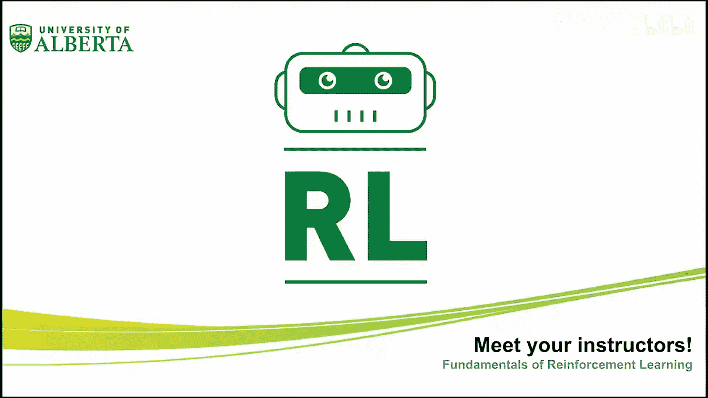

# 002：认识你的导师

在本节课中，我们将认识本课程的两位导师——Martha和Adam，了解他们的背景、研究兴趣以及他们为何认为强化学习是一个重要且充满前景的领域。

## 👋 导师介绍

我是Martha，阿尔伯塔大学的助理教授。我是Adam，阿尔伯塔大学的研究教授，同时也是DeepMind的高级研究员。

Adam因其在强化学习的预测知识方面的工作而闻名。全球多个研究小组都在基于他的思想进行研究。我个人认为这是他近年来最重要的工作之一，并且其影响力只会越来越大。他还是一位出色的实证研究者，是设计实验以触及关键问题的大师。他一直在努力提升强化学习领域的科学理解。

Martha对强化学习的算法贡献不胜枚举。她开发了多种新的离策略学习算法、新的策略梯度方法，并在表示学习方面做出了数十项令人印象深刻的贡献。她确实是强化学习领域冉冉升起的年轻新星之一。她恰好也是我最频繁的合作者以及我的人生伴侣。

## 🧑‍💻 进入计算机科学的契机

上一节我们认识了两位导师，本节中我们来看看他们是如何进入计算机科学领域的。

**Martha的经历：**
我成长于东海岸。高中时，我对科学非常感兴趣，比如物理、化学、生物，但一直没有找到特别契合的方向。于是，我有些随机地选修了一门关于计算机科学和编程的课程，用的还是GW-BASIC语言。那对我来说真是一个决定职业生涯的时刻。我记得第一次实现一个`if`语句或`for`循环时，那种能让计算机为我执行一系列指令的感觉太神奇了。从那时起，我就注定要在大学学习计算机科学了。

**Adam的经历：**
那么，你为何开始研究强化学习呢？为了研究生学业，我搬到了阿尔伯塔大学。我来这里原本是想做并行分布式计算，那是我本科时关注的方向。所以我选了很多系统课程。当时我还需要再选一门选修课，于是我采用了一个非常合理的策略：我浏览了教授们的照片，然后挑选了看起来最友善的那位教授。没错，那就是Rich Sutton，课程是“强化学习导论”。那门课太棒了，非常鼓舞人心。那是我第一次接触人工智能或任何形式的机器学习。我记得课程早期的一个作业是实现SARSA算法来解决一个网格世界问题。这又是一个决定性的时刻：看着智能体学会解决这个迷宫，它接收到的唯一反馈就是每步-1的奖励信号，但它却神奇地找到了迷宫中那条极其高效的路径。这再次让我感到惊奇，我被迷住了，并决定余生都要继续从事这个领域。

## 🧠 投身AI研究的历程

了解了他们进入计算机领域的契机后，我们再来看看Martha是如何开始人工智能研究的。

我本科其实是从数学开始的。我一直认为函数和动力系统非常优美。后来我只是为了好玩选了一门计算机科学课程，结果发现真的很有趣，于是我就继续同时学习数学和计算机科学。实际上，这两个学科对于人工智能和机器学习来说结合得非常好。之后我在暑期做了一些AI研究，并从此继续了下去。我留在这个领域，是因为随着时间的推移，它不仅仅是关于数学中的函数了。这真的是一个你可以进行大量合作的社区，你可以建立一个帮助他人的职业生涯。在我的日常工作中，我指导很多人，并与大团队一起攻克难题。能够在一个团队中研究如此有趣的问题，这真是太棒了。

## 🎓 研究生阶段的重要收获

对于可能想攻读强化学习研究生学位的学习者，Adam分享了他认为研究生阶段最重要的收获。

也许令人惊讶的是，我学到的一个经验可能适用于所有科学领域，事实上，适用于任何形式的研究：那就是真正热爱去理解事物的细节，专注于小问题并真正、彻底地理解它们。我认为这一点在广泛的领域中都非常适用。这也是我传授给我的学生、在我的课程中强调，并着重教导我的研究生的一点。我希望与学习这个专项课程的人们分享这一点。

## ❤️ 工作中最珍视的部分

接下来，Adam谈到了他工作中最珍视的部分。

我热爱做研究，但有时这也会让人有点疲惫，比如工作时间很长，同行评审过程可能有点令人沮丧。在这些时候，当你退一步审视自己的研究时，它可能显得有点渺小，有点微不足道，很难看清它将如何发展，如何影响世界并让它变得更好。所以在那些时候，你总是可以回归到教学和指导上。教学是你帮助人们第一次学习事物、理解你所在领域如何运作的地方，这非常令人兴奋。你也是他们职业生涯开端的一部分，无论他们最终进入学术界、工业界还是创办自己的公司。能成为这个过程的一部分，是一种非常奇妙的体验。你知道，在我的一周中，对我来说最好的一天总是那些日程排满了与学生会议的日子，我可以帮助他们解决问题，更好地理解强化学习。

## 🚀 为何强化学习如此重要

那么，为什么他们认为强化学习值得投入研究呢？以下是他们的观点。

**Adam的观点：**
我认为强化学习的潜力非常大，但仍然存在许多开放的挑战。机器学习已经开始被更广泛地使用，但强化学习目前只在少数几个领域得到应用。但同时，我认为强化学习可以产生非常大的影响。我认为在未来十年左右，我们将看到更多的控制工程师在他们的系统中实际使用强化学习。我们真的会看到，它是一个可以在更大的工程系统中帮助进行自动化决策的工具。但我认为，要真正实现这一点，我们需要在强化学习方面取得一些进展。我们需要更多地思考如何开发出稳健的算法，以及如何让人们乐于使用这些算法。所以我认为，随着在工业界的应用，我们需要思考如何改进强化学习算法，让这两件事能够共同发生。

**Martha的观点：**
很自然地，我认为强化学习是研究人工智能、推动解决人工智能问题的正确框架。但强化学习对我来说也很重要，因为我对发展性学习系统非常感兴趣。你可以想想人类婴儿在地上玩耍，或者幼年动物学习认识世界。我想了解这些系统及其工作原理。如果你思考这些系统，它们能在极短的时间内学到海量的知识。它们学习如何爬行，学习自己的身体如何工作，学习如何与环境互动、操纵物体、与世界中的其他智能体交流。总的来说，它们是非常强大的学习系统，而这一切只发生在几周到几个月的时间里。这真的令人震惊，感觉我们还有大量的工作要做，才能接近这类系统。所以我真的想理解这些系统可能使用的算法和表示方法，而我认为强化学习是观察和理解这些事物的正确视角。

## 🔮 强化学习的未来应用

应用总是推动领域兴趣和兴奋点的关键。强化学习在游戏和一些工业控制问题上已有一些应用，但未来的重大进展会在哪里？

**Adam的展望：**
我认为，强化学习的核心是一种通用的自动化决策方法。它是一个将在我们许多工程系统中帮助我们的工具。因此，我认为它将真正起飞的地方是工业控制领域。在工业控制中，专家们确实在寻找方法来优化他们的系统性能。所以我们将看到它被用于降低能源成本，或节省工业控制系统中的其他类型成本。在专家手中，我们真的可以在不远的将来让这些算法良好工作。所以我真的把它看作是一个促进专家工作的工具，而不是说取代人或使其自动化。

---

**本节课总结：**
本节课中，我们一起认识了本课程的两位导师Martha和Adam。我们了解了他们进入计算机科学和强化学习领域的个人经历，他们从研究生涯中获得的宝贵见解，以及他们为何对强化学习的未来充满热情与期待。他们认为强化学习不仅是实现通用人工智能的关键框架，也是解决现实世界工业控制与决策问题的强大工具，其发展需要算法鲁棒性与实际应用的共同推进。