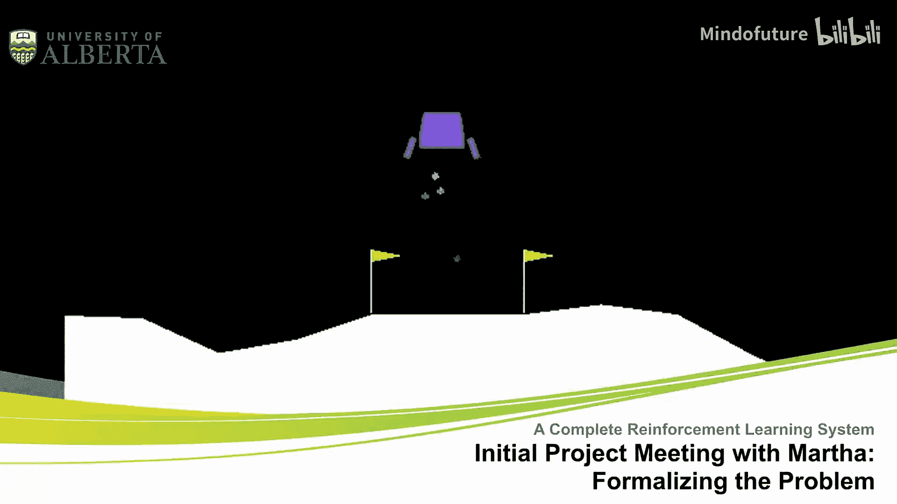
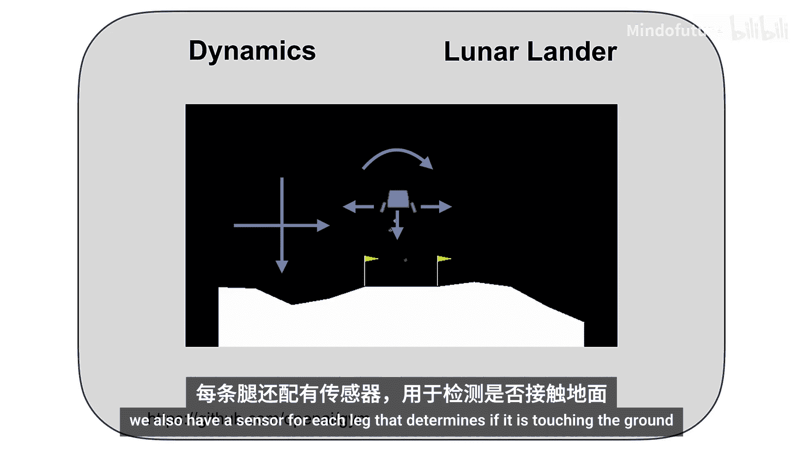
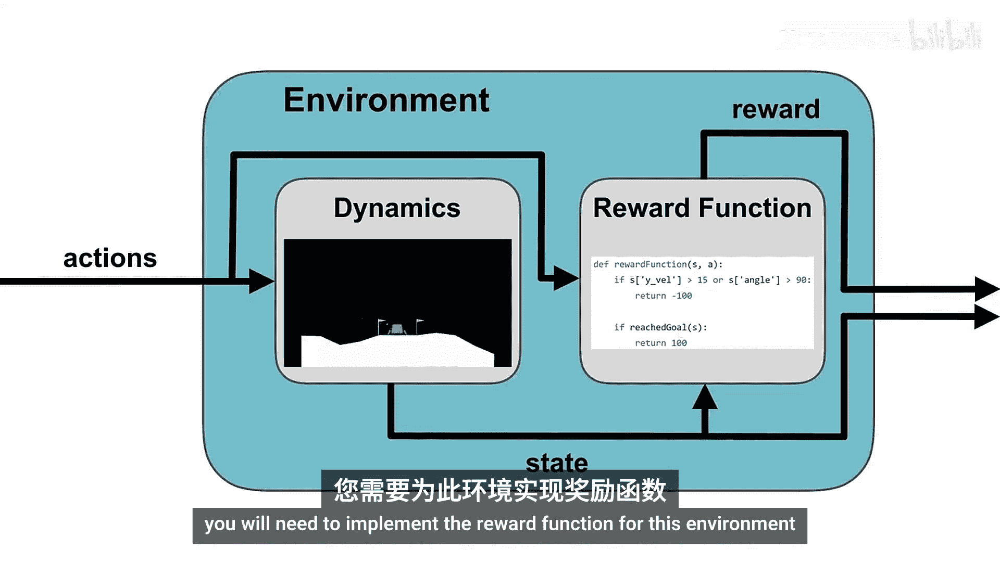
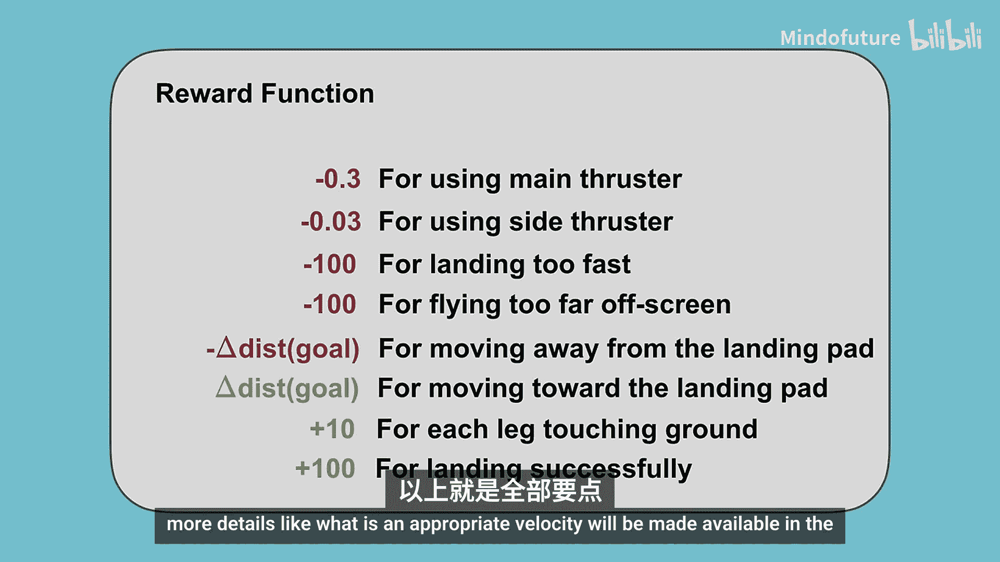

# 003：与玛莎的初步项目会议-形式化问题

## 概述

在本节课中，我们将学习如何将一个复杂的现实世界任务——月球着陆——形式化为一个强化学习问题。我们将介绍一个模拟的“月球着陆器”环境，并详细说明其状态空间、动作空间以及你需要实现的奖励函数。

---

想象一下，你想要在月球上着陆。这看起来是一项艰巨的任务，我们需要了解大量的物理学和控制理论，并且必须预见无数可能出错的情况。

但是，如果我们将其构建为一个强化学习问题呢？

我们的智能体不需要知道真实世界的动力学原理。

它可以通过简单的交互来学习。你的智能体将做到这一点：月球着陆器将与世界交互，尽管不清楚其动力学原理。

但是，为了让着陆器按照你的意愿行动，你必须设计奖励函数。

当然，通过试错来学习如何在月球上着陆可能有点危险且成本高昂。

因此，我们将在模拟器中训练我们的智能体，以找到一个稳健且高效的着陆策略。

然后，我们可以将智能体部署到月球上，并允许它继续学习。

调整其价值函数和策略，以适应我们的模拟器与现实之间的差异。

这意味着在模拟器中训练时，我们不必担心安全或金钱问题。

但请记住，我们在这里使用的是非常简单的模拟。

它并不能反映外层空间的所有复杂性。

但我们不能使用高保真模拟器，因为我们需要你的实验能够合理地快速运行。

即使使用我们的高保真模拟器，我们的智能体在部署时可能仍然会遇到问题。

要让在模拟器中训练的智能体迁移到现实世界，需要许多技术细节。

但这个主题远远超出了这个小项目的范围。

我们的目标是帮助你处理一个中等有趣的问题，并帮助你获得将问题的文字描述转化为具体解决方案的经验。

在本视频中，我们将向你介绍你将使用的环境。

你将理解状态空间、动作空间以及你需要实现的奖励函数。

这就是月球着陆器环境的样子。

以下是智能体成功着陆的几个例子。

我们的目标是让月球着陆器降落在位于两个黄色旗帜之间的着陆区。

着陆区始终位于同一位置，但其周围的地形可能会发生变化。

我们可以点燃主推进器或任意一个侧推进器来调整模块的方向并减缓其下降速度。

状态由八个变量组成，包括模块的XY位置和速度。

以及它相对于地面的角度和角速度。

我们每条腿上还有一个传感器，用于确定它是否接触地面。

让我们更深入地看看你将实现的环境部分。

环境接收动作输入，该动作与当前状态一起传递给动力学函数，以产生下一个状态。

下一个状态和动作随后将被传递给一个编码了期望行为的奖励函数。

最后，环境将输出下一个状态和奖励。

智能体可以采取四种动作。智能体可以点燃主推进器。

点燃左侧推进器，点燃右侧推进器，或者在此时间步内什么都不做。

你需要为此环境实现奖励函数。

燃料是昂贵的，主推进器会消耗大量燃料。

我们希望阻止智能体不必要地使用主推进器。

侧推进器消耗的燃料较少，因此智能体频繁使用它们的负面影响较小。我们希望鼓励智能体向目标移动。

因此，它将根据自上一个时间步以来它离目标移动了多远而损失一些奖励。

让我们尝试阻止智能体学习以可能损坏设备的方式驾驶模块着陆，同时也要阻止它飞向外层空间或遥远的陨石坑而消失不见。

智能体将因其设法让每条腿接触地面而获得奖励。

并且，智能体将以适当的速度成功降落在着陆垫上时，将获得一大笔奖励。

更多细节，例如什么是适当的速度，将在笔记本中提供。

## 总结

本节课中，我们一起学习了如何将月球着陆任务形式化为强化学习问题。我们介绍了“月球着陆器”模拟环境，明确了其状态由八个变量（如位置、速度、角度等）构成，动作空间包括点燃主/侧推进器或保持不动。核心任务是设计一个奖励函数，该函数需要权衡燃料成本、朝向目标的移动、安全着陆以及成功降落在指定区域等多个目标。你本周的目标就是为这个问题实现这个奖励函数。祝你在构建环境时好运。