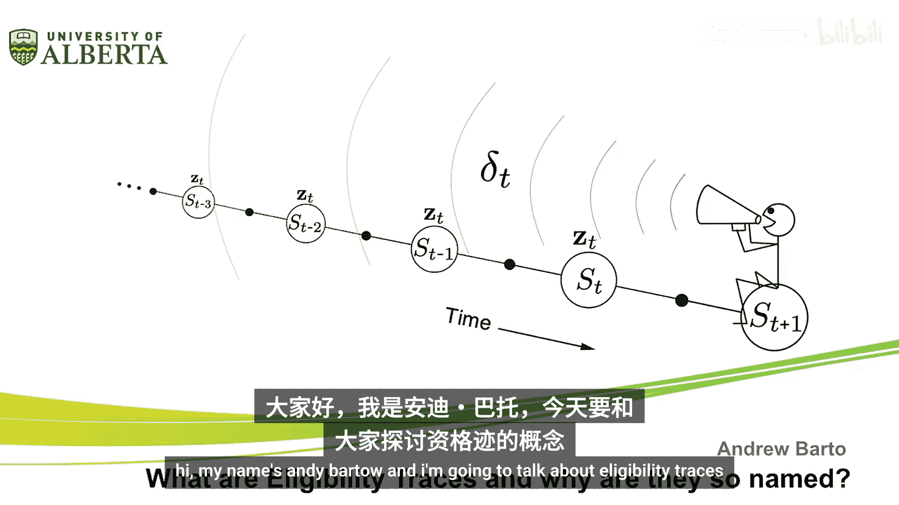
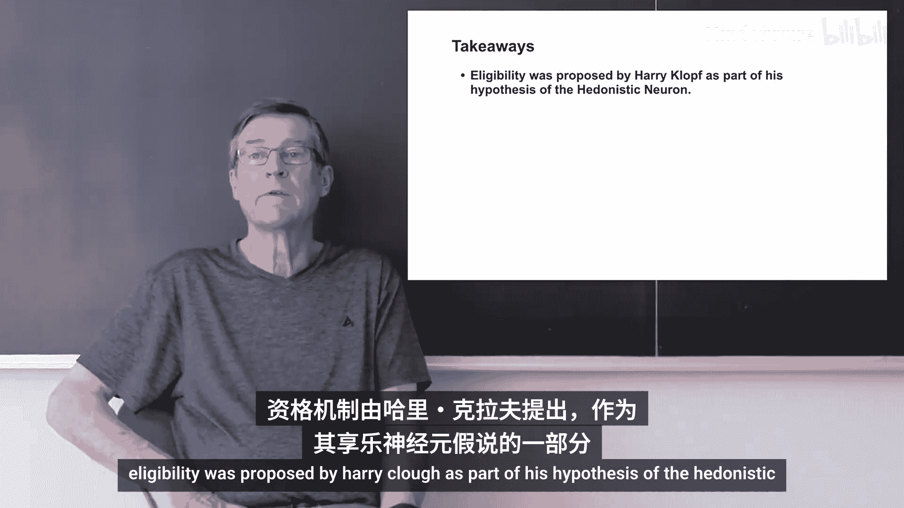

# 004：论什么是资格迹以及它们为何如此命名

## 概述
在本节课中，我们将学习强化学习中的一个核心概念——资格迹。我们将探讨资格迹的起源、其命名的原因，以及它在学习算法中的作用。通过理解神经元学习机制与强化学习算法之间的联系，你将看到资格迹是如何被我们一直使用的。

## 资格迹的起源与概念

资格迹的概念源于哈里·克洛夫的假说。哈里是美国空军科学研究办公室航空电子学理事会的一位资深科学家。他在1972年发表了一篇专著，并在1982年出版的《享乐主义神经元》一书中提出了他的核心思想。

他的假说认为，神经元个体是享乐主义者，它们努力最大化局部的“快乐”类似物，同时最小化局部的“痛苦”类似物。换句话说，根据他的观点，每个神经元都是一个强化学习智能体，而大脑则是一个由相互作用的强化学习智能体组成的社会。

为了理解克洛夫的假说，我们需要了解一些神经元的基础知识。神经元的输出或动作被称为动作电位，通过神经元的轴突传递给其他神经元。当神经元产生动作电位时，我们称其为“放电”。动作电位通过突触作用于其他神经元，而突触具有效能或权重/强度，这些会在学习过程中发生改变。

下图是一个突触的示意图。动作电位通过顶部的突触前末梢到达，并影响底部的突触后神经元。我们通常认为突触权重或效能存在于这个连接中，而“资格”这个概念通常被认为是由轴突内部的生物化学过程实现的，可能就在此处所示的突触前末梢。

克洛夫的具体假说如下：当神经元放电产生一个动作电位时，所有促成此次放电的突触都变得有“资格”去改变其效能或权重。如果在此动作电位之后的一个合适时间窗内出现了奖励的增加，那么所有具备资格的突触的效能就会增加（如果是惩罚，则减少）。

这就引出了一个问题：资格迹的形状应该是怎样的？资格迹是存储在突触处、基于神经元先前活动的记忆记录。

## 资格迹的形状与类型

克洛夫指出，神经元嵌入在持续时间各不相同的众多反馈回路中。有些反馈回路在神经系统内部，因此非常短；有些则通过环境延伸到生物体外部，再通过感觉器官返回，因此是更长的反馈回路。所以，神经元活动的后果会以不同的时间延迟返回给它。

资格迹的形状就是这些反馈回路持续时间的一种直方图。下图展示了资格迹可能呈现的形状：在神经元放电后，有少数非常短的反馈回路会迅速返回信息；可能在某个时间点（例如600毫秒）达到最大数量（当然，不同神经元会不同）；然后还有少数非常长的反馈回路。因此，克洛夫假设的资格迹形状大致如下所示。

资格迹主要分为两种类型：
*   **依存性资格迹**：取决于突触前和突触后活动，正如克洛夫所假设的。突触前输入需要参与引发突触后活动。这导致了一个三因素学习规则：突触前活动、突触后活动以及稍后到达的强化输入。
*   **非依存性资格迹**：仅由突触前活动触发。这导致了一个两因素学习规则：突触前活动和强化输入，而不依赖于突触后神经元的活动。

下图展示了这些概念。顶部的曲线是几个突触前动作电位，下面的曲线是几个突触后动作电位。可以看到，在两个实例中，它们大致同时发生，表明突触前动作电位有助于引起突触后动作。对于依存性资格迹，只有这两个实例会触发资格迹。而非依存性资格迹则会包含最后一个实例，它仅由突触前脉冲触发，即使当时没有突触后脉冲。

## 资格迹在演员-评论家架构中的应用

现在，看看你们已经学过的演员-评论家架构（特别是在策略梯度方法中）。事实证明，演员和评论家之间的主要区别在于：**演员使用依存性资格迹，而评论家使用非依存性资格迹**。

因此，在第一种情况下，演员试图最大化强化信号，而在评论家的情况下，它试图预测强化信号。这主要就是由于这两种资格迹类型的差异造成的。

## 强化学习中的简化与实现

在强化学习中，我们使用了克洛夫所建议的那种迹的简化版本，它看起来像这样：一个**指数衰减的迹**。相比于我之前展示的更复杂的迹，这种形式更容易实现和分析。但有时，更接近克洛夫原始设想的迹可能表现更好，不过目前我还不清楚是否有深入研究这个问题的相关工作。

实际上，你们一直在使用资格迹，尽管是最简单的那种。仅仅一个时间步的延迟就可以被认为是用资格迹实现的。如果这是时间线，事件发生在时间 `t`，那么在 `t+1` 时刻就是迹。这意味着反馈回路只考虑了一个时间步长，这是唯一被考虑的情况。所以，这可以说是一种退化的情况，你们研究过的几乎所有强化学习算法都将其作为其机制的一部分。

## 总结

本节课中，我们一起学习了资格迹的核心概念。以下是几个关键要点：

*   资格迹由哈里·克洛夫作为其“享乐主义神经元”假说的一部分提出。
*   资格迹记录了突触过去的活动，以便在该活动之后到达的反馈能够改变突触的强度。
*   在演员-评论家架构中，演员和评论家的主要区别在于：演员的资格迹是**依存性**的，而评论家的是**非依存性**的。
*   资格迹对于在突触学习规则中考虑信号时序的作用至关重要。
*   最后，神经科学正在积累证据，表明神经系统确实存在非常类似于资格迹的机制。

