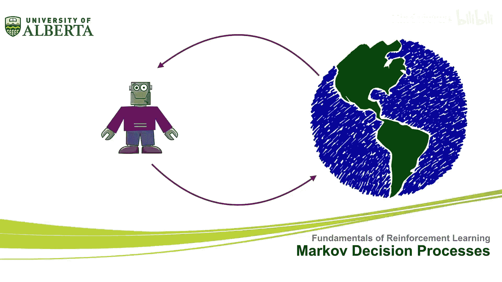
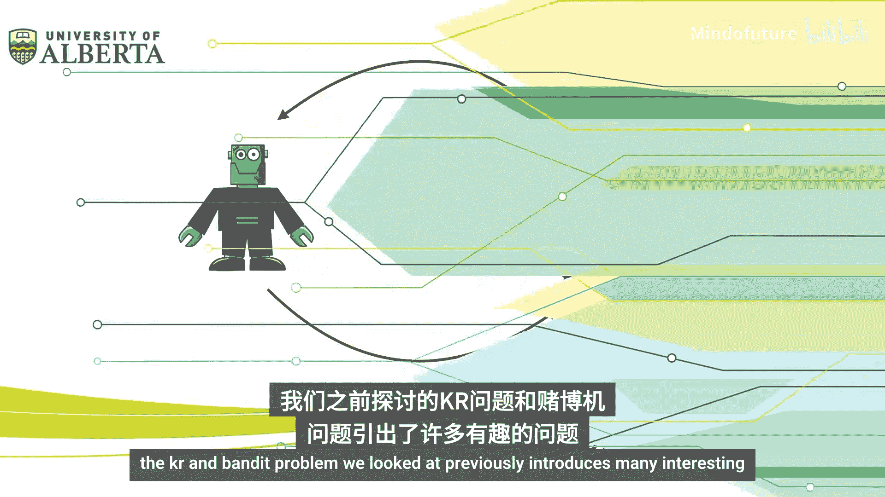
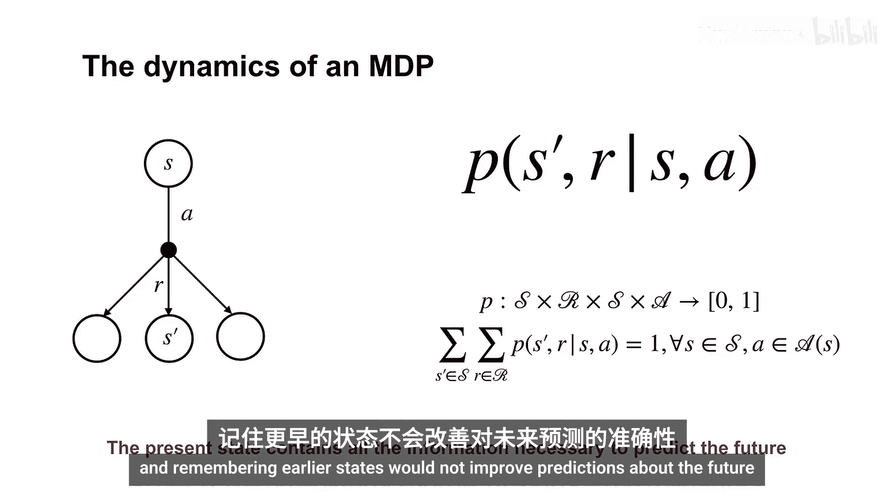

# 005：马尔可夫决策过程回顾 02_02_01






在本节课中，我们将要学习马尔可夫决策过程。我们将从多臂老虎机问题的局限性出发，理解为什么需要MDP框架来建模更复杂的现实世界问题。我们将通过一个兔子的例子，直观地展示MDP的核心概念，并最终用数学公式来形式化地定义MDP的动态特性。

## 从老虎机到序列决策 🐇

上一节我们介绍了多臂老虎机问题，它引出了许多有趣的问题。然而，它没有包含现实世界问题的许多方面。

在老虎机问题中，智能体在每个时刻面临相同的情况，并且总是存在一个最优动作。但在许多问题中，不同的情况需要不同的应对策略。此外，我们现在选择的动作会影响未来能获得的奖励数量。

马尔可夫决策过程形式化地捕捉了现实世界问题的这两个方面。

## 一个简单的例子：兔子的选择 🥕

让我们从一个简单的例子开始，来突出老虎机问题和MDP之间的区别。

想象一只兔子在田野里游荡寻找食物，它发现自己处于这样一种情况：右边有一根胡萝卜，左边有一棵西兰花。我们的兔子更喜欢胡萝卜，所以吃胡萝卜会产生+10的奖励。而吃西兰花只产生+3的奖励。

但是，如果后来兔子发现自己处于另一种情况：右边是西兰花，左边是胡萝卜呢？显然，兔子此时会倾向于向左走，而不是向右走。多臂老虎机问题无法解释“不同情况需要不同动作”这一事实。

它在另一个方面也有局限。假设我们确实考虑了不同情况下的不同动作。在这里，兔子似乎想向右走以获得胡萝卜。然而，向右走也会影响兔子接下来看到的情况。

假设就在胡萝卜的右边，有一只老虎。如果兔子向右移动，它就能吃到胡萝卜。但之后，它可能不够快，无法逃脱老虎。如果我们考虑到行动的长期影响，兔子应该向左走，选择西兰花，给自己一个更好的逃跑机会。

一个只关心即时奖励的“老虎机兔子”会选择胡萝卜。但通过考虑我们决策的长期影响，可以做出更好的决定。

## 定义MDP的核心要素 📝

现在让我们看看随着兔子采取行动，情况是如何变化的。我们将这些情况称为**状态**。在每个状态下，兔子选择一个**动作**。例如，兔子可以选择向右移动。

基于这个动作，世界会转变为一个新的状态并产生一个**奖励**。在这个例子中，兔子吃了胡萝卜并获得+10的奖励。然而，兔子现在紧挨着老虎。假设兔子选择了向左的动作。世界转变为一个新的状态，老虎吃掉了兔子，兔子获得-100的奖励。

从原始状态，兔子也可以选择向左移动，然后世界转变为一个新的状态，兔子获得+3的奖励。这个图表现在显示了两种可能的状态序列，实际发生的序列取决于兔子采取的行动。

我们可以用一个通用框架来形式化这种交互。在这个框架中，**智能体**和**环境**在离散的时间步上进行交互。

在每个时间步`t`，智能体从环境接收一个状态`S_t`，它来自一组可能的状态集合`S`。幻灯片上显示的配置就是一个状态的例子。

基于这个状态，智能体从一组可能的动作集合`A(S_t)`中选择一个动作`A_t`。`A(S_t)`是状态`S_t`中有效动作的集合。向右移动就是一个动作的例子。

一个时间步之后，部分基于智能体的动作，智能体发现自己处于一个新的状态`S_{t+1}`。例如，这个状态是兔子紧挨着老虎的状态。

环境还提供一个标量奖励`R_{t+1}`，它来自一组可能的奖励集合`R`。在这个例子中，吃胡萝卜的奖励是+10。

下图总结了MDP框架中的智能体-环境交互。这种交互生成了一条由状态、动作和奖励组成的经验轨迹。动作既影响即时奖励，也影响未来的状态，并通过那些状态影响未来的奖励。

## 形式化动态特性：转移概率函数 🧮

那么，我们如何表示这种交互的动态特性呢？与老虎机问题一样，结果是随机的，因此我们使用概率的语言。

当智能体在一个状态下采取一个动作时，存在许多可能的下一个状态和奖励。**转移动态函数 `P`** 形式化了这个概念。

给定一个状态`s`和动作`a`，`P`告诉我们下一个状态`s‘`和奖励`r`的联合概率。在本课程中，我们通常假设状态、动作和奖励的集合是有限的，但别担心，你也会学习能够处理无限集和不可数集的算法。

由于`P`是一个概率分布，它必须是非负的，并且对所有可能的下一个状态和奖励的求和必须等于1。

**公式表示：**
```
P(s‘, r | s, a) = Pr{ S_{t+1} = s‘, R_{t+1} = r | S_t = s, A_t = a }
```

并且满足：
```
∑_{s‘ ∈ S} ∑_{r ∈ R} P(s‘, r | s, a) = 1， 对于所有 s ∈ S， a ∈ A(s)
```

需要注意的是，未来的状态和奖励仅取决于当前的状态和动作。这被称为**马尔可夫性**。这意味着当前状态是充分的，记住更早的状态不会改善对未来的预测。



## 总结与展望 🎯


本节课中我们一起学习了马尔可夫决策过程。MDP为序列决策制定提供了一个通用框架，其动态特性由一个概率分布定义。

总结一下，MDP的核心要素包括：
*   **状态**：描述环境情况的变量。
*   **动作**：智能体可以做出的选择。
*   **奖励**：环境对智能体动作的即时反馈。
*   **转移概率函数 `P`**：定义了在给定状态和动作下，转移到下一个状态并获得相应奖励的概率。

在下一个视频中，我们将讨论几种决策制定任务，并将每一种形式化为一个MDP。