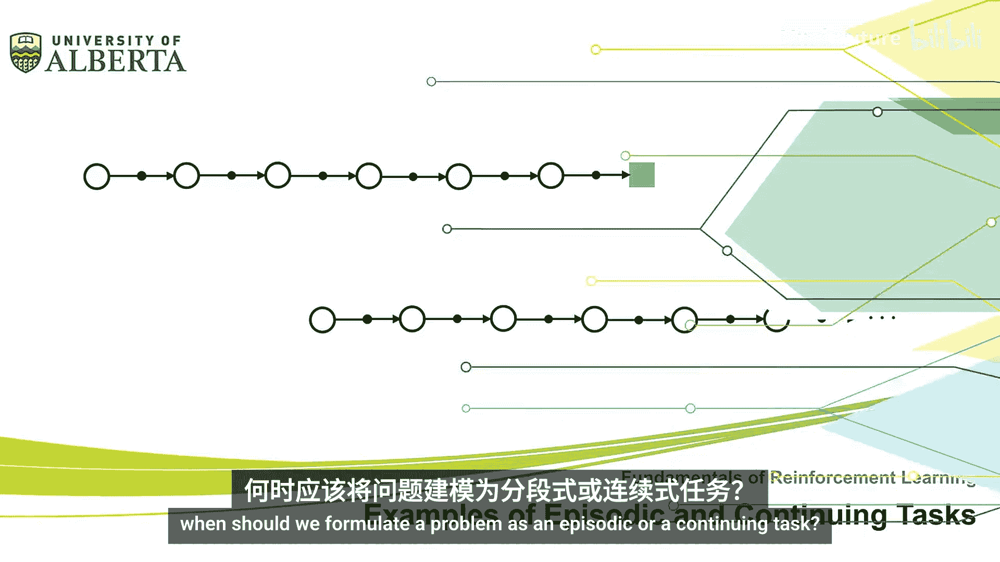
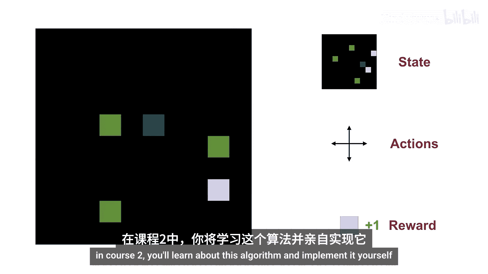

# 006：区分回合制与持续型任务 🎮

在本节课中，我们将通过具体例子，学习如何判断一个强化学习问题应该被建模为**回合制任务**还是**持续型任务**。理解这一区别对于正确设计智能体及其学习目标至关重要。

## 回合制任务示例 🕹️

上一节我们介绍了回合制任务的基本概念，本节中我们来看看一个具体的例子。

考虑一个智能体学习玩一个简单的视频游戏。玩家（用蓝色方块表示）通过收集白色宝藏方块来获得分数。当玩家触碰到绿色敌人方块时，游戏结束。

这个游戏很自然地可以被建模为一个**回合制马尔可夫决策过程**。智能体的目标是在游戏结束前，通过收集尽可能多的宝藏来获得高分。

以下是该任务的关键要素：
*   **状态**：一个与当前游戏屏幕对应的像素值数组。
*   **动作**：四个方向：上、下、左、右。
*   **奖励**：每当智能体收集一个宝藏方块时，获得 **+1** 的奖励。
*   **回合终止**：当智能体触碰到任意一个绿色敌人时，当前回合结束。无论回合如何结束，下一个回合都会从智能体位于屏幕中央且没有敌人出现的初始状态重新开始。

顺便一提，你现在看到的这个智能体是通过Q学习算法训练的，它在这个游戏中表现得相当不错。在课程的第二部分，你将学习这个算法并亲自实现它。

## 持续型任务示例 💻

了解了回合制任务后，我们再来看看一个持续型任务的场景。

假设有一个智能体负责在一组服务器上调度作业。我们有三台服务器，供强化学习研究人员运行实验。研究人员将具有不同优先级的作业提交到一个队列中。

以下是该任务的关键要素：
*   **状态**：空闲服务器的数量，以及队列顶部作业的优先级。
*   **动作**：拒绝或接受队列顶部的作业（如果有空闲服务器）。
*   **奖励**：
    *   接受作业会运行它，并产生一个等于该作业优先级的正奖励。
    *   拒绝作业会产生一个与优先级成比例的负奖励，并将该作业送回队列末尾。

智能体需要谨慎调度低优先级作业，因为这可能会阻碍后续高优先级作业的调度。当服务器完成当前作业后，会重新变为可用状态。研究人员会持续地向队列中添加新作业，而智能体则不断地决定接受或拒绝它们。

由于这个过程永远不会停止，因此它非常适合被描述为一个**持续型任务**。

## 总结 📝

本节课中，我们一起学习了回合制任务与持续型任务的具体例子。

*   **回合制任务**：能够自然地分解为独立的回合，每个回合有明确的开始和结束（如电子游戏的一局）。
*   **持续型任务**：被假定为无限期持续进行，没有自然的中断点（如持续运行的服务器作业调度系统）。

现在，你应该能够根据问题的特性，判断哪种任务形式化方法更为合适了。