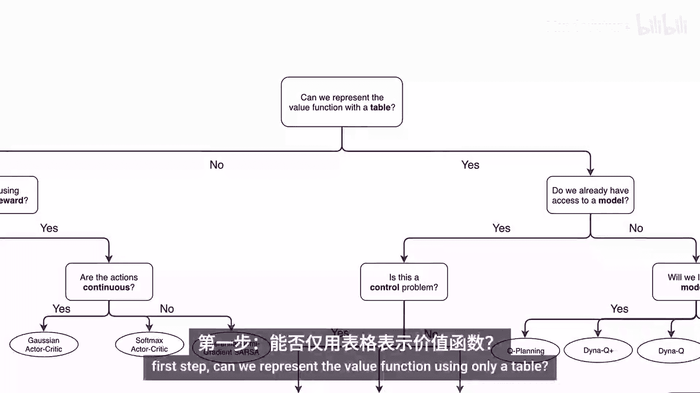
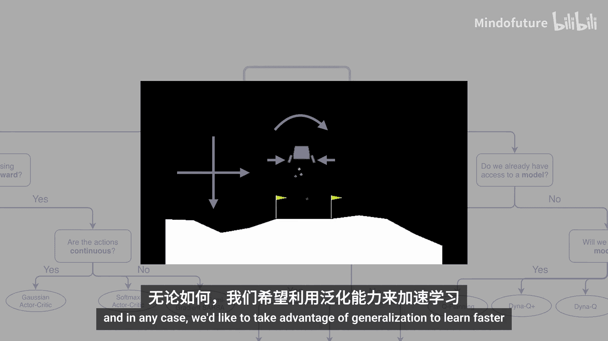
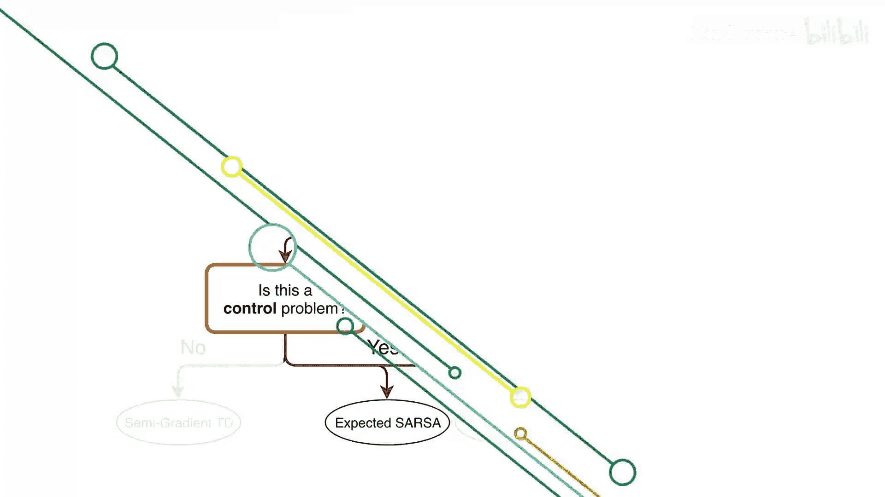

# 007：与尼科的会议-选择学习算法

在本节课中，我们将为“月球着陆器”项目选择合适的学习算法。我们将回顾问题形式化，并利用课程三中的算法地图，系统地筛选出最适合本项目的算法。

## 概述

本周，我们将开始讨论如何解决月球着陆器这个马尔可夫决策过程问题。核心任务是，从已学过的众多算法中，选择一个最适合本问题的算法。

## 回顾问题与算法地图

上一节我们已将月球着陆问题形式化为一个MDP。本节中，我们来看看如何利用课程三的算法地图来指导我们的选择。

以下是算法决策流程：

1.  **能否用表格表示价值函数？**
    首先，回顾月球着陆器的状态空间。智能体观测到着陆器的位置、方向、速度和接触传感器等八个状态变量。其中六个是连续变量，这意味着我们无法用表格来精确表示所有状态。此外，我们希望利用泛化能力来加速学习。因此，**表格型方法不适用**。

2.  **这适合建模为平均奖励问题吗？**
    接下来，思考问题的动态特性。月球着陆器从低轨道开始下降，直到在月球表面静止。这个过程会不断重复，每次新的着陆尝试都独立于上一次的结果而开始。这正是**分幕式任务**的定义。平均奖励公式适用于持续式任务，因此在这里不是最佳选择。我们可以**排除平均奖励分支的算法**。

3.  **是否可能且有益于在每个时间步更新策略和价值函数？**
    我们可以使用蒙特卡洛方法或时序差分方法。考虑在月球上着陆模块：如果在幕中任何传感器受损，我们希望能在幕结束前就更新策略。这类似于我们讨论过的“开车回家”的例子。我们预计**时序差分方法**在这类问题上表现更好。

4.  **最终目标是什么？**
    最后，不要忘记我们的目标。我们希望在模拟器中学习一个安全、鲁棒的策略，以便能在月球上使用。我们希望学习一个能最大化奖励的策略，因此这是一个**控制任务**。

经过以上筛选，我们剩下三个候选算法：SARSA、期望SARSA和Q学习。

## 在候选算法中做出最终选择

由于我们使用函数近似，学习一个ε-软策略将比学习一个确定性策略更鲁棒。请记住那个由于状态混叠导致确定性策略次优的例子。

以下是最终决策考量：

*   **期望SARSA和SARSA**都允许我们学习最优的ε-软策略。
*   **Q学习**则不能保证这一点。

因此，我们首先排除Q学习。

现在需要在期望SARSA和SARSA之间选择。我们在之前的视频中提到过，**期望SARSA通常比SARSA表现更好**。因此，我们选择排除SARSA。

## 总结

本节课中，我们一起学习了如何为月球着陆器项目系统地选择学习算法。我们回顾了问题的MDP形式，并利用算法决策地图，逐步排除了不合适的选项。最终，我们选择了**期望SARSA算法**作为智能体实现的基础。下周我们将基于此算法继续构建我们的智能体。