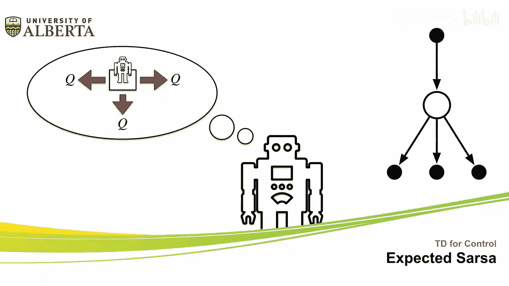
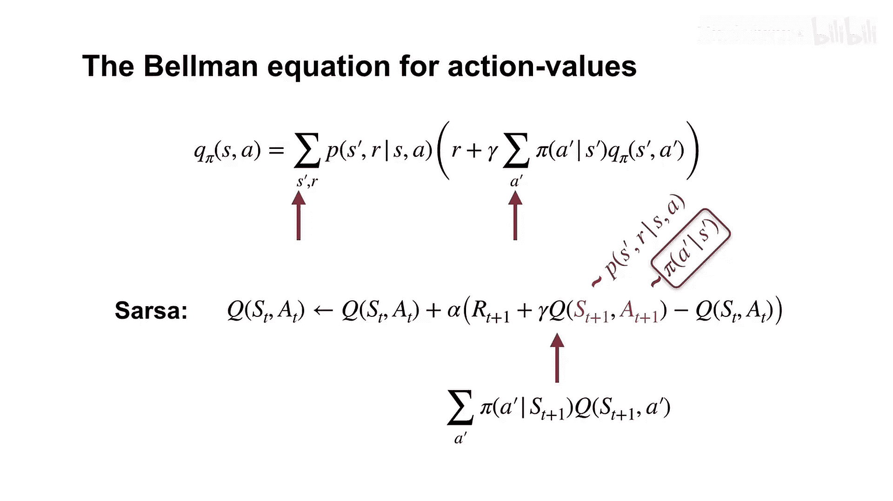
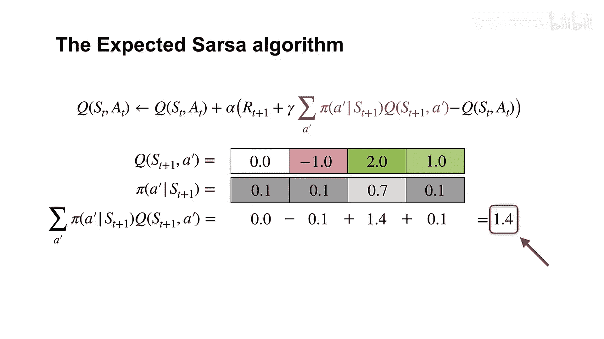
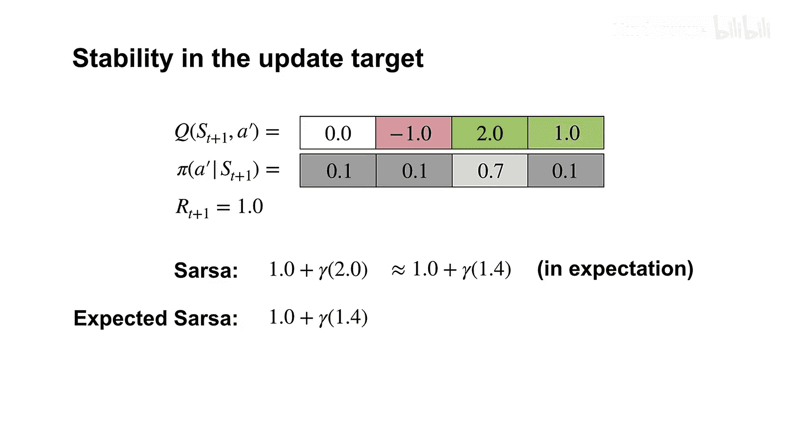
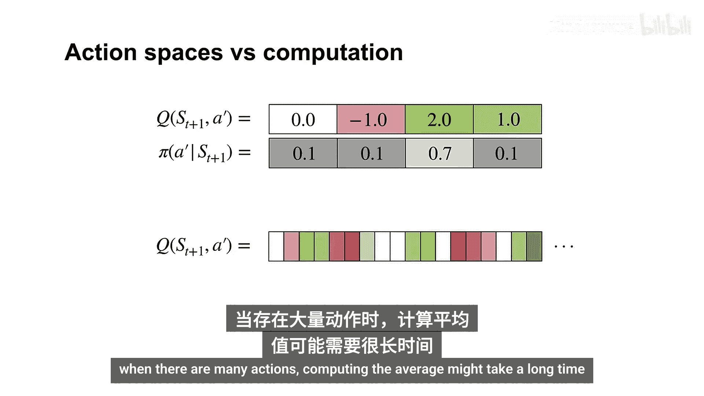
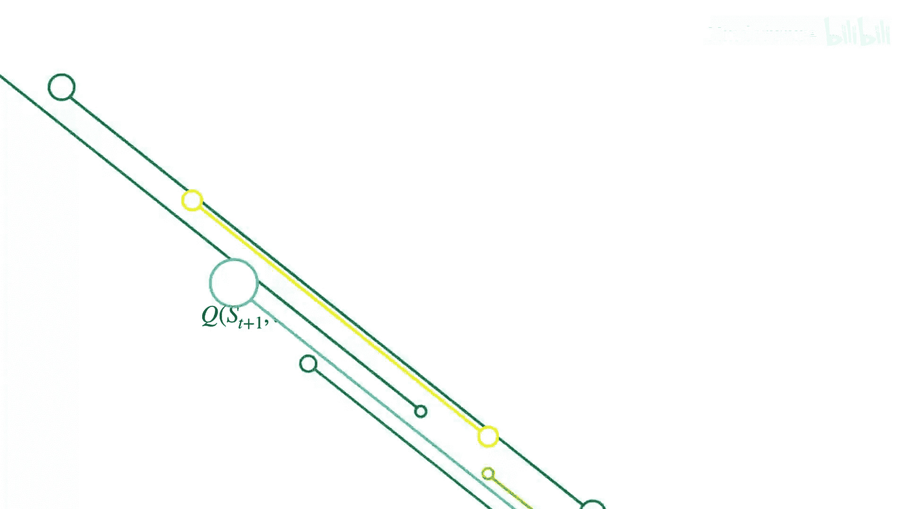

# 008：期望Sarsa算法详解 🧠



在本节课中，我们将学习第三种时序差分控制方法——期望Sarsa。我们将探讨其核心思想、更新规则，并与之前学过的Sarsa和Q学习算法进行比较。

上一节我们介绍了Sarsa和Q学习这两种时序差分控制方法。本节中，我们来看看另一种基于动作值函数贝尔曼方程的算法：期望Sarsa。

## 核心思想：从采样到期望计算

回顾动作值函数的贝尔曼方程，其中包含了对下一个“状态-动作”对值的期望。这个期望可以分解为对可能的下一个状态和可能的下一个动作的求和。

Sarsa算法通过从环境中采样下一个状态，并从其策略中采样下一个动作来估计这个期望。但智能体本身已知其策略，为何还需要采样下一个动作？它应该可以直接计算期望。具体而言，我们可以对所有可能的下一个动作的值进行加权求和，权重即为策略下采取每个动作的概率。



**公式表示**：
`E[Q(S', A')] = Σ_a π(a|S') * Q(S', a)`

显式计算下一个动作的期望，就是期望Sarsa算法背后的核心思想。

## 算法更新规则

由于期望Sarsa仍然基于动作值函数的贝尔曼方程，因此其学习更新遵循熟悉的形式。该算法与Sarsa几乎相同，**关键区别**在于其时序差分误差使用的是下一个动作值的**期望估计**，而非下一个动作值的**采样值**。

这意味着在每一步，智能体都需要根据策略下各动作出现的可能性，对下一个状态的所有动作值进行平均。



**代码描述更新规则**：
```python
# 假设已知策略概率 pi 和下一个状态的所有动作值 Q_next
expected_next_q = sum(pi[a] * Q_next[a] for a in actions)
td_target = reward + gamma * expected_next_q
td_error = td_target - Q_current
Q_current = Q_current + alpha * td_error
```

## 稳定性优势与计算代价

显式计算期望带来一个巨大优势：期望Sarsa的更新目标比Sarsa更稳定。

让我们通过一个例子来更清楚地说明这一点。在一个中间奖励确定为正的示例中，即使Sarsa和期望Sarsa都从下一个状态的**真实动作值**开始，Sarsa对下一个动作的采样仍可能导致其更新方向错误。它依赖于在多次更新的期望中方向是正确的。相比之下，期望Sarsa的更新目标是完全准确的，不会使估计值偏离真实值。

总的来说，期望Sarsa的更新目标方差比Sarsa低得多。然而，较低的方差也伴随着一个缺点：随着动作数量的增加，计算下一个动作的平均值会变得更加昂贵。当存在许多动作时，计算平均值可能需要很长时间，尤其是这个平均值需要在每个时间步都进行计算。



以下是期望Sarsa与Sarsa的简要对比：

*   **更新目标**：期望Sarsa使用期望值，Sarsa使用采样值。
*   **方差**：期望Sarsa的更新方差更低，更稳定。
*   **计算成本**：期望Sarsa需要计算加权平均，在动作空间大时成本更高；Sarsa只需采样，计算更高效。





## 总结

本节课中，我们一起学习了期望Sarsa算法。该算法的核心在于**显式计算其策略下的期望值**，而非进行采样。这种做法虽然比采样计算代价更高，但带来了**更低的方差和更稳定的学习过程**。理解期望Sarsa有助于我们更全面地认识时序差分控制方法的谱系，并在实际应用中根据问题特性（如对稳定性的要求、动作空间的大小）在算法间进行权衡选择。