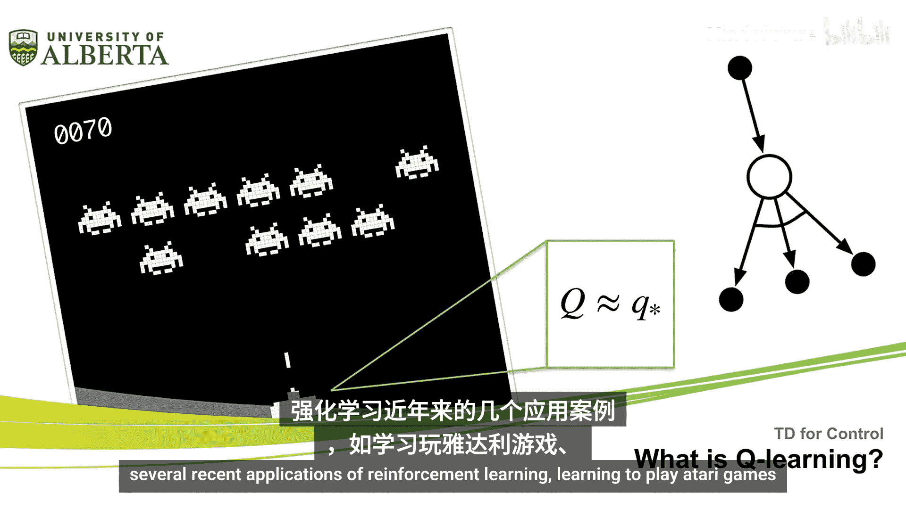
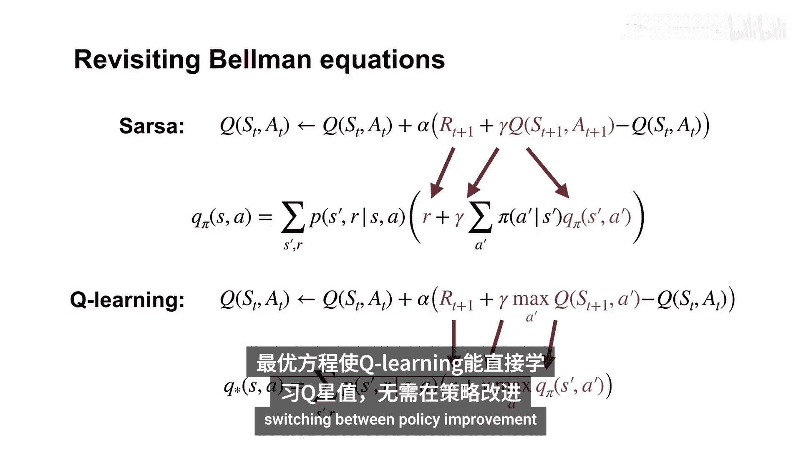

# 009：Q学习算法回顾 🧠



在本节课中，我们将学习Q学习算法，并探讨它与贝尔曼最优方程之间的关系。Q学习是强化学习领域一个经典且重要的在线学习算法。

## Q学习算法简介

Q学习算法于1989年被提出，是最早的主要在线强化学习算法之一。近年来，许多强化学习的应用，例如学习玩雅达利游戏、控制交通信号灯，甚至自动配置网络系统，都基于这一单一算法。

## Q学习伪代码解析

以下是Q学习算法的伪代码结构。我们之前见过类似的格式：智能体在状态中选择一个动作，执行该动作，然后观察下一个状态和奖励。接着，智能体进行一次更新，循环重复。

```
初始化 Q(s, a)
对于每一个回合：
    初始化状态 s
    当状态 s 不是终止状态时：
        根据策略（如ε-greedy）从状态 s 中选择动作 a
        执行动作 a，观察奖励 r 和下一个状态 s'
        Q(s, a) ← Q(s, a) + α [ r + γ * max_a' Q(s', a') - Q(s, a) ]
        s ← s'
```

在众多熟悉的元素中，Q学习的新颖之处在于其动作价值更新方式。其更新目标为：**奖励 Rt+1 + γ * 后续状态中的最大动作价值**。这与SARSA算法不同，SARSA在其更新目标中使用的是下一个“状态-动作”对的价值。

## Q学习与贝尔曼最优方程的关系

Q学习为何使用最大值，而不是下一个具体的“状态-动作”对？这种联系可以追溯到动态规划的内容。

SARSA的更新方程与动作价值的贝尔曼方程非常相似。实际上，SARSA是一种基于样本的算法，用于求解给定策略下的动作价值贝尔曼方程。



Q学习同样使用环境样本来求解一个贝尔曼方程。但它使用的不是标准的贝尔曼方程，而是**动作价值的贝尔曼最优方程**。最优方程使Q学习能够直接学习最优动作价值函数Q*，而无需在策略改进和策略评估步骤之间切换。

尽管SARSA和Q学习都基于贝尔曼方程，但它们基于的是非常不同的贝尔曼方程。

*   SARSA是基于样本的策略迭代版本，它使用依赖于固定策略的贝尔曼方程。
*   Q学习是基于样本的价值迭代版本，它迭代地应用贝尔曼最优方程。

应用贝尔曼最优方程会严格改进价值函数，除非它已经是最优的。因此，价值迭代会持续改进其价值函数估计，并最终收敛到最优解。同理，只要智能体持续探索并对状态-动作空间的所有区域进行采样，Q学习也会收敛到最优价值函数。

## 本节总结

本节课中，我们一起学习了Q学习算法，并描述了它与贝尔曼最优方程之间的核心联系。Q学习通过直接逼近最优动作价值函数，为求解强化学习问题提供了一种高效且理论基础坚实的途径。