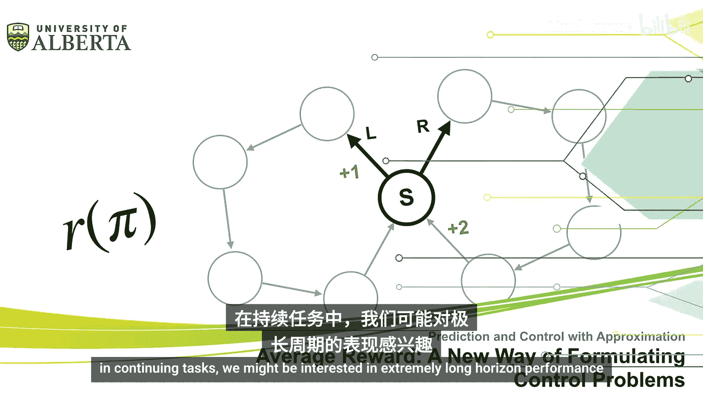
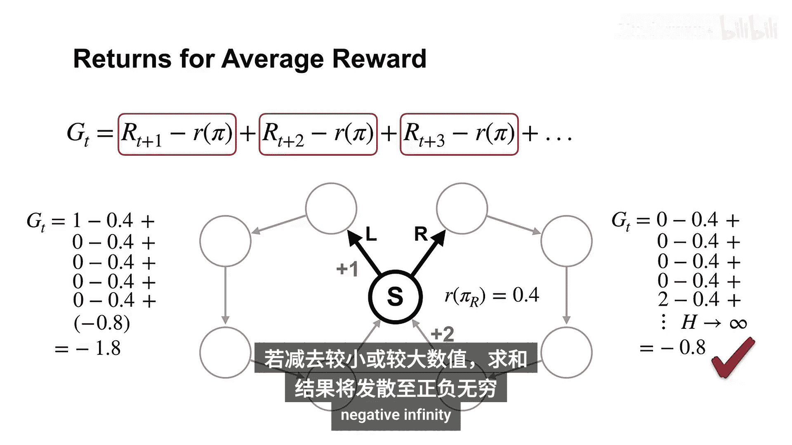
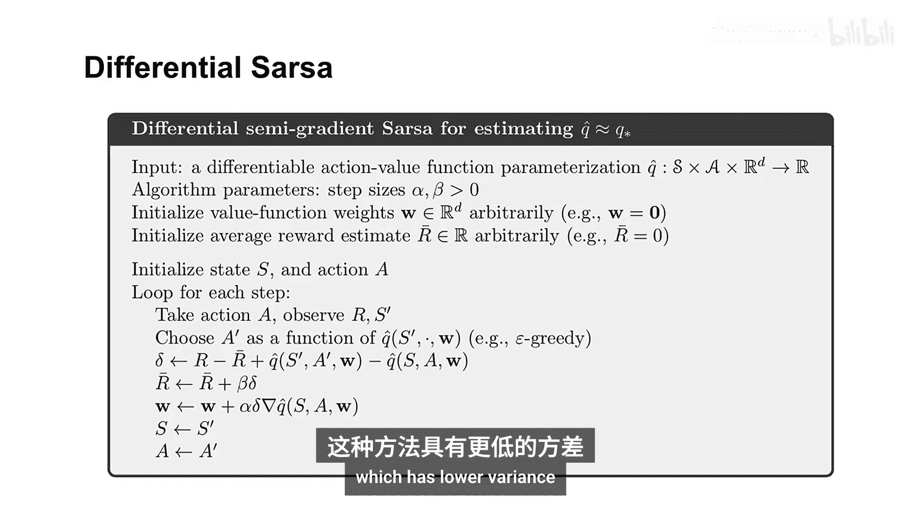

# 010：平均奖励与差分值函数

在本节课中，我们将学习一种用于持续任务的新问题表述方法——平均奖励设定。我们将了解其核心概念，并理解为何在某些情况下，基于平均奖励的最优策略会与基于折扣奖励的最优策略不同。

## 持续任务与折扣方法的局限性

上一节我们介绍了折扣奖励在平衡短期与长期收益中的应用。然而，这并非表述持续任务的唯一方式。

在持续任务中，我们可能关注极长视野下的性能表现。到目前为止，我们使用折扣因子来处理持续问题，以平衡短期表现和长期收益。但这种方法存在局限性。

## 近视MDP示例

今天我们将通过一个称为“近视MDP”的简单示例来探讨这个问题。想象一个状态排列成两个相交环的任务。在大多数状态下，只有一个可用动作，因此无需做出决策。仅在一个特定状态S，智能体可以决定遍历哪个环。这意味着存在两种确定性策略：遍历左环或遍历右环。

奖励在所有地方都为零，除了每个环中的一个转移。在左环中，紧接状态S之后，奖励为+1。在右环中，紧接状态S之前，奖励为+2。

直观上，你会选择右边的动作，因为你知道会获得+2的奖励。但价值函数会告诉我们怎么做呢？

## 折扣价值分析

如果我们使用折扣方法，这两种不同策略下状态S的价值是多少？

选择左动作的策略的价值为：
`V_L = 1 / (1 - γ^5)`

选择右动作的策略的价值为：
`V_R = (2 * γ^4) / (1 - γ^5)`

让我们思考在特定γ值下，状态S在这两种策略下的价值。

*   如果γ=0.5，`V_L ≈ 1`，`V_R ≈ 0.1`。这意味着在这种更短视的折扣下，采取左动作的策略更优。
*   如果γ=0.9，`V_L ≈ 2.4`，`V_R ≈ 3.2`。因此现在我们更倾向于另一种策略。

事实上，我们可以计算出使智能体偏好向右策略所需的最小γ值。γ需要至少为0.841。

这里的问题是，折扣幅度取决于具体问题。对于这个例子，0.85就足够大了，但如果每个环有1000个状态，这个折扣因子就需要超过0.99。通常，确保智能体行为能最大化长期奖励的唯一方法是不断将折扣因子向1增加。根据问题不同，我们可能需要γ非常大。请记住，在持续设定中我们不能将其设为1，因为那样回报可能是无限的。

那么，使用较大的γ有什么问题呢？较大的γ值也可能导致更大、更不稳定的求和结果，这可能难以学习。那么，有替代方案吗？

## 平均奖励目标

让我们讨论一种称为**平均奖励**的新目标。

想象智能体与世界交互了H步。这是它在这些步骤中平均获得的奖励，换句话说，是它的**奖励率**。如果智能体的目标是最大化这个平均奖励，那么它对近期和远期奖励的关心程度是相等的。

我们用`r(π)`表示策略π的平均奖励。更一般地，我们可以使用状态访问分布`μ`来书写平均奖励：
`r(π) = Σ_s μ_π(s) Σ_a π(a|s) Σ_{s‘, r} p(s’, r|s, a) r`

内层项是策略π下状态的期望奖励。外层求和取该状态被访问频率的期望。合起来，我们得到跨状态的期望奖励，即策略的**平均奖励**。

在近视MDP示例中，两种可能的确定性策略会无限期地访问左环或右环。在这两种情况下，每个环中的五个状态被访问的次数相等。

*   在左环中，除了一个获得+1的状态外，所有状态的即时期望奖励为+0。这导致平均每5步获得1的奖励，即平均奖励为0.2。
*   在右环中，大多数状态的即时期望奖励也是+0，但这次最后一个状态获得+2。这给出平均每5步获得2的奖励，即平均奖励为0.4。

我们可以看到，平均奖励更倾向于总体上获得更多奖励的策略，而无需考虑越来越大的折扣因子。

## 差分回报与差分值函数

平均奖励的定义对于判断一个策略是否优于另一个策略是直观的，但我们如何判断从一个状态出发的哪个动作更好呢？我们需要的是这个新设定下的动作价值。

第一步是弄清楚**回报**是什么。在平均奖励设定中，回报是根据奖励与平均奖励`r(π)`之间的**差值**来定义的。这被称为**差分回报**。

让我们看看在近视MDP中差分回报是什么。差分回报表示智能体从当前状态和动作开始，与遵循该策略的平均奖励相比，将多获得多少奖励。

差分回报只有在减去的常数等于真实平均奖励时，才是一个收敛的和。如果减去一个更低或更高的数字，和将发散到正无穷或负无穷。

现在我们有了平均奖励的有效回报定义，我们可以像往常一样将价值函数定义为期望回报。类似地，我们也可以定义**差分值函数**，作为从给定状态（或状态-动作对）开始，遵循策略的期望差分回报。

这个量捕捉了智能体从特定状态开始，与如果遵循固定策略在所有状态上平均获得的奖励相比，将多获得多少奖励。

与折扣设定类似，差分值函数可以写成贝尔曼方程。方便的是，它们看起来与我们之前见过的方程相似，不同之处仅在于它们从即时奖励中减去了`r(π)`，并且没有折扣。

## 算法应用

折扣情况下的许多算法可以重写以应用于平均奖励情况。例如，**差分SARSA**与你之前见过的SARSA算法非常相似。

以下是关键区别。差分SARSA必须跟踪其策略下平均奖励的估计值，并在其更新中从样本奖励中减去它。这个实现使用了我们在整个课程中见过的增量平均技术。

给定这个估计值，它然后在更新中从采样的奖励中减去`r_bar`。

在实践中，我们可以通过对该算法稍作修改来获得更好的性能。我们使用以下更新来计算`r_bar`，而不是奖励的指数平均，因为它具有更低的方差：
`δ_t = R_{t+1} - r_bar_t + q(S_{t+1}, A_{t+1}) - q(S_t, A_t)`
`r_bar_{t+1} = r_bar_t + β * δ_t`
`q(S_t, A_t) = q(S_t, A_t) + α * δ_t`

## 总结

本节课中，我们一起学习了平均奖励目标，并为此设定定义了差分回报和差分值函数。我们了解到，平均奖励提供了一种不依赖折扣因子的、评估持续任务长期性能的方法，并且通过差分值函数，我们可以比较同一策略下不同动作的优劣。下周我们将讨论优化这个平均奖励目标的另一种方法。