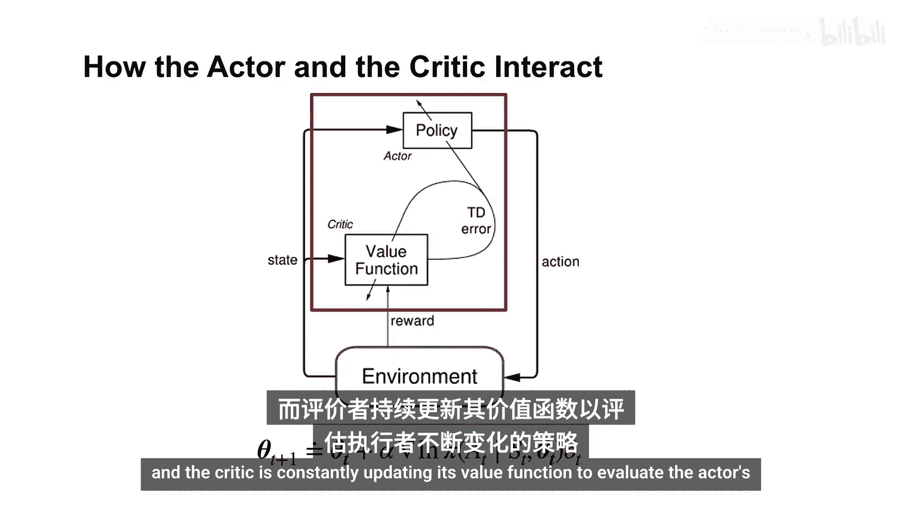
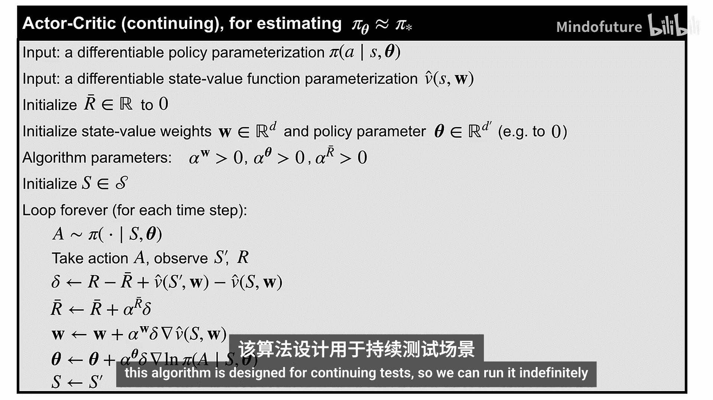

# 011：Actor-Critic算法回顾

在本节课中，我们将要学习Actor-Critic算法。这是一种结合了策略学习和价值学习的强化学习方法，它通过“演员”和“评论家”两个组件的交互来共同优化策略。

## 概述

上一节我们介绍了策略梯度方法。本节中我们来看看如何将价值函数学习融入其中，从而形成Actor-Critic算法。

我们是否必须在直接学习策略参数和学习价值函数之间做出选择？答案是否定的。即使在策略梯度方法内部，像时序差分（TD）这样的价值学习方法仍然扮演着重要角色。在这种设置中，参数化策略扮演“演员”的角色，而价值函数则扮演“评论家”的角色，用于评估演员选择的动作。这些所谓的Actor-Critic方法，是强化学习中最早引入的基于TD的方法之一。

## 从策略梯度到Actor-Critic

我们以上一视频的策略梯度学习规则表达式结束：

**公式：策略梯度更新**

但我们无法直接获得真实的动作价值函数 Q，因此需要对其进行近似。我们可以采用通常的TD方法，使用一步自举回报，即**差分奖励**加上下一个状态的价值。

**公式：一步TD目标**

与往常一样，参数化函数 **V_hat** 是价值函数的学习估计。在本例中，**V_hat** 是差分价值函数。这就是Actor-Critic算法中的“评论家”部分，它为演员提供即时反馈。

为了训练评论家，我们可以使用任何状态价值学习算法。这里我们将使用平均奖励版本的半梯度TD方法。

## 引入基线减少方差

参数化策略是“演员”，它使用如下所示的策略梯度更新。

我们可以直接使用这种更新形式，但还可以做最后一件事来改进算法：减去一个称为**基线**的值。我们不单独使用一步价值估计，而是减去状态 **S_t** 的价值估计，从而得到如下更新：

**公式：带基线的策略梯度更新**

这里的 **V_hat(S_t)** 就是基线。请注意，这个表达式等于**TD误差**。

这个更新的期望值与之前的更新相同。为什么？

让我们以特定时间 **T** 的状态 **S** 为条件，计算更新的期望值。求和的期望等于期望的和。我们可以利用这一点，将原始项的期望与涉及被减价值函数的期望分离开。事实证明，第二项的期望为0。因此，我们可以在不改变更新期望值的情况下添加这个基线。

你可以自行验证这一点。首先，将期望写为动作的求和，并将 **V_hat** 项从求和中提取出来。我们将其留作练习。

那么，如果更新的期望值相同，我们为什么要添加这个基线呢？减去这个基线有助于**减少更新的方差**，从而带来更快的学习速度。

## 算法直观理解

这个更新在直观上是有道理的。在我们执行一个动作后，我们使用TD误差来判断该动作相对于该状态的平均水平有多好。如果TD误差为正，意味着所选动作带来的价值高于预期。更频繁地采取该动作应能改进我们的策略。这正是此更新所做的：它根据评论家的判断，改变策略参数以增加那些优于预期的动作的概率。

相应地，如果评论家“失望”且TD误差为负，则该动作的概率会降低。演员和评论家同时学习，不断交互。演员不断改变策略以超越评论家的期望，而评论家则不断更新其价值函数以评估演员不断变化的策略。

## 完整的平均奖励Actor-Critic算法

有了策略更新规则，我们就可以介绍完整的平均奖励Actor-Critic算法了。

以下是算法的主要步骤：

1.  **初始化**：指定策略参数化和价值函数参数化。例如，可以使用瓦片编码来构建近似价值函数和softmax策略参数化。我们还需要维护一个平均奖励的估计，就像在差分SARSA算法中一样，初始化为零。我们可以按喜好初始化权重和策略参数。初始化价值估计、策略和平均奖励的步长参数，它们可以各不相同。从环境中获取初始状态，然后开始行动和学习。
2.  **循环（每一步）**：
    *   根据当前策略选择动作，并从环境中接收下一个状态和奖励。
    *   利用这些信息，计算差分TD误差，并更新我们对平均奖励的运行估计。
    *   使用TD更新规则更新价值函数的权重。
    *   最后，使用我们的策略梯度更新规则更新策略参数。

这个算法是为**持续性任务**设计的，因此我们可以无限期地运行它，并持续改进策略。

## 总结

本节课中我们一起学习了Actor-Critic算法。你现在应该理解，学习一个价值函数来估计策略参数的梯度是非常有用的。Actor-Critic算法通过一个为演员学习价值函数的评论家来实现这一思想。这种演员与评论家协同工作的框架，是强化学习中一个强大且基础的概念。