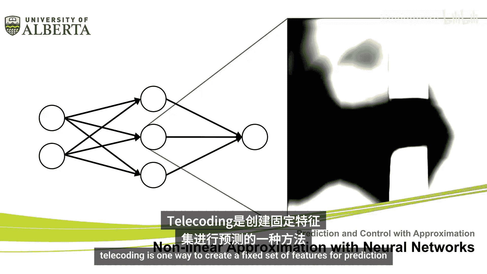
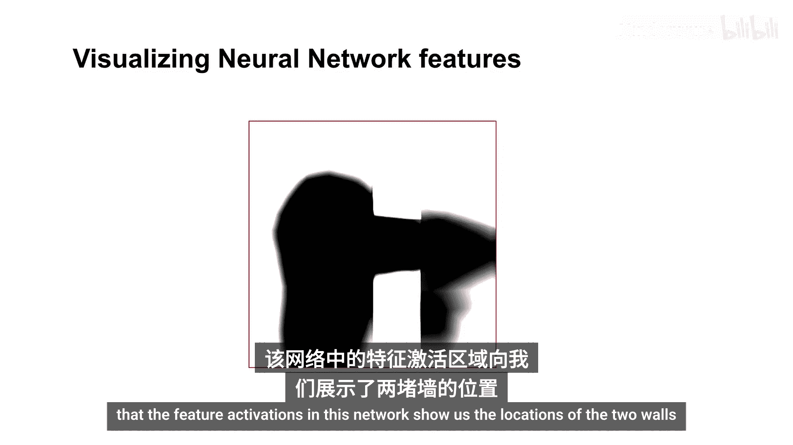

# 015：使用神经网络的非线性近似

在本节课中，我们将学习神经网络如何作为一种非线性函数近似器，用于强化学习中的特征构造。我们将对比之前学习的瓦片编码方法，理解神经网络如何从数据中学习有用的特征表示。

## 概述

上一节我们介绍了瓦片编码作为特征构造的一种方法。本节中，我们来看看神经网络如何提供一种学习有用特征集的策略。我们将理解神经网络如何创建特征，以及它如何成为状态的非线性函数。

## 神经网络如何构造特征

前馈神经网络是我们构建非线性函数近似的基础。当我们首次构建神经网络时，需要指定初始权重。权重的初始化方式很重要，但关于这一点我们稍后再详细讨论。现在，我们假设权重是从某个随机分布中抽取的。

让我们看看一个给定的输入向量在通过网络时会发生什么。首先，我们只关注网络中的一个节点。

以下是单个节点的计算过程：
1.  每个输入乘以对应的权重。
2.  这些加权输入的和被传递给一个非线性激活函数。
3.  结果是输入的一个非线性函数。

这个过程在层的每个节点上重复进行。每个节点都有一组不同的权重，因此会产生不同的输出，我们称之为一个特征。所有这些新特征共同构成了新的状态表示。

## 与瓦片编码的对比

这个过程实际上与瓦片编码没有太大不同。我们将输入传递给瓦片编码器，得到一个新的表示。因此，在这两种情况下，我们都构建了一个输入到特征的非线性映射。在这两种情况下，我们都对表示进行线性组合以产生输出，即当前状态的近似价值。

通过对比瓦片编码，我们可以更深入地理解神经网络的表示能力。

回想一下，当我们创建瓦片编码器时，必须设置几个参数：瓦片的大小和形状，以及瓦片的数量。这些参数在学习之前是固定的。在神经网络中，我们有类似的参数，对应于层数、每层的节点数和激活函数。这些通常也在学习之前固定。从这个意义上说，两者都使用先验知识来帮助构造特征。

然而，除此之外，神经网络还具有可调整的参数，可以在学习过程中改变特征。神经网络可以利用数据来改进特征，而瓦片编码器则可以从数据中纳入新信息。

## 非线性特征的可视化

瓦片编码和神经网络都产生了在输入空间上非线性的特征。我们可以通过可视化预训练神经网络的隐藏层来更好地理解这一点。

我们在一个包含两面墙之间狭窄走廊的连续二维空间中训练了一个智能体。这里我们绘制了网络学习到的单个特征的感受野。坐标轴对应于XY位置，即MDP的状态空间。图中的每个点对应于该XY状态的特征值，颜色越深表示激活越大。如果是白色，则表示该特征在该状态下不活跃。

这个图意味着什么？它显示了该特征对哪些状态是活跃的，即特征幅度高于一个小的阈值。因此，在更高层次上，这个图向你展示了这个特征是如何泛化的：对其权重的更新会改变所有这些状态的价值。

观察几个特征的感受野，我们可以看到不同的特征以不同的方式泛化，并形成复杂的非线性形状。这些激活不像瓦片编码那样有硬边界。这些学习到的特征可以具有平滑变化的边界，这个特征根据状态的不同具有不同程度的泛化能力。有趣的是，这个网络中的特征激活还向我们展示了两面墙的位置。

## 总结

本节课中，我们一起学习了神经网络如何被视为一种构造特征的方式，并且理解了神经网络是状态的非线性函数。我们对比了瓦片编码，看到了神经网络如何通过可学习的参数从数据中自动生成复杂且适应性强的特征表示，从而为强化学习智能体提供更强大的函数近似能力。