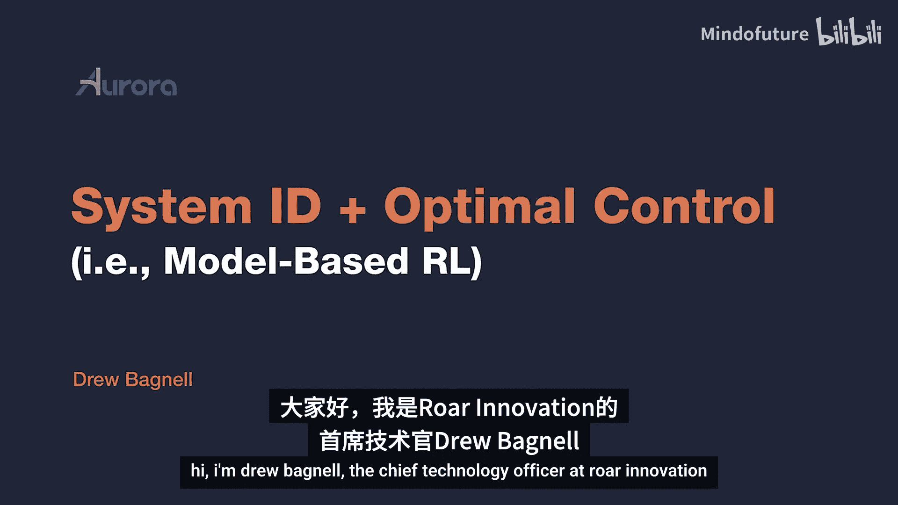

# 016：Drew Bagnell论系统识别与最优控制

## 📘 概述
在本节课中，我们将学习基于模型的强化学习中的一个核心环节：**模型学习**。我们将探讨为什么传统的“系统识别”方法在实践中常常失败，并介绍一种更有效的、交互式的迭代方法。课程将以自动驾驶直升机完成“漏斗内悬停”任务为例，帮助你理解如何构建一个能在真实世界中表现良好的模型与策略。

---

## 🔍 传统方法：系统识别
上一节我们讨论了使用模型进行模拟学习的优势。本节中，我们来看看如何学习这个模型。

传统的工程统计学方法被称为**系统识别**，其本质是一种监督学习。

以下是其标准流程：
1.  使用一个探索策略（例如，飞行员手动控制直升机并引入扰动）来收集数据。
2.  将观测到的数据应用于监督学习算法（例如线性回归）。
3.  学习一个模型 **`f_θ(s, a)`**，该模型将状态和动作映射到下一个状态。
4.  将这个模型与成本函数结合，使用规划或最优控制合成算法（即强化学习算法）来输出一个学习到的策略，希望该策略在真实世界中是最优的。

**公式表示：**
`f_θ(s, a) → s'`
其中，`s` 是当前状态，`a` 是采取的动作，`s'` 是预测的下一个状态。

---

## ⚠️ 传统方法的缺陷：协变量偏移
然而在实践中我们发现，优秀的工程师并不直接采用上述方法，而是采用迭代式的方法来构建模型。让我们看看原因。

如果我们收集专家演示“漏斗内悬停”任务的数据，并应用最优控制算法来生成策略，结果往往会失败得很彻底。

其根本原因在于，系统识别本质上是一个“先有鸡还是先有蛋”的问题。我们真正需要的是一个在策略学习过程中**可能访问到的状态区域**上表现良好的模型。不幸的是，如果我们针对一个模型进行规划或优化，几乎必然会在过程中访问到那些在数据收集中采样不足、模型不准确的状态。然后，强化学习算法会找到任何方式来利用这种不准确性，从而学到一个在真实世界中表现不佳的策略，因为真实世界在这些状态下与模型不匹配。

这个普遍问题有时被称为**协变量偏移**或**分布偏移**。只要我们将统计学习与决策制定相结合，这就是一个根本性的问题。结果就是，无论在理论上还是实践中，你都可以构建一个误差很低的动态统计模型，并对其应用一个优秀的优化器或强化学习算法，但在真实世界中仍然得到糟糕的性能。

---

## 🎮 交互式迭代方法
理解基于模型的强化学习的一个有效方式，是将其视为优化器（RL算法）与模型学习器（及世界）之间的**双人博弈**。正如多年前从Chris Atkeson那里学到的：**发现模拟器中不准确性的最佳方法，就是让一个强化学习算法去尝试利用它**。

因此，我们需要更稳健、本质上更具交互性的方法来寻找好的模型和控制器。

接下来，我们将介绍一种本质上是交互式的方法。其核心思想是，我们将从我们当前认为的最优策略以及之前提到的探索策略中收集数据。

以下是该交互式循环的步骤：
1.  从当前的最优策略和探索策略中收集状态转移数据 `(s, a, s')`。
2.  将这些新的转移数据与之前收集的所有历史数据聚合在一起。
3.  再次拟合模型（例如使用线性回归）。
4.  将这个模型交给最优控制合成器（规划器/RL算法），得到一个新的、声称最优的策略。
5.  回到第1步，用这个新策略（混合一些探索数据）继续收集数据，并重复此循环。

研究表明，运行这个循环的交互式方法，更接近优秀工程师实际使用的方式，在实践中效果很好，并能提供更强的理论保证。

---

## ✅ 理论保证与“无悔学习”
如果使用一个稳定的函数逼近器，在多次交互迭代中学习到一个低误差的模型，并使用一个好的最优控制求解器来生成策略，那么你**必须**获得良好的真实世界性能。

反之，如果使用一个“无悔学习”算法（我们用来针对模型学习一个好的优化器的那类算法）却未能获得良好的真实世界性能，那么原因必然是：在某个时刻，你未能构建出一个能准确描述世界运作方式的低误差模型。

“无悔学习”是一个强大的概念，在任何类似博弈的语境中都很有用。你可以将其简化为这样一类算法：它们不会因为训练数据中的微小扰动而大幅改变其返回的模型，并且能在数据量足够大的情况下获得良好性能。

---

## 🚁 实践结果：成功悬停
现在，我们可以将之前提到的“漏斗内悬停”问题，应用上述描述的交互式循环。

结果如下：我们使用这种**数据聚合**方法收集相同数量的样本。在这种情况下，我们实际上能够解决问题。这很有趣，因为唯一的不同之处在于数据收集方式：我们以交互式的方式收集数据，即提出最优控制器、尝试它们、收集更多数据、然后重建模型。最终结果是，我们成功地执行了“漏斗内悬停”任务。

---

## 📝 总结
本节课中，我们一起学习了基于模型的强化学习中模型学习的关键点。我们认识到，传统的、一次性的系统识别方法由于**协变量偏移**问题，在实践中常常失败。取而代之的是一种**交互式迭代方法**，它通过不断在最新策略下收集数据、更新模型、再优化策略的循环，更稳健地逼近真实世界动态，从而成功学习到有效的控制策略。这种方法不仅更符合工程实践，也具备更坚实的理论保证。