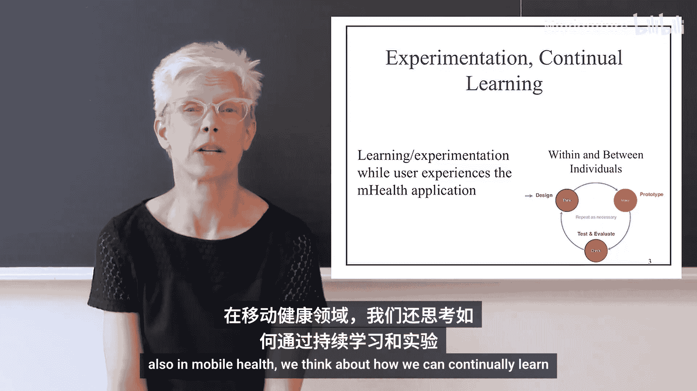
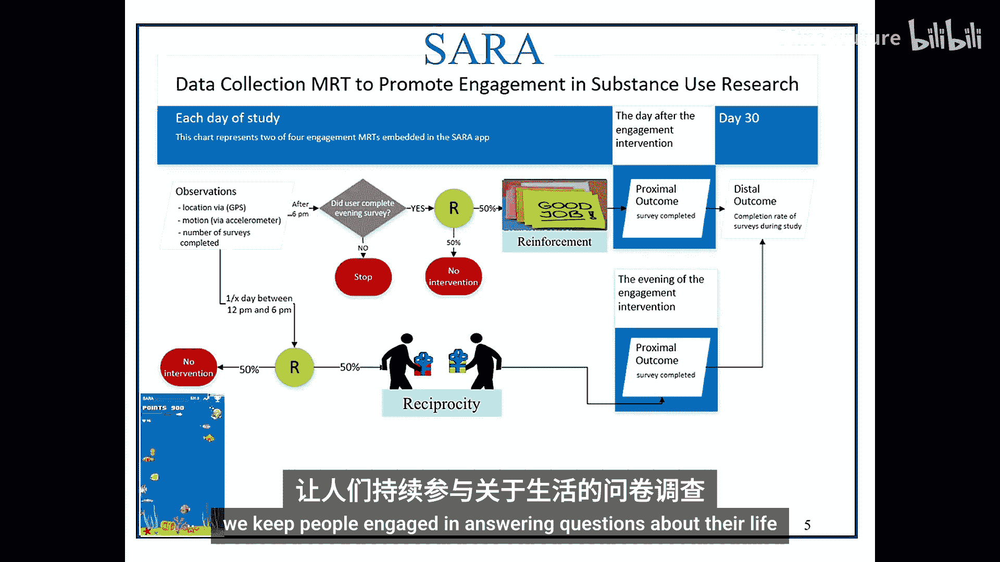
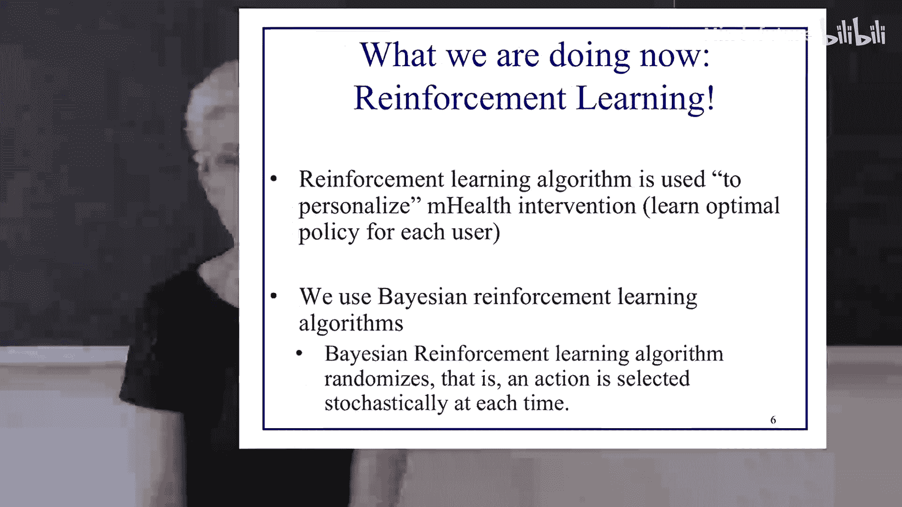
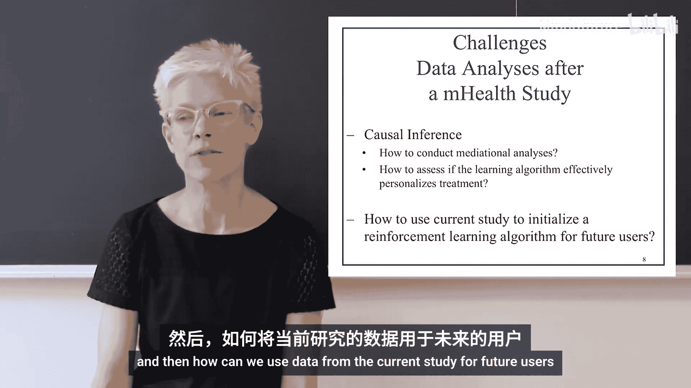
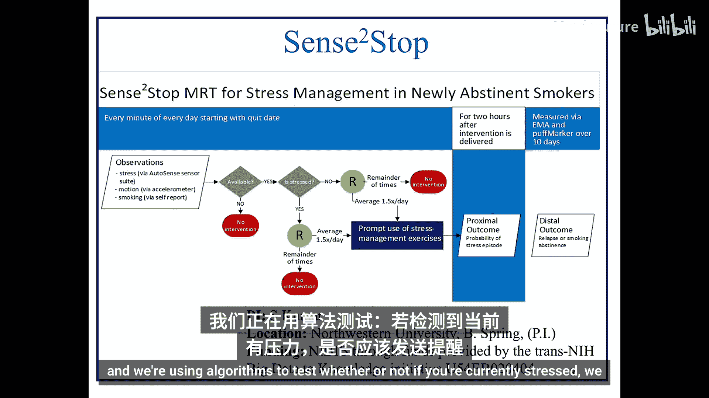

# 017：移动健康中的强化学习应用

## 概述
在本节课中，我们将跟随哈佛大学的Susan Murphy教授，学习强化学习在移动健康领域的具体应用、面临的挑战以及实际研究案例。

---

大家好，我是苏珊·墨菲，来自哈佛大学。我同时在统计系和计算机科学系任职。我的研究方向是移动健康，特别是如何将强化学习应用于移动健康领域。在大家面前的幻灯片上，可以看到我们参与过的各种不同类型的研究。许多研究涉及成瘾问题，也有很多涉及青少年等群体。

在移动健康领域，我们的目标是什么？我们的目标是帮助那些正在与问题作斗争的人们，这些问题通常是慢性疾病，例如有人正在与毒瘾斗争并试图保持清醒，或者有人正在与抑郁症抗争。我们旨在为个人提供长期支持。我们也希望能够进行因果推断测试，以真正理解在强化学习情境下的治疗行动是否真的对那个人产生了影响。

此外，在移动健康中，我们思考如何能够持续学习。我们可以持续进行实验，从而不断为每个人改进移动健康应用程序。这正是这张幻灯片所讨论的内容。

---

## 基本设置与干预措施
上一节我们了解了移动健康的研究背景，本节中我们来看看其基本设置。

对于任何给定的用户，他们可以接收到各种各样的干预措施，也就是行动。我在幻灯片上列出了一些例子，例如提醒（可能是提醒服药、提醒进行特定类型的锻炼等）、关于生活中可以做什么的建议、如何将你与经历过类似问题的其他人联系起来等等。这些干预可以随着时间的推移反复进行。

每次我们提供不同类型的治疗行动后，我们会观察一个奖励。奖励可以是多种形式，例如，如果我的目标是帮助你更活跃，奖励可能是接下来30分钟内的总步数；如果应用程序旨在帮助你管理压力，奖励可能是直到你再次感到压力所经过的时间。

在下一张幻灯片中，我将展示一项刚刚完成的研究。在这项研究中，我们的目标是帮助人们在回答关于压力和孤独感的问题时更加积极。这项研究招募了青少年和大学生（并非总是大学生），他们是从我们的急诊室招募的，因为他们饮酒过量。研究思路是，如果我们能了解他们的孤独感和抑郁程度，我们就可以开发一个应用程序来帮助他们管理这些情绪。

---

## 一项具体研究：用户参与度
接下来，我们深入看一项具体研究，它专注于如何保持用户的参与度。

这个强化学习问题中的所有行动都围绕着：我们如何给予你强化激励，以便你保持参与并回答我们的问题。你可以看到我们有一个游戏化的界面，它是一个水族馆。当你回答问题后，你的水族馆会变得越来越丰富，你也可以在水族馆环境中升级到更高的等级。

但我主要感兴趣的是：如果你回答问题，我们如何为你提供奖励（这是图表中的首要目标）？什么样的奖励（如表情包、礼物）能帮助你更投入，以便你明天继续回答我们的问题？我也感兴趣的是：如果我们今天给你一份礼物，你是否更有可能在今晚回答我们的问题？因此，这项研究的全部目标是找到良好的策略，以保持人们参与回答关于他们生活的问题。

---

## 当前工作与贝叶斯强化学习
基于上述研究，我们现在的工作是利用这类研究来初始化移动健康中的强化学习算法。

其核心思想是，强化学习算法应该为每个用户个性化定制应用程序。从我们的角度来看，多年来，我们认为这与为每个用户学习一个最优策略是相同的。在我的实验室，我们主要使用**贝叶斯强化学习**。

你们可能还没有学习过贝叶斯强化学习，但对我们来说，它的主要工具和优势之一在于它随时间更新个体用户信息的方式。同时，它在每个时间点以随机（**stochastic**）的方式选择行动，这有助于我们在研究结束后也能从数据中学习。

---

## 移动健康中强化学习的挑战
那么，当试图在我的设置（即移动健康）中使用强化学习时，会遇到哪些挑战呢？其中一个问题是，如果你曾经下载过应用程序，你完全明白我在说什么。当应用程序频繁通知你时，可能会变得非常恼人。

因此，应用程序通常有很大潜力在当下帮助你，对即时奖励产生积极影响，但也会带来负面的延迟效应。这正是强化学习的经典设定。

以下是我们必须弄清楚如何解决的一些问题：
*   **价值函数近似**：如何近似价值函数，以便我们能够快速学习，同时在选择行动时不犯错误。
*   **个性化策略**：我们总是有许多不同的用户，每个人都是独特的。如何利用一个用户的数据来为每个特定用户个性化或确定一个好的策略，这是我们目前正在努力应对的一大挑战。
*   **因果推断**：研究结束后，我们总是希望进行因果推断研究，以帮助科学家更多地了解人们为何会采取某些行为，例如为什么人们会复吸毒品或复吸香烟。这些都是因果推断问题。我们想利用这些数据来做这件事，即使数据是通过强化学习算法收集的，我们也必须弄清楚如何利用它。
*   **知识迁移**：我们如何将当前研究的数据用于未来的用户，以便他们能够从我们在当前研究中学到的东西中受益？

---

## 另一项研究：戒烟与压力管理
最后，我想展示下一张也是最后一张幻灯片上的另一项研究。

这项研究相当酷，它即将结束。在这项研究中，每个人都在尝试戒烟。研究从他们决定戒烟的那天开始。他们佩戴各种可穿戴设备，度过日常生活，所有的传感器数据流不断传入并被使用。传感器数据用于形成各种预测，其中一个特定的预测是：他们当前是否处于生理压力状态。我们正在使用算法来测试：如果你当前处于压力状态，我们是否应该提供提醒，建议你练习压力管理练习。当然，长期目标是**为每个用户找到最优策略**。

谢谢。

祝你的课程学习顺利。

---

## 总结
本节课中，我们一起学习了强化学习在移动健康领域的应用。我们从基本设置和干预措施入手，分析了一项旨在提高用户参与度的具体研究，探讨了利用贝叶斯强化学习进行个性化策略学习的当前工作，并梳理了在该领域应用强化学习时面临的独特挑战，如平衡即时与延迟效应、进行因果推断等。最后，我们了解了一项利用传感器数据帮助戒烟者管理压力的前沿研究。这些内容展示了强化学习在提供个性化、适应性健康干预方面的巨大潜力。