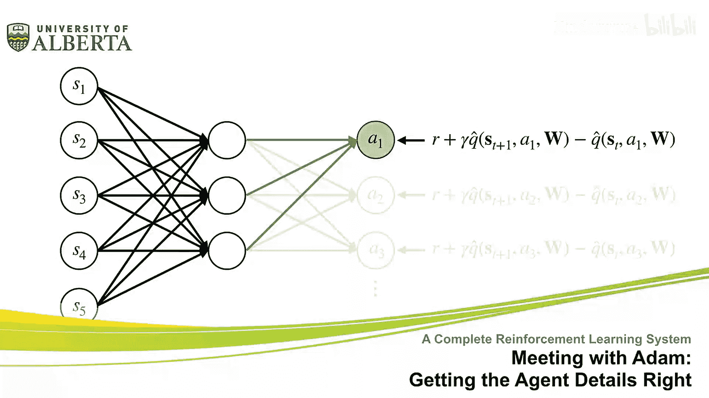
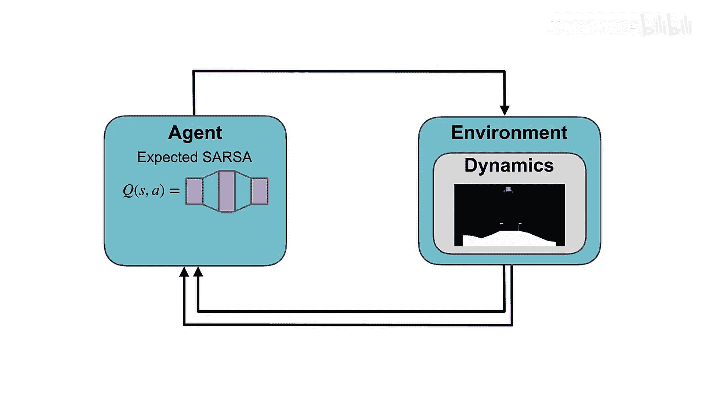
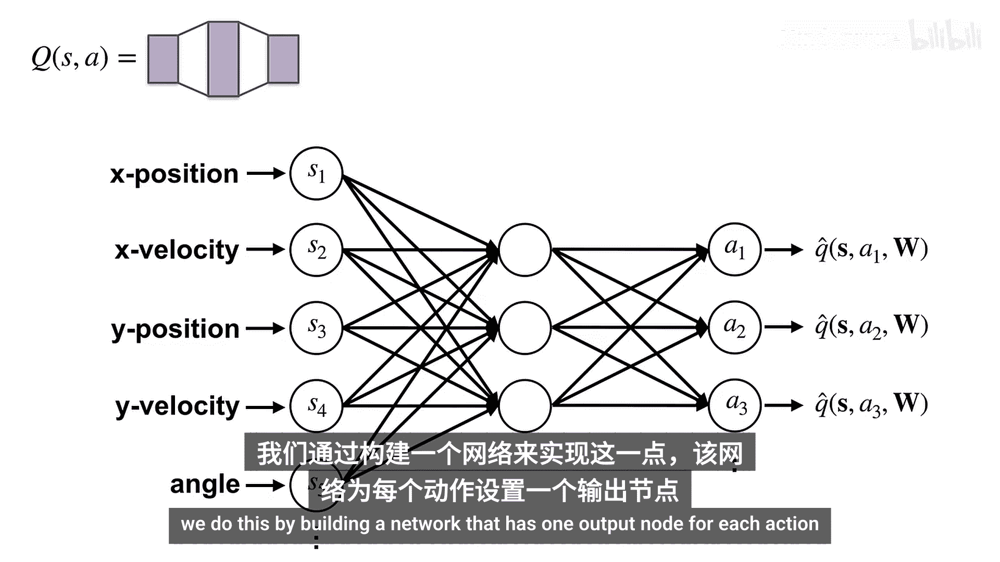
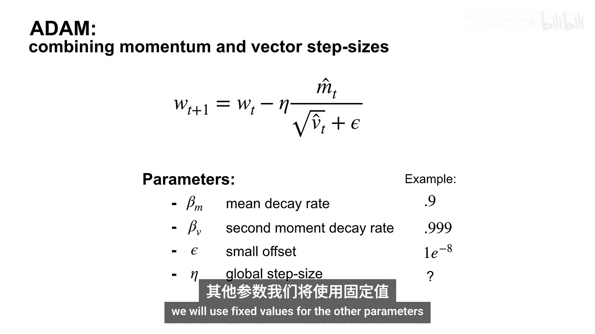

# 018：与亚当的会议-实现代理细节_05_01_01

欢迎来到顶点项目的倒数第二周。

这是一个激动人心的时刻，因为你终于可以开始构建你的代理了。

上周我们头脑风暴了一些高层次的代理设计选择，本周我们将讨论一些关于网络及其更新方式的实现细节。

在实践中，这些决策会对性能产生重大影响。

今天我们将讨论如何更新我们的动作价值估计，以及Adam算法的细节。

我们决定使用神经网络来估计动作价值。

让我们回顾一下它的工作原理。你可能还记得在课程三中，神经网络接收状态并产生一个新的表示。

例如，在这个案例中，状态可能由着陆器的位置和速度等信息组成。

然后，我们将使用得到的表示来估计每个动作的价值。

我们通过构建一个网络来实现这一点，该网络为每个动作都有一个输出节点。

让我们讨论如何训练这个神经网络来近似动作价值函数。

我们将使用时间差分误差来训练网络。更准确地说。

我们将修改权重以减少每个时间步上的TD误差。

我们只更新与所选动作对应的输出权重。

我们只是不更新最后层中对应动作2和3的权重。你可能会问。

这有问题吗？一般来说没有，但这里有一些细微之处需要考虑。

对于线性函数近似，我们也为每个动作价值维护独立的权重。

我们只更新被采取动作的权重。对于神经网络。

每次更新一个动作时，所有动作的共享表示也会改变。

但在学习过程中，每个动作的结果可能会对表示产生不同的、可能相互冲突的更新。

但这实际上是我们想要的。

我们希望神经网络学习一个对所有动作都有用的表示。

对多个预测都有用的特征通常是泛化能力更好的特征。

相反，我们可以学习完全独立的神经网络，每个动作一个。

但那样每个动作的表示是用更少的样本学习的。

并且我们可以从学习共享表示中获得潜在的好处。

我们做出的另一个决定是使用Adam算法。

该算法结合了向量步长和一种动量形式。在课程三中。

我们讨论了一个步长向量，网络中的每个权重都有自己的步长，该步长根据学习过程的统计数据进行调整。

这意味着我们可以对某些权重进行较大的更新，对其他权重进行较小的更新。

如果损失在某些维度上更平坦，这可能会有用。或者。

我们可以在损失变化更剧烈的其他维度上采取较小的步长。

我们还讨论了如何使用动量来加速学习。

特别是当我们发现处于损失的平坦区域时。

请记住，在同一方向上重复步长会建立动量，而在不同方向上采取步长会消除动量。

Adam算法结合了这两种思想。它保持梯度的移动平均值来计算动量。

`beta_m`参数是一个控制动量大小的超参数。

Adam还保持梯度平方的移动平均值。这为我们提供了一个步长向量。

这种更新通常会导致更高效的数据学习，因为每次更新都更有效。

你可能已经注意到，我们刚刚引入了几个需要设置的新超参数。

我们有两个衰减率、分母中的小偏移量大小以及一个全局步长。

所以我们在这里并没有实现无超参数学习。事实上。

我们用四个超参数取代了一个。

幸运的是，通常不难根据经验法则为这些超参数找到良好的设置。

但通过单独调整它们通常可以获得更好的性能。

许多人正在研究减少强化学习中对超参数选择敏感性的方法。

但这仍然是一个非常开放的问题。在这个顶点项目中。

你将研究不同全局步长选择的影响。

我们将为其他参数使用固定值。

本周的内容就到这里，你现在应该拥有实现代理所需的所有工具了。

接下来，就是用强化学习让航天器在月球上着陆。