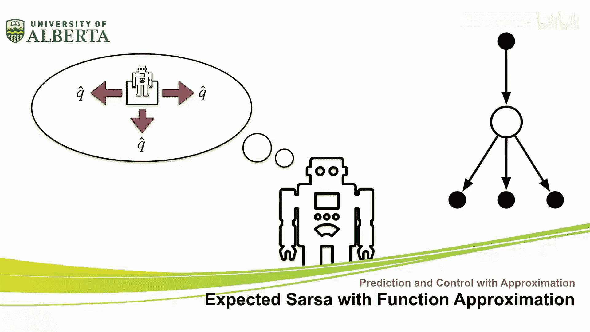
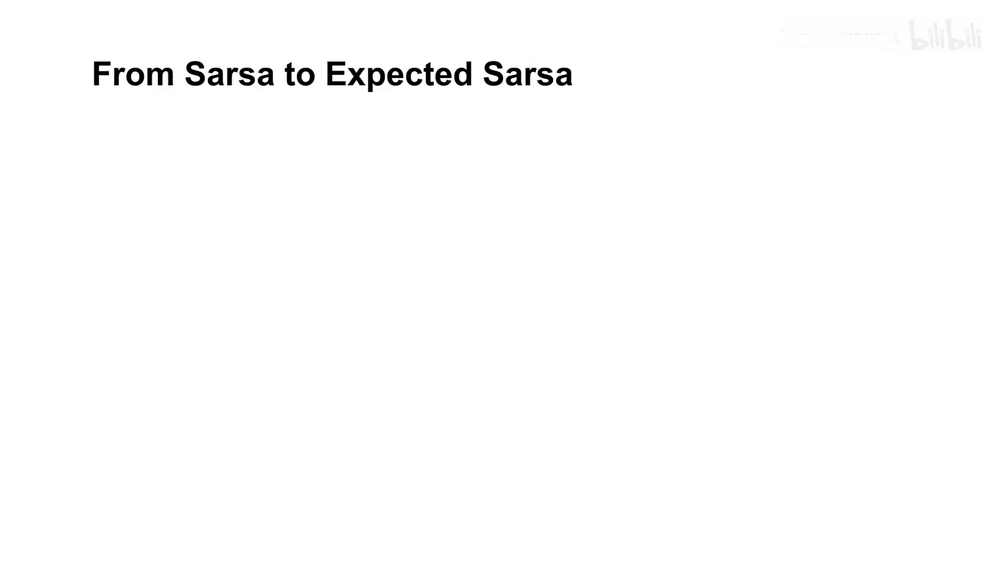
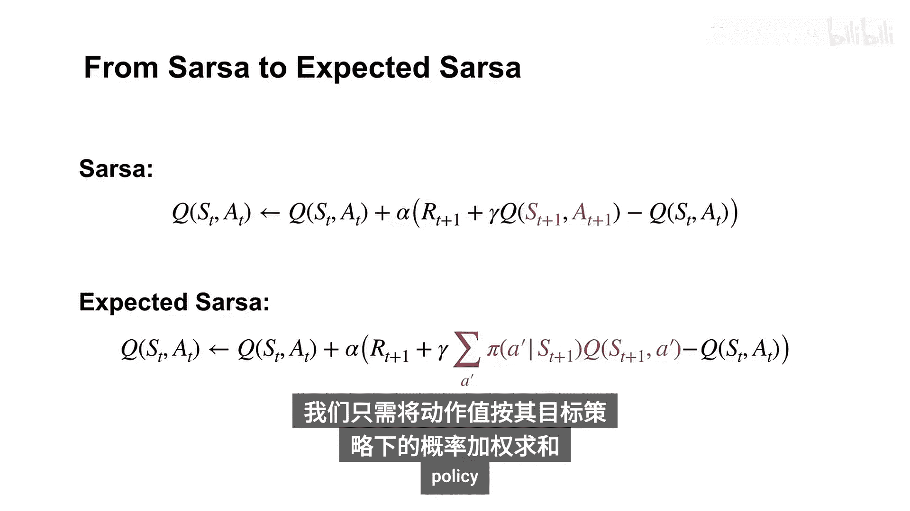
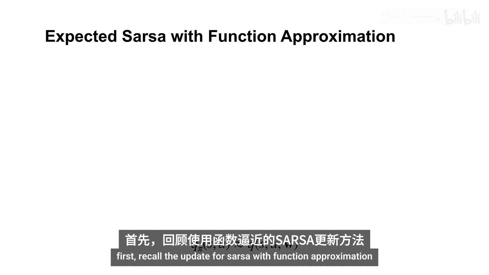
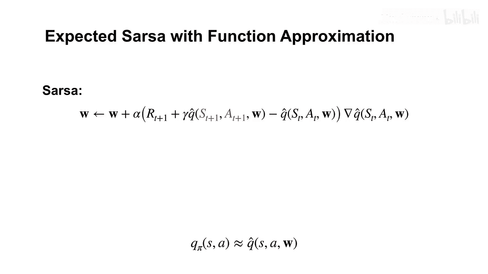
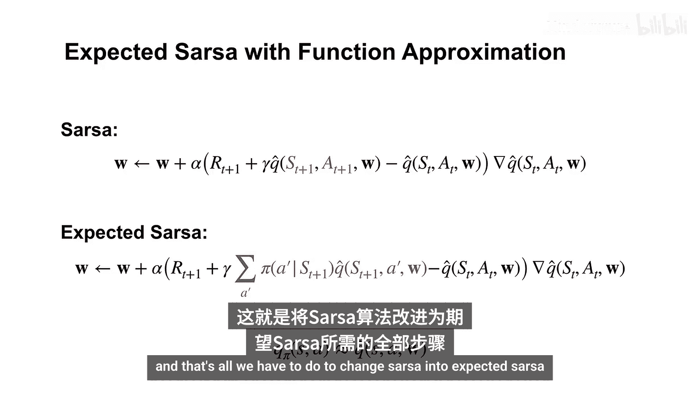
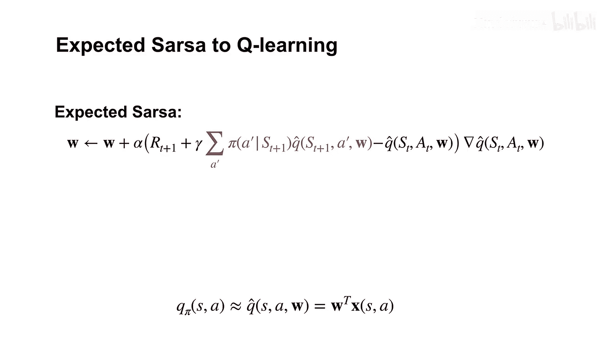
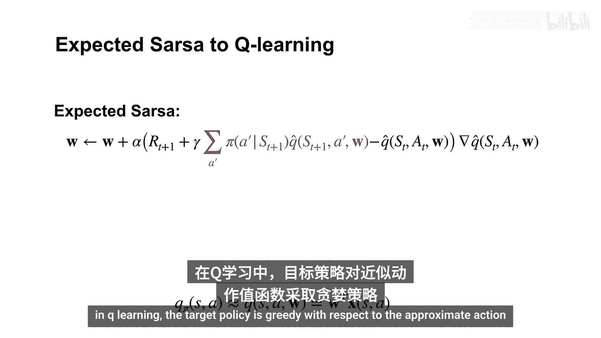
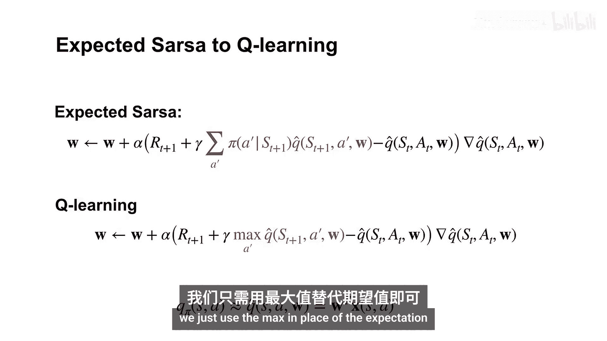

# 020：函数逼近下的期望SARSA与Q学习 🧠

在本节课中，我们将学习如何将表格型强化学习中的期望SARSA和Q学习算法，扩展到使用函数逼近的场景。我们将重点理解其更新公式的推导与核心差异。

上一节我们介绍了使用函数逼近的SARSA算法。本节中，我们来看看如何将其进一步发展为**期望SARSA**，并理解**Q学习**在函数逼近下的特殊形式。

## 从SARSA到期望SARSA

首先，回顾表格型SARSA的更新目标，它包含了下一个状态和动作的动作价值。

**SARSA更新公式（表格型）**：
`Q(S, A) ← Q(S, A) + α [R + γ * Q(S‘, A’) - Q(S, A)]`

期望SARSA则不同，它使用目标策略下的期望值来计算更新目标。这个期望值是通过对目标策略下所有可能动作的动作价值进行加权求和得到的。

**期望SARSA更新目标（表格型）**：
`目标 = R + γ * Σ [π(A‘|S’) * Q(S‘, A’)]`
其中，`π(A‘|S’)` 是目标策略在状态S‘下选择动作A’的概率。

## 函数逼近下的实现

当我们使用函数逼近时，同样可以计算这个期望值。以下是具体的实现步骤。

首先，回顾使用函数逼近的SARSA更新公式。它与表格型设置类似，但动作价值估计由权重向量 **w** 参数化。此外，我们还需要一个梯度项来将误差适当地分配到各个权重上。

**SARSA更新公式（函数逼近）**：
`w ← w + α [R + γ * q̂(S‘, A’, w) - q̂(S, A, w)] * ∇ q̂(S, A, w)`

函数逼近下的期望SARSA遵循相似的结构。以下是其更新过程：

1.  我们使用权重向量 **w** 为下一个状态的所有可能动作计算其动作价值估计 `q̂(S‘, a, w)`。
2.  然后，我们计算这些估计值在目标策略 `π` 下的期望。

**期望SARSA更新公式（函数逼近）**：
`w ← w + α [R + γ * Σ π(a|S‘) * q̂(S‘, a, w) - q̂(S, A, w)] * ∇ q̂(S, A, w)`

这就是将SARSA转变为期望SARSA所需做的全部改动。

## 扩展到Q学习

那么，如何为使用函数逼近的Q学习实现这一点呢？

幸运的是，**Q学习是期望SARSA的一个特例**。在Q学习中，目标策略是关于近似动作价值的贪婪策略。

在贪婪策略下计算期望，等同于计算**最大动作价值**。因此，函数逼近下的Q学习更新实际上非常直接：我们只需用最大值（max）代替期望（expectation）即可。

**Q学习更新公式（函数逼近）**：
`w ← w + α [R + γ * maxₐ q̂(S‘, a, w) - q̂(S, A, w)] * ∇ q̂(S, A, w)`

---

本节课中我们一起学习了函数逼近框架下的期望SARSA和Q学习算法。我们看到了期望SARSA如何通过计算目标策略下的期望值来改进SARSA，而Q学习则作为其贪婪策略下的特例，使用最大值操作进行更新。下一节，我们将探讨在使用函数逼近时如何进行有效的探索。