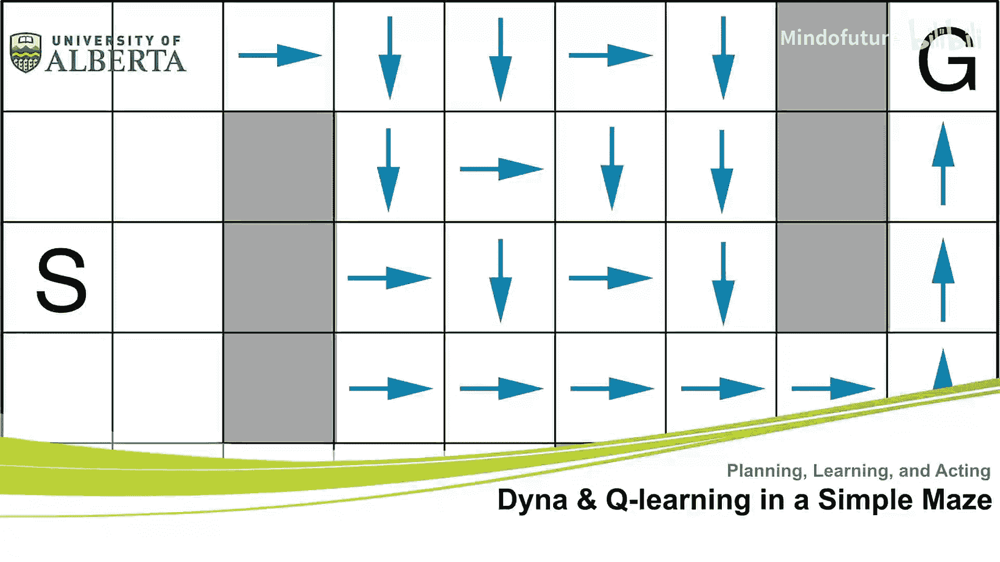
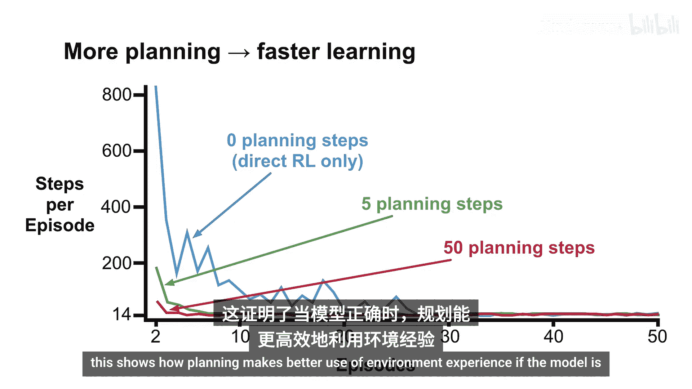
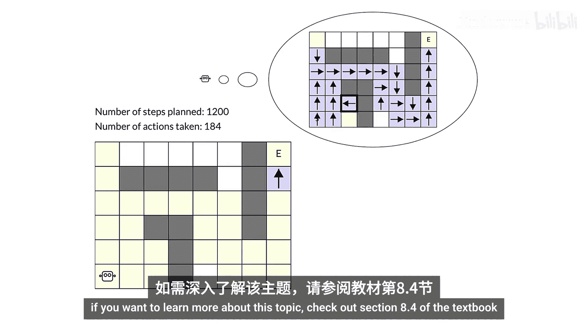

# 021：在简单迷宫中回顾Dyna-Q学习

在本节课中，我们将通过实验来比较表格型Dyna-Q算法和无模型的Q学习算法在小型迷宫环境中的性能。我们将观察规划步骤如何影响学习效率，并理解从真实经验和模型经验中学习的不同作用。

## Dyna-Q架构回顾

上一节我们介绍了Dyna-Q的架构。它结合了规划、学习和行动三个过程。

Dyna-Q的核心思想是，智能体不仅从与环境的真实交互中学习，还利用学到的环境模型进行“想象”或规划，从而更高效地更新价值函数。

## 实验设置：小型迷宫环境

本节中，我们来看看具体的实验环境。我们将使用一个简单的网格世界迷宫。

*   **状态与动作**：智能体有四个动作（上、下、左、右）。
*   **奖励**：只有进入目标状态（Gulf）会获得+1的奖励，其他所有转移的奖励均为0。
*   **任务类型**：这是一个分幕式任务。
*   **折扣因子**：γ = 0.95。

我们将比较三个智能体，它们都使用相同的参数：学习率 α = 0.1，探索率 ε = 0.1，并且所有动作价值估计初始化为0。实验运行50幕，重复30次后取平均结果。

## 规划步骤对性能的影响

以下是不同规划步骤下智能体性能的比较结果。

我们绘制了智能体完成每一幕所需的平均步数。步数越少，表示性能越好。

*   **0步规划（即标准Q学习）**：性能提升缓慢，最终稳定在每幕约14步。
*   **5步规划（Dyna-Q）**：达到与Q学习相同的性能水平，但速度更快。
*   **50步规划（Dyna-Q）**：仅需大约3幕就能找到一个优秀策略。

实验表明，**Dyna-Q的学习效率远高于Q学习**。在相同数量的环境交互后，Dyna-Q能学到更多知识。这证明了如果模型正确，规划可以更有效地利用环境经验。

## 搜索控制对规划效率的影响

让我们更仔细地观察搜索控制（即如何从模型中选择状态-动作对进行规划）如何影响规划过程。

为了更清晰地说明问题，我们调整了实验：智能体每次连续调用规划循环10次，每次进行10步规划，总计100步规划。

观察发现，许多规划更新并未改变价值函数。事实上，经过100步规划后，智能体只更新了两个状态-动作对的价值。

即使将单次规划步数增加到100步，最初的几次规划调用也仅更新了少数几个动作价值。

**为什么智能体需要如此多的规划步骤才能学到合理的价值函数和策略？**

原因是搜索控制**随机采样**状态-动作对。如果采样的状态-动作对产生的时序差分误差（TD error）为零，那么这次规划更新就无效。在这个奖励稀疏（除目标外均为0）且价值初始化为0的环境中，这种情况经常发生。

如果采用更高效的顺序（例如，优先更新那些TD误差大的状态-动作对），智能体可能仅用6次规划更新就能学到优秀策略。在大型环境中，随机搜索控制的问题会更加突出。

## 可视化学习过程

我们换一个迷宫来可视化学习过程。用箭头表示每个状态下根据估计价值的贪婪动作，没有箭头的状态表示策略下所有动作概率均等。

经过第一幕后，Q学习只更新了一个动作价值：即目标旁边状态中“向上”动作的价值。因为这是唯一经历了非零奖励转移的状态。需要更多幕才能将价值“回溯”到附近的其他状态。

相比之下，Dyna-Q通过规划，能更快地将价值信息传播到整个状态空间。

## 总结

本节课中，我们一起学习了在简单网格世界中测试表格型Dyna-Q算法。

我们看到了**规划如何能显著加速学习过程**。在我们的实验中，规划步骤越多，智能体的表现就越好。关键在于，Dyna-Q通过从模型生成的模拟经验中学习，减少了对昂贵环境交互的依赖，从而实现了更高的数据效率。