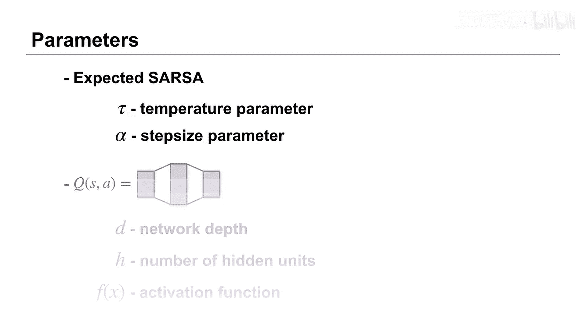

# 024：与亚当的会议-强化学习中的参数研究

在本节课中，我们将学习如何通过参数研究来深入理解强化学习算法。我们将探讨如何系统地测试不同的超参数设置，并通过可视化结果来评估算法的性能与参数敏感性。

## 概述

这是顶点项目的最后一周。完成本周的学习后，你将成功实现一个从问题定义到超参数精心选择的完整强化学习系统。今天我们将重点讨论如何精心选择超参数。

## 超参数选择的重要性

回想一下我们在项目早期阶段确定的所有关键性能参数。如果我们希望构建一个成功的学习智能体，就需要为这些参数选择良好的值。

在实践中，我们可能不得不依赖经验法则来做出许多选择。然而，在某些情况下，我们有机会通过研究参数的影响来获得更深入的见解。

例如，在我们的模拟器中学习时，我们可以用许多不同的参数配置来测试我们的智能体。这可以帮助我们确定特定参数的合理取值范围。当我们最终在月球上部署智能体时，这些研究也可能帮助我们设定参数。

## 如何进行参数研究

在研究中，我们可能会在各种模拟问题中，用许多不同的参数设置来测试我们的算法。这可以提供关于我们的算法在一般情况下可能如何表现的见解。

运行这样的科学研究不仅对科学家有用，在工业界也同样重要。在这两种情况下，真正理解你所部署的方法都至关重要。

让我们思考一下如何更好地理解算法在不同参数下的行为。

以下是进行参数研究的基本步骤：

1.  为每个参数选择一个取值范围，并在该范围内测试多个值。
2.  使用参数敏感性曲线来可视化结果。

## 理解参数敏感性曲线

在Y轴上，我们使用某种性能度量。例如，如果我们让智能体运行50个回合，这个度量可以是这50个回合的总回报之和，我们称之为**总回报**。

然后，我们在多次运行中取平均值，得到**平均总回报**。在X轴上，我们放置正在测试的参数值。

对于超参数的每个值，我们进行一次完整的运行。这意味着我们让智能体运行指定的步数（例如10,000步），并运行期望的次数（例如30次）。我们计算每次运行的总回报，然后将这些数字在30次运行中取平均值。我们为每个选定的超参数绘制这些平均值，从而得到敏感性曲线。

这条曲线提供了关于算法在其超参数范围内的行为表现，以及选择这些参数的难易程度的见解。

## 曲线形状的启示

如果曲线非常尖锐，则表明良好参数的范围很窄。如果你事先不知道这一点，那么你不太可能找到这个良好的参数设置。即使你设法选择了一个非常接近最佳值的超参数，性能也可能差很多。因此，尽管在最佳情况下算法可以表现良好，但在实践中，它的表现可能会差得多。

你可能会想，一旦我找到了这个良好的设置，我就可以直接使用那个超参数并获得良好的性能。不幸的是，对于一个新问题，最佳超参数很可能不同。相反，这个分析表明你可能很难选择超参数，因此我们在部署时需要小心。

另一方面，如果良好参数的范围很广，那么你更有可能成功选择一个好的参数。此外，这可能表明你的算法总体上对其超参数不太敏感。如果你在不同问题中观察到对超参数有类似的敏感性，那么这一点就更可能成立。

## 生成有效曲线的注意事项

为了产生有意义的曲线，我们必须注意几个因素。

首先，我们必须测试足够数量的超参数值。否则，我们对真实参数敏感性曲线的近似会很差。为了理解这一点，想象一下关于参数α的真实曲线是这样的：`f(α) = -α^2 + 10α - 20`。如果我们只抽样测试少数几个点，我们可能会意外地跳过这些参数的最佳值。

其次，我们需要测试足够宽泛的参数范围。如果我们选择的范围使得最佳值位于范围的一端，我们可能会错过更好的超参数值。

别担心，我们不会要求你详尽地测试每个超参数组合。你只需要为你的期望SARSA智能体扫描其中一个参数。这样，你将获得一些进行参数研究的经验，而不必等待程序运行数小时。我们会为其余的参数建议合适的值。

## 参数研究的实际应用

需要注意的是，我们并不使用参数扫描来为实际问题实际选择参数。相反，这是在简化设置中理解我们算法的一种策略。

系统地用许多超参数测试智能体通常并不可行。我们怎么能用可能导致反复坠毁的不良超参数设置，一遍又一遍地测试在月球上着陆模块呢？你很快就会因此被解雇。

理解我们的算法以及它们可能如何表现是如此重要，尤其是在现实世界（或者在这种情况下是外太空）中进行部署时。

## 总结

本节课中，我们一起学习了强化学习中的参数研究方法。我们探讨了如何通过测试不同超参数值并绘制敏感性曲线来评估算法性能。我们了解到，尖锐的曲线表明参数选择困难且对性能敏感，而平缓的曲线则意味着算法更稳健。我们还讨论了进行有效参数研究的注意事项，包括测试足够多的值和足够宽的范围。最后，我们明确了参数研究的主要目的是理解算法行为，而非直接为实际部署选择参数。