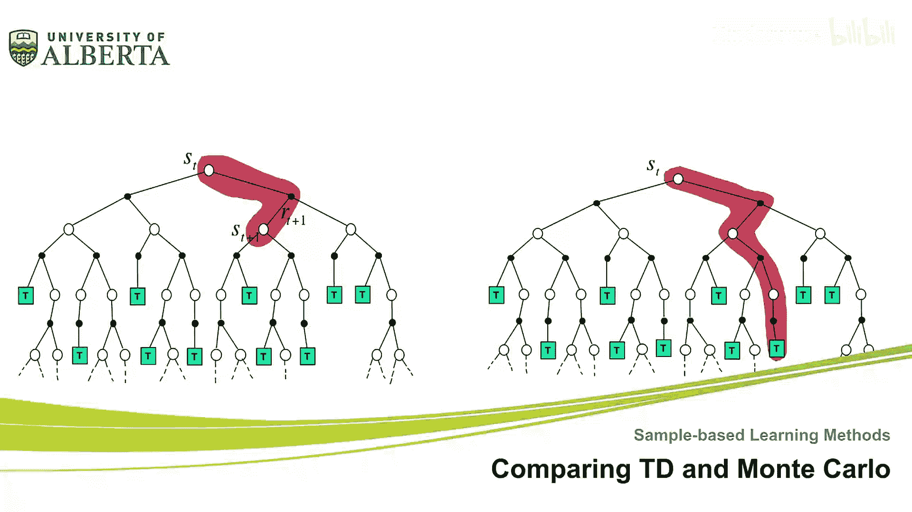
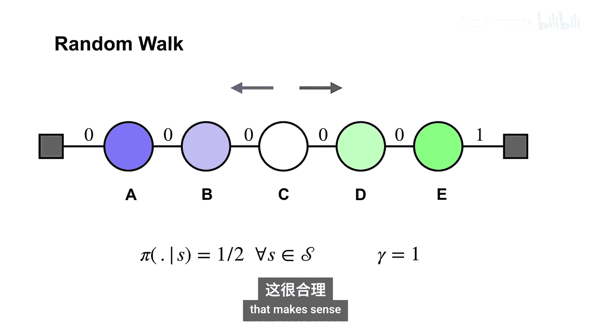
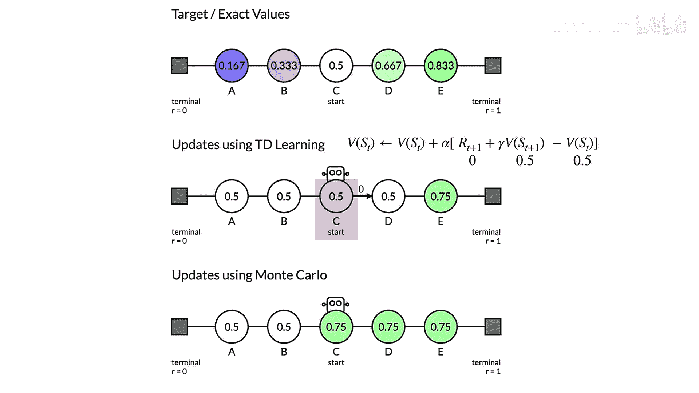
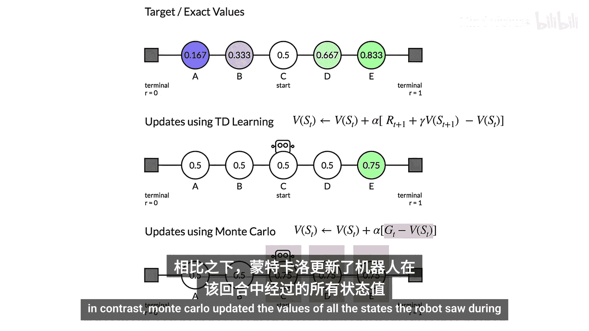
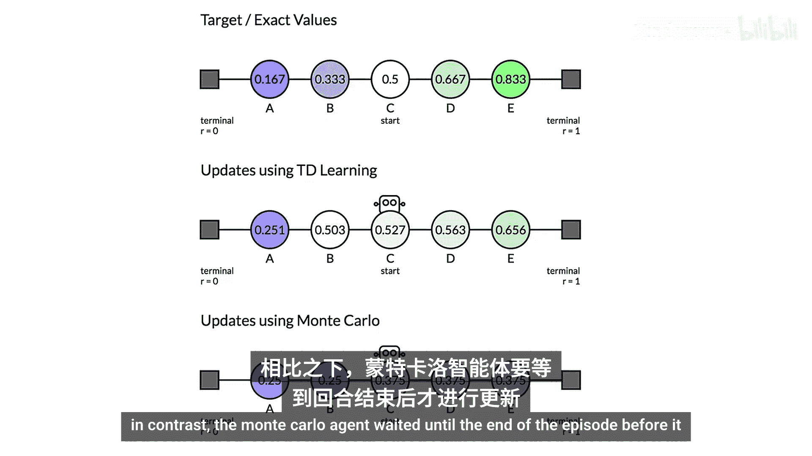
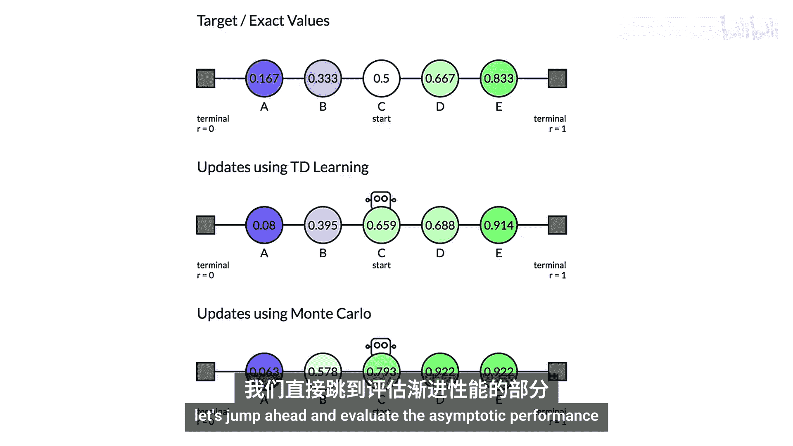
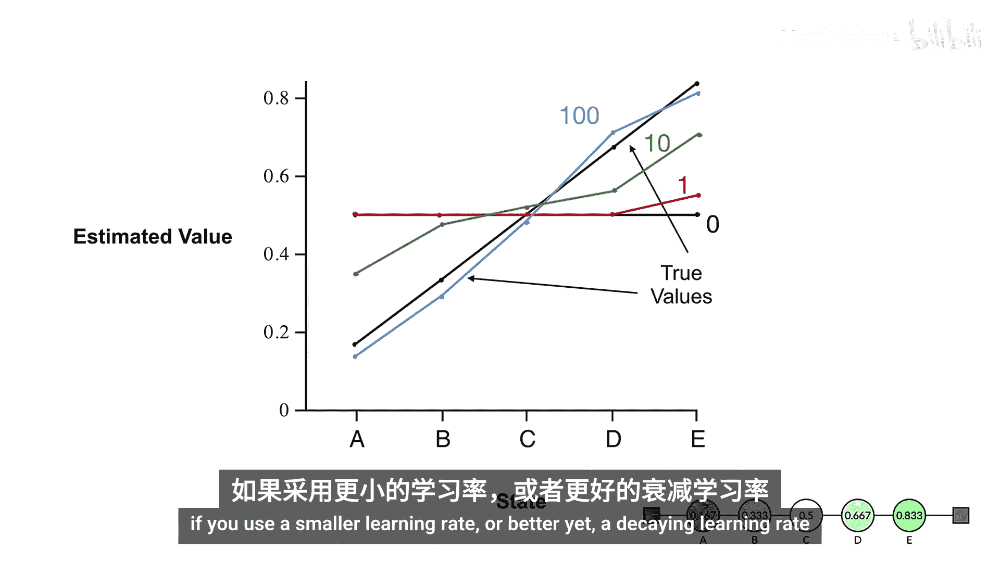
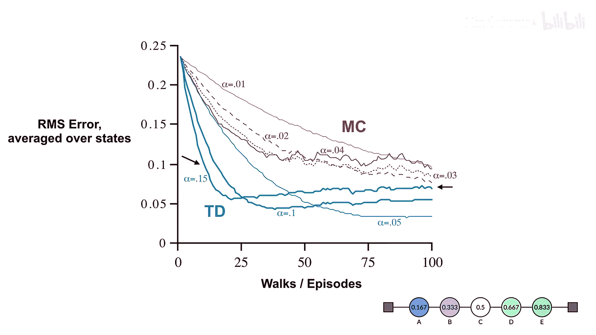
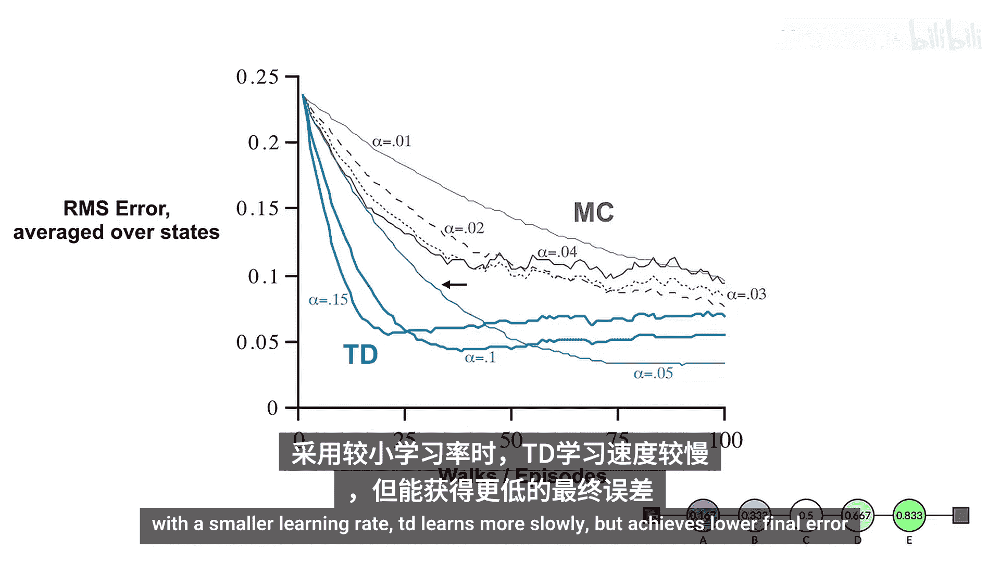
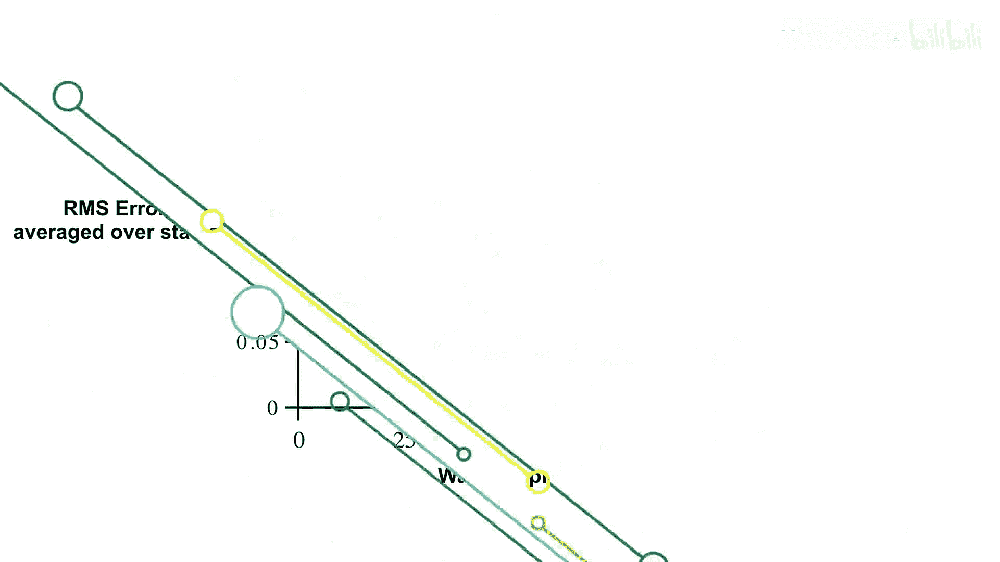

# 025：TD与蒙特卡洛方法对比实验

在之前的课程中，我们介绍了时序差分学习，并讨论了它相对于动态规划和蒙特卡洛方法的优势。

在本节课中，我们将通过一个精心设计的科学实验，更深入地比较TD学习和蒙特卡洛方法。

在本节课结束时，你将能够识别TD学习在实证上的优势。

## 实验环境设定

考虑一个简单的马尔可夫决策过程，它有五个非终止状态。在每个状态中，我们有两个确定性的动作：向左和向右。我们的目标是评估一个均匀随机策略，并估计其价值函数。

所有回合都从状态C开始。回合在到达最左侧或最右侧时终止。除了在右侧终止时获得+1奖励外，所有状态转移的奖励均为0。我们将折扣因子γ设置为1。

在这个问题中，状态价值有一个直观的含义：每个状态的价值等于从该状态出发，最终在右侧终止的概率。起始状态C的价值是0.5，这意味着从中心开始随机游走，有50%的概率在右侧终止。这很合理。

让我们为其余状态标上它们的真实价值。现在开始运行实验。

## 第一回合对比

幻灯片顶部标注了MDP各状态的**真实价值**。我们的智能体——一个可爱的小机器人——使用TD学习来估计价值函数。在底部，另一个智能体使用蒙特卡洛方法。我们将两个智能体的**近似价值函数**初始值都设为0.5。

让我们观察两个智能体在第一个回合中的表现。

注意，TD智能体只更新了状态E的价值。要理解这一点，考虑从状态C到D的转移。TD误差的计算公式为：

**δ = R + γ * V(S‘) - V(S)**

在这个转移中，奖励R为0（因为是非终止转移），状态C和D的价值都是0.5，所以TD误差δ为0，因此我们不对C的估计值进行任何更新。除了从状态E进入终止状态的这一步外，其他每一步都会发生同样的情况。

相比之下，蒙特卡洛智能体更新了机器人在该回合中访问过的所有状态的价值。

## 后续回合与渐进性能

让我们观察下一个回合。注意在回合中价值是如何更新的。

最终，TD智能体在每一步都进行了更新。相比之下，蒙特卡洛智能体则等到回合结束后才进行更新。

再看几个回合，TD智能体的价值估计似乎在向真实价值移动。这个过程太长了，让我们直接跳到后面，评估它们的渐进性能。

## 学习过程可视化

让我们绘制在学习过程中几个时间点的估计价值。

*   X轴代表MDP中的每个状态。
*   Y轴代表估计的价值。
*   图中标出了真实价值。
*   我们也绘制了初始价值估计（均为0.5）。
*   红色曲线显示了第一个回合结束后学到的价值。正如我们讨论过的，在第一回合结束时，TD只更新了一个状态的价值。
*   100个回合后的估计值已经接近它们能达到的最佳水平。记住，我们使用的是恒定步长α=0.1，这意味着价值会根据最近回合的结果产生波动。如果我们使用更小的学习率，或者更好的衰减学习率，可能会得到更精确的估计。

## TD vs. 蒙特卡洛：学习速度

一个很自然的问题是：TD学习比蒙特卡洛更快吗？

让我们在我们的示例问题上比较TD和蒙特卡洛的性能。

*   X轴代表回合数。
*   Y轴代表价值函数与学习到的估计值之间的**均方根误差**。
*   红色学习曲线代表了蒙特卡洛方法在不同α值下的性能。每条曲线是100次独立运行的平均结果。例如，这个点代表了学习率α=0.01时，50个回合后达到的平均误差。

现在来看TD的性能。我们看到TD的表现始终优于蒙特卡洛。

让我们更仔细地观察。注意，学习率α=0.15时，误差下降更快，但最终导致了更高的最终误差。

使用更小的学习率时，TD学习得更慢，但达到了更低的最终误差。

## 总结

在本节课中，我们一起进行了一个严谨的实验来比较TD学习和蒙特卡洛方法。

实验结果表明，在这个特定问题中，TD学习收敛更快，并且能达到更低的最终误差。

我们下节课再见。