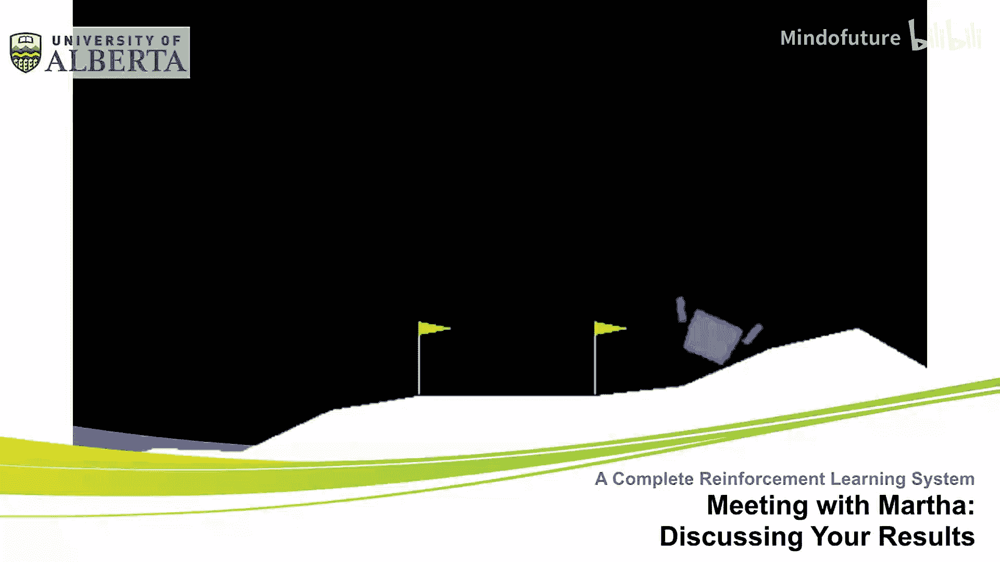

# 027：与玛莎的会议-讨论你的结果

在本节课中，我们将通过可视化智能体在学习过程中的表现，来深入理解其学习行为。我们已经完成了顶点项目，训练了一个能让登月舱着陆的智能体，并分析了其对超参数的敏感性。现在，我们将观察智能体在训练过程中的实际表现，以直观地了解它是如何学习的。

## 观察训练后的智能体

上一节我们分析了学习曲线和参数敏感性图。本节中，我们来看看智能体在训练过程中的行为表现。

以下是一段智能体经过一定训练后的演示视频。你会注意到，虽然策略尚未完美，但已经相当不错。然而，智能体并非一开始就如此。

*   智能体起初对这个世界一无所知，必须通过试错来学习。
*   在训练早期，智能体的行为明显不是最优的。
*   例如，智能体可能在整个回合中只决定开启一侧的推进器，这显然无法成功着陆。
*   之后，智能体有时学会了只使用底部主推进器。然而，这会将智能体远远推离屏幕，导致它获得很大的负奖励。

## 分析早期学习行为

如果智能体不能一直使用主推进器，也不能一直使用侧推进器，那么一个明显的错误选择就是完全不做任何动作。

我们可以尝试假设一些可能导致这种情况的原因：

*   一种可能性是神经网络在早期产生了不良的表征。
*   例如，智能体可能过度泛化。如果侧推动作在某个状态下导致了很高的负奖励，智能体可能会过度泛化，认为侧推动作在所有状态下都很糟糕。
*   随着表征的改进，智能体能更好地区分不同状态。当然，这只是一个假设，要找出真正的原因还需要一些实验。

## 观察改进后的表现

经过更多回合的学习后，智能体的表现要好得多。

*   智能体下降的速度仍然稍快，导致一个角撞到了地面。
*   但从这里开始微调策略相对容易。

## 总结与意义

本节课中，我们一起学习了通过可视化来观察智能体的学习过程。

观看智能体着陆的视频不仅有趣，也是一种调试和理解智能体的有效方法。只要条件允许，花时间进行这种可视化是值得的，它能帮助你更深入地理解你的智能体。