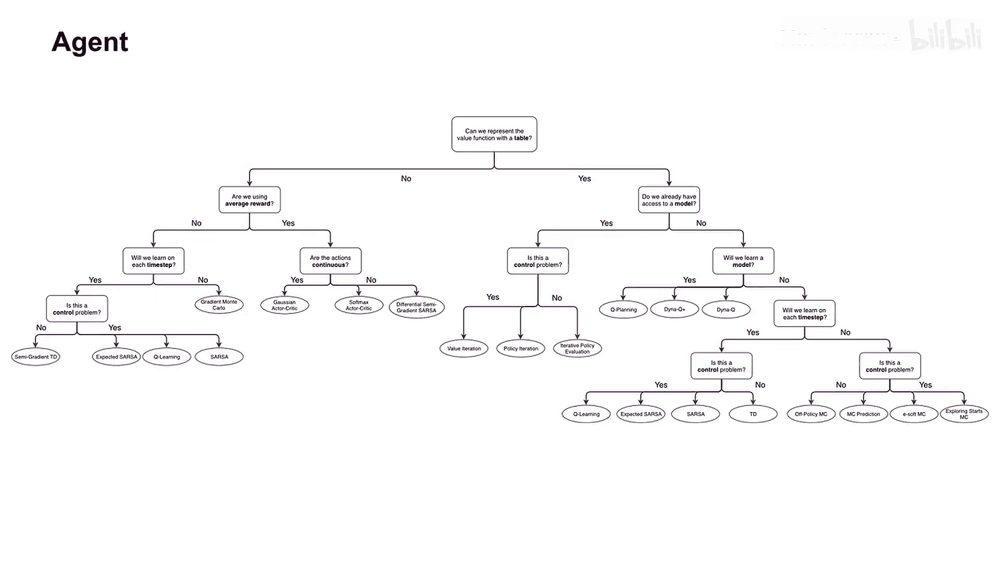
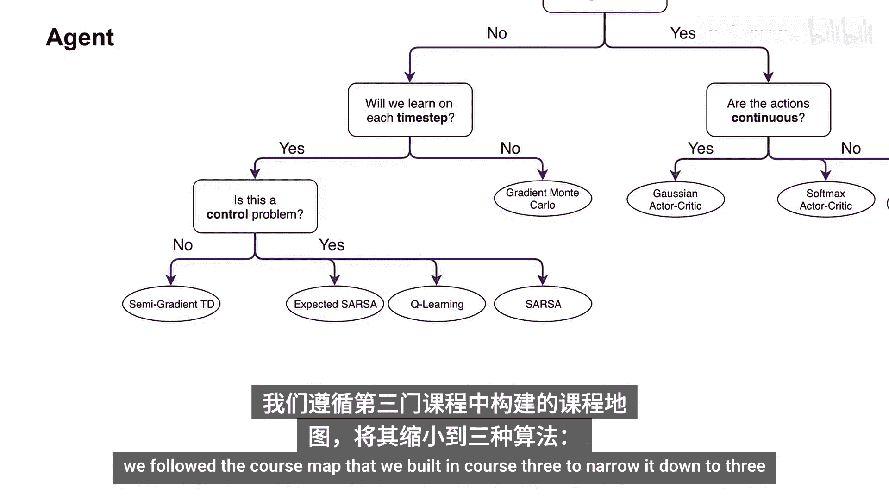
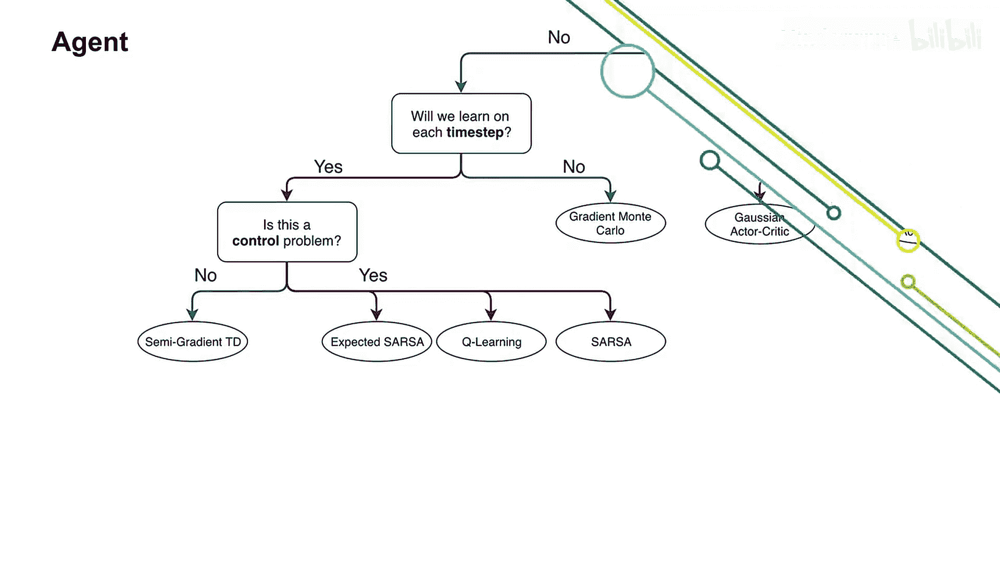
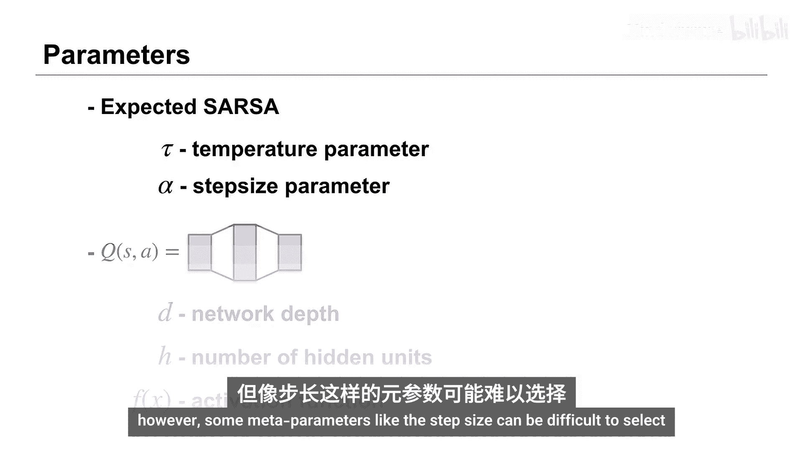
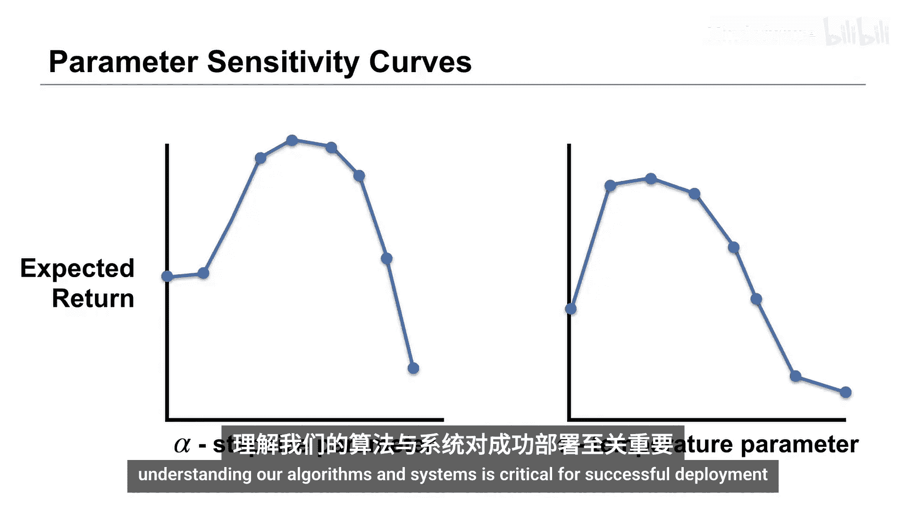

# 028：课程总结

在本节课中，我们将回顾并总结整个强化学习系统的构建过程。从问题形式化到智能体设计，再到参数调优，我们将系统性地梳理所学内容。

---

## 🎉 课程回顾与系统总结

恭喜你！你已经完成了课程，并构建了一个完整的强化学习系统。

让我们快速回顾一下你所构建的系统。在整个顶点项目中，我们逐步添加了用于解决月球着陆器问题的工具。

我们首先将问题形式化为一个马尔可夫决策过程，并实现了环境。这主要涉及精确指定奖励函数，以引导智能体成功着陆。

上一节我们介绍了问题形式化，本节中我们来看看如何设计智能体。

我们接着讨论了如何设计一个智能体，使其能在此环境中学习到一个优秀的策略。第一步是确定哪种强化学习算法适合给定的问题设置。

我们遵循在课程3中构建的课程地图，将选择范围缩小到三种算法：**期望SARSA**、**SARSA**和**Q学习**。

以下是这三种算法的核心更新公式：

*   **期望SARSA**:
    `Q(S, A) ← Q(S, A) + α [R + γ * Σ π(a|S') * Q(S', a) - Q(S, A)]`
*   **SARSA**:
    `Q(S, A) ← Q(S, A) + α [R + γ * Q(S', A') - Q(S, A)]`
*   **Q学习**:
    `Q(S, A) ← Q(S, A) + α [R + γ * max_a Q(S', a) - Q(S, A)]`

接下来，我们研究了元参数的选择如何影响智能体的成功。所有具体的实现细节，包括关于函数近似、探索和优化的细节，都可以被视为元参数。我们如何指定这些参数会对智能体的性能产生重大影响。

我们讨论了其中的几种选择以及常见的经验法则。例如，我们根据常规经验决定了神经网络的规模和激活函数。然而，像步长这样的元参数可能难以选择。

这引出了项目的最后一部分：对步长进行参数研究。理解我们的算法和系统对于成功部署至关重要。

最后，你得以看到你的智能体实际运行。

---

## 📚 总结与展望

本节课中我们一起学习了将强化学习方法应用于实践的完整流程。我们构建了一个解决月球着陆器问题的完整系统，涵盖了从环境定义、算法选择到参数调优的全过程。

我们希望你已经对在实践中应用强化学习方法的细微之处有了一些了解。这其中需要做出许多选择，并且需要相当多的专业知识和经验才能做好。我们的目标是让你获得一些实践经验，希望这能帮助你在未来将强化学习应用于现实世界的努力中。