# 029：专业化总结

在本节课中，我们将回顾整个强化学习专项课程的核心内容，梳理从基础概念到高级方法的知识脉络，并对学习成果进行总结。

## 课程概述

恭喜你完成了强化学习专项课程。从第一门课程学习价值函数、策略和序贯决策问题的基本概念开始，我们已经走过了很长的路。

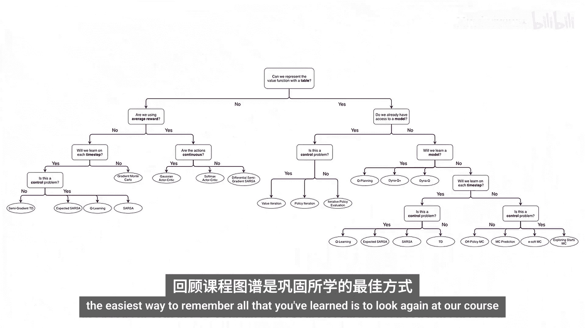

回顾所学知识最简单的方法是再次查看我们的课程地图。

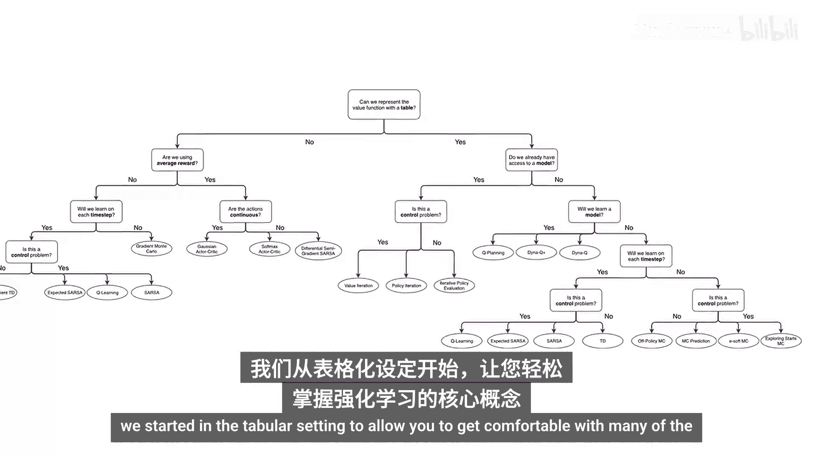

## 表格化设置入门

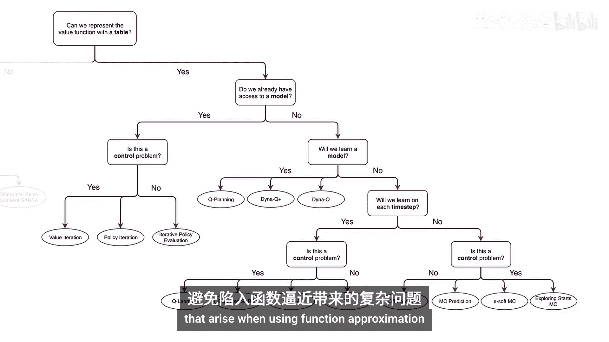

我们从表格化设置开始，让你在不被函数逼近带来的额外问题困扰的情况下，熟悉强化学习的许多关键概念。

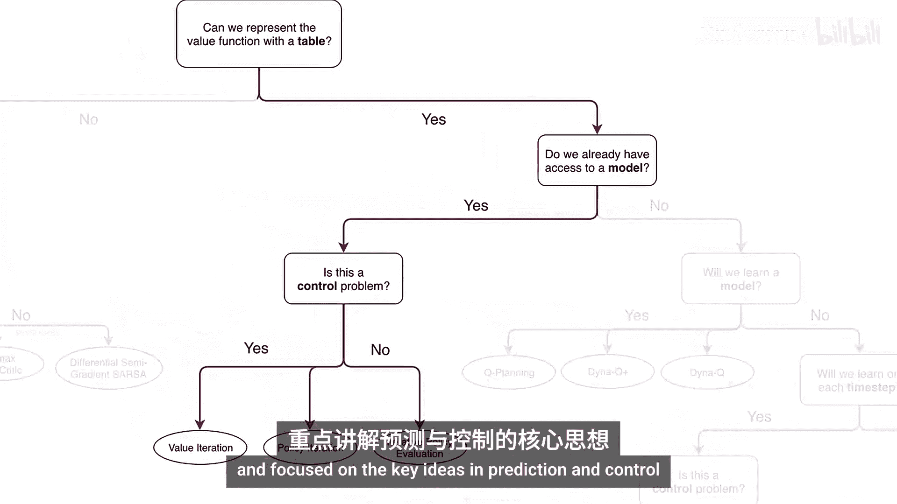

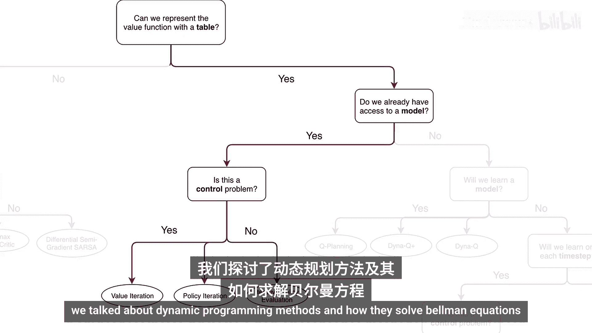

我们首先假设你拥有一个完美的模型，并专注于预测和控制中的关键思想。我们讨论了动态规划方法以及它们如何解决贝尔曼方程。

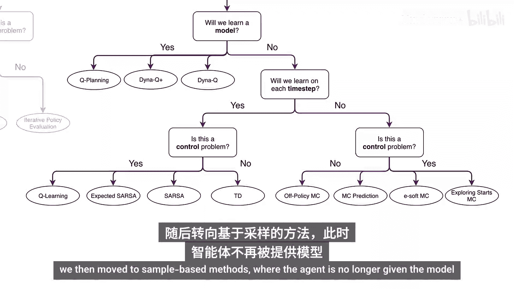

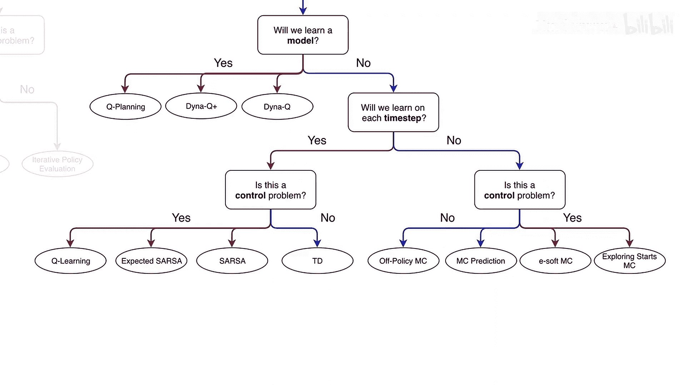

## 转向基于样本的方法

上一节我们介绍了在已知模型下的规划方法，本节中我们来看看当智能体不再被给定模型时的情况。

我们转向基于样本的方法，智能体主要通过与环境的试错交互进行学习。

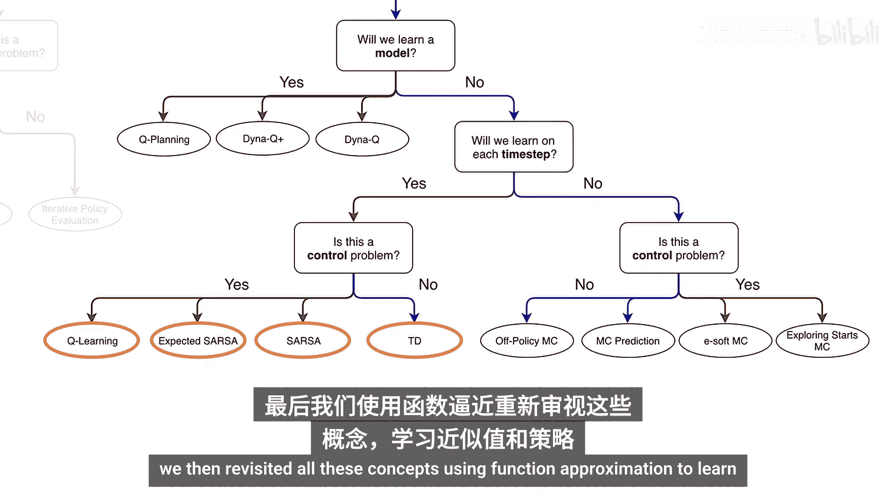

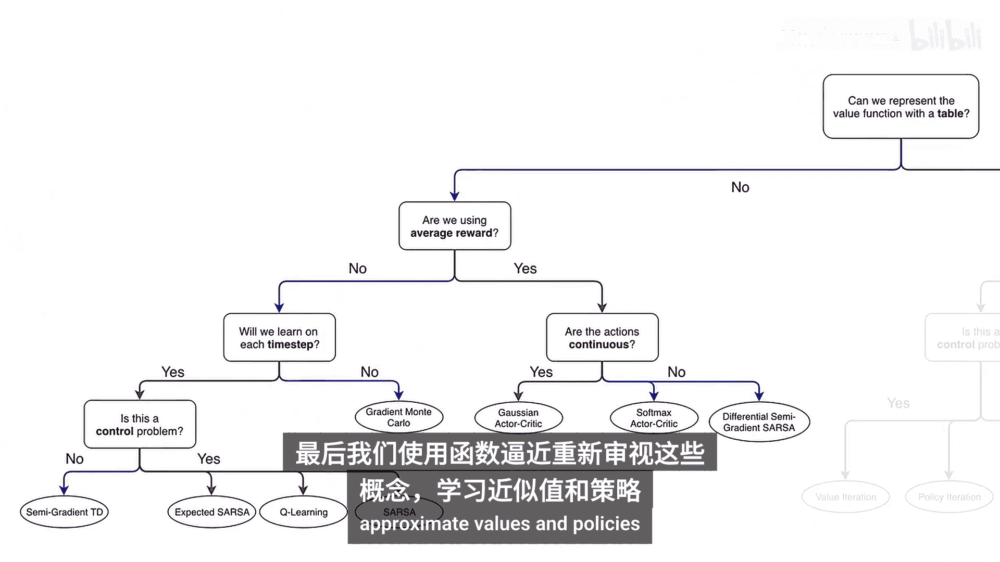

我们首先考虑智能体不学习模型的算法，包括蒙特卡洛算法和使用自举的时间差分学习算法，后者可以在每个时间步学习和更新策略。

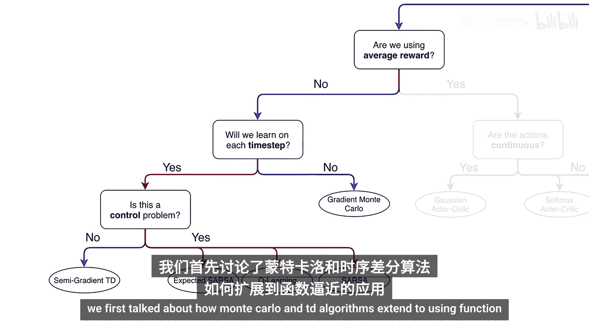

以下是这些算法的核心：
*   **预测算法**：TD(λ) 用于价值预测。
*   **控制算法**：Q-learning、Sarsa 和 Expected Sarsa 用于学习最优策略。

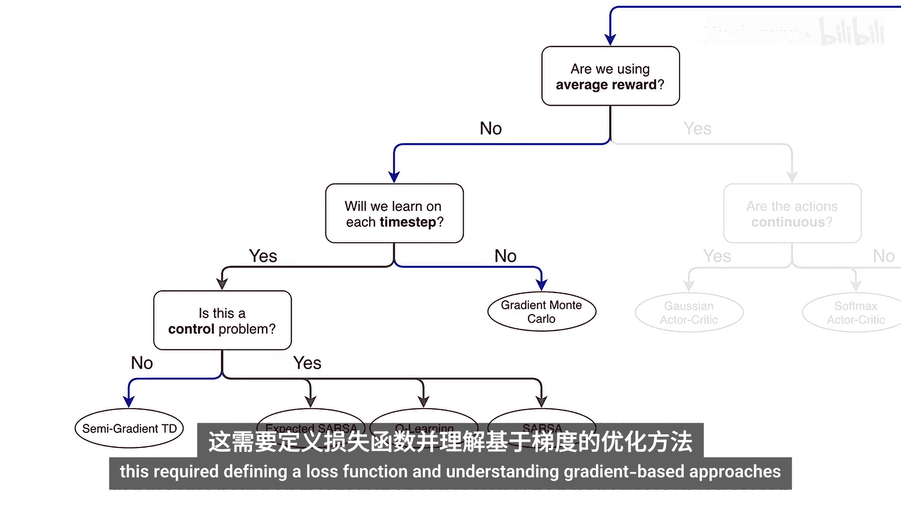

## 引入函数逼近

在掌握了样本方法后，我们使用函数逼近重新审视了所有这些概念，以学习近似的价值和策略。

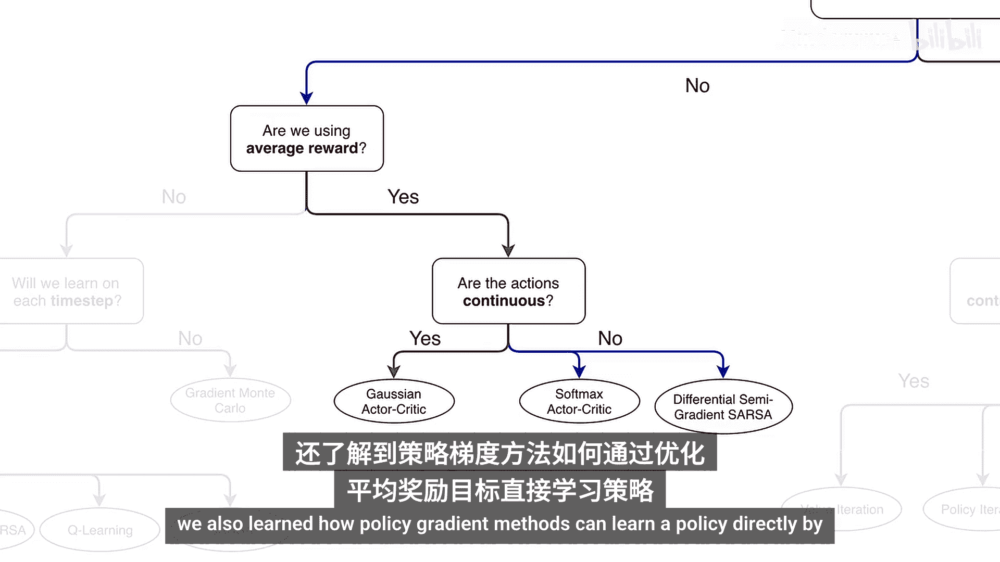

我们首先讨论了蒙特卡洛和TD算法如何扩展到使用函数逼近。这需要定义一个损失函数，并理解基于梯度的优化方法。

## 新目标与策略优化

接着，我们讨论了两个新思想：平均奖励和策略梯度方法。

我们学习了使用平均奖励作为在持续任务中表述智能体目标的新方法。我们也学习了策略梯度方法如何通过直接优化平均奖励目标来学习策略。

## 学习成果与展望

本专项课程的目标是为你提供基础性知识。理解基本原理对于恰当地使用强化学习至关重要。

你现在应该能更好地理解强化学习何时适合解决特定问题，以及如何将你的问题表述为一个强化学习问题。这个看似简单的事情代表了一大步。人们常常思考：“我如何将最先进的强化学习技术应用到我的问题上？”而实际上，有时一个非常简单的方法就足够了，或者问题本身最初就没有被很好地表述为强化学习问题。我们希望你能更明智地判断。

希望你学到了一些关于在使用强化学习时保持条理性和科学性的方法。你现在知道了形式化你的马尔可夫决策过程或赌博机问题、确定合适的算法以及仔细评估和理解你的自主学习系统性能是多么重要。

掌握基础知识是学习强化学习高级主题的第一步。你在这里学到的知识也将有助于揭开你在博客文章或科学论文中读到的、乍一看很复杂的算法的神秘面纱。你现在应该能够看到，最先进的系统实际上是建立在相对简单的思想之上的。永远不要对你不理解的事物感到敬畏。

我的目标是帮助更多人理解并有效地使用强化学习。我期待着看到你用新技能所取得的成就。

我们非常享受与你共度的时光。第一次学习一个新主题是如此令人兴奋。我们也坚信，强化学习和人工智能将使世界变得更美好。你现在已经准备好在这个更美好的世界中发挥你的作用了。😊

## 总结

本节课中我们一起回顾了整个强化学习专项课程的旅程。我们从表格化环境下的基础概念和动态规划出发，学习了无模型的蒙特卡洛和时间差分方法，进而扩展到使用函数逼近处理大规模问题，并最终探讨了平均奖励目标和直接优化策略的策略梯度方法。这套知识体系为你奠定了坚实的理论基础，使你能够明智地判断问题、选择方法，并向着更高级的强化学习应用与创新迈进。