# 001：利用函数逼近进行预测和控制 🚀

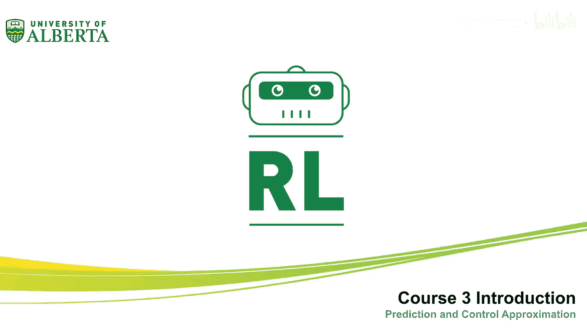

## 概述

在本节课中，我们将开启强化学习的新篇章，学习如何利用函数逼近来处理大规模或连续状态空间的问题。我们将告别存储所有状态值的表格方法，转而学习使用参数化函数（如神经网络）来近似价值函数。虽然这会导致某些状态下的价值估计不精确，但函数逼近带来的泛化能力是巨大的优势。我们将学习新的目标函数、梯度下降方法，并将之前学到的蒙特卡洛、时序差分等算法扩展到函数逼近的框架下。

---

## 课程3：新旧交织的故事 📖

课程3讲述的是一个“新旧交织”的故事。今天，我们开始强化学习中函数逼近的旅程。这在某种意义上是全新的，因为我们将首次讨论**目标函数**、**梯度下降**、**参数化函数**以及**泛化与区分**。

但你已经为此做好了充分准备。探索与利用、价值函数、策略以及你已经学过的许多算法的思想，都能自然地迁移到函数逼近的设定中。

---

## 视角的重大转变 🔄

课程的开始代表着视角的重大转变。我们需要将焦点转向学习参数化函数。我们将不再假设可以将所有状态的价值存储在一个表格中。事实上，我们甚至无法保证能多次看到同一个状态。相反，我们将学习由一组权重（如神经网络）参数化的函数，来近似价值。

我们无法使这个近似变得完美。这意味着在某些状态下，我们必须接受价值函数的不准确性。尽管如此，转向参数化价值函数总体上仍是积极的，因为它带来了**泛化**能力。这实际上反映了我们人类的学习方式：你会根据修读其他课程的经验，来泛化预测这门课程需要投入多少工作量。

概念将变得更加技术性。我们将分析智能体遇到的状态分布及其对价值函数准确性的影响。我们将计算目标函数的梯度，并推导出新的学习规则。

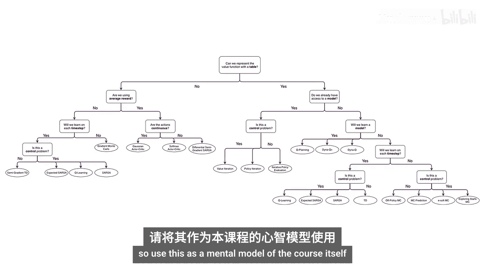

---

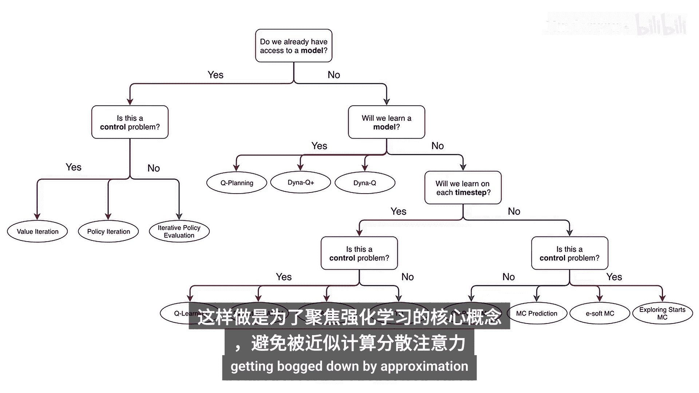

## 课程地图导航 🗺️

在专项课程的这一阶段，你已经学习了许多内容，现在我们将学习一系列新知识。这很容易让人迷失方向，更糟的是，你可能会看不清哪些算法对当前任务最相关。

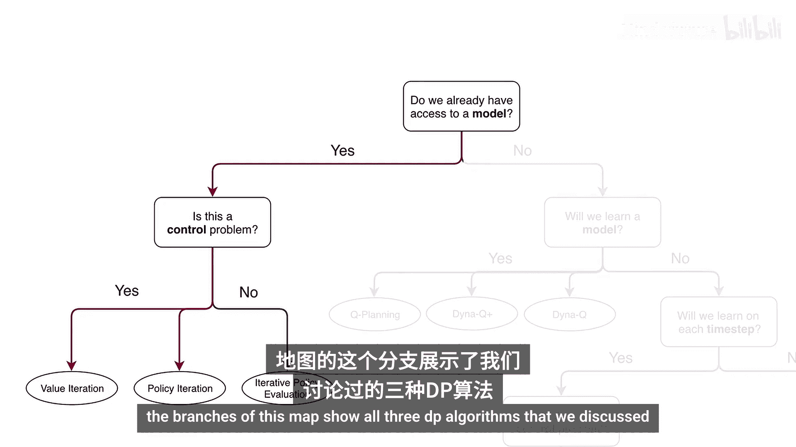

为了帮助解决这个问题，我们开发了一张课程地图。其理念是，你可以从树状图的顶部开始，逐步向下找到最适合你问题的算法。请记住，这是一张课程地图，它并未包含强化学习中的所有算法，只涵盖了我们讨论过的那些。这张地图旨在总结本课程的算法，并不一定是分类更广泛强化学习算法的最佳方式，因此请将其视为对本课程内容的一个心智模型。

让我们通过地图回顾一下在第一、二课程中学过的内容。

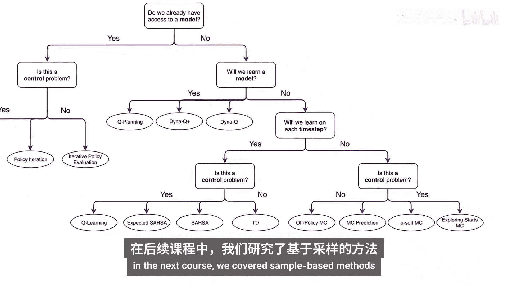

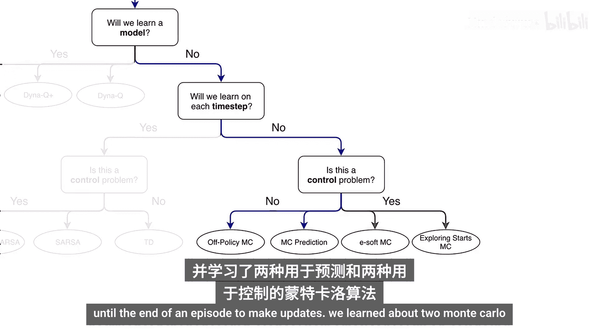

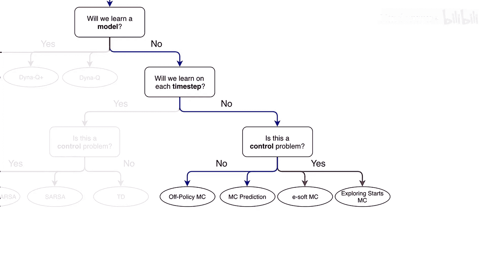

我们最初假设智能体可以用表格完美地表示价值。这样做是为了专注于强化学习的基本概念，而不被近似问题所困扰。

我们讨论的第一类强化学习方法是使用一个给定的（而非学习的）世界模型。我们使用动态规划方法，在不与世界交互的情况下，从模型计算价值函数和最优策略。地图的这个分支展示了我们讨论过的所有三种动态规划算法。

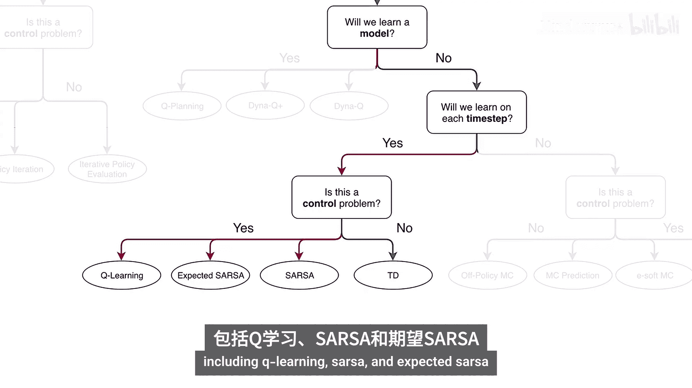

在下一门课程中，我们涵盖了基于样本的方法。我们首先讨论了必须等到一个回合结束后才能进行更新的**蒙特卡洛方法**。我们学习了两种用于预测的蒙特卡洛方法和两种用于控制的蒙特卡洛方法。

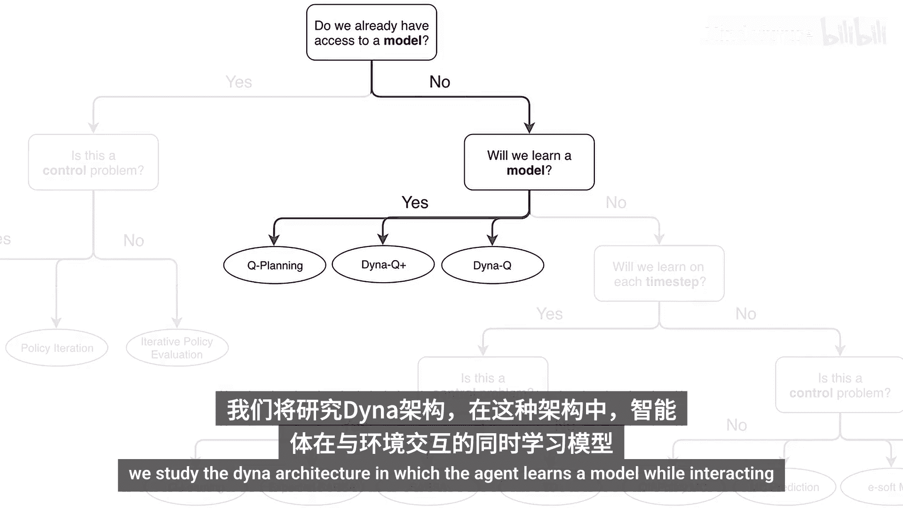

之后，我们向你介绍了**时序差分学习**。这类算法允许智能体在回合的每一步更新价值函数和策略。在这里，我们学习了一些强化学习中最广泛使用的算法，包括 **Q学习**、**SARSA** 和 **期望SARSA**。

我们通过回到基于模型的规划方法结束了第二课程，研究了智能体在与世界交互时学习模型的**Dyna架构**。

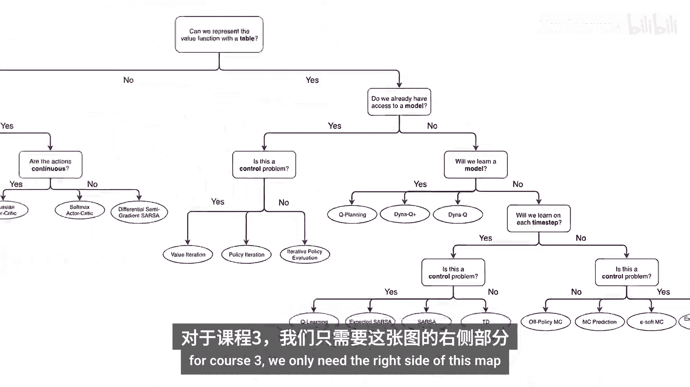

对于课程3，我们只需要这张地图的右侧部分。我们将首先介绍参数化函数，以及如何用它们来近似价值函数。我们将讨论泛化与区分，以及特定的函数逼近器，包括**粗编码**和**神经网络**。和之前一样，我们将从预测开始，利用监督学习和梯度下降的思想，推导出新的蒙特卡洛和时序差分算法。

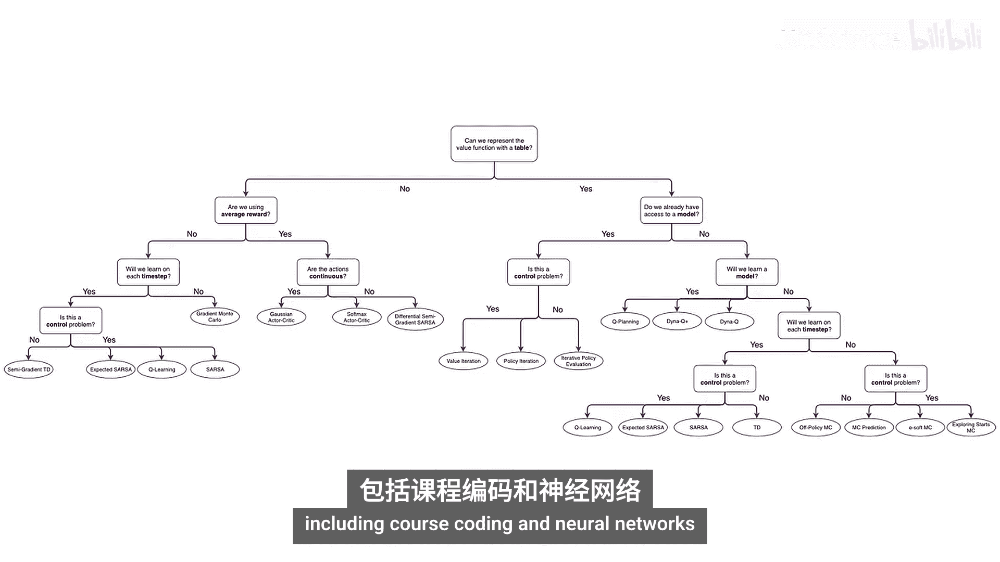

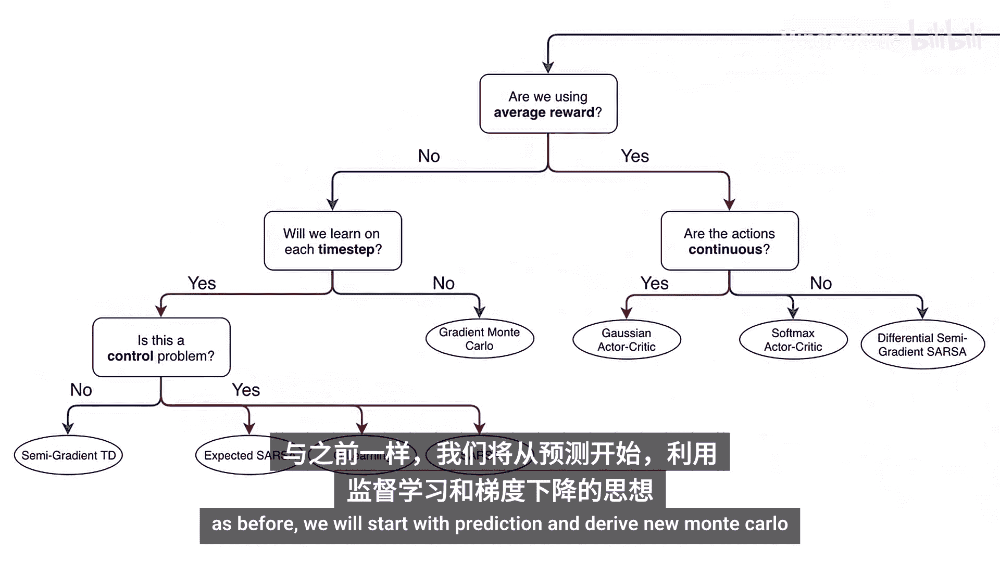

然后，我们将讨论用于函数逼近的控制算法，包括**期望SARSA**和**Q学习**。

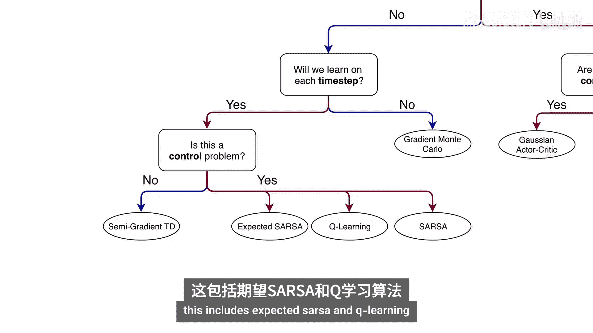

之后，我们将用一种称为**平均奖励**的、表述持续性控制问题的新方法，彻底颠覆你的认知。

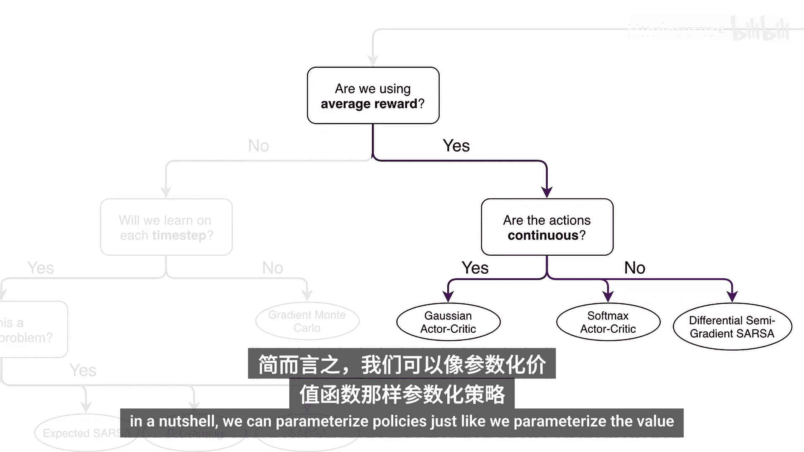

我们将以**参数化策略**作为课程3的结尾。简而言之，我们可以像参数化价值函数一样参数化策略。我们将讨论如何在平均奖励设定下做到这一点。

到本课程结束时，你将掌握将强化学习扩展到实际问题所需的大部分知识。然后，你将在课程4中运用所有这些新获得的理解，实现一个完整的强化学习系统。

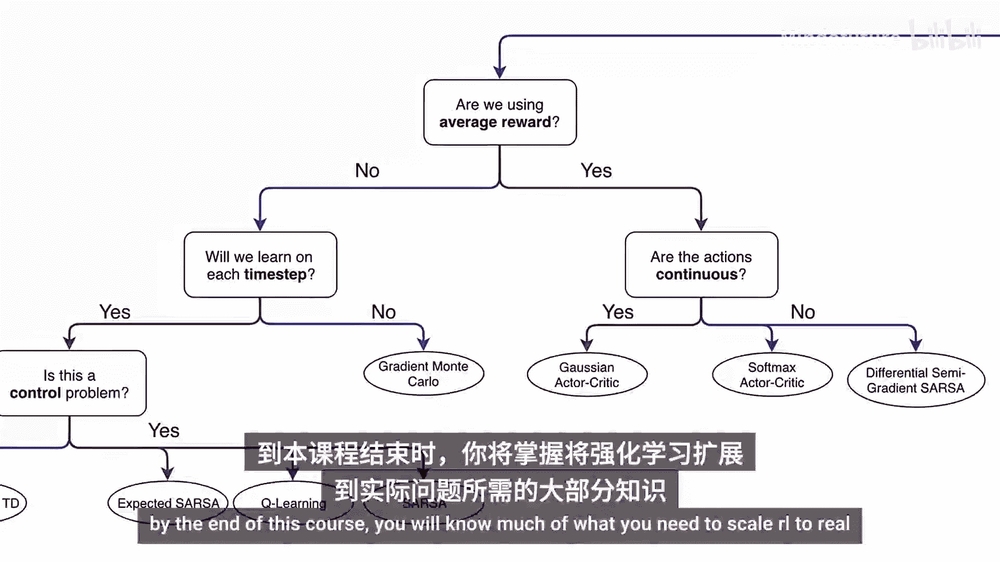

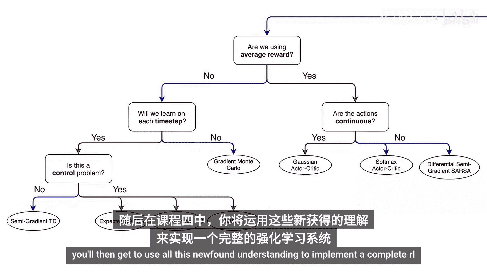

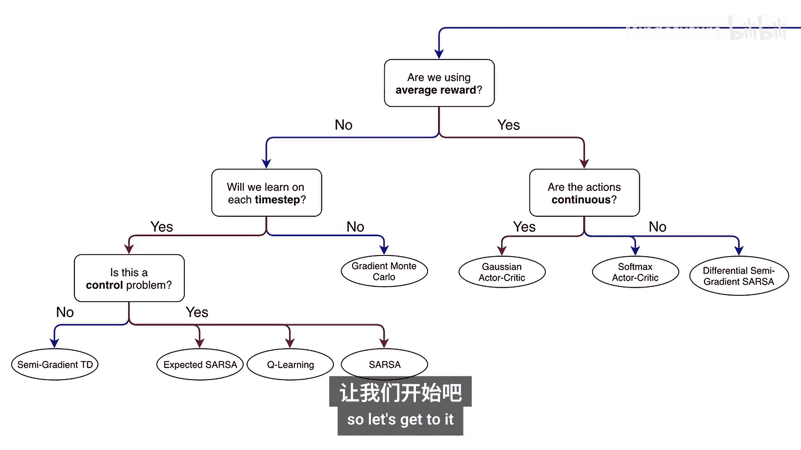

那么，让我们开始吧。