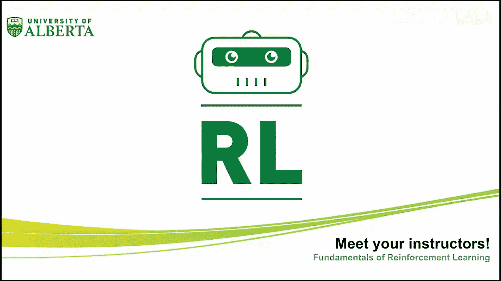

# 002：认识你的导师

在本节课中，我们将认识本课程的两位导师——Martha和Adam，了解他们进入计算机科学和强化学习领域的历程，以及他们对研究、教学和强化学习未来发展的看法。

## 导师介绍 👨‍🏫👩‍🏫

以下是两位导师的背景介绍。

*   **Martha**：阿尔伯塔大学助理教授。她在强化学习算法方面贡献卓著，开发了多种离策略学习算法和策略梯度新方法，并在表示学习领域有数十项重要贡献，是强化学习领域冉冉升起的新星。
*   **Adam**：阿尔伯塔大学研究教授，Deep Mind高级研究员。他以在强化学习的预测知识方面的工作而闻名，其思想被全球多个研究小组借鉴和发展。同时，他也是一位杰出的实证研究者，擅长设计实验以揭示关键问题，并持续致力于提升RL领域的科学理解。

## 进入计算机科学的契机 💻

上一节我们介绍了两位导师，本节中我们来看看他们是如何与计算机科学结缘的。

以下是他们各自的故事。

*   **Adam**：在高中时期对物理、化学、生物等科学感兴趣，但未找到完全契合的方向。偶然选修了一门计算机科学和编程课程（使用GW-BASIC），第一次实现`if`语句或`for`循环时，被能让计算机为自己执行一系列指令的能力所震撼，这成为了他职业生涯的决定性时刻，从此坚定地选择了计算机科学。
*   **Martha**：本科主修数学，认为函数和动力系统非常优美。出于兴趣选修了计算机科学课程，并发现其乐趣十足，因此同时继续修读数学和CS。这两个学科的结合为后来从事AI和机器学习研究打下了良好基础。

## 与强化学习（RL）的相遇 🤖

了解了他们进入计算机领域的经历后，我们接下来看看他们是如何接触到强化学习并投身其中的。

以下是关键转折点。

*   **Adam**：在研究生阶段来到阿尔伯塔大学，原本计划从事并行分布式计算。为了凑满选修学分，他采用了一个“合理”的策略——浏览教授照片，选择了看起来最友善的Rich Sutton教授的《强化学习导论》课程。这门课令人惊叹且充满启发，是他首次接触人工智能或机器学习。在课程早期实现Sarsa算法解决网格世界问题的作业中，看到智能体仅凭每步-1的奖励信号就学会了走出迷宫的高效路径，这再次震撼了他，让他决定终生投身于此。
*   **Martha**：在本科暑期参与了一些AI研究，并从此继续深入。她留在这个领域不仅因为对数学和函数的兴趣，更因为这是一个可以大量协作、帮助他人的社区。她的日常工作包括指导很多学生，在团队中共同攻克难题，这种在团队中研究有趣问题的体验非常棒。

## 研究生涯的感悟与教学的意义 🧠

从与RL的结缘到深入其中，研究之路既有挑战也有收获。本节我们来听听导师们从研究生涯中学到的重要一课，以及他们如何看待教学的意义。

以下是他们的分享。

*   **最重要的收获**：Adam认为，一项适用于所有科学乃至任何形式研究的重要经验是：真正热爱深入理解事物的细节，专注于小问题并将其理解得非常透彻。这是一项广泛适用的能力，他也在努力将其传授给自己的学生和本专项课程的学习者。
*   **教学与指导的价值**：Adam提到，研究有时会令人疲惫，同行评审过程可能令人沮丧，此时回顾自己的工作可能显得渺小且难以看到其对世界的实际影响。而教学和指导则是可以依靠的支柱。教学是帮助人们首次了解事物、理解领域运作方式的激动人心的过程。无论是与学生讨论、帮助他们解决问题，还是见证他们职业生涯的起步，都是非常棒的体验，也是他每周最期待的日子。

## 强化学习的重要性与未来展望 🚀

前面我们探讨了研究本身，现在让我们把目光投向更广阔的领域：为什么强化学习如此重要？它的未来可能走向何方？

以下是两位导师的观点。

*   **Adam的观点**：RL的潜力巨大，但仍面临许多开放挑战。目前机器学习已被广泛应用，但RL仅在少数领域得到使用。他认为RL能产生巨大影响，预计在未来十年左右，将看到更多控制工程师在实际系统中使用RL。RL将成为在大型工程系统中辅助自动化决策的工具。但要实现这一点，需要在算法鲁棒性和用户接受度方面取得进展。
*   **Martha的观点**：首先，强化学习是研究AI、推动AI问题解决的正确框架。其次，她对发展学习系统非常感兴趣，例如人类婴儿或幼年动物如何在极短时间内学习爬行、了解身体、与环境互动、操纵物体、与其他智能体交流。这些高度胜任的学习系统令人惊叹，而我们离实现类似的系统还有很长的路要走。她希望通过强化学习这个视角，去理解这些系统可能使用的算法和表征。

## 强化学习的下一个重大应用领域 🏭

展望未来，应用领域往往驱动着整个领域的兴趣和 excitement。本节我们探讨导师们眼中RL的下一个重大应用方向。

以下是Adam的预测。

*   **核心与方向**：RL本质上是自动化决策的通用方法。它将成为帮助我们改进众多工程系统的工具。
*   **主要领域**：预计RL将在工业控制领域大放异彩。该领域的专家一直在寻求优化系统性能的方法，RL可以帮助实现降低能耗、节约成本等目标。在专家手中，这些算法能在不久的将来发挥良好作用。因此，RL更应被视为辅助专家工作的工具，而不是取代人或使其自动化。

---

本节课中我们一起认识了本课程的两位导师Martha和Adam，了解了他们进入计算机科学和强化学习领域的故事，分享了他们对深入研究、教学指导价值的感悟，并探讨了强化学习的重要性以及未来在工业控制等领域的应用前景。希望他们的经历和见解能为你学习强化学习带来启发。