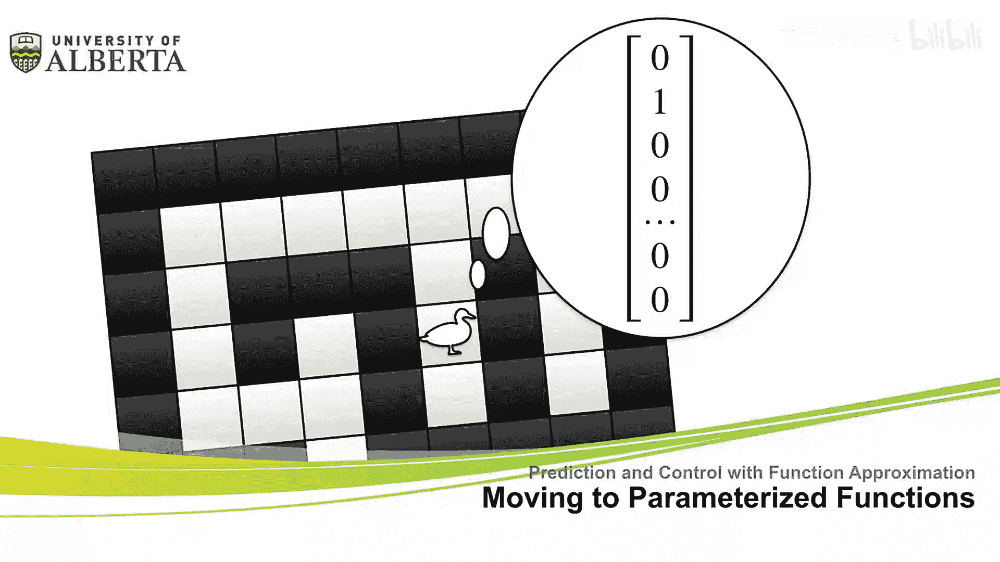
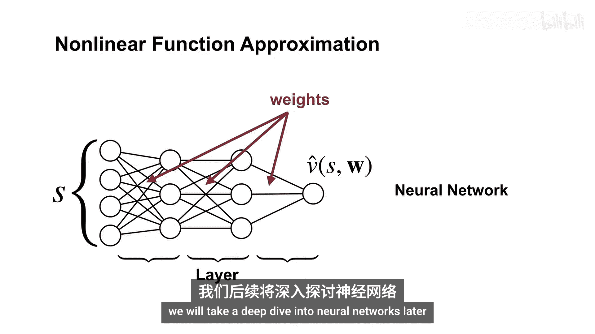

# 003：从表格法到参数化函数

在本节课中，我们将要学习如何从传统的表格法过渡到更通用的函数逼近方法，特别是参数化函数。我们将理解线性函数逼近的原理，并认识到表格法其实是线性逼近的一个特例。最后，我们会了解到参数化价值函数有多种不同的实现方式。

## 表格法的局限性

上一节我们介绍了表格法，它通过为每个可能的状态单独存储一个价值来学习。然而，在现实世界的问题中，状态空间可能极其庞大。想象一个通过摄像头观察世界的机器人，我们显然无法为每一张可能的图像都存储一个表格条目。

幸运的是，表格法并非唯一的选择。本节中，我们来看看更通用的价值函数逼近方法。

## 参数化函数简介

在之前的课程中，我们花了大量时间思考如何估计价值函数。到目前为止，我们的价值函数逼近都采用同一种形式：为每个状态在表格中存储一个独立的值，并在学习过程中查找和修改这些值。

但这并不是逼近价值函数的唯一方式。原则上，我们可以使用**任何**以状态为输入、输出一个实数的函数。例如，在一个网格世界中，我们的价值函数逼近可以接收x和y坐标，并将它们相加来产生一个价值估计。

这只是一个启发性的例子。我们不会真的使用这个函数，因为它无法被修改，我们也就无法进行学习。这正是**参数化函数**这一概念的用武之地。

## 引入可调权重

我们在函数中引入一组实数值的**权重**，通过调整这些权重来改变函数的行为。例如，在网格世界的例子中，我们可以不使用固定的x+y，而使用如下形式的函数：
`V_hat(s) = w1 * x + w2 * y`
这里的权重`w1`和`w2`就是**参数化**我们函数的参数，它们允许我们改变函数的输出。

为了表示这个函数在逼近真实的价值函数，我们使用符号 **`V_hat(s; w)`**。其中，**`w`** 是一个包含所有参数化权重的向量。我们不再需要存储一整张价值表，只需存储两个权重就能表示我们的价值函数逼近。可以想象，这种紧凑的表示方式对于庞大的状态空间非常有用。

## 线性函数逼近

我们刚刚讨论的例子是一种特殊情况，称为**线性价值函数逼近**。在这种情况下，每个状态的价值被表示为权重的线性函数。这意味着每个状态的价值是通过权重乘以状态的某些固定属性（称为**特征**）之和来计算的。

我们可以简洁地表达这一点。近似价值由特征向量和权重向量的**内积**给出：
**`V_hat(s; w) = x(s)^T * w`**
我们用粗体的 **`x(s)`** 来表示特征向量。

我们对特征的选择会影响我们能够表示的价值函数的类型。例如，考虑我们目前讨论的逼近方式（`x`和`y`坐标）。使用它，我们只能表示那些价值随特征`x`和`y`**线性变化**的价值函数。

考虑一个情况，真实价值函数由网格上的数字给出。我们无法将其表示为`x`和`y`的线性函数。为了让外围的值正确，`w1`和`w2`都需要为0。然而，这将意味着内部的值不正确，因为要使和为5，`w1`和`w2`中至少有一个必须非零。

因此，线性函数逼近依赖于拥有**好的特征**。在这个问题中，`x`和`y`坐标并不是好的特征。但正如你稍后将看到的，存在许多强大的方法来构造特征。

## 表格法是线性逼近的特例

线性函数逼近实际上非常通用。事实上，**表格表示法本身就是线性函数逼近的一个特例**。

为了构建一个线性价值函数来表示这个表格价值函数，我们需要定义特征。我们选择特征为特定状态的**指示函数**。对于状态`s_i`，特征`i`为1，其余特征为0。这样我们就有了16个特征，每个状态一个。

让我们用这些特征来计算一个状态的近似价值。由于除了一个特征外，所有特征都为零，内积就等于与该状态相关联的那个权重。因为每个状态的价值都由一个独立的权重表示，所以这等价于一个表格价值函数。

## 其他参数化函数

这些参数值是通用的，我们可以考虑许多不同类型的函数。

**神经网络**就是状态的非线性函数的一个例子。网络的输出就是给定状态的近似价值。状态作为输入传递给网络。网络中的所有连接都对应着实数值的权重。当数据通过连接传递时，输入会乘以权重。这个过程将输入状态通过一系列层进行转换，最终产生价值估计。我们将在后续课程中深入探讨神经网络。

## 总结

本节课中，我们一起学习了参数化函数的概念，以及它们如何被用来逼近价值函数。你现在应该对参数化函数的思想以及线性函数逼近（包括其特例——表格法）感到熟悉了。在接下来的课程中，我们将讨论如何在智能体与世界交互的同时，更新这些近似的价值函数。