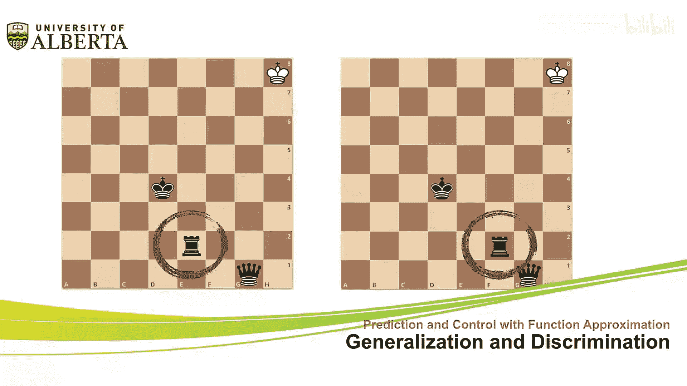
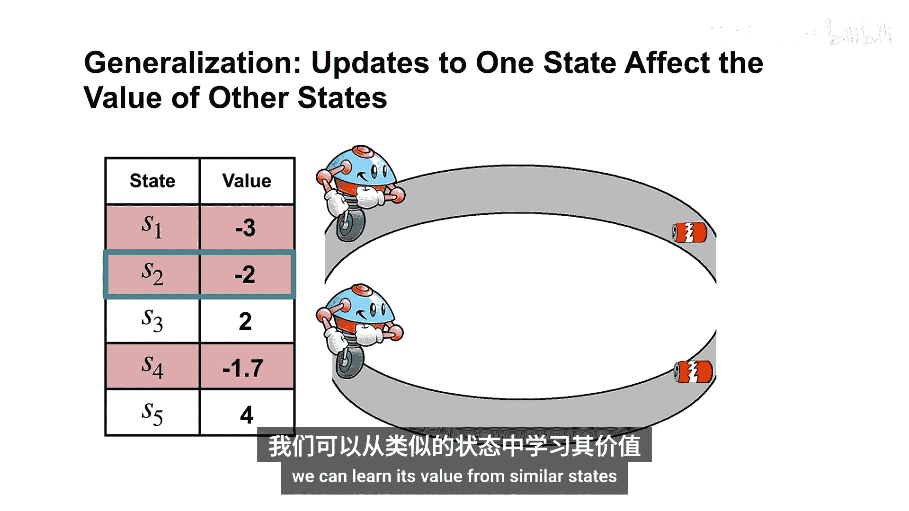
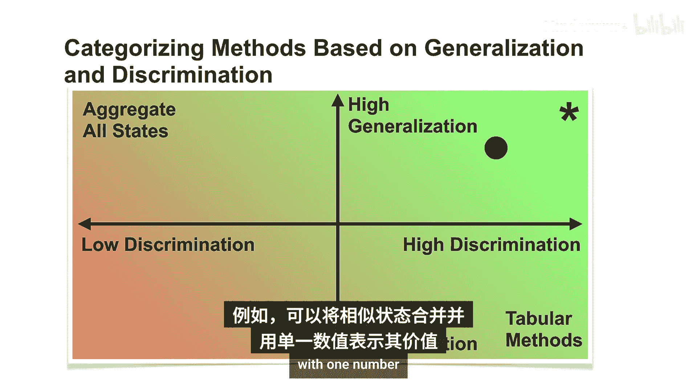
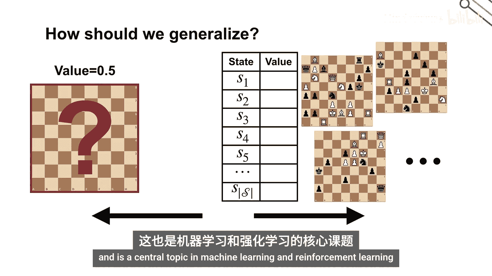

# 004：泛化与区分

## 概述
在本节课中，我们将要学习函数逼近中的两个核心概念：泛化与区分。理解这两个概念对于设计高效的学习算法至关重要。

---

## 泛化的概念与益处

上一节我们介绍了函数逼近的基本思想，本节中我们来看看什么是泛化。

泛化直观上意味着将特定情境中获得的知识，应用到更广泛的情境中得出结论。在策略评估的语境下，泛化指的是对一个状态价值估计的更新，会影响到其他状态的价值。

想象一个机器人收集易拉罐的任务，它通过一组分布在各地的远距离传感器观察世界。对于许多位置，机器人开到最近易拉罐所需的时间是相同的。尽管这些位置对应着不同的传感器读数，但它们具有相似的价值，因此我们可能希望价值函数能在这些状态之间进行泛化。

泛化可以通过更好地利用已有经验来加速学习。如果我们能从相似的状态中学习到某个状态的价值，那么我们可能就不需要频繁访问每一个状态来获得其准确价值。

## 区分的概念与必要性

与泛化相对的是区分。区分指的是能够使两个状态的价值不同，即能够区分这两个状态的价值。

回到机器人收集易拉罐的例子。想象它处于一个状态：易拉罐在3英尺外，但隔着一堵墙。对比另一个状态：易拉罐在3英尺外，并且有清晰的路径可以到达。机器人会希望为这两个状态分配不同的价值。

因此，虽然在与最近易拉罐距离相似的状态之间进行泛化是有用的，但当我们有其他可能影响状态价值的信息时，能够基于这些信息对不同状态进行区分也同样重要。

## 泛化与区分的权衡

我们可以用一个以泛化和区分为维度的二维图来可视化可能的方法空间。

以下是不同类型方法在权衡空间中的位置：

*   **表格方法**：位于图的右下角。它们能完美地区分不同状态，但完全不泛化学到的价值。每个价值都是独立表示的。
*   **完全泛化方法**：位于图的左上角极端。它将所有状态视为相同，每次更新都泛化到所有状态，但完全无法区分。最多只能学到与当前状态无关的平均回报，这通常没什么用。
*   **理想方法**：我们真正想要的是能同时实现良好泛化和良好区分的学习方法。这样的方法会将学到的价值泛化到相似状态，从而学得更快；同时也能区分不同状态，这意味着随着数据增多，价值函数逼近可以准确地表示价值。
*   **实际方法**：在实践中，我们更可能得到一个位于中间的点，在那里我们用一定程度的区分来换取泛化。例如，我们可能会将相似的状态组合在一起，并用一个数字来表示它们的价值。

## 以国际象棋为例加深理解

为了建立更多直觉，让我们以国际象棋游戏作为一个具体例子。

以下是两种极端情况：

*   **完全泛化**：将所有状态视为相同。这个价值对应于获胜的概率。无论游戏处于何种状态，在双方实力匹配的情况下，这个数字可能是 **`50%`**。
*   **完全区分（表格法）**：将每个状态都视为完全不同。这对于小问题来说没问题，但在像国际象棋这样的游戏中，甚至枚举所有可能状态都是不切实际的。国际象棋大约有 **`10^46`** 个状态。进一步想象，单独学习所有这些状态的价值需要多长时间。

我们显然需要一种介于两者之间的方法，能够在获胜概率相似的状态之间进行泛化。如何识别这些相似性以获得这样的分组是一个难题，没有单一的答案。如何进行泛化会对我们算法的性能产生重大影响，这也是机器学习和强化学习中的一个核心课题。

---

## 总结
本节课中我们一起学习了函数逼近中泛化与区分的核心概念。你现在应该理解：表格表示法提供了良好的区分能力，但没有泛化能力；泛化对于加速学习非常重要；同时具备泛化和区分能力是理想状态，但在实践中通常需要权衡。在接下来的几个模块中，我们将在研究具体的函数逼近器时再次探讨这些概念。