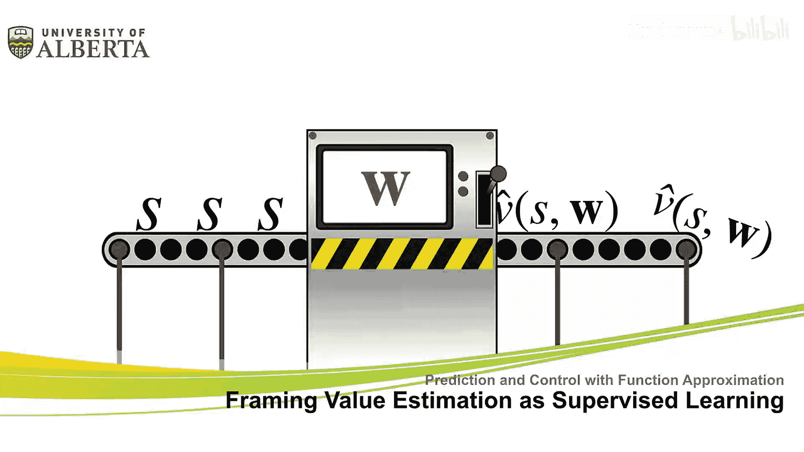
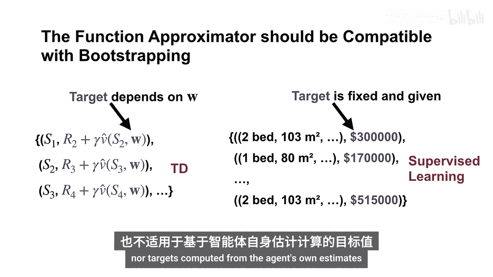

强化学习：5.2.1.5：将价值估计构建为监督学习问题

在本节中，我们将学习如何将强化学习中的价值估计问题，构建为一个监督学习问题。我们将看到，虽然两者有相似之处，但并非所有监督学习方法都适用于强化学习场景。

---

监督学习方法通过一组输入-目标示例来学习一个函数，这与强化学习非常不同。然而，监督学习方法在处理强化学习问题的某些部分时可能非常有用。

通过本节的讲解，你将能够理解如何将价值估计构建为监督学习问题，并认识到并非所有的函数逼近方法都适合用于强化学习。

---

### 监督学习概述

监督学习涉及在给定一组输入-目标对的数据集后，逼近一个函数。例如，假设我们有一个房价列表，以及每栋房子的一系列属性。

我们可以使用监督学习来训练一个函数，该函数以房屋属性作为输入，并估计该房屋的预期价格。我们希望学到的函数也能推广到训练集中未出现的房屋，并近似其预期价格。

这个参数化函数可以用多种方式表示，例如一个神经网络。

### 将策略评估构建为监督学习

强化学习中的策略评估问题可以类似地构建。这种相似性在蒙特卡洛方法中最为明显。

回想一下，蒙特卡洛方法使用回报样本来估计价值函数。我们可以将其视为一个监督学习问题，其中输入是状态，目标是回报。

通过足够多的示例进行训练，我们希望学习到的函数的输出能够接近预期回报，即每个状态的价值。

时序差分方法也可以构建为监督学习。在这种情况下，目标是单步自举回报。

### 方法适用性的考量

原则上，监督学习中的任何函数逼近技术都可以应用于策略评估任务。然而，并非所有方法都同样适用，原因如下：

在强化学习中，智能体与环境交互并持续生成新数据。这通常被称为**在线设置**，以区别于**离线设置**。在离线设置中，完整的数据集从一开始就可用，并且在学习过程中保持不变。

如果我们想使用函数逼近技术，应确保它能在在线设置中工作。有些方法与在线设置不兼容，因为它们要么是为固定批次数据设计的，要么不是为处理时间相关的数据而设计的。而强化学习中的数据总是相关的。

### 时序差分方法的额外挑战

在应用监督学习技术时，时序差分方法带来了额外的复杂性。TD方法使用自举，这意味着我们的目标现在依赖于我们自己的估计。这些估计会随着学习的进行而改变，因此我们的目标也在不断变化。

这与监督学习不同，在监督学习中，我们拥有作为目标的真实标签。例如，房屋的价格不依赖于我们的估计，也不会因为我们的估计改变而改变。监督学习方法通常不是为变化的目标而设计的，也不是为从智能体自身估计计算出的目标而设计的。

---

### 总结

在本节中，我们一起学习了如何将策略评估任务构建为监督学习问题。我们了解到，虽然这种构建方式提供了有价值的视角，但并非所有监督学习方法都适用于强化学习。我们需要的是与在线更新和自举兼容的方法。