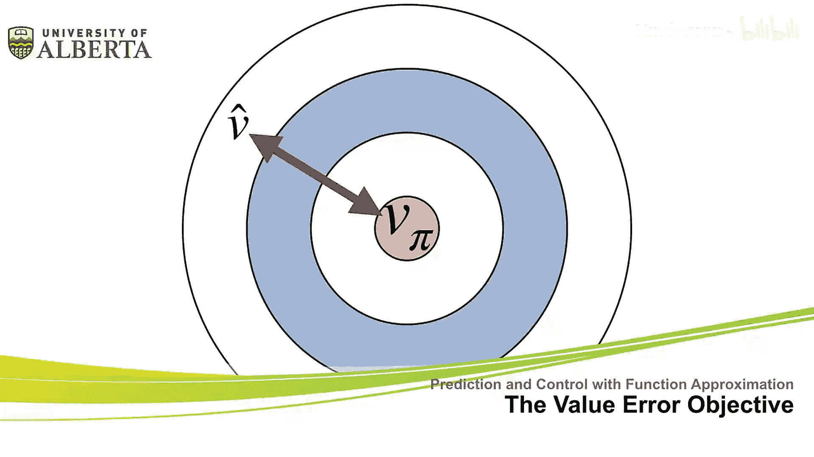
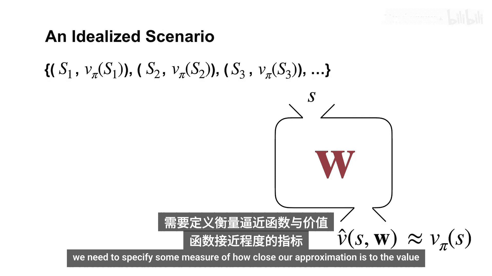
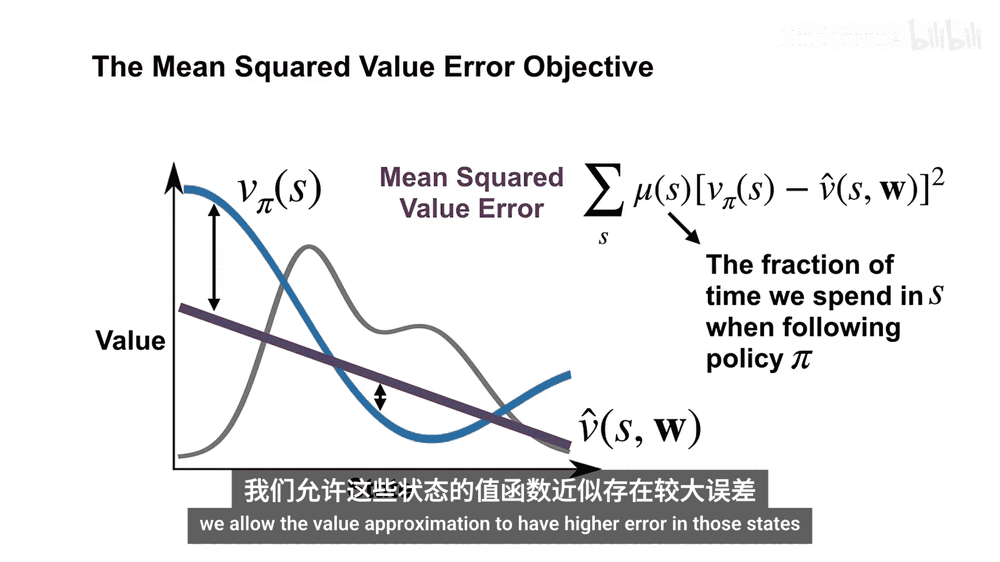
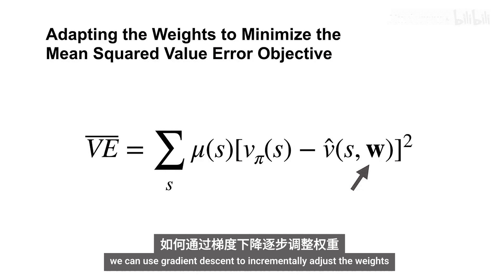

强化学习：函数逼近预测与控制：6：价值误差目标

在本节课中，我们将学习如何为策略评估中的价值函数逼近定义一个明确的优化目标。我们将介绍均方价值误差这一核心概念，并解释状态分布在该目标中的作用。

上一节我们讨论了如何将价值估计构建为一个监督学习问题。在监督学习中，确定要优化的目标是一个关键步骤。本节中，我们将更精确地定义我们希望优化的目标。

让我们从一个理想化的场景开始。假设我们获得了一系列状态及其对应真实价值的数据对。我们希望利用这些数据，找到一个参数化的函数来近似表示策略π的价值函数V^π。我们将通过调整权重参数，使得该函数在给定状态下的输出值与其对应的真实价值尽可能接近。

通常，我们无法在所有状态上都完美匹配真实的价值函数。我们所选择的函数逼近器会限制我们能够表示的价值函数范围。为了使目标更精确，我们需要定义一个衡量近似值与真实价值函数之间接近程度的指标。

考虑一个用V_hat(s; w)表示的线性价值函数逼近器。为了可视化简便，我们假设状态是单维且连续的。下图展示了我们估计的价值函数。现在，假设真实的价值函数如下图所示。显然，我们的近似并不完美，但差距究竟有多大呢？

让我们更精确地定义这个差距。首先，我们定义一个衡量单个状态价值与其近似值之间误差的指标。一个自然的选择是平方误差，即真实价值与近似值之差的平方。

然而，仅凭单个状态的误差不足以定义函数逼近的全局目标。因为提高某个状态的估计准确性，往往意味着会降低另一个状态的准确性。因此，我们需要指定我们有多关心每个状态的估计准确性，我们将这个权重称为μ(s)。关于μ(s)的更多细节稍后讨论。

现在，我们可以将完整的目标函数写为在整个状态空间上加权平方误差的总和，其中每个状态的权重由μ(s)决定。我们称此目标为**均方价值误差**。

回到μ(s)的选择问题。μ(s)应该告诉我们有多关心每个状态。一个自然的衡量标准是，在遵循策略π时，访问每个状态的时间比例。这意味着我们希望最小化在遵循策略π时所访问状态的平均价值误差。策略花费更多时间访问的状态，在目标函数中具有更高的权重；而对于策略较少访问的状态，我们对其误差的容忍度更高。

μ(s)是一个概率分布，如幻灯片所示。在这个例子中，策略在状态空间两端花费的时间很少。这意味着在均方价值误差目标下，我们允许价值逼近器在这些状态上具有更高的误差。

定义目标函数的目的是为了调整权重参数，使均方价值误差尽可能低。从现在起，我们将此目标称为VE_bar。以某种方式改变权重可能会增加价值误差，而以另一种方式改变则可能减少价值误差。

在下一讲中，我们将讨论如何使用梯度下降法来增量式地调整权重。

本节课中，我们一起学习了为什么在函数逼近下的策略评估需要我们指定一个优化目标，并介绍了**均方价值误差**这一可能的目标函数。