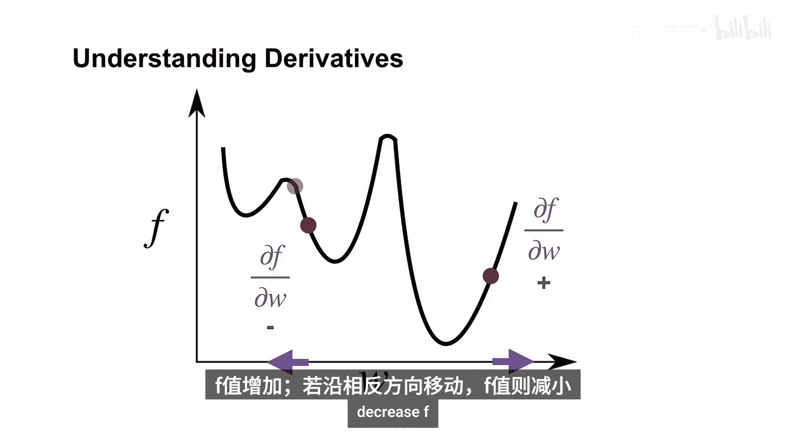
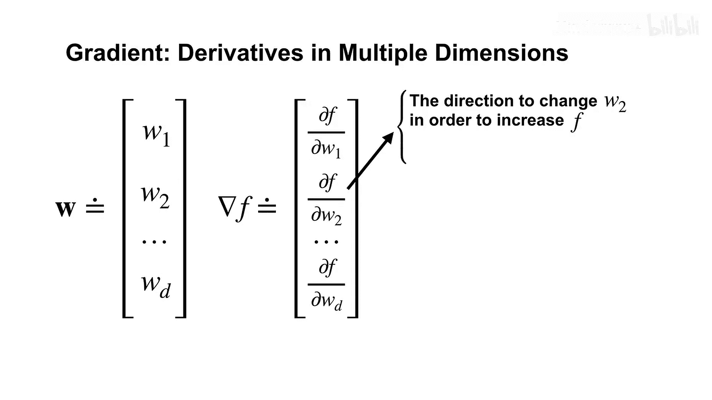
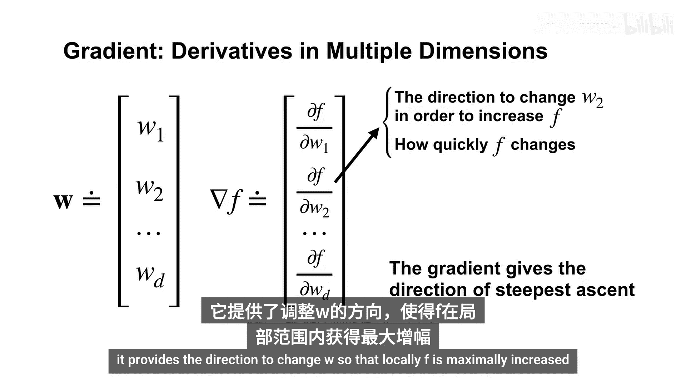

强化学习：函数逼近预测与控制：P07：梯度下降介绍

在本节课中，我们将学习一种用于最小化目标函数的通用策略——梯度下降。我们将理解其基本思想，并了解它如何收敛到驻点。

---

上一节我们介绍了如何将价值函数估计问题构建为监督学习问题，并通过指定一个目标函数使其精确化。本节中，我们来看看如何找到这个目标函数的解。

我们希望最小化均方价值误差，使我们的价值估计接近真实的价值函数。回想一下，我们的价值估计由一个关于状态的函数给出，该函数由一组实值权重 **w** 参数化。这些权重决定了如何为每个状态计算价值。改变权重将修改许多状态的价值估计。为了最小化整体价值误差，我们需要思考如何改变权重，这需要用到一点微积分知识。

希望你还记得微积分中导数的概念。这里我们绘制了一个关于标量参数 **W** 的函数 **F**。导数告诉我们如何在局部改变 **w** 来增加或减少 **F**。在特定点 **W** 处，函数 **f** 的导数的符号指示了改变 **w** 以增加 **F** 的方向。导数的大小则指示了函数 **F** 在该点 **W** 处的斜率，即随着 **w** 变化，**F** 变化的快慢。

如果 **F** 由多个变量参数化，那么 **w** 就是一个向量。在这种情况下，我们需要引入梯度的概念来描述 **F** 如何随着向量 **W** 的变化而变化。梯度是偏导数的向量，指示了 **w** 的每个分量的局部变化如何影响函数。注意，梯度的大小必须与权重向量相同。

梯度每个分量的符号指定了改变 **w** 相应分量以增加 **F** 的方向（正或负）。分量的大小则指定了 **w** 沿该方向移动时 **F** 变化的快慢。如果函数在某个维度上非常陡峭，该维度的梯度大小就会很高；如果非常平坦，则很低。无论大小如何，梯度都给出了最陡下降的方向，它提供了改变 **W** 以使 **F** 在局部最大程度增加的方向。

举一个具体的例子，我们来推导线性价值函数的梯度。记住，线性价值近似只是权重与状态特征向量的内积。其对单个权重的偏导数就是与该权重相关联的特征。特征本身不依赖于权重。这意味着线性价值近似的梯度就是该状态的特征向量。

我们的目标是权重的一个函数。例如，均方价值误差是权重的函数，因为它是 **V̂** 的函数，而 **V̂** 又是权重的函数。我们的目标是调整权重以使目标函数值变小。

这里有一个我们目标函数的假设图。为了简化，假设我们的函数由单个权重参数化。x轴对应这个权重，y轴对应该权重下的目标函数值。由于只有一个权重，这意味着我们的梯度只是一个标量导数。

如果我们想减小目标函数，我们应该沿着梯度负方向移动权重。这就是梯度下降的思想。以下是捕捉这一直觉的梯度下降更新规则：我们朝着最能减少目标函数的方向进行微小的移动。我们使用步长参数 **α** 来控制移动的距离，否则有步幅过大的风险。这是因为沿着这个方向移动只能保证在局部减小目标函数。

通过以足够小的 **α** 重复进行此类更新，我们最终将收敛到梯度为零的驻点。这很可能是一个局部最小值，意味着这些权重比紧邻区域内的所有权重都要好，但可能不是最优的。其他可能的驻点包括局部最大值和鞍点，这些都是不稳定的解。我们算法中固有的随机性通常足以防止陷入这些不良的驻点。

另一方面，局部最小值是稳定的，因此即使是随机算法也倾向于收敛到那里。因此，我们通常说算法收敛到局部最小值。在某些情况下，梯度下降保证收敛到全局最小值，即目标函数下权重的最佳可能设置。例如，对于使用线性函数近似的均方价值误差，这一点是成立的。

对于更复杂的函数逼近器，例如神经网络，驻点可能不是全局最小值。请注意，全局最小值不一定对应于真实的价值函数。它受到我们选择的函数参数化的限制，并取决于我们选择的目标函数。

想象一个特征向量，它只包含一个元素，无论处于什么状态，该元素始终为1。最小化均方价值误差的近似价值函数将收敛到所有状态的平均价值，这不是一个很好的价值函数。然而，就价值误差目标而言，这仍然是该参数化下我们能做的最好结果。

---

本节课中，我们一起学习了梯度下降如何用于寻找目标函数的驻点，以及这些解并不总是全局最优的。下次课，我们将讨论如何将梯度下降具体应用于强化学习。