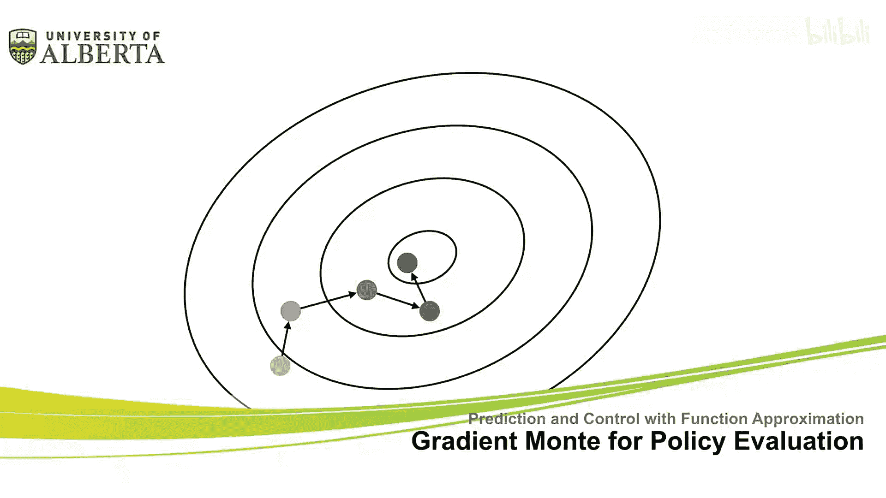
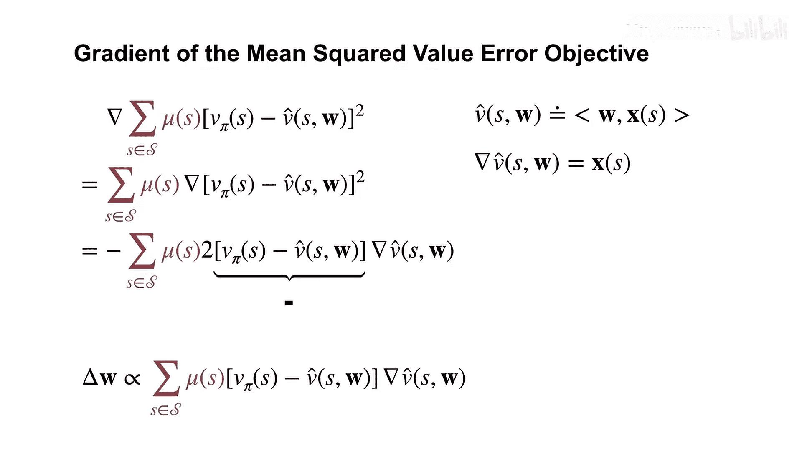
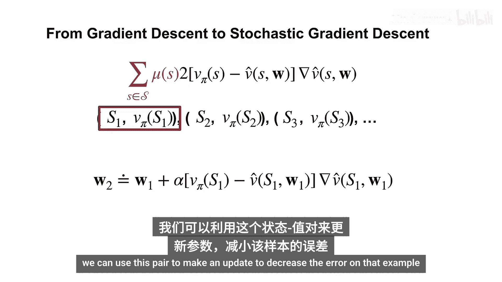
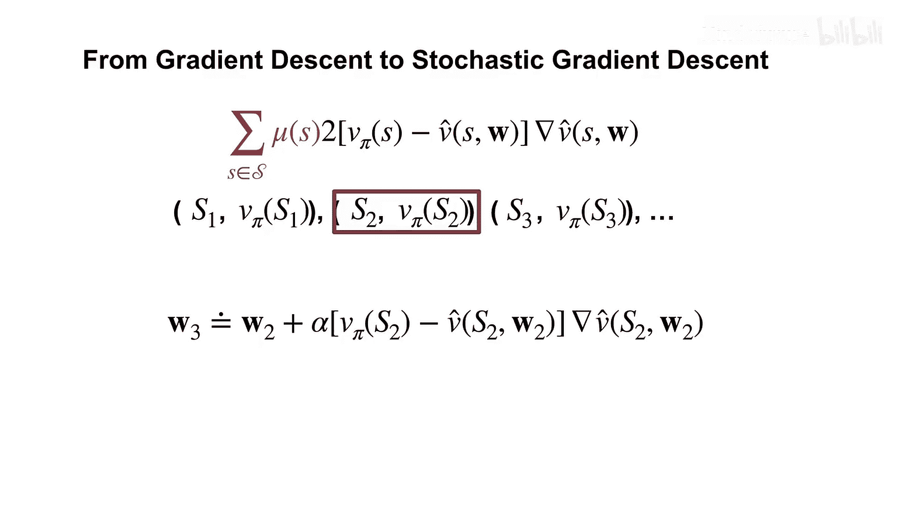
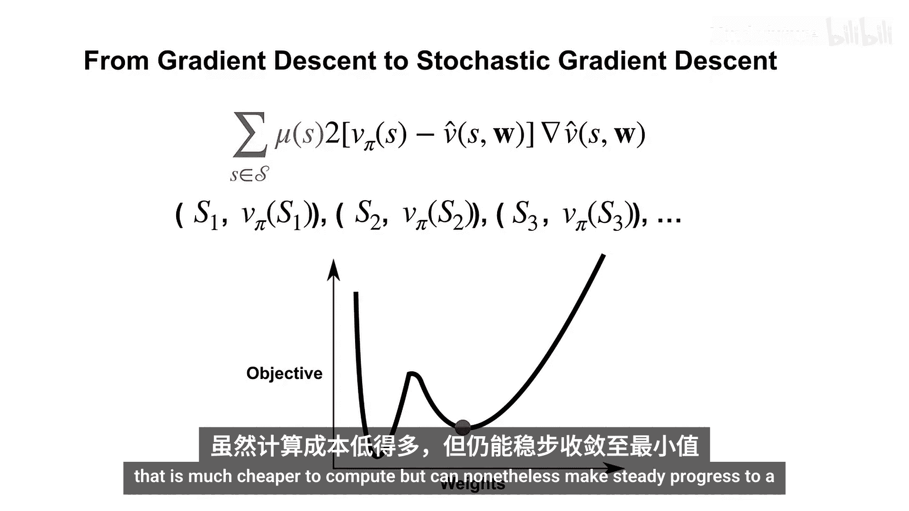
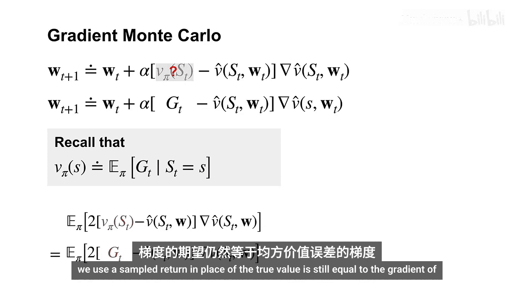

# 008：策略评估的梯度蒙特卡洛方法

在本节课中，我们将学习如何结合梯度下降与蒙特卡洛方法，来近似估计策略的价值函数。我们将从目标函数出发，推导出更新规则，并最终介绍完整的梯度蒙特卡洛算法。

上一节我们介绍了梯度下降这一最小化目标函数的策略，并明确了策略评估的目标——价值误差。本节中我们来看看如何将这两者结合，利用蒙特卡洛方法来最小化价值误差。

## 计算价值误差的梯度

要使用梯度下降，第一步是找到目标函数关于参数的梯度。我们的目标是均方价值误差，其公式为：
**VE(w) = Σ μ(s) [v_π(s) - v̂(s,w)]²**

根据微积分法则，我们可以将梯度算子移入求和符号内。然后对求和内的每一项应用链式法则求导。由于真实价值 v_π(s) 不依赖于权重 w，其梯度为零。因此，误差项的梯度仅依赖于价值函数近似 v̂(s,w)。

对于线性函数近似，其梯度计算特别简单，正如我们在上一视频中展示的，它就是该状态下的特征向量：
**∇ v̂(s,w) = x(s)**

这个梯度的意义很直观：它指示了如何改变权重 w 以增加在该状态下的估计值 v̂。我们将这个方向乘以真实价值与估计值之间的差值。如果差值为正，说明估计值偏低，我们应朝增加估计值的方向调整权重；如果差值为负，则向相反方向调整。

## 从梯度下降到随机梯度下降

计算完整的均方价值误差梯度需要对所有状态求和，这通常不可行。此外，我们可能也不知道状态分布 μ。

我们可以通过采样来近似这个梯度。设想一个理想场景：我们虽然不知道 μ，但可以通过遵循策略 π 来从中采样状态。假设我们采样到一个状态 S1 及其对应的真实价值 v_π(S1)。我们可以利用这一对样本（状态-目标值）来更新权重，以减少在该样本上的误差。

以下是针对单个状态 S1 的梯度：
**∇ VE(w) ≈ -2 [v_π(S1) - v̂(S1,w)] ∇ v̂(S1,w)**

我们可以使用这个梯度进行下降更新，以减少该样本对的误差。然后，我们可以对遵循策略时观察到的另一个状态 S2 重复此过程。通过对每个样本对进行小幅更新，虽然有时可能会增加整体目标误差，但总体趋势是向最小值前进。

这种更新方法称为**随机梯度下降**，因为它只使用梯度的随机估计。事实上，每个随机梯度的期望值等于目标函数的真实梯度。你可以将其视为对真实梯度的一种噪声近似，虽然计算成本低得多，但仍能稳步向最小值前进。

## 用采样回报替代真实价值

随机梯度下降允许我们通过采样梯度来高效地更新权重。然而，还有一个实际问题：我们无法获得真实价值 v_π。

让我们看看如何从更新规则中去除它。我们可以用 v_π 的一个估计值来替代它。一个选择是使用每个访问状态 S_t 的回报样本 G_t，就像我们在蒙特卡洛方法中所做的那样。这是合理的，因为价值函数正是这些样本的期望值。

事实上，当我们使用采样回报代替真实价值时，梯度的期望仍然等于均方价值误差的梯度。这引出了用于估计 v_π 的梯度蒙特卡洛算法。

## 梯度蒙特卡洛算法

以下是梯度蒙特卡洛算法的步骤概要：

1.  **输入**：待评估的策略 π。
2.  **初始化**：
    *   选择一个可微的价值函数近似器 v̂(s,w)。
    *   设定步长参数 α > 0。
    *   初始化权重 w（例如，设为0）。
3.  **循环**（对每个回合）：
    *   遵循策略 π，与环境交互，生成一个完整的回合轨迹。
    *   对于该回合中访问的每个状态 S_t，计算其采样回报 G_t。
    *   对于回合中的每一步 t：
        *   执行随机梯度下降更新：
            **w ← w + α [G_t - v̂(S_t,w)] ∇ v̂(S_t,w)**

本节课中我们一起学习了如何利用随机梯度下降来估计价值函数，并详细了解了梯度蒙特卡洛算法的工作原理。我们看到了如何从理论目标推导出实用的、基于样本的更新规则。