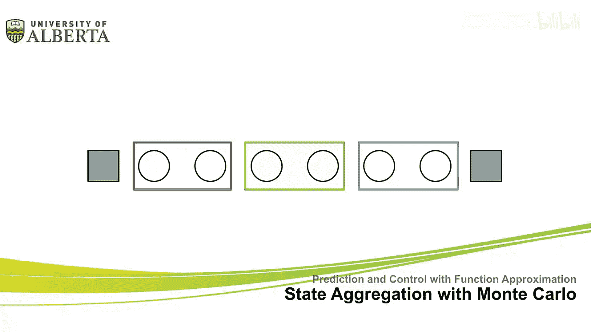
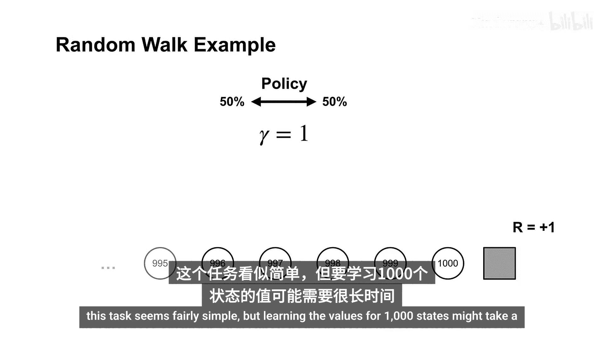
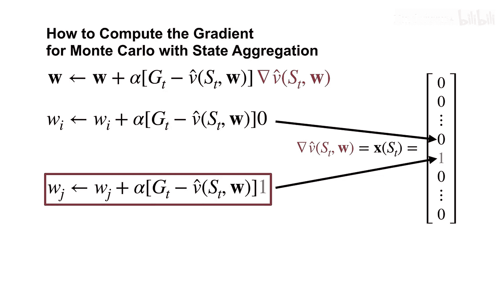
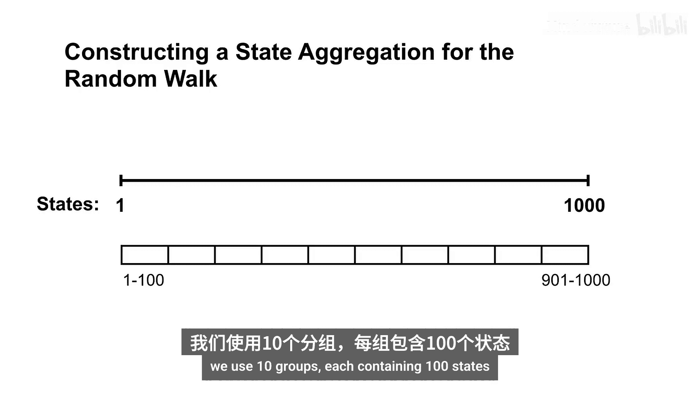
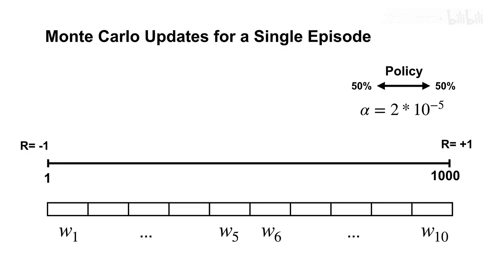
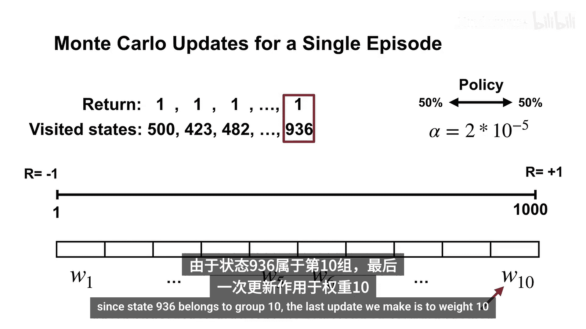
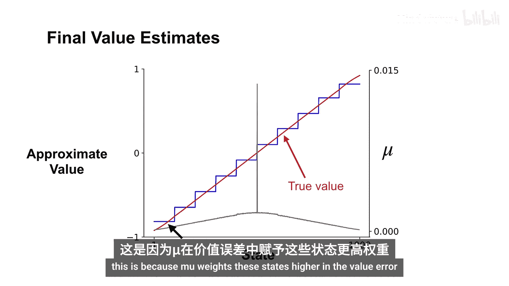

# 009：使用蒙特卡洛的状态聚合




在本节课中，我们将学习一个使用“状态聚合”技术进行价值函数逼近的具体示例。我们将结合蒙特卡洛方法和状态聚合，来近似求解一个大型随机游走任务中的状态价值。学完本节，你将能够理解状态聚合如何用于近似价值函数，并掌握如何应用带状态聚合的梯度蒙特卡洛方法。

## 一个大型随机游走任务示例

上一节我们介绍了函数逼近的基本概念，本节中我们来看看一个具体的应用场景，它能帮助我们加速学习。

考虑一个大型随机游走任务。状态编号从1到1000，并按从左到右的顺序排列。所有回合都从中间的状态500开始。有两个动作：向左和向右。向左的动作会使智能体向左移动，但不一定是移动一格。智能体会向左随机跳转到100个相邻状态中的任意一个。同样，向右的动作会向右随机跳转到100个相邻状态中的一个。

我们将评估一个均匀随机策略，即智能体以相等的概率选择向左或向右移动。靠近左侧终止状态的状态，其左侧的相邻状态少于100个。所有会跳出链条边界的动作都会导向终止状态，右侧同理。在左侧终止会获得-1的奖励，在右侧终止会获得+1的奖励，所有其他转移的奖励均为0。折扣因子γ为1。

这个任务看似简单，但要学习一千个状态的价值可能需要很长时间。因此，我们可能会从某种函数逼近方法中受益。



## 状态聚合方法

这里我们将使用一种称为“状态聚合”的技术。顾名思义，状态聚合将某些状态视为相同的。例如，在一个有8个状态的表格中，我们可以选择每4个状态聚合为一组。这样，价值函数就不再是8个条目的表格，而只有2个条目。当我们更新第一组中任何一个状态的价值时，该组中所有其他状态的价值也会被更新。

状态聚合是线性函数逼近的另一个例子。每个状态组对应一个特征。如果当前状态属于某个组，则该组对应的特征值为1，否则为0。状态的近似价值就是该状态所属组对应的权重。

以下是状态聚合的数学表示：
```
假设有K个聚合组。
特征向量 x(s) 是一个K维向量，其中第k个元素为：
x_k(s) = 1， 如果状态s属于组k
x_k(s) = 0， 否则
近似价值函数为：V(s) ≈ w^T * x(s) = w_k， 其中k是s所属的组。
```

## 梯度蒙特卡洛与状态聚合

现在，让我们看看如何将状态聚合与梯度蒙特卡洛算法结合。我们已经知道如何计算给定状态的价值，现在需要思考如何计算价值函数的梯度，以便使用核心更新公式。

状态聚合是线性函数逼近的一个例子，因此梯度就等于特征向量。更新规则只修改与当前活动组对应的权重。

以下是带状态聚合的梯度蒙特卡洛更新规则：
```
权重更新公式：w ← w + α [G_t - V(S_t)] ∇_w V(S_t)
对于状态聚合，∇_w V(S_t) = x(S_t)
因此，更新简化为：w_k ← w_k + α [G_t - w_k]
其中，k是状态S_t所属的聚合组索引。
```



让我们思考这个更新规则如何改变权重。如果估计值小于样本回报G_t，则权重增加；如果估计值大于样本回报G_t，则权重减少。

## 应用于随机游走任务

让我们回到随机游走任务，看看如何应用状态聚合。首先，我们必须选择如何聚合状态。状态聚合强制同一组中的状态使用相同的价值估计。因此，理想情况下，如果我们有理由相信某些状态的价值相似，就应该将它们分在一组。在这个问题中，选择很简单：彼此靠近的状态应该具有相似的价值。



接下来，我们必须选择每组包含多少个状态。如果分组较小，我们的价值估计最终会更精确，但学习时间会更长。我们使用10个组，每组包含100个状态。这比我们开始时的一千个状态要简化得多。

以下是梯度蒙特卡洛算法的步骤概述：
1.  输入策略、选择的状态聚合函数和一个小步长参数α。
2.  将所有权重初始化为零。
3.  生成一个完整的回合轨迹。
4.  遍历所有访问过的状态并进行更新。



## 算法运行示例

让我们逐步了解梯度蒙特卡洛算法的工作原理。

首先，我们生成一个回合。一旦有了完整的轨迹，我们就遍历所有访问过的状态并进行更新。假设在这个回合中，智能体在右侧终止，获得+1的奖励，因此每个状态的回报G_t都是1（因为γ=1，且中间转移奖励为0）。我们的第一次更新是针对状态500，它属于第5组。因此，我们基于样本回报1对该组的权重执行梯度蒙特卡洛更新。



我们像这样对轨迹中的每个状态进行更新，最终处理到状态936，这是终止前访问的最后一个状态。由于状态936属于第10组，我们进行的最后一次更新是针对权重w_10。

完成所有更新后，我们的价值估计可能如下图所示。这张图显示了单个回合后的估计值。我们绘制了从状态1到1000每个状态的近似价值。状态空间不是连续的，但将近似价值绘制成一条线是有意义的。

请注意，每组的价值估计都是非负的。这是因为第一个回合的回报是正的，而我们的初始估计是零。

再看另一个回合后的同一张图。这次智能体在左侧终止，获得-1的奖励。这意味着每个状态的回报都是-1。被访问状态对应的权重略有下降。

运行许多回合后，我们得到的状态价值如下图所示。图中的每个“台阶”对应一组共享相同近似价值的状态。作为对比，图中也显示了真实的价值函数。尽管我们通过聚合许多状态进行了大幅近似，但我们的价值估计偏差并不大。

## 理解近似结果的偏差

你可能会问，为什么红色真实价值线没有直接穿过所有蓝色台阶的中心？这里状态分布μ扮演了重要角色。回想一下，μ(s)是状态s的访问频率。如下图所示，靠近链条中心的状态比靠近终止状态的状态访问更频繁。

例如，让我们看看最左边的一组状态，即状态1到100。靠近状态100的状态比靠近状态1的状态访问频繁得多。近似价值会偏向于靠近状态100的那些状态的真实价值。这是因为在价值误差中，μ给这些状态赋予了更高的权重。



## 总结

本节课中，我们一起学习了如何将梯度蒙特卡洛算法与状态聚合结合在实践中应用。我们通过一个大型随机游走的具体例子，演示了如何通过将状态分组来简化价值函数的表示与学习。你看到了状态聚合作为线性函数逼近的一种形式，其梯度更新非常简洁。我们也观察到，由于状态访问频率的不同，最终的近似价值函数会向更常访问的状态的真实价值倾斜。理解这种偏差对于设计有效的聚合方案至关重要。