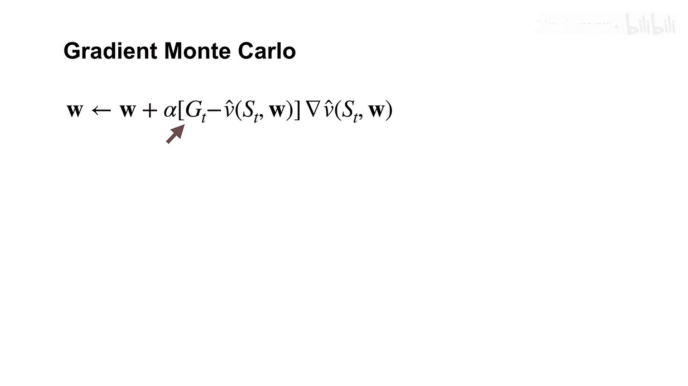
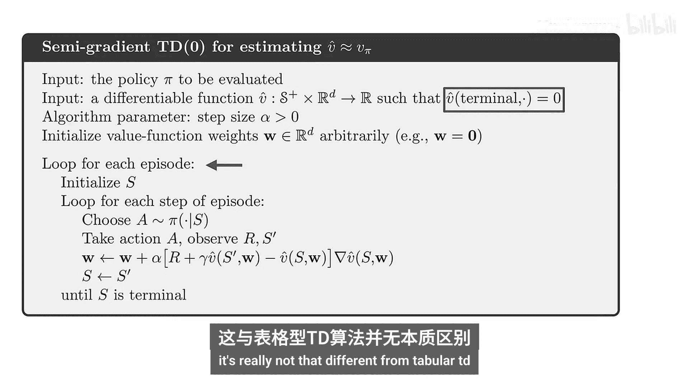

# 010：半梯度TD算法

在本节课中，我们将学习如何将时序差分学习与函数逼近结合，并理解半梯度TD算法的原理与实现。

上一节我们介绍了基于函数逼近的蒙特卡洛方法。本节中，我们来看看如何将时序差分思想应用于函数逼近。

## TD学习与函数逼近

TD学习的核心思想是智能体可以利用其对价值函数的当前估计来更新预测。我们已在表格型案例中见过TD学习。现在我们将描述它在函数逼近下的工作原理。



## 从梯度蒙特卡洛到TD目标

回顾梯度蒙特卡洛的更新公式。它将当前的价值估计向回报`G_t`的样本靠近：


`w ← w + α [G_t - v̂(S_t, w)] ∇ v̂(S_t, w)`

然而，我们可以考虑使用其他目标来代替回报。事实上，我们可以将此更新中的回报替换为对价值的任何估计。

`w ← w + α [U_t - v̂(S_t, w)] ∇ v̂(S_t, w)`

我们称此估计为`U_t`。如果`U_t`是对真实价值的无偏估计，那么在适当条件下，我们的函数逼近器将收敛到一个局部最优解。回报`G_t`就属于这种情况。

但我们也可以用自举目标来替换`U_t`，例如一步TD目标`R_{t+1} + γ v̂(S_{t+1}, w)`。这仍然是对回报的一个估计，但此估计是有偏的。TD目标使用了我们当前的价值估计，而该估计很可能不等于真实的价值函数。因此，我们无法保证此算法会收敛到价值误差的局部最小值。

其优点是，TD目标通常比回报样本具有更低的方差。这意味着TD往往能以更少的更新次数收敛。

## 为何是“半梯度”？

TD更新实际上并非真正的随机梯度下降更新。为了理解原因，我们计算单样本误差相对于权重的梯度。记住，`U_t`等于TD目标。使用链式法则，我们得到单样本平方误差梯度的展开表达式：

`∇ [1/2 (U_t - v̂(S_t, w))^2] = (U_t - v̂(S_t, w)) ∇ (U_t - v̂(S_t, w)) = (U_t - v̂(S_t, w)) (∇ U_t - ∇ v̂(S_t, w))`

但这看起来不像TD更新。仅当`∇ U_t`等于0时，这两个表达式才会相等。对于TD而言，情况并非如此。在TD中，目标包含了对价值的估计，而该估计依赖于权重`w`。这意味着`∇ U_t`不为零，如下所示：

`∇ U_t = ∇ (R_{t+1} + γ v̂(S_{t+1}, w)) = γ ∇ v̂(S_{t+1}, w) ≠ 0`

因此，TD并非在平方误差上执行梯度下降。我们称其为**半梯度**方法。尽管如此，TD在我们关心的许多情况下都能收敛。我们将在后续视频中讨论TD的收敛性质。

## 半梯度TD算法

以下是半梯度TD的伪代码。它实际上与表格型设置的TD算法非常相似。

此算法无需等到一个回合结束才进行更新。与梯度蒙特卡洛不同，TD在每一步都执行一次更新。

以下是算法的步骤概述：

在回合的每一步，智能体在状态`S`下选择动作`A`。我们利用得到的奖励`R`和下一个状态`S‘`来计算TD目标，并立即更新权重。我们以这种方式继续，直到到达终止状态（其价值定义为0）。然后我们开始一个新的回合。这与表格型TD并无太大不同。

**算法伪代码：**
```
初始化权重向量 w （例如，w=0）
对每个回合：
    初始化状态 S
    当 S 非终止状态：
        根据策略选择动作 A
        执行 A，观察奖励 R 和下一个状态 S'
        计算 TD 目标：U = R + γ * v̂(S', w)
        计算 TD 误差：δ = U - v̂(S, w)
        更新权重：w ← w + α * δ * ∇ v̂(S, w)
        S ← S'
```



## 总结

本节课中我们一起学习了半梯度TD算法。我们理解了TD更新如何与函数逼近结合，认识到由于TD目标本身依赖于待学习的权重，导致更新并非真正的梯度下降，因此被称为“半梯度”。最后，我们概述了半梯度TD算法的步骤，该算法允许在每一步进行在线更新，效率更高。