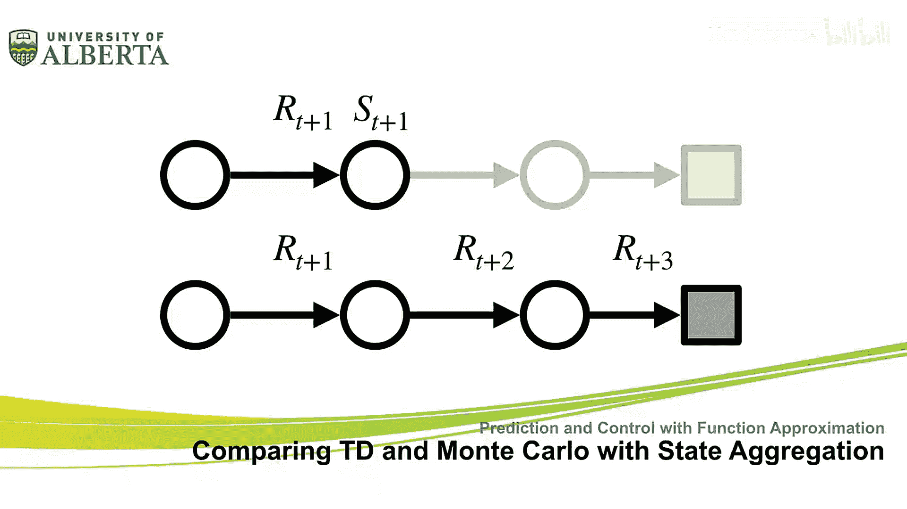
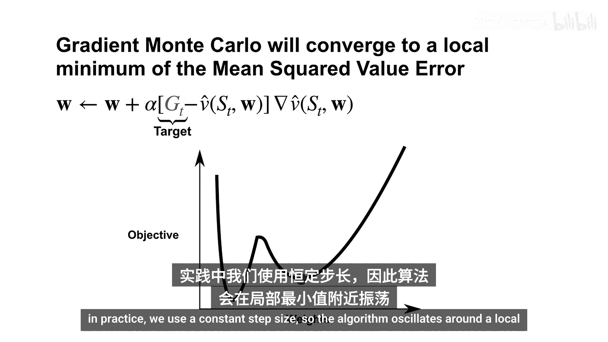
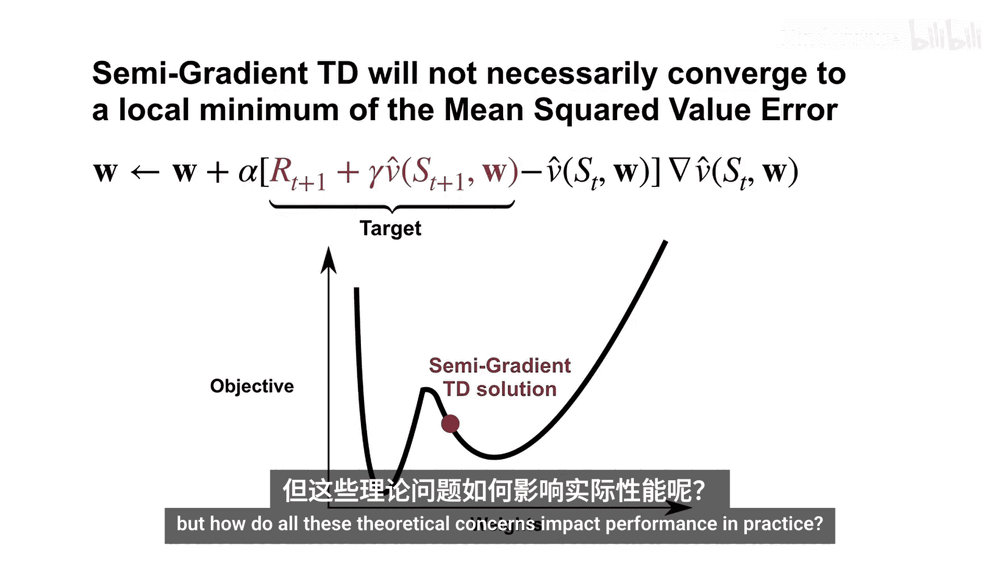
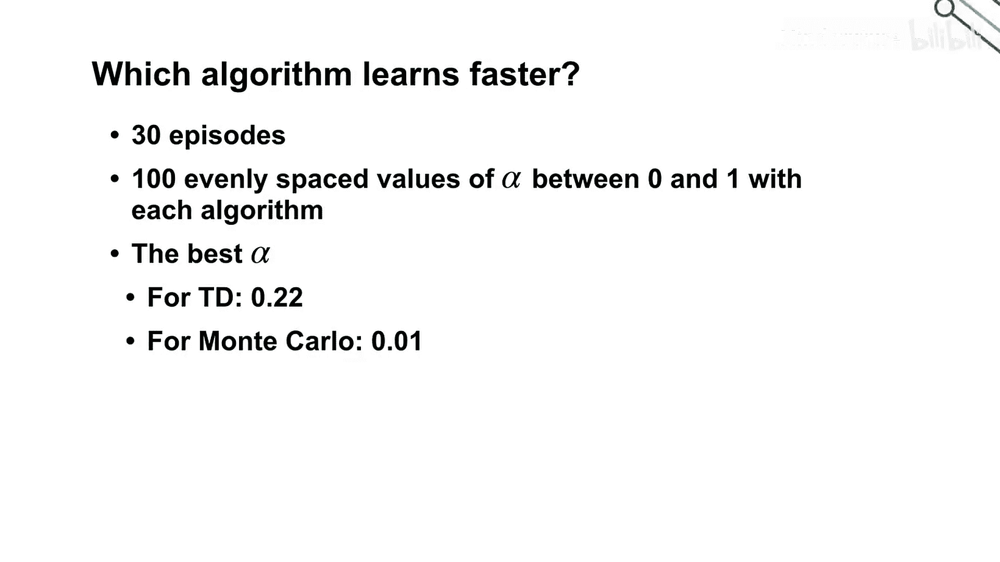
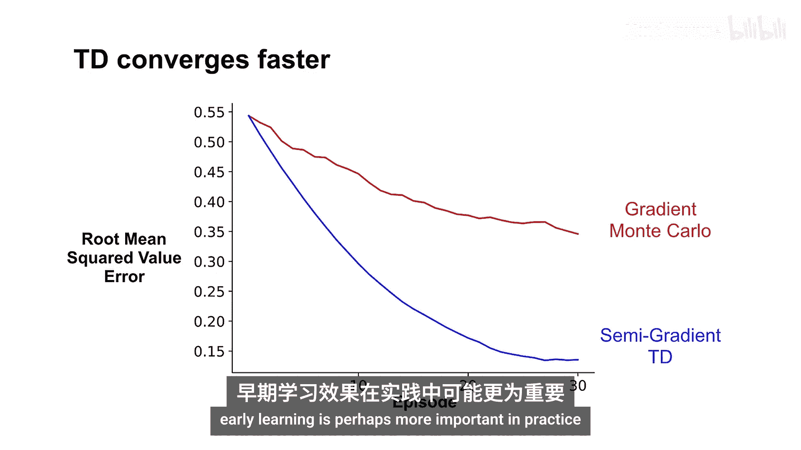

强化学习：11：比较使用状态聚合的TD和蒙特卡洛方法

在本节课中，我们将深入探讨在函数逼近背景下，时间差分（TD）学习与蒙特卡洛（MC）方法之间的差异。我们将重点关注TD更新的偏差特性，并通过一个小实验来比较两者的学习速度和最终性能。

上一节我们介绍了使用函数逼近的蒙特卡洛和TD方法。本节中，我们将更详细地分析TD更新的偏差，并将其与蒙特卡洛方法进行比较。

### 📊 理论差异：偏差与收敛性

在合理的假设下，梯度蒙特卡洛方法会随着样本增多，逐渐逼近价值误差均方（MSVE）的一个局部最小值。这是因为其更新使用了价值误差梯度的**无偏估计**。理论上，我们需要运行算法很长时间并衰减步长参数才能实现这种收敛。实践中，我们使用恒定步长，因此算法会在局部最小值附近振荡。

另一方面，TD的目标值依赖于我们对**下一个状态价值**的估计。这意味着我们的更新可能是**有偏的**，因为目标中的估计可能不准确。由于我们的价值逼近永远不可能完美，即使在极限情况下，目标值也可能保持偏差。因此，我们无法保证半梯度TD会收敛到价值误差均方的局部最小值。当然，随着估计的改进，这种偏差会减小。

### 🧪 实验：随机游走问题中的表现

那么，这些理论上的考量在实践中如何影响性能呢？让我们回到三状态随机游走的例子，观察TD更新中偏差的影响。这次，我们将使用半梯度TD而非蒙特卡洛来学习近似价值。

经过长时间运行TD直到价值估计不再变化后，我们得到的结果显示，许多状态的价值估计与真实值吻合得并不好。**TD的估计不如蒙特卡洛学习到的估计准确**。在这个使用状态聚合的领域中，蒙特卡洛在长期性能方面具有优势。

但是学习速度呢？TD和蒙特卡洛中，谁能更有效地利用有限的样本？为了探究这个问题并聚焦于早期学习，我们进行了一个新实验：只运行30幕（上一个实验用了1000幕）。

两种算法的性能都取决于步长参数α的设置，且它们可能需要非常不同的α值。为了公平比较，我们为每种算法测试了0到1之间均匀分布的100个α值，并选取性能最佳的那个α进行比较（最佳α定义为训练30幕后能产生最低价值误差的α）。
*   对于此任务，TD的最佳α为 **0.22**。
*   蒙特卡洛的最佳α则小得多，为 **0.01**。

以下是性能对比结果。Y轴显示了100次运行平均后的**均方根价值误差**，X轴是幕数。

我们看到，**TD能以更快的速度达到更低的误差**。这并非偶然结果，TD通常比蒙特卡洛学习得更快。这是因为TD可以在幕内学习，并且其更新的方差更低。蒙特卡洛更好的长期性能并不总是我们关注的重点，在实践中我们可能永远无法运行足够长的实验来达到渐近性能，因此**早期学习速度往往更为重要**。

### 📝 总结

本节课中我们一起学习了TD更新在函数逼近下可能存在的**偏差**，以及它如何影响长期价值估计的准确性。然而，由于**TD学习通常速度更快**，在实践中我们往往更倾向于使用它而非蒙特卡洛方法。理解这些权衡有助于我们根据实际问题（是更看重快速学习还是长期精确度）来选择合适的算法。