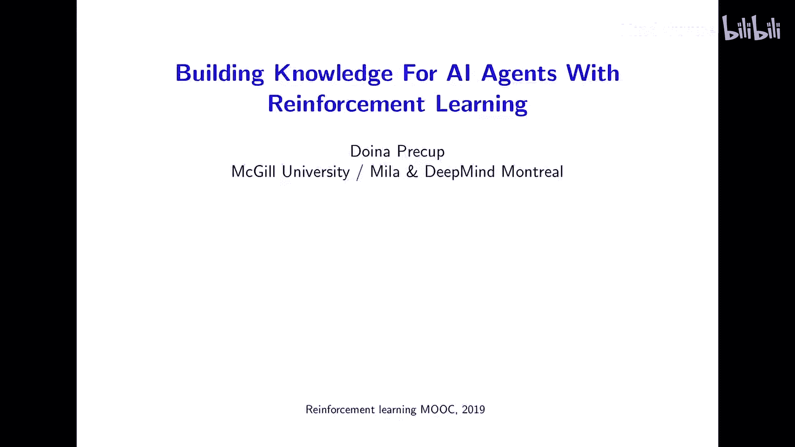

# 012：利用函数逼近进行预测和控制

在本节课中，我们将探讨强化学习智能体如何构建两种核心知识：程序性知识和预测性知识。我们将重点介绍一种称为“选项”的时域抽象方法，它允许智能体在更长的时间尺度上进行规划和推理，并讨论其与状态抽象（函数逼近）结合时面临的挑战。

我的名字是多伊娜·普雷卡普，我是麦吉尔大学的教授，同时也作为研究科学家在DeepMind工作。我的许多研究兴趣与强化学习中的抽象问题有关。

强化学习智能体需要获取两种知识。第一种是程序性知识，即如何做事情，策略是这方面最基本的知识。实际上，我们可能还希望拥有许多其他知识，例如如何与特定对象交互，或如何在不同的地点之间移动。我将从技能、选项或有时是目标驱动行为的角度来讨论这类知识。

我们也希望拥有预测性知识或经验性知识。这意味着在智能体行为的条件下可能会发生什么，这体现在价值函数上，但也包括其他方面，例如模型。

我们希望这些知识具备某些特性。一是我们希望这些知识是可学习的，以便我们能从数据中获取它。二是我们希望它具有表达性，我们希望智能体能够了解许多不同的事物和不同的情况。三是我们希望智能体能够将已有的知识片段组合成更大的知识单元。

这些是我们知识表示的主要要求。知识表示必须在智能体行为的时间尺度上，以及在智能体对其感知世界的推理能力方面进行泛化。这就是状态抽象和函数逼近发挥作用的地方。

我将更多地讨论程序性知识在时间尺度上的泛化。为什么我们需要这样的东西呢？许多智能体在“诞生”时，只有一组非常有限的动作，并且这些动作总是持续一个时间步长，因为我们要符合马尔可夫决策过程的框架。

但在现实情况下，智能体可能需要将一系列行动持续多个时间步长。例如，如果你考虑从蒙特利尔前往埃德蒙顿，你不会想用肌肉抽搐来思考，而是会考虑打车去机场，然后飞往埃德蒙顿，再打车到大学，可能中途还要吃个晚饭。这些是持续一段时间的行为，它们各不相同，但智能体应该能够在这个层面上进行推理，因为这意味着它的计划现在会短得多，可能只有四步，而不是成千上万步。此外，这个计划在其他情况下可能可以重用，例如，如果你想去多伦多或其他城市，智能体仍然会经历相同类型的步骤。

那么，我们如何形式化这种在时间层面或行为层面的抽象思想呢？一种方法是通过“选项”这个概念来实现。

我们将一个选项视为由三个组成部分构成。第一个是启动集，这意味着可以启动选项的环境条件集合。例如，我们只有在机场才能飞往某地，所以“在机场”就是一个启动集。第二个组成部分是内部策略，这意味着在选项执行期间选择原始动作的方式。例如，如果我们走向登机口，行走动作就是一个策略。该策略将接管控制并执行，这是在给定智能体状态下采取原始动作的通常概率。然后我们有一个终止条件，通常这也是随机的。它基本上告诉我们智能体在任何特定状态下完成该行为的概率。例如，如果我们走向登机口，我们可能因为到达了飞机登机口而完成此行为，但也可能因为发生警报而完成此行为，例如我们可能需要离开建筑物，从而切换到其他行为。

如果我们从这些组成部分的角度来思考，实际上智能体现在拥有可以执行的行为选择，我们也可以考虑与这些行为选择配对的模型。因此，每个选项都会有一个模型，其模型包括智能体在此过程中可能获得的期望奖励，以及本质上它可能最终到达的状态的转移概率分布。因为选项需要不同的时间长度，所以我们不只是考虑转移到下一个状态，实际上我们还要考虑到下一个时间点。因此，这实际上将是状态和时间的联合分布。

一旦智能体被赋予了选项，它的推理方式本质上与在MDP中相同，只是我们现在拥有所谓的半马尔可夫决策过程。因此，马尔可夫性质仍然成立，但行为的持续时间不是固定的，它实际上基于概率分布。然而，所有你已经熟悉和喜爱的规划和学习算法，例如价值迭代、时序差分学习，以及本课程中讨论的所有其他内容，在半马尔可夫决策过程中的工作方式与在MDP中几乎相同。因此，我们可以运用这些算法的所有思想来学习选项。

一个有趣的问题是如何在实现时域抽象的同时进行状态抽象或函数逼近。理想情况下，我们希望同时做到这两件事，就像我们希望思考“去机场”这个行为，而不是思考肌肉抽搐一样，我们也希望思考“机场”这个概念，而不是空间中的具体厘米位置。然而，这两者实际上是不同的，我们希望它们能在某种意义上协同工作。但是，如何同时获得良好的时域抽象和状态抽象，并且让它们之间能够良好地沟通，这实际上仍然是一个开放的研究问题。

同样，一个有趣的开放研究问题是弄清楚选项从何而来。谁告诉我们什么是好的终止条件？这是我们希望弄清楚的事情，但我们对此还没有完全掌握。

本节课中，我们一起学习了强化学习智能体构建知识的两种类型：程序性知识和预测性知识。我们重点介绍了“选项”作为实现时域抽象的关键方法，它由启动集、内部策略和终止条件三部分组成，允许智能体在更高层次上进行规划和复用行为。我们还探讨了将时域抽象（选项）与状态抽象（函数逼近）结合所面临的挑战，以及选项的自动发现等开放性问题，这些都是当前强化学习研究的前沿方向。