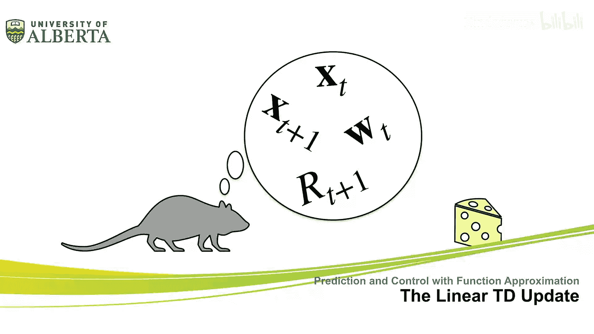
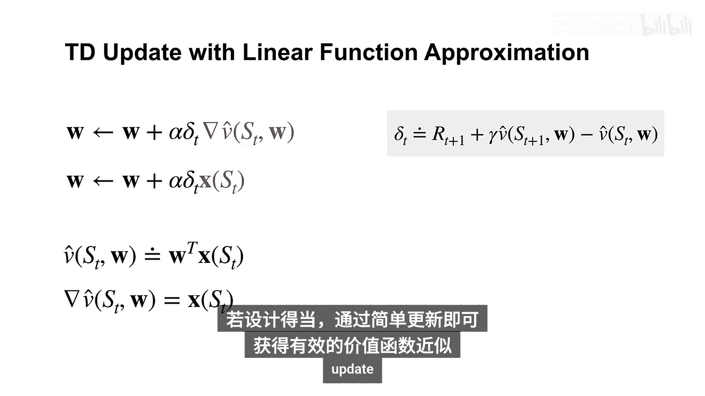
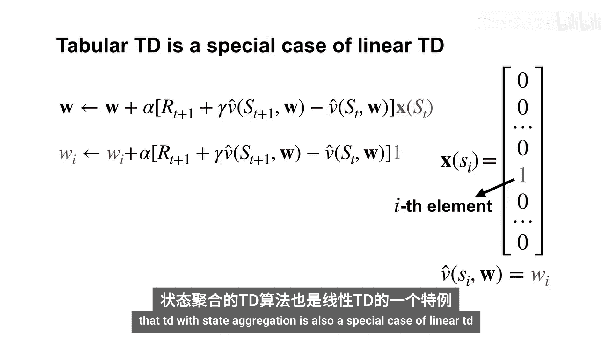

# 013：线性TD更新

在本节课中，我们将学习线性函数逼近在时序差分学习中的应用。我们将推导线性TD更新公式，理解表格型TD是其特例，并探讨线性方法的重要性。

## 线性TD更新公式推导

上一节我们介绍了半梯度TD更新的通用形式。本节中，我们来看看当价值函数逼近器是线性函数时的具体更新公式。

在强化学习中，原则上可以使用任何类型的函数逼近器。线性函数逼近是一个重要且特殊的类别。它足够简单，便于我们深入理解，同时在实际应用中依然非常强大。事实上，结合TD的线性函数逼近已被用于构建在许多雅达利游戏中超越人类表现的智能体。

回顾半梯度TD的更新规则，它根据时序差分误差（TDR）乘以价值函数近似值相对于权重的梯度方向来调整权重。

在线性情况下，状态近似价值函数的梯度就是该状态的特征向量。因此，半梯度TD的更新公式如下：

**权重更新公式：**
`w ← w + α * δ * x(S)`
其中，`δ = R + γ * x(S‘)ᵀw - x(S)ᵀw` 是TD误差，`x(S)` 是状态 `S` 的特征向量，`α` 是学习率。

如果某个特征值很大，那么对应的权重对预测结果会产生较大影响。反之，如果特征值为零，则该权重对预测没有影响，其梯度也为零。由专家设计的固定基特征对更新过程有重大影响。如果设计得当，我们可以通过简单的更新实现有效的价值函数逼近。

## 作为特例的表格型TD

我们已经看到线性价值函数逼近如何严格泛化了表格型价值函数逼近。我们可以证明，线性TD严格泛化了表格型TD和状态聚合TD。

让我们通过算法来明确地看看表格型TD是如何成为特例的。

假设我们有一个表格型的状态表示。只有对应当前状态的那个特征值为1，其余特征值均为0。状态的近似价值就等于与当前状态相关联的权重。因此，我们可以将权重向量视为一个价值表格，每个状态对应一个值。

以下是使用这种表格特征时，半梯度TD的更新公式：

**表格型TD更新公式：**
`w(S) ← w(S) + α * δ`

在更新中，状态 `S_t` 的特征向量 `x(S_t)` 选择了与当前状态相关联的单个权重。这个权重就是该状态的价值估计值，因此这个更新对应于我们在先前课程中看到的表格型TD更新。

我们可以用同样的分析来证明，状态聚合TD也是线性TD的一个特例。

## 为何关注线性函数逼近

但我们为何如此关注线性函数逼近这个特例？

线性方法在数学上更易于理解和分析。TD学习的大部分理论都是针对线性设置的，我们将在下一个视频中详细讨论这一点。

在某些应用中，你可能拥有专家知识来帮助你设计好的特征。也许你就是领域专家，或者你可以咨询非常了解你应用场景的人。如果我们能很好地设计这些特征，那么就可以期望线性方法能够快速学习并达到良好的预测精度。特征设计提供了一种融入领域知识的方式，在实践中可以获得良好的性能。

## 总结

本节课中，我们一起学习了线性TD更新公式，探讨了表格型TD如何作为线性半梯度TD的一个特例，并理解了线性函数逼近为何有用。下次课再见。