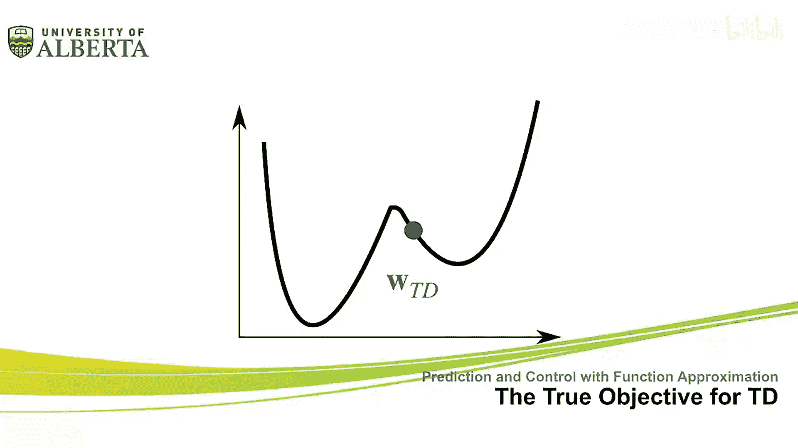
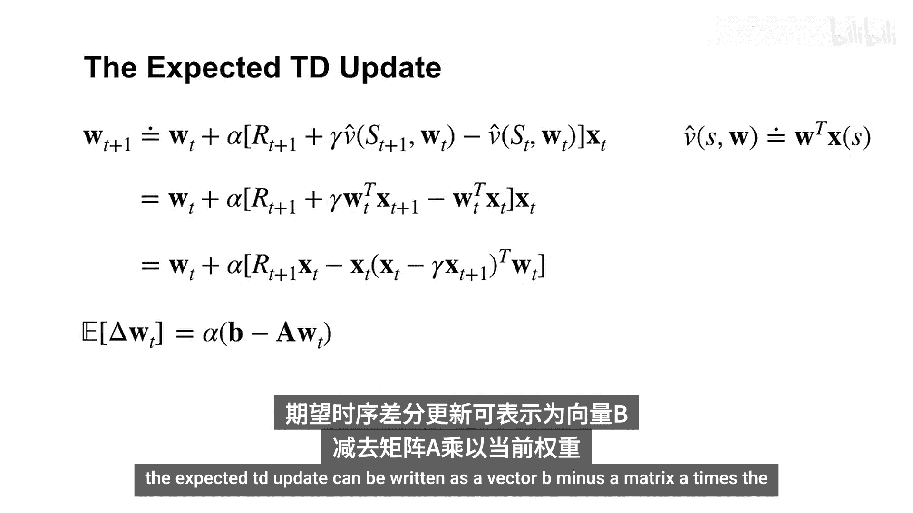
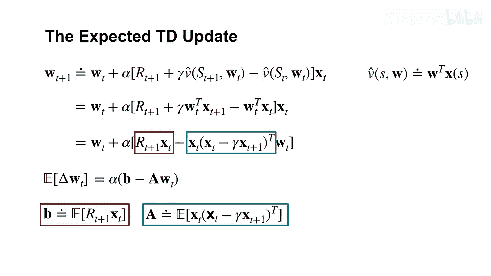
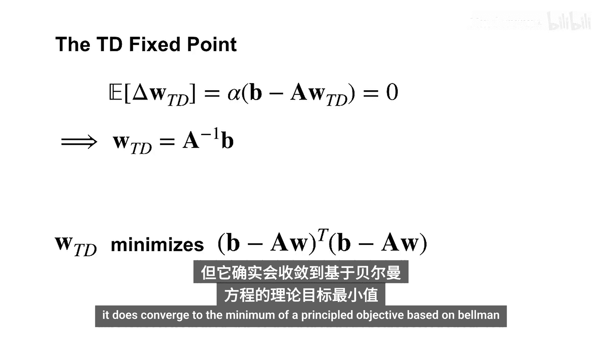

# 014：TD的真实目标

在本节课中，我们将深入探讨线性函数逼近下时序差分（TD）算法的真实优化目标。我们将了解到，TD算法并不直接优化均方价值误差，而是收敛到一个被称为“TD不动点”的特定解。我们将分析这个不动点的性质，并理解它与最小均方误差解之间的关系。

## 回顾与引入

上一节我们介绍了半梯度TD算法，它被描述为在均方价值误差上的近似梯度下降。但这实际上是一个简化的说法，TD算法并不精确地优化这个目标。相反，对于线性函数逼近，半梯度TD有一个不同的、更微妙的目标。

事实上，线性TD被证明会收敛到一个有明确理论解释的近似解，即TD不动点。本节课我们将讨论这个概念。课程结束时，你将能够理解线性TD的不动点，并描述在TD不动点处均方价值误差的一个理论保证。

## 线性TD更新分析

让我们更仔细地观察使用线性函数逼近的TD更新。一个状态的价值是状态特征向量与学习权重向量的内积。

为了简化符号，我们用 **X_t** 表示与状态 **S_t** 相关联的特征向量。那么价值函数可以表示为：
`V(S_t) = w^T * X_t`

我们可以将TD更新展开如下：
`w <- w + α * [R_{t+1} + γ * w^T * X_{t+1} - w^T * X_t] * X_t`

我们可以用一点线性代数知识重写这个公式。首先，将 **X_t** 移入括号内：
`w <- w + α * X_t * [R_{t+1} + γ * w^T * X_{t+1} - w^T * X_t]`

然后，利用标量的转置等于其本身这一事实，我们可以进一步整理。

现在，让我们思考一下这个更新在期望下的表现。理解期望更新是证明收敛性的关键。TD更新可以重写为期望更新加上一个噪声项，因此其行为主要由期望更新的特性决定。

期望更新描述了权重从一个时间步到下一个时间步的预期变化。期望TD更新可以写成一个向量 **b** 减去一个矩阵 **A** 乘以当前权重 **w** 的形式。

矩阵 **A** 是根据特征的期望定义的：
`A = E[ X_t * (X_t - γ * X_{t+1})^T ]`

而向量 **b** 则是根据特征和奖励的期望定义的：
`b = E[ R_{t+1} * X_t ]`

## TD不动点

当期望TD更新为零时，权重将收敛到一个固定点。我们称这个点为 **w_TD**。

如果矩阵 **A** 是可逆的，我们可以将其表示为：
`w_TD = A^{-1} * b`

更一般地说，**w_TD** 是这个线性系统的解：
`A * w = b`
我们称这个解为 **TD不动点**。

可以证明，线性TD算法会收敛到这个点。事实上，可以证明TD最小化了一个基于 **A** 和 **b** 的目标函数。这个目标将TD与贝尔曼方程的联系扩展到了函数逼近的设定中。

回想一下，在表格型设定中，我们将TD描述为求解贝尔曼方程的基于采样的方法。线性TD同样近似求解贝尔曼方程，它最小化的是所谓的 **投影贝尔曼误差**。这个目标的细节超出了本课程的范围，但你可以在课程教材中找到更多详细信息。

关键要点是：尽管TD不收敛到最小均方价值误差的解，但它确实收敛到一个基于贝尔曼方程的有理论依据的目标的最小值。

## TD不动点与最小误差解的关系

尽管如此，我们仍然希望理解TD找到的解与最小价值误差解之间的关系。我们可以用以下方程来形式化地描述这种关系：

如果折扣因子 **γ** 接近1，TD不动点与最小价值误差解之间的差异可能会很大。另一方面，如果 **γ** 非常接近0，那么TD不动点将非常接近最小价值误差解。

这个界限也取决于特征的质量。如果特征有限，那么最小均方价值误差和TD不动点处的价值误差都可能很大。如果我们能完美地表示价值函数，那么无论 **γ** 是多少，TD不动点都等价于最小价值误差解。这是因为方程左右两边都将是零。

那么，为什么一般情况下TD不动点不等于最小价值误差解呢？这是因为在函数逼近下的自举（Bootstrapping）特性。如果由于函数逼近的限制，我们对下一个状态的估计持续不准确，那么TD可能会永远朝着一个不准确的目标更新。另一方面，如果我们的函数逼近器非常好，那么我们对下一个状态的估计就会非常准确，因此基于这个估计进行自举就不会有问题，TD解的误差也就接近最小价值误差。

## 总结

本节课我们一起学习了线性半梯度TD算法为何能保证收敛到一个被称为TD不动点的固定点。我们分析了期望更新方程，定义了矩阵 **A** 和向量 **b**，并理解了不动点 `A * w = b` 的含义。最后，我们探讨了TD不动点与最小均方价值误差解之间的关系，认识到这种差异主要源于函数逼近下的自举过程以及折扣因子和特征表示质量的影响。