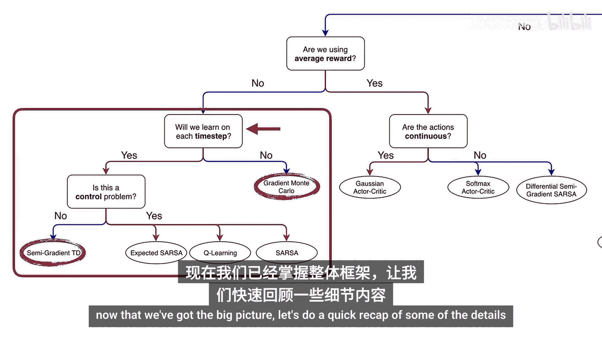
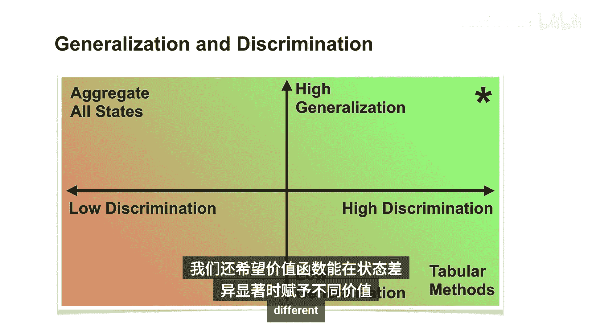
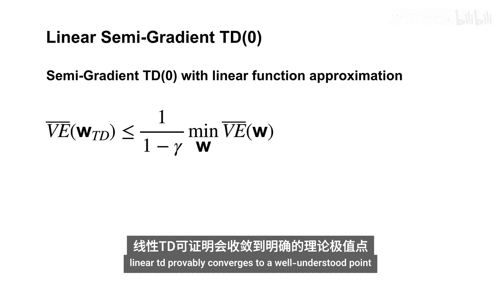

# 015：利用函数逼近进行预测与控制总结 🧠

在本节课中，我们将总结第一周关于如何将强化学习从表格形式扩展到函数逼近方法的核心内容。我们将回顾关键概念、算法及其在整体学习框架中的位置。

## 课程概述 📋

在许多现实世界问题中，枚举所有可能状态并存储在表格中是不切实际的。因此，转向函数逼近是使强化学习更广泛应用的重要一步。本周我们学习了参数化函数逼近的框架，并介绍了两种用于策略评估的算法。

## 整体框架与算法地图 🗺️

上一节我们介绍了从表格方法转向函数逼近的必要性。本节中我们来看看本周所学内容在整个算法体系中的位置。

下图展示了本专项课程中涵盖的所有算法及其相互关系。请注意，此图仅包含本课程中介绍的算法。

本周的主要概念转变是转向了参数化函数逼近的框架。这意味着我们不再使用表格来存储每个状态的值。这使我们位于地图的左侧。关于平均奖励的讨论将在后续进行，现在让我们聚焦于此。

本周我们专注于策略评估问题，并介绍了两种算法：梯度蒙特卡洛法和半梯度时序差分法。

## 参数化价值函数 🔧

在了解了整体框架后，本节我们来快速回顾一些具体细节。

我们描述了参数化价值函数，它是从状态到实数的映射。输出由一个实值权重向量 **W** 控制。我们使用符号 **v̂(s, W)** 来表示近似价值函数，这表明价值估计由当前状态和学习到的权重向量决定。

以下是参数化价值函数的两个例子：
*   线性函数：基于固定或专家设计的特征。
*   神经网络。

## 函数逼近的关键属性 ⚙️

我们讨论了函数逼近的两个关键属性：泛化与区分。

*   **泛化**：更新一个状态的价值可以改进其他状态的价值估计。这种泛化可以使学习更快。
*   **区分**：我们希望价值函数在状态差异很大时能分配不同的价值。

## 从监督学习到价值函数学习 📊

接下来，我们讨论了如何利用监督学习的思想来学习近似价值函数。我们无法保证对每个状态的价值都完美逼近，因此需要定义一个目标函数，来衡量我们的近似值与真实值之间的距离。

我们使用**均方价值误差**作为目标函数，即每个状态的真实价值与近似价值之间误差的平方和，并按状态访问频率 **μ** 进行加权。

我们讨论了如何使用**随机梯度下降**来优化我们的目标。

## 核心算法回顾 🤖

以下是本周介绍的核心算法：

*   **梯度蒙特卡洛算法**：使用采样得到的回报来执行随机梯度下降更新权重。这意味着它可以从智能体与世界交互产生的经验中学习近似价值。
*   **半梯度时序差分法**：作为随机梯度下降的一种近似。半梯度TD利用了自举法，在实践中可能比蒙特卡洛法收敛得快得多。其名称中的“半梯度”提醒我们，它并非一个完整的梯度下降算法。

## 线性半梯度TD算法 ✅

最后，我们讨论了线性半梯度TD算法，即使用线性函数逼近的TD算法。

线性TD被证明会收敛到一个易于理解的点。

## 总结与展望 🎯

本节课中，我们一起学习了将强化学习扩展到函数逼近的基础。你现在已经具备了理解基于参数化函数的强化学习的良好基础。

接下来，我们将讨论构建状态及状态-动作特征的不同方法。下次见。