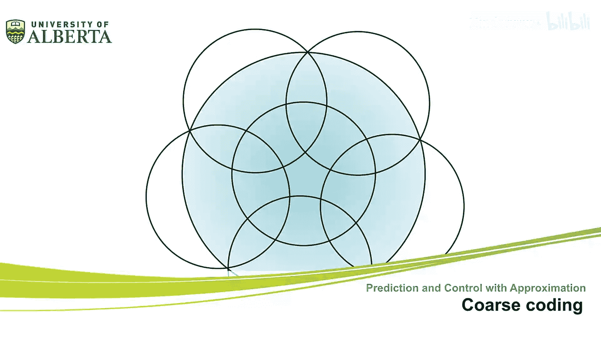
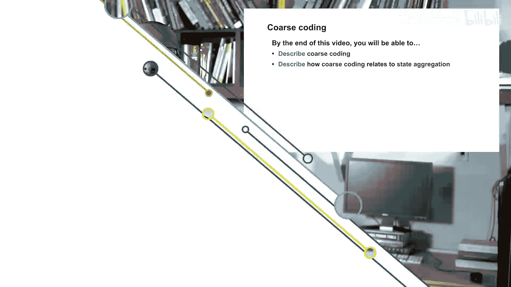
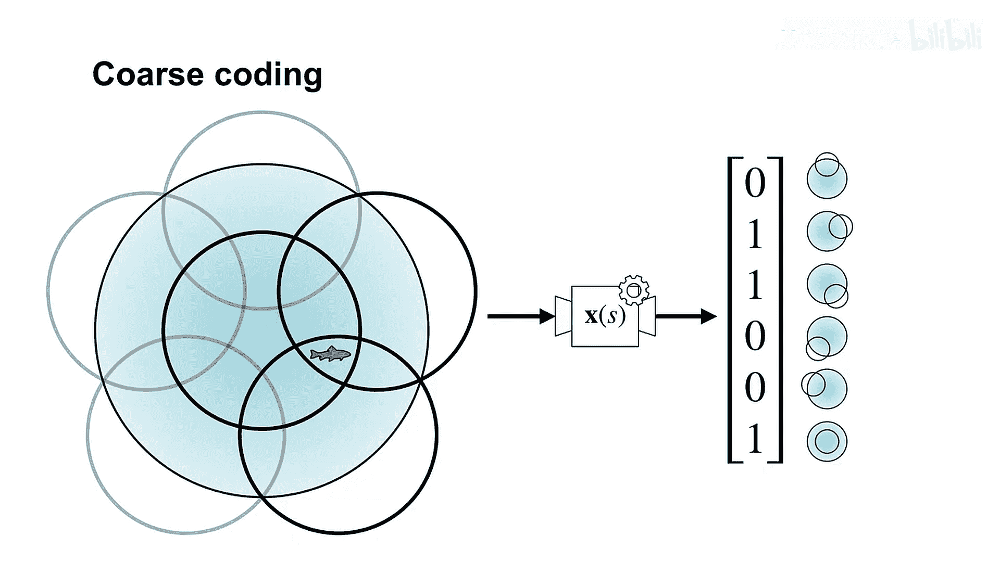

# 016：粗编码




在本节课中，我们将学习如何为线性价值函数创建特征。特征是用来构建价值估计的重要组成部分。我们将讨论一种简单而有效的方法——粗编码，并解释它如何与状态聚合相关联。课程结束时，你将能够描述粗编码及其与状态聚合的关系。



## 线性价值函数与特征回顾

上一节我们介绍了近似价值函数的基本概念。现在，我们来回顾一下线性价值函数是如何工作的。

近似价值函数由一个权重向量 **W** 参数化。要计算一个状态的价值，我们首先需要计算其特征，并构建该状态的特征向量 **x(S)**。然后，状态的价值近似为权重向量与特征向量的点积。

**公式：** `V(S) ≈ W · x(S)`

表格化表示可以看作是一种特殊的线性函数逼近。在这种表示中，每个状态对应一个不同的特征。如果智能体处于某个状态，那么该状态对应的特征值为1，其他所有特征值均为0。这本质上是一种**独热编码**。

**代码示例（概念性）：**
```python
# 假设有3个状态：S0, S1, S2
state = ‘S1’
# 对应的独热编码特征向量
feature_vector = [0, 1, 0]  # 索引1（对应S1）为1，其余为0
```

当然，当状态空间的大小远超智能体可用内存时，这种表格化方法就不可行了。

## 从状态聚合到粗编码

当状态空间连续或极大时，我们无法为每个状态分配唯一的特征。回忆一下，我们可以使用**状态聚合**将附近的状态与相同的特征关联起来。

这就像将每个方格内的所有状态视为同一个状态。在状态聚合中，各个组块通常形状相似且互不重叠。

然而，组块使用相同形状并非必要。实际上，我们可以使用任何形状来聚合状态，只要这些形状没有间隙或重叠。状态聚合通常不允许形状重叠，但这个限制并非必需。

通过允许形状重叠，我们得到了一类更灵活的特征表示方法，称为**粗编码**。

## 粗编码工作原理

让我们通过一个例子来理解粗编码。假设我们想表示一条在池塘（一个二维状态空间）中游动的鱼的位置。鱼的位置有无限多种可能。

在粗编码中，我们定义多个（例如圆形）的“感受野”。每个感受野对应特征向量中的一个索引（即一个特征）。

以下是判断特征是否激活的规则：
*   如果鱼位于某个圆形区域内，则该圆形对应的特征被**激活**（设置为1）。
*   否则，该特征被**置为0**。

当鱼移动到一个新位置时，它通常会被一组不同的圆形覆盖。附近的状态会具有相似的特征激活模式，但它们激活的具体特征组合和数量可能不同。

**关键点：**
*   感受野可以重叠。
*   一个状态可以同时激活多个特征。
*   这允许对状态空间进行更丰富、更渐进的表示。

## 总结与扩展

本节课我们一起学习了粗编码。我们首先回顾了表格表示法如何用状态的二进制独热编码来表示。接着，我们探讨了状态聚合作为处理大规模状态空间的方法。最后，我们介绍了**粗编码**，它是状态聚合的一种推广，通过允许特征感受野重叠，提供了更强大和灵活的特征表示方式。

这些思想不仅限于二维状态空间，粗编码同样可以应用于更高维度的输入。



下一节我们将继续探讨其他函数逼近方法。

