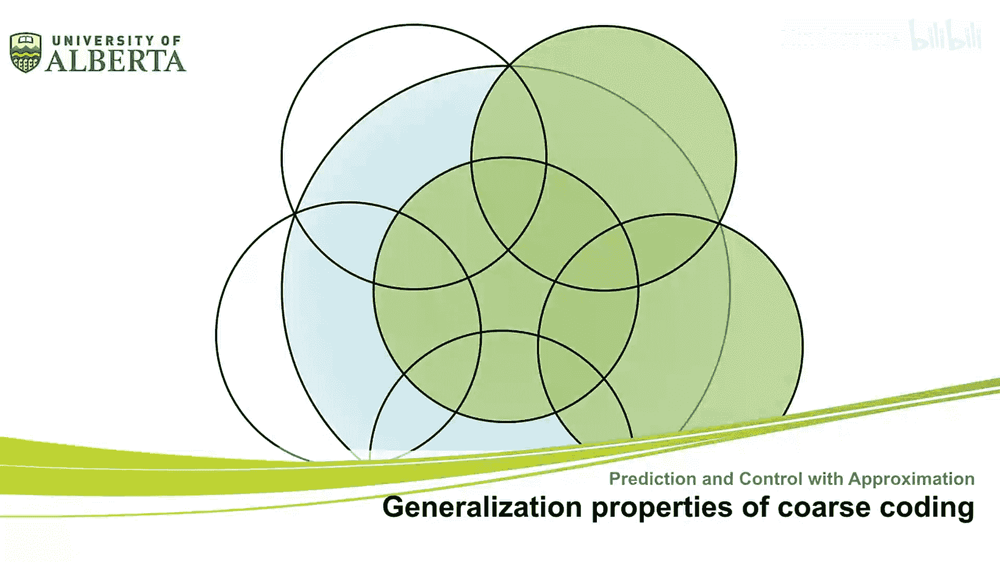
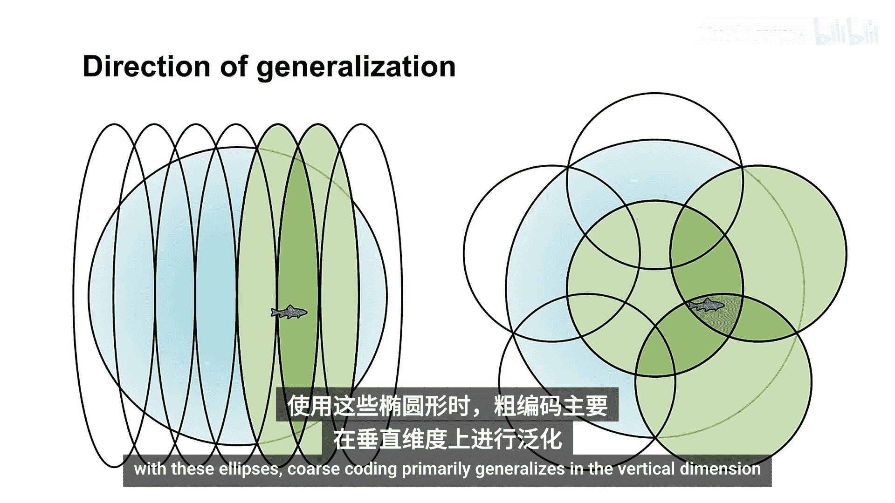
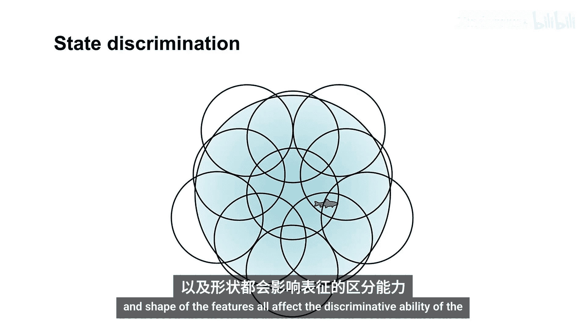

# 017：粗编码的泛化属性

在本节课中，我们将要学习粗编码（Coarse Coding）中特征表示的性质如何影响强化学习算法的泛化能力和区分能力。我们将探讨特征的大小、数量和形状如何决定学习的速度以及最终价值函数近似的准确性。

上一节我们介绍了几种不同的特征表示方法，包括表格法、状态聚合和粗编码。但我们没有详细解释为什么粗编码可能有用。本节中，我们来看看改变粗编码的属性如何影响泛化与区分。

## 特征形状与大小对泛化的影响

粗编码将状态分组到任意形状和大小（如圆形、椭圆形、正方形或其组合）的特征中。改变这些特征的形状和大小会直接影响泛化和区分能力，进而影响学习速度和可表示的价值函数。

对权重的一次更新，会改变所有处于激活特征感受野内的状态的价值估计。如果激活特征的感受野并集很大，则特征表示的泛化能力更强。反之，如果并集很小，则泛化能力很弱。例如，右侧较大的圆形感受野能更广泛地泛化，将更新分布到更多状态上。

然而，泛化不仅仅是一个标量概念。在粗编码中使用不同的形状可以改变泛化的方向。例如，与圆形相比，使用垂直拉长的椭圆形进行粗编码，其感受野在垂直维度上更长，因此泛化主要发生在垂直方向上。

## 特征重叠对区分能力的影响

我们已经讨论了感受野的形状和大小如何影响泛化及学习速度。那么，关于我们估计的最终准确性呢？这就涉及到区分能力。

区分能力指的是区分两个不同状态价值的能力。在粗编码中，圆形（或特征）之间的重叠程度决定了区分能力的水平。我们不可能做到完美的区分，因为更新一个状态的价值时，总会影响到其他状态的价值。

以下是一个关于区分能力的直观说明：
*   处于相同颜色形状区域内的所有状态将拥有完全相同的特征向量。
*   因此，它们必须具有相同的近似价值。
*   这些区域越小，我们的区分能力就越好。

通过增加特征的数量或减小特征的尺寸，这些区域会变得更小，我们就能更精细地区分不同状态的价值。因此，特征的大小、数量和形状都会影响表示的区分能力。

## 一维输入空间示例

让我们通过一个一维输入空间的简单例子来更好地理解表示选择如何影响学习速度和最终近似的质量。假设我们要学习近似一个阶跃函数，并且可以采样真实函数值来更新我们的估计。

在这个一维函数中，每个特征的感受野将被表示为重叠的区间。以下是两种不同设置的对比：

**1. 使用较短的区间**
我们放置大约50个这样的短区间，让它们在函数定义域上随机重叠。每个特征的感受野相当小。
*   **学习过程**：即使经过多次采样，我们对阶跃函数的近似效果也不理想。经过大量训练后，近似结果才与真实函数接近，但仍不完美（例如，函数顶部的近似不够平坦或平滑）。

**2. 使用较长的区间**
每个特征的感受野相当大。
*   **学习过程**：我们能用相对较少的样本就近似出函数的大致形状。随着采样增多，估计值形成了对真实函数越来越好的近似。
*   **结果分析**：较长区间的广泛泛化使学习速度更快（需要更少的样本来获得良好的近似）。同时，大量较长区间也带来了更好的区分能力，从而获得了对真实函数更好的最终近似。

在这个特定例子中，较长的区间最终实现了更好的泛化和区分。但这并非总是成立，每个任务可能需要不同的特征属性，并不存在一个通用的解决方案。

## 总结

本节课中，我们一起学习了粗编码特征的大小、数量和形状如何影响泛化能力，以及由此产生的形状交集如何影响区分能力。粗编码是一种非常通用的表示类型，理解它在学习过程中如何进行泛化和区分，将帮助我们理解包括神经网络在内的其他表示方法。