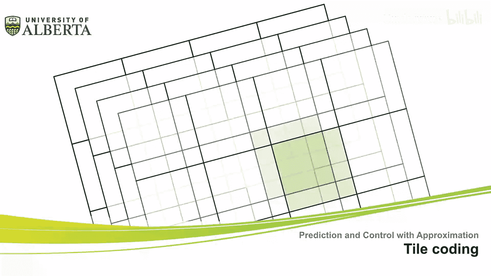
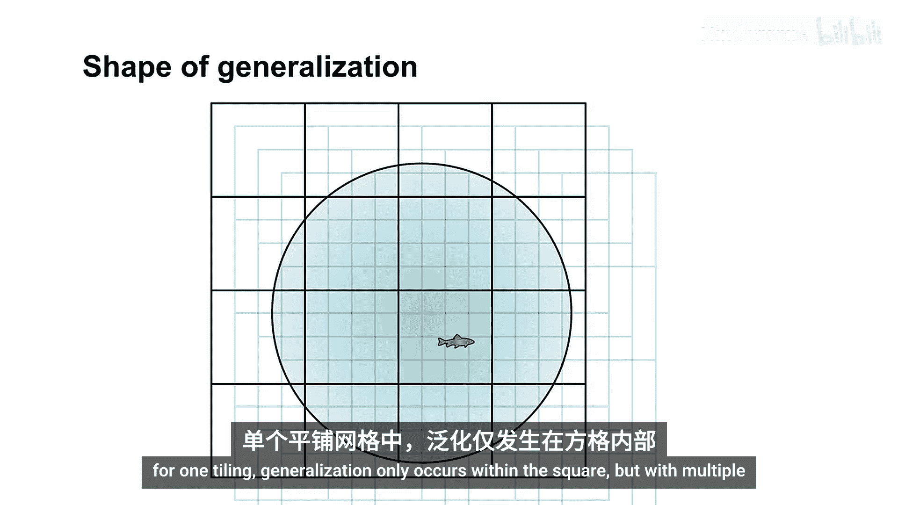
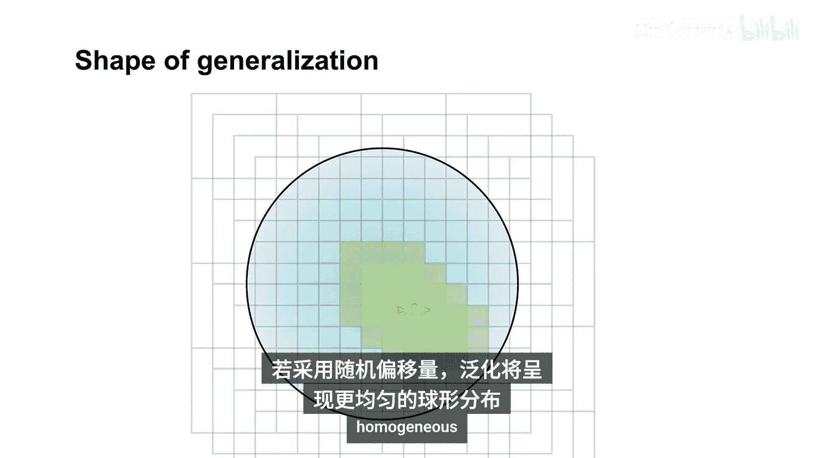
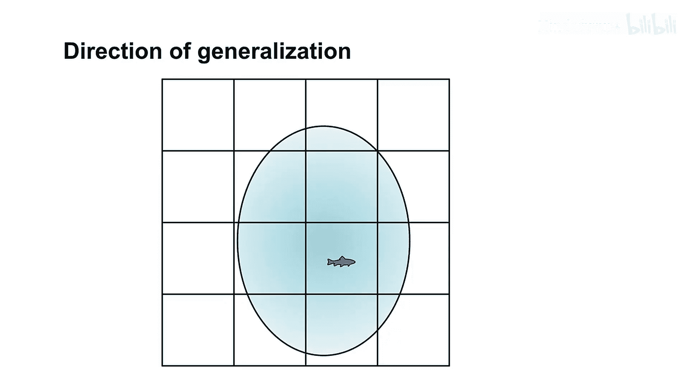
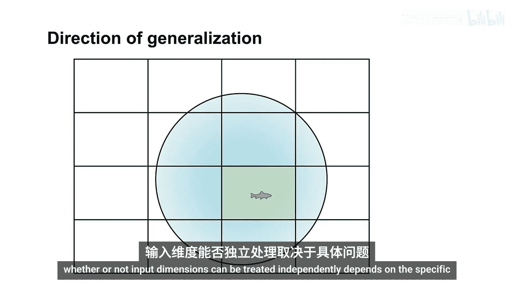

# 018：瓦片编码

在本节课中，我们将学习瓦片编码。这是一种计算高效的粗编码方法。我们将解释瓦片编码如何同时实现泛化与区分，并理解其优势与局限性。

## 瓦片编码简介 🧱

上一节我们介绍了粗编码，本节中我们来看看一种计算高效的粗编码实现方式：瓦片编码。

瓦片编码是一种特定类型的粗编码。它使用重叠的网格对状态空间进行详尽划分。

## 瓦片编码的工作原理 ⚙️

通过一个例子可以最好地理解瓦片编码。让我们回顾一下生活在二维连续状态空间（池塘）中的鱼朋友。与使用任意形状的粗编码不同，瓦片编码使用正方形。

在一个空间上布置一堆正方形最方便的方法是使用网格。我们称这个网格为一个**瓦片层**。目前，仅使用一个瓦片层就只是状态聚合。

较大的瓦片会导致更强的泛化能力。虽然理想的瓦片大小取决于具体问题，但通常使用较大的瓦片是个好主意。

## 提升区分能力 🎯

为了提高瓦片编码的区分能力，我们可以将多个瓦片层叠加在一起。每个瓦片层都偏移一个很小的量。

偏移每一层瓦片会产生许多小的交叉区域。这带来了更好的区分能力。在实践中，使用大量瓦片层是有用的。

对于一个瓦片层，泛化只发生在正方形内部。但有了多个瓦片层，对这个状态的更新会泛化到这些其他状态。

在这种情况下，泛化是沿对角线的。如果我们使用了随机偏移，那么泛化会更接近球形且更均匀。

教科书中有更多关于此的讨论。

## 控制泛化属性 🔧

我们可以通过创建矩形网格而非正方形网格来进一步控制泛化属性。一种高效的方法是缩放状态空间的每个维度。

环境在这里看起来被挤压了。实际上，在这个被挤压的环境上叠加正方形，就像在未被挤压的环境上叠加矩形。

通过使用矩形，我们可以控制泛化在状态空间每个维度上的广度。

## 瓦片编码的优势与局限 ⚖️

瓦片编码可以表示广泛的函数，但其效用不止于此。瓦片编码在计算上也很高效。由于网格是均匀的，很容易计算当前状态位于哪个单元格。

由于其计算效率，瓦片编码可用于在低维环境中快速运行初步实验。

然而，随着维度的增加，所需的瓦片数量呈指数级增长。因此，可能需要分别处理输入维度。

输入维度是否可以独立处理取决于具体问题。

## 总结 📝

本节课中我们一起学习了瓦片编码。我们讨论了粗编码，以及它是如何作为状态聚合的泛化。瓦片编码通过使用重叠的网格层，在计算效率和表示能力之间取得了良好的平衡。下次见。