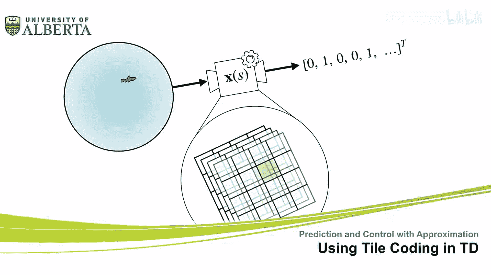
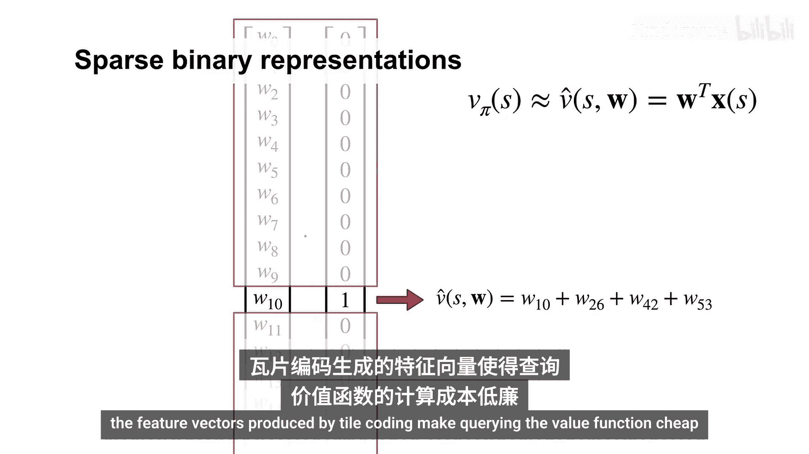
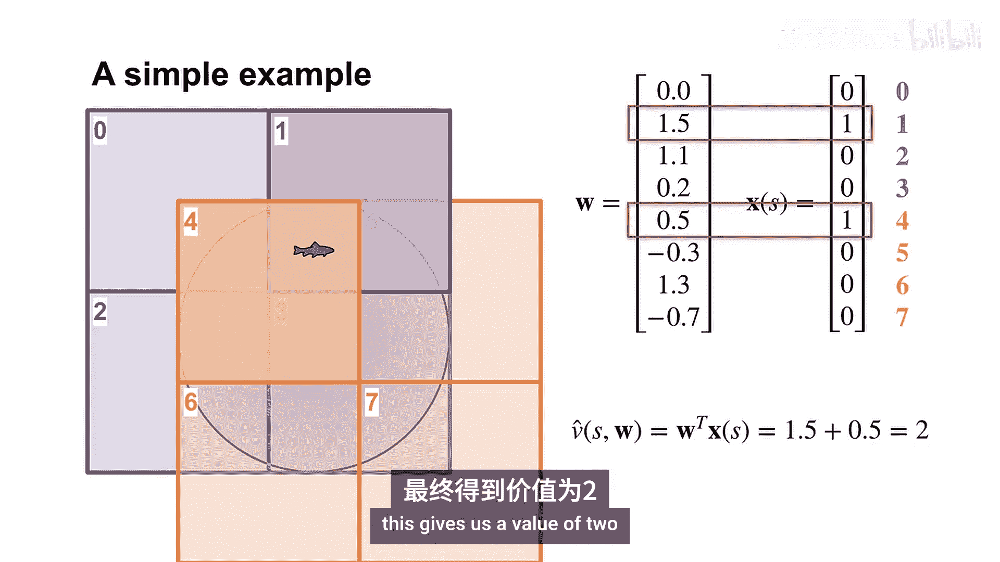
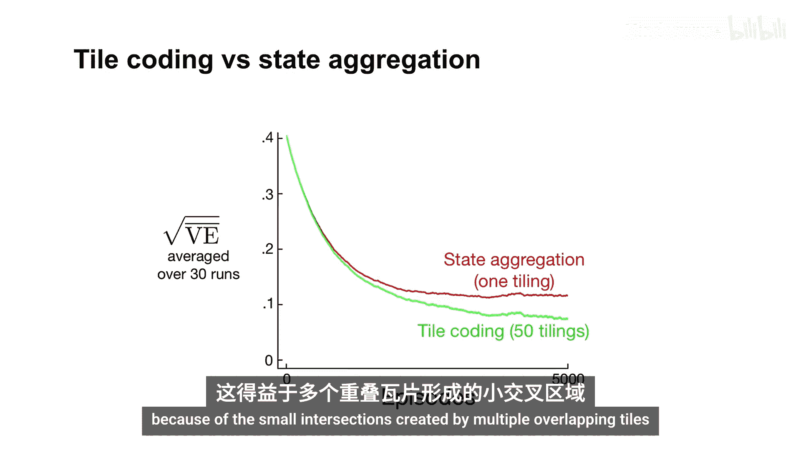

# 019：在TD中使用瓦片编码

在本节课中，我们将学习如何将瓦片编码与线性时序差分学习结合使用，以实现高效的价值函数逼近。我们将探讨瓦片编码的关键特性，并通过一个实验将其与状态聚合方法进行比较。

## 瓦片编码与线性TD学习

上一节我们介绍了瓦片编码的基本概念。本节中，我们来看看如何将其应用于强化学习中的价值函数逼近。

瓦片编码产生的特征向量是稀疏且二进制的。在每一个状态，只有少数几个瓦片被激活。这个特性使得我们可以高效地计算价值函数。

回忆一下，在线性函数逼近中，价值函数是权重向量 **w** 和特征向量 **x(s)** 的点积：
`V(s) = w · x(s)`

当特征向量是稀疏二进制向量时，这个点积的计算可以大大简化。因为大部分元素乘积为零，我们只需要考虑非零特征对应的权重。由于特征是二进制的（值为1），计算点积就简化为对激活特征对应的权重进行求和。

以下是计算步骤：
1.  识别当前状态激活的瓦片（即特征向量中值为1的位置）。
2.  将这些位置对应的权重值相加。
3.  所得的和即为该状态的估计价值 `V(s)`。

这种方法计算效率很高，因为每个状态激活的瓦片数量是固定的，计算时间恒定。

## 瓦片编码价值计算示例

让我们通过一个具体例子来理解这个过程。

假设我们回到熟悉的池塘环境，使用两个瓦片组，每组包含4个瓦片。瓦片组和每个瓦片方格已按图中所示进行颜色编码和索引。

如果鱼的位置和权重因子如图所示，鱼所在位置的价值是多少？

我们可以观察到，鱼同时位于紫色瓦片组的方格1和橙色瓦片组的方格4。因此，该状态的特征向量如下：

`x(s) = [1, 0, 0, 0, 0, 0, 0, 1]` （前4位对应紫色组，后4位对应橙色组）

现在，我们简单地通过点积计算状态价值。由于特征向量是二进制的，我们只需将非零特征位置对应的权重相加。

假设权重向量为 `w = [2, 1, 3, 4, 1, 2, 3, 0]`，则：
`V(s) = w[0] + w[7] = 2 + 0 = 2`

因此，鱼在该位置的价值估计为2。

## 瓦片编码 vs. 状态聚合：实验比较

现在，让我们通过一个实验来比较瓦片编码和状态聚合的性能。

回想一下，瓦片编码本质上是多个状态聚合实例（即多个瓦片组）的叠加。我们的实验环境是一个包含1000个状态的随机游走问题。状态编号从1到1000，所有回合都从状态500开始。在每个时间步，智能体会随机转移到当前状态左右两侧共200个相邻状态之一。超出状态1或1000的转移将导致进入终止状态。

我们将在这个问题上使用函数逼近：
*   **状态聚合**：我们使用5个分组，每组对应200个状态。
*   **瓦片编码**：我们设计一个包含50个瓦片组的编码器。每个瓦片覆盖200个状态。由于每个瓦片组之间存在偏移，每个组需要6个瓦片（而非5个）来完全覆盖1000个状态的空间。

我们使用梯度蒙特卡洛方法比较这两种函数逼近器。步长参数α根据激活特征的数量进行缩放（瓦片编码为1/50，状态聚合为1/1）。以下是实验结果。

我们绘制了30次运行后每个回合的平均价值误差。
*   两种方法都因积极的泛化而学习迅速。
*   然而，**瓦片编码表示能够更好地区分不同状态，并达到更低的价值误差**。
*   有趣的是，尽管瓦片编码器有更多的参数（50组 x 6瓦片 = 300个权重），但它学习的速度与简单的状态聚合（仅5个权重）一样快，同时还能实现更好的区分度。这得益于多个重叠瓦片创建的小交叉区域所提供的精细分辨率。

## 总结

本节课中，我们一起学习了如何将瓦片编码用于策略评估中的价值函数逼近。我们探讨了其利用稀疏二进制特征实现高效计算的原理，并通过一个随机游走实验，将瓦片编码与状态聚合进行了对比。实验表明，瓦片编码在保持高效学习的同时，能提供更精确的状态价值区分。

下一次，我们将超越这种固定的特征表示方法，开始学习如何使用神经网络来学习数据本身的表示。