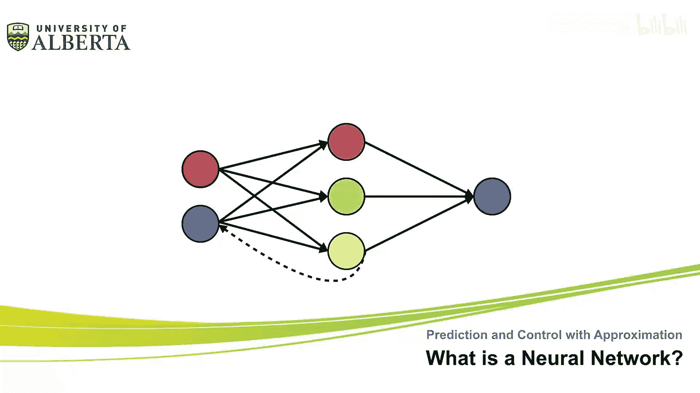
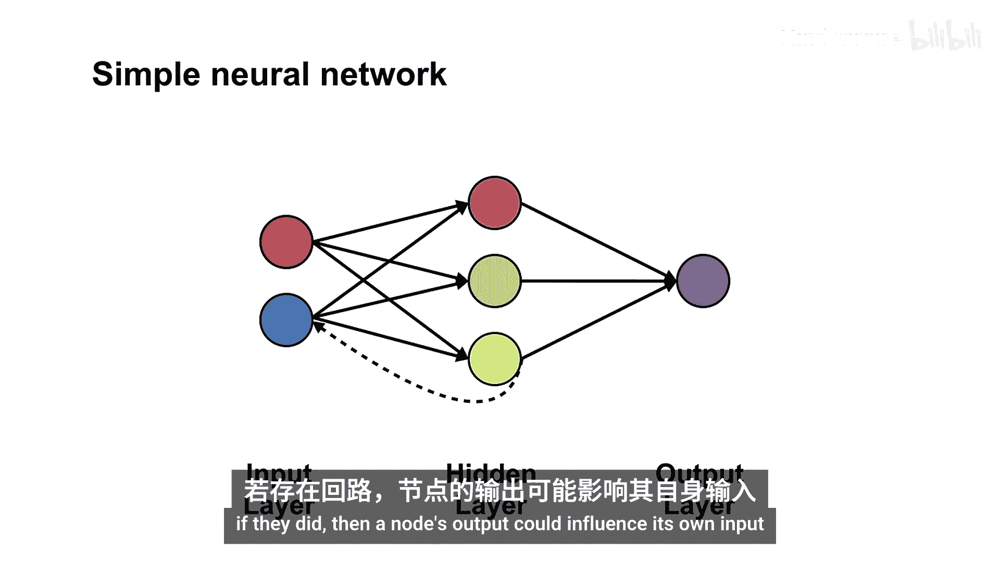
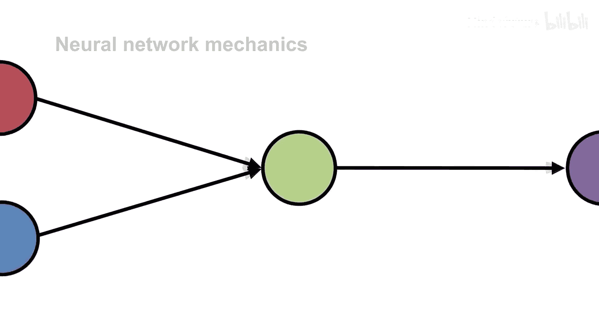
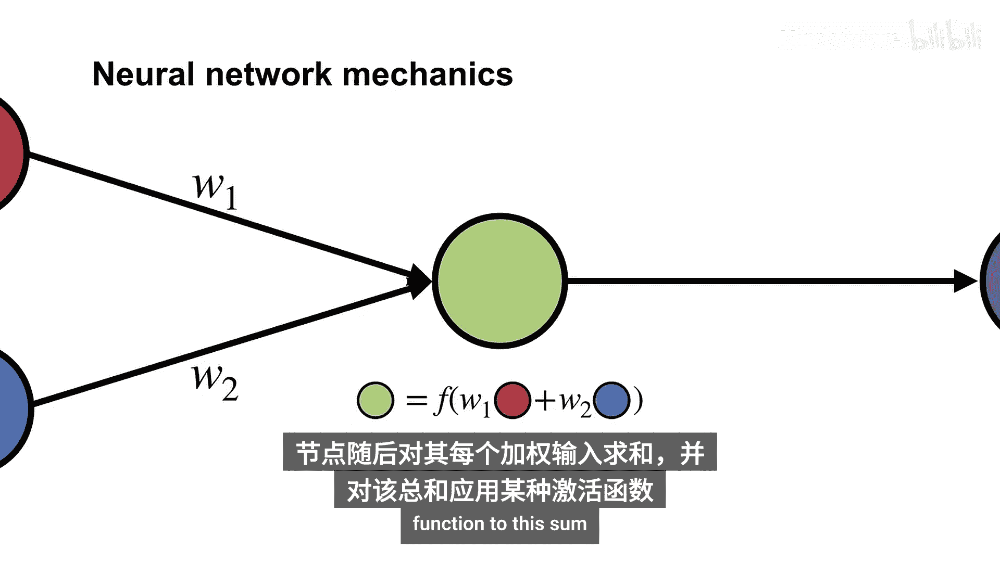
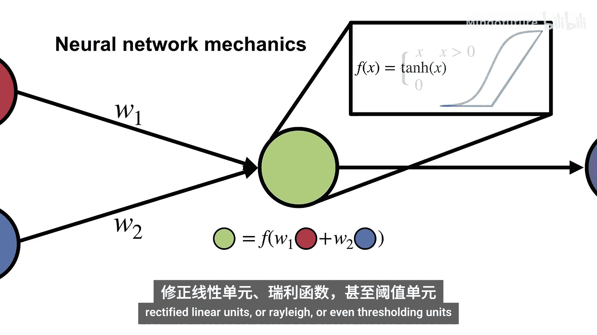
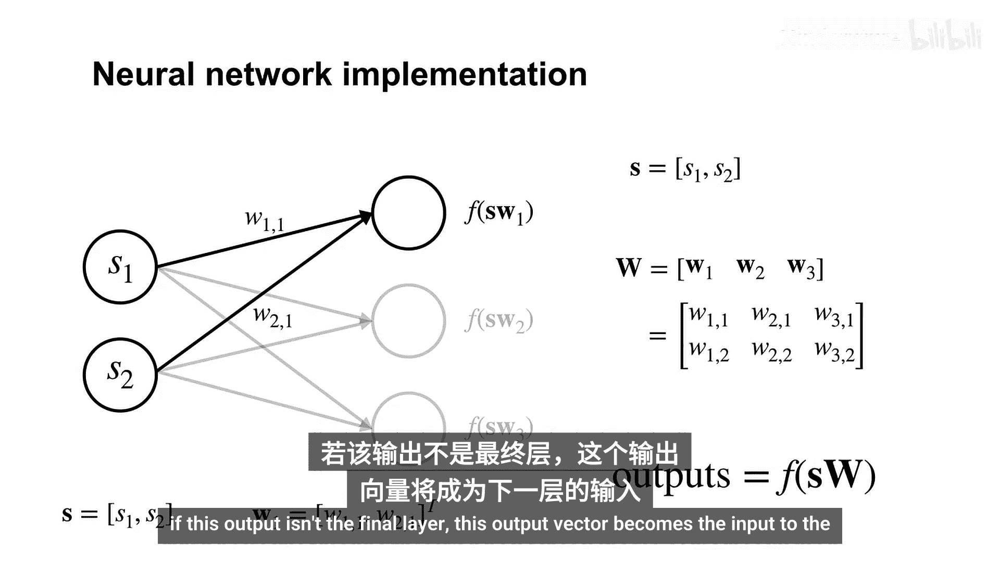

# 020：什么是神经网络

在本节课中，我们将学习神经网络，这是一种灵活且强大的非线性函数逼近器。我们将了解其基本结构、工作原理以及如何将其视为参数化函数。

## 神经网络概述 🧠

神经网络是一类灵活且强大的非线性函数逼近器。在强化学习中，神经网络已被用于创造世界冠军级的围棋程序、实现超越人类水平的Atari游戏智能体，甚至辅助自动驾驶汽车。

## 前馈神经网络结构 🔄

上一节我们介绍了神经网络的基本概念，本节中我们来看看其具体结构。一个简单的神经网络由节点和连接组成。

每个圆圈代表网络中的一个节点，每条线代表节点之间的连接。节点被组织成不同的层。当新数据输入时，它从输入层开始，通过连接被发送到下一层节点。该层对数据进行一些计算，然后将结果发送到下一层。这个过程持续进行，直到最后一层产生最终输出。

我们称之为**前馈神经网络**，因为数据总是向前通过各层。没有任何连接会回环到网络的前面。如果存在回环，那么一个节点的输出可能会影响它自己的输入，这种神经网络被称为**循环神经网络**。

## 节点计算与激活函数 ⚙️

了解了网络结构后，我们来看看单个节点如何处理信息。当数据通过连接传递时，会应用一个权重。节点然后对其每个加权输入求和，并对这个和值应用某个激活函数。

激活函数通常是一个非线性变换。以下是常见的激活函数：
*   **Sigmoid函数**：如 `tanh` 或逻辑函数。
*   **整流线性单元**：即 `ReLU`。
*   **阈值单元**。

## 前馈过程的数学表达 📐

现在，我们学习如何用数学公式表达神经网络的前馈过程。在每个节点，我们有两个向量：输入向量和每个输入对应的权重向量。

第一个下标表示连接来源的节点，第二个下标表示连接指向的节点。我们将权重与输入进行点积，然后将结果通过激活函数。

注意，这里 `s` 是一个行向量，因此我们不需要在点积运算中写转置。

## 作为参数化函数的神经网络 🧮

每个层由许多这样的节点组成。神经网络本质上就是一个参数化函数，尽管将其视为一组连接的节点时，这一点可能不太明显。

为了更明确地理解这一点，让我们使用矩阵向量乘法来重写网络中的操作。我们可以将一层的输入视为一个行向量，将该层的权重视为一个矩阵（即一个二维数组）。我们可以使用矩阵乘法计算整个层的输出。

然后，我们将激活函数应用于输出向量的每个元素。如果这个输出不是最终层，那么这个输出向量就成为下一层的输入，我们重复这个过程。

## 总结 📝

本节课中我们一起学习了神经网络。我们解释了神经网络如何由处理和传递信息的节点网络组成，并讨论了前馈神经网络如何作为一个参数化函数。下次见。