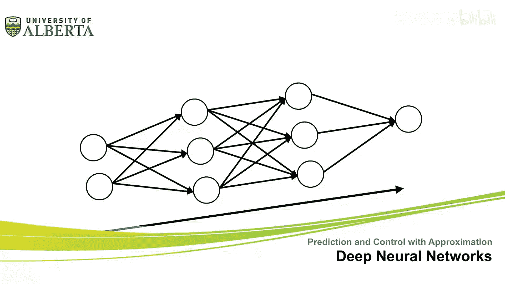
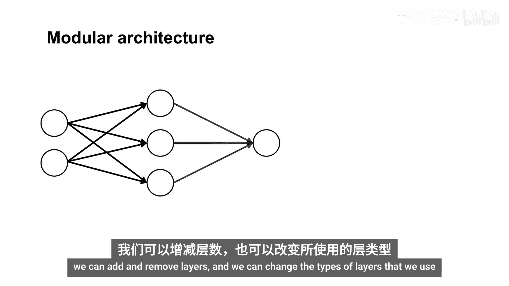
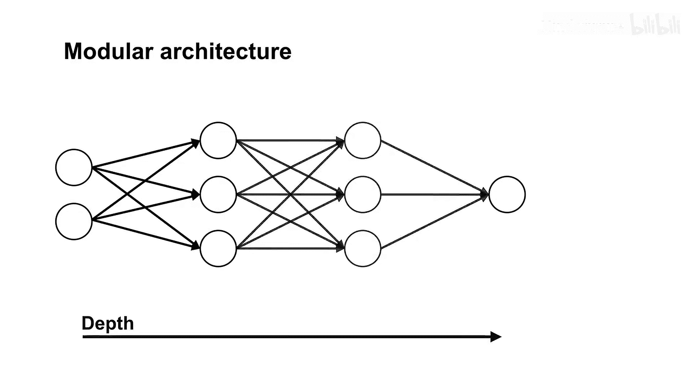
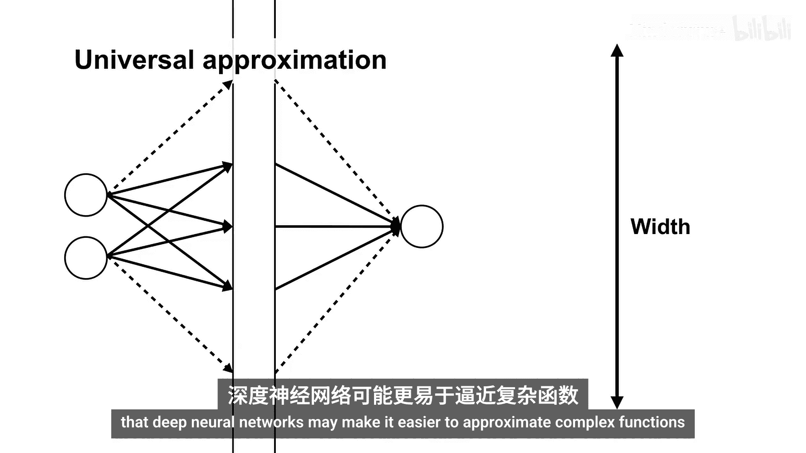
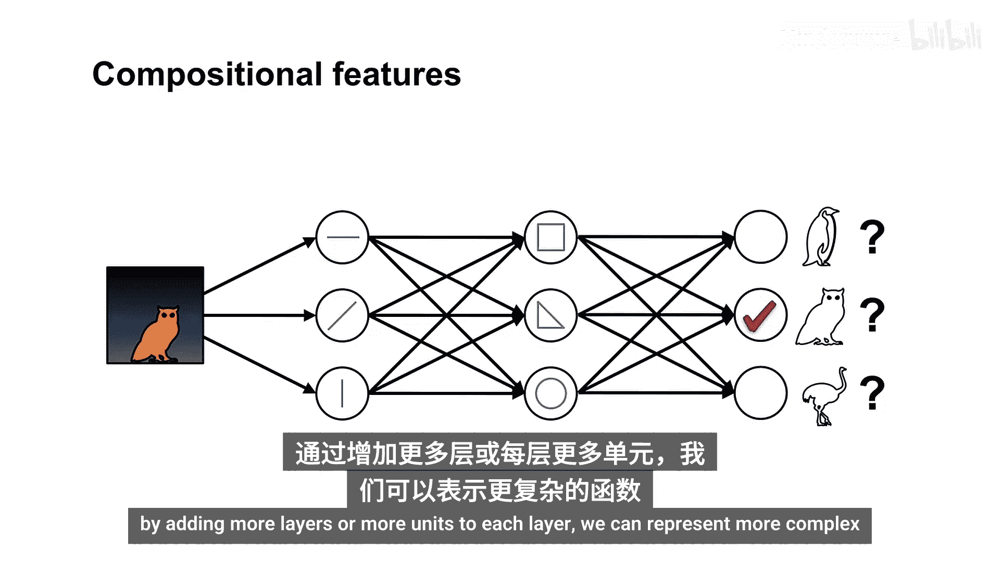
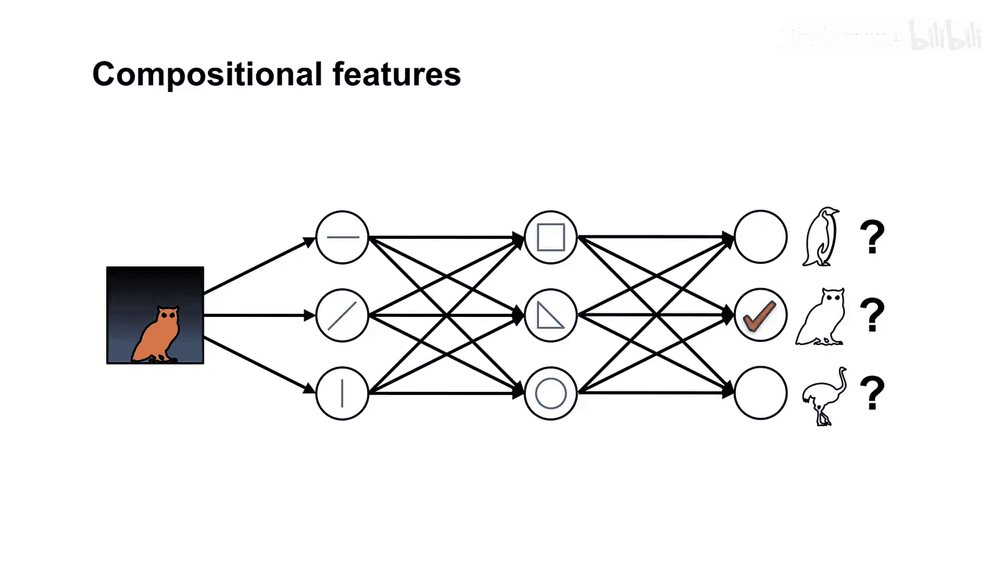
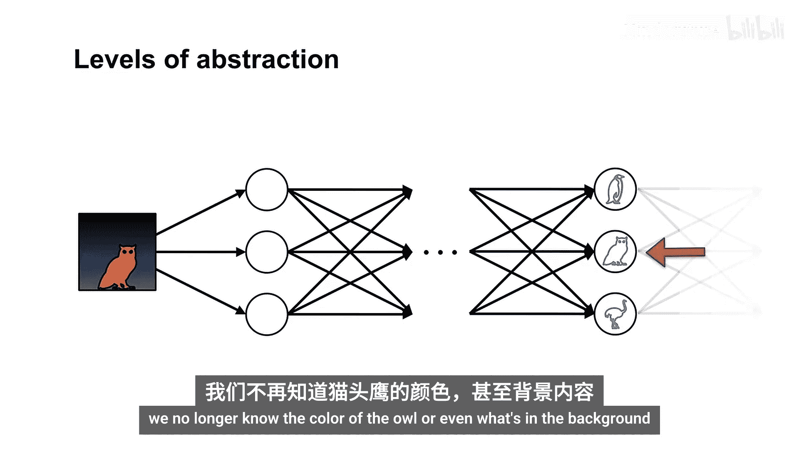

# 022：深度神经网络_03_02_03

在本节课中，我们将要学习深度神经网络中“深度”的作用。我们将探讨网络架构的选择如何影响性能，并理解深度如何通过特征的组合与抽象来促进学习。

## 网络架构的影响 🏗️

神经网络架构的选择对性能有重大影响。这包括节点的数量、激活函数，以及节点的排列和连接方式。本节我们将重点讨论深度在网络中扮演的角色。

## 深度网络的定义与理论基础 📚

上一节我们介绍了架构的基本要素，本节中我们来看看网络深度的具体定义。

网络的深度由其隐藏层的数量定义。理论上，神经网络不一定需要很深。一个具有单个隐藏层的神经网络，只要足够宽，就可以近似任何连续函数。我们称之为**通用近似定理**。

然而，实践经验与理论都表明，深度神经网络可能使近似复杂函数变得更容易。

## 深度促进特征组合 🔗

深度之所以有益，一个关键原因在于它允许特征的组合。通过组合模块化组件，可以产生更专门化的特征。

考虑一个直观的例子：输入是图像的原始像素。较早的层可能学习捕获低级特征，比如各种角度的线条。下一层可能学习将这些线条组合成各种形状。基于这些，网络或许能够检测图像中的物体或动物。这种方法通常比试图直接从原始像素推断这些信息效果更好。

通过向每层添加更多层或更多单元，我们可以表示更复杂的函数。

## 深度促进抽象化 🎯

深度也有助于获得抽象化。深度神经网络组合了许多较低层次的抽象层，每一连续层都贡献于越来越抽象的表示。

考虑之前的例子，网络最终可能用单个比特来表示“猫头鹰”这个概念。0表示图像不包含猫头鹰，1表示图像包含猫头鹰。在这个层次上，图像中所有额外的细节都已被移除。我们不再知道猫头鹰的颜色，甚至不知道背景中有什么。

事实上，我们可以明确地设计网络来从输入中移除不必要的细节。例如，可以设计一个带有瓶颈层的网络。其思想很简单：每一连续层包含的节点都比前一层少。表示层是节点最少的层，它包含了预测所需的关键细节。

## 总结与预告 📝

本节课中我们一起学习了深度神经网络的优势。总体而言，网络中的深度可以显著提高我们智能体学习特征的能力。

在本视频中，我们描述了网络如何由多层组成，并讨论了深度如何促进组合与抽象。我们探讨了深度神经网络在实践中可能带来的一些好处。选择正确的架构可能很困难，并且会显著影响性能。本课程中我们将不再进一步讨论网络架构，关于这个主题有许多优秀的资源，如果您想了解更多，可以查阅它们。

接下来，我们将讨论如何学习神经网络的参数。