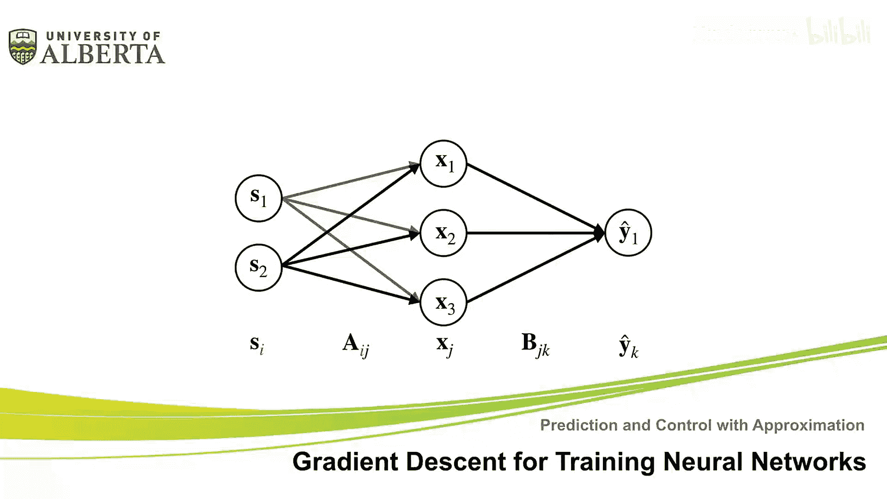
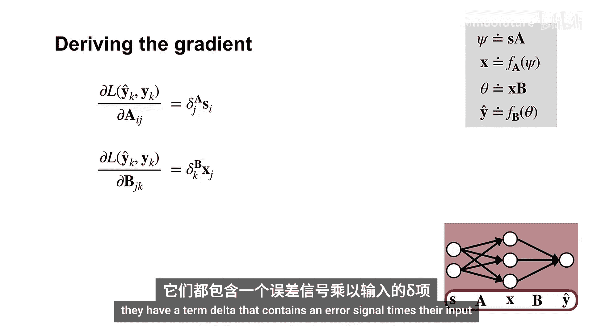
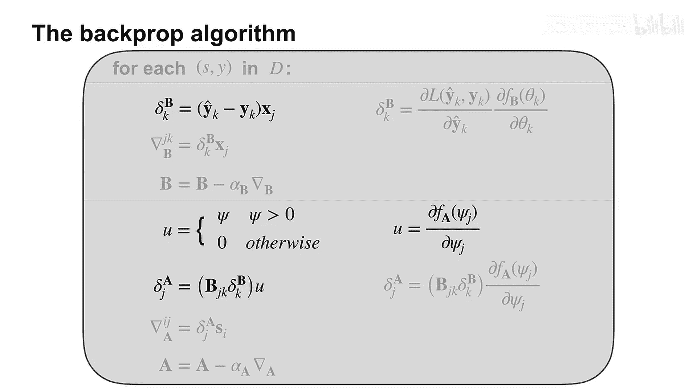

# 023：用于训练神经网络的梯度下降 🧠

在本节课中，我们将学习如何为神经网络推导梯度，并实现梯度下降算法。我们将从定义损失函数开始，逐步推导出网络参数的更新规则，最终理解反向传播算法的核心思想。

## 概述

我们之前讨论的算法更新规则通常很简单，并且大多基于梯度下降。神经网络也是如此。反向传播算法实际上并不复杂，它本质上就是梯度下降，但由于嵌套函数的存在，其梯度计算稍显复杂。

## 定义损失与目标

与线性函数逼近类似，第一步是定义关于神经网络参数的损失函数，然后推导其梯度。损失函数衡量了网络预测值与正确值之间的差距。我们训练神经网络的目标是找到能够最小化这个损失函数的参数。

函数的梯度指向下降最快的方向。通过沿着梯度的反方向移动，我们就能朝着最快速最小化损失的方向前进。

## 计算神经网络的梯度

那么，我们如何计算神经网络损失函数的梯度呢？在开始之前，我们先建立一些符号约定。

*   网络的输入是 **S**，输出是 **Y_hat**。
*   隐藏层学习特征，我们称之为 **X**。
*   权重矩阵 **A** 用于生成特征 **X**。
*   权重矩阵 **B** 对 **X** 进行线性加权以产生输出 **Y_hat**。

网络每一层的输出都可以表示为一个向量，这里就是 **X** 和 **Y_hat**。权重矩阵的第一个索引代表该层的输入，第二个索引代表输出。

我们暂时假设有一个通用的损失函数 **L**，以便描述基本思想。**L** 的一个例子是平方误差。在推导过程中，我们将保持 **L** 的通用性，稍后会给出使用平方误差时的具体更新规则。

## 推导前的准备

在深入推导之前，让我们先了解一下方向。虽然推导过程有些复杂，但我们会发现最终的更新规则相当简单。

每个参数矩阵的更新看起来都像是一个误差项 **delta** 乘以该层的输入。对于 **A**，输入是 **S**；对于 **B**，输入是 **X**。此外，我们还会发现 **Delta_A** 可以有效地表示为 **Delta_B** 的函数。来自网络输出的误差 **Delta_B** 被反向传播到更早的层，以帮助确定 **A** 在产生该误差中所起的作用。

## 梯度推导

现在，我们如何得到 **Delta_A** 和 **Delta_B** 呢？为了趣味和教育目的，我们现在进行完整的推导。让我们从网络的输出开始，向后推导，这样做有很好的理由，你马上就会看到。

**1. 计算关于权重 B 的梯度**

我们首先计算损失函数 **L** 关于第一组权重 **B** 的偏导数。我们使用链式法则，得到 **L** 关于 **Y_hat** 的导数乘以 **Y_hat** 关于 **B** 的导数。

`∂L/∂B = (∂L/∂Y_hat) * (∂Y_hat/∂B)`

下一步，再次对 `∂Y_hat/∂B` 使用链式法则。为了简化，我们引入一个新变量 **θ**。**θ** 是隐藏层输出与最后一组权重的乘积。我们把它写在旁边以便记住。

`θ = X * B`

现在，我们用 **θ** 重写 **Y_hat**。

`Y_hat = f_B(θ)`

让我们展开 `∂Y_hat/∂B`。使用链式法则，我们得到 `f_B` 关于 **θ** 的导数乘以 **θ** 关于 **B** 的导数。

`∂Y_hat/∂B = (∂f_B/∂θ) * (∂θ/∂B)`

**θ** 关于 **B** 的导数是 **X**。这是因为 **θ** 是 **B** 的线性函数，并且 **X** 不依赖于 **B**。

`∂θ/∂B = X`

至此，我们完成了关于 **B** 的梯度推导。接下来，我们将推导关于 **A** 的梯度。但在那之前，让我们为损失函数和激活函数做出具体选择，以便能看到 **B** 的通用方程的一个具体实例。

**2. 具体实例：平方误差与线性输出**

让我们定义 **L** 为平方误差，并在最后一层使用线性激活函数。

`L = 0.5 * (Y_hat - Y)^2`

损失关于 **Y_hat** 的导数是：

`∂L/∂Y_hat = (Y_hat - Y)`

输出层激活函数 `f_B` 的导数是 1（因为 `f_B` 是恒等函数，且 **θ** 关于自身的导数是 1）。

`∂f_B/∂θ = 1`

这是损失关于 **B** 的通用梯度公式：

`∂L/∂B = (∂L/∂Y_hat) * (∂f_B/∂θ) * X`

将具体值代入关于 **B** 的梯度公式，我们得到：

`∂L/∂B = (Y_hat - Y) * 1 * X`

为了在计算关于 **A** 的梯度时简化符号，我们定义一个新项 **Delta_B**。

`Delta_B = (∂L/∂Y_hat) * (∂f_B/∂θ)`

现在，关于 **B** 的梯度可以重写为 **Delta_B** 乘以它的输入 **X**。

`∂L/∂B = Delta_B * X`

**3. 计算关于权重 A 的梯度**

现在，为了计算关于 **A** 的梯度，我们需要经历与 **B** 相同的步骤。主要区别在于，由于权重 **A** 也影响 **X**，我们多了一个链式法则步骤。

让我们从这里开始。我们使用链式法则展开这个导数。

`∂L/∂A = (∂L/∂Y_hat) * (∂Y_hat/∂X) * (∂X/∂A)`

在展开下一项之前，让我们引入另一个辅助变量 **ψ**。

`ψ = S * A`

我们把它放在一边，并用它重写 **X**。

`X = f_A(ψ)`

然后我们展开下一项 `∂X/∂A`。

`∂X/∂A = (∂f_A/∂ψ) * (∂ψ/∂A)`

再次使用链式法则，我们得到 `f_A` 关于 **ψ** 的导数乘以 **ψ** 关于 **A** 的导数。因为 **ψ = S * A**，我们得到 `∂ψ/∂A = S`。

`∂X/∂A = (∂f_A/∂ψ) * S`

把它们全部放在一起，我们最终得到关于 **A** 的导数。

`∂L/∂A = (∂L/∂Y_hat) * (∂Y_hat/∂X) * (∂f_A/∂ψ) * S`

回想一下，`∂Y_hat/∂X` 实际上就是 **B**（因为 `Y_hat = X * B`）。并且我们已经有了 `(∂L/∂Y_hat) * (∂Y_hat/∂X)` 这部分，它正是我们之前定义的 **Delta_B**。

因此，公式简化为：

`∂L/∂A = Delta_B * (∂f_A/∂ψ) * S`

**4. 定义 Delta_A 并总结**

现在，我们可以通过再次定义一个项 **Delta_A** 来清理这个导数。

`Delta_A = Delta_B * (∂f_A/∂ψ)`

现在，关于 **A** 的导数是 **Delta_A** 乘以它的输入 **S**。

`∂L/∂A = Delta_A * S`

注意，两个梯度都可以重写为相似的形式：它们都有一个包含误差信号的 **delta** 项乘以各自的输入。

## 反向传播算法伪代码

让我们简要看一下实现随机梯度下降反向传播算法的一些伪代码。

以下是处理每个数据点的步骤：

1.  **前向传播**：对于数据集中的每个数据点 **(S, Y)**，我们首先从网络获得预测值 **Y_hat**。
2.  **计算输出层梯度**：我们从输出开始计算梯度。首先计算 **Delta_B** 和关于 **B** 的梯度。
3.  **更新参数 B**：使用步长 **α_B** 和计算出的梯度更新参数 **B**。
4.  **计算隐藏层梯度**：接下来，我们计算 **Delta_A**，它使用了 **Delta_B**。注意，通过先计算网络末端的梯度，我们避免了为 **A** 重新计算那些已经为 **Delta_B** 计算过的相同项。事实上，这就是反向传播背后的主要思想。它只是梯度下降，加上了一种高效计算梯度的策略。
5.  **更新参数 A**：然后我们计算关于 **A** 的梯度，并使用步长 **α_A** 和该梯度更新 **A**。

这个推导和算法很容易扩展到更深的网络。更早层的 **delta** 同样可以使用下一层的 **delta** 递归计算。每一层的更新总是采用 **delta** 乘以该层输入的形式。

## 具体网络示例

为了让内容更具体，让我们看一个特定网络的反向传播算法伪代码。假设我们在隐藏层使用 ReLU 激活函数，在输出层使用线性单元。

以下是伪代码步骤：

1.  计算输出层的误差：`error = Y_hat - Y`
2.  计算 **Delta_B**：`Delta_B = error` （因为输出是线性的，`∂f_B/∂θ = 1`）
3.  计算 ReLU 单元关于 **ψ** 的导数：`u = (X > 0) ? 1 : 0`
4.  使用输出层的误差信号和 **u** 计算隐藏层的误差信号：`Delta_A = Delta_B * B * u`
5.  更新权重：`B = B - α_B * Delta_B * X`， `A = A - α_A * Delta_A * S`

其余部分保持不变。

## 总结

本节课中，我们一起学习了如何推导神经网络的梯度，并讨论了反向传播的主要思想：从网络输出开始计算梯度可以节省计算量。这是一个相当详细的推导，你实际上不需要记住所有步骤。我们的目标是让你对神经网络的更新规则有一些深入的了解，以及它如何随着损失函数、激活函数和网络层的不同选择而变化。在你的练习中，你将实现本视频末尾给出的伪代码。

在下一个视频中，我们将为你提供更多工具，使你的神经网络实现在实践中更加有效。