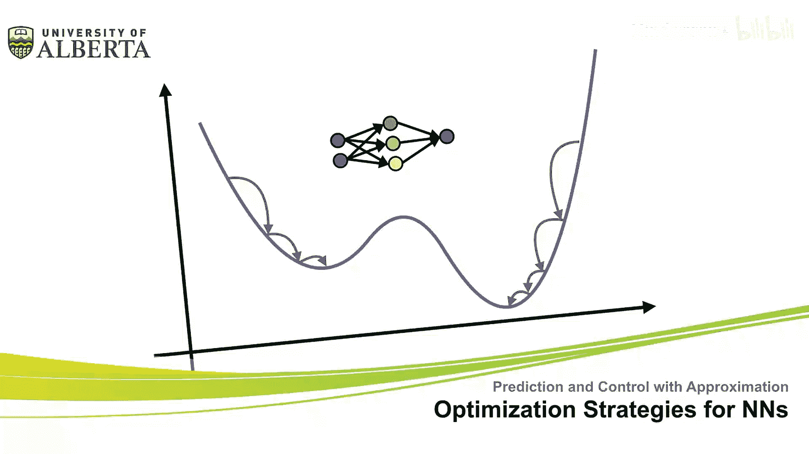
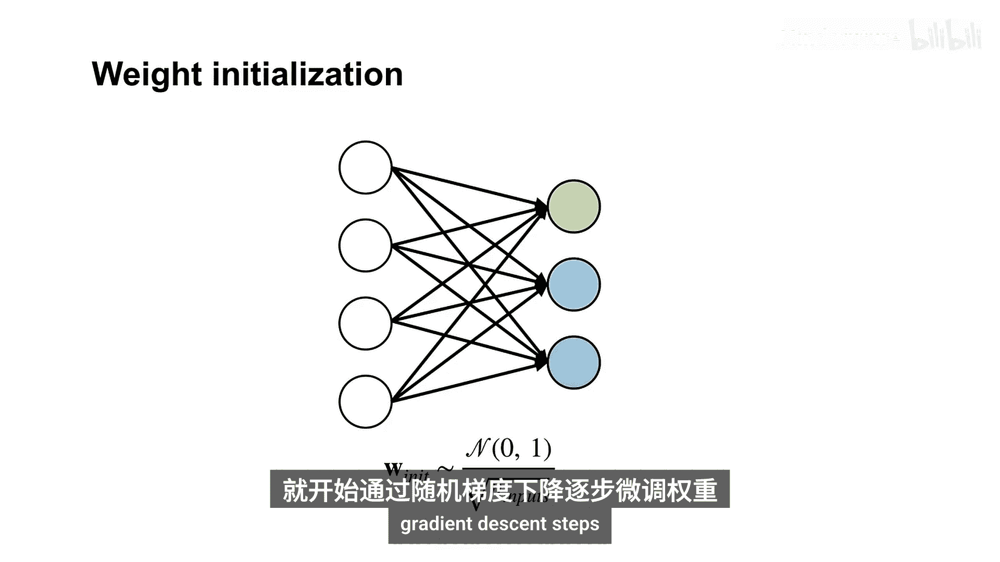
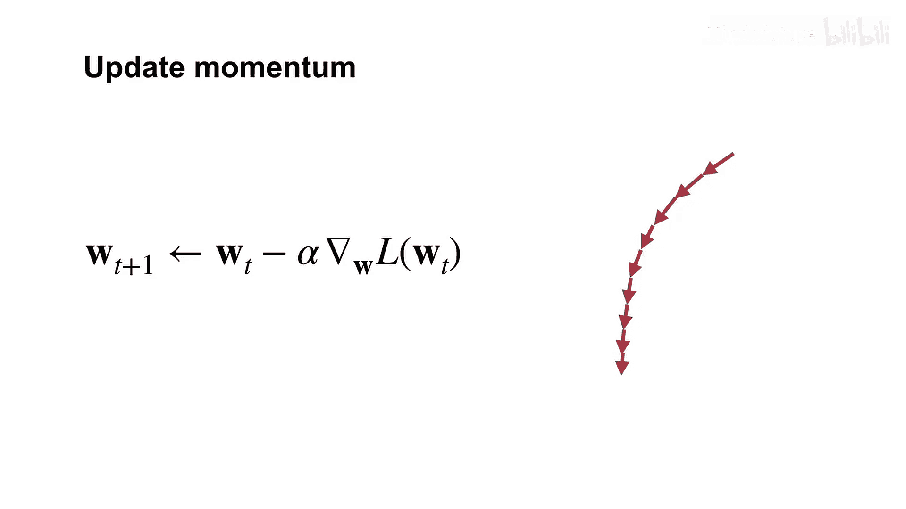
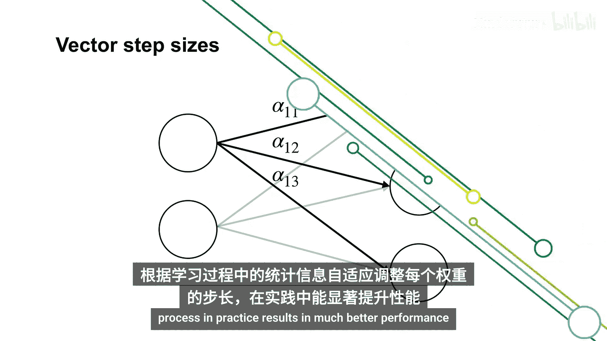

# 024：神经网络的优化策略

在本节课中，我们将学习如何更有效地训练神经网络。我们将探讨两个关键方面：如何为网络选择好的初始起点，以及如何使用更高级的优化技术来加速训练过程。

## 初始化的重要性

上一节我们介绍了神经网络训练的基本框架。本节中我们来看看训练过程的起点——权重初始化。这个选择对神经网络的最终性能有重大影响。

神经网络的训练是一个迭代过程，这个过程必须有一个起点。这个起点的选择可以在神经网络的性能中扮演重要角色。

让我们看一个只有一个权重的例子。在y轴上，我们将展示损失函数。在x轴上，我们将展示权重的值。正如你所知，梯度下降将迭代地将权重移向最近的驻点。

但神经网络损失函数并不那么简单。如果我们从这个近乎平坦的区域开始，梯度下降可能很难取得任何进展，因为梯度接近于0。

相反，如果我们从这个小的“碗”状区域内部开始，那么我们可以快速找到局部最优点。

但是，如果我们能从某个更好的位置开始，从而快速找到更优的点，那不是更好吗？

以下是一种简单而有效的初始化策略：

*   从方差较小的正态分布中随机采样初始权重。
*   这样，每个神经元在其层内与其他神经元具有不同的输出。
*   这提供了一组更多样化的潜在特征。
*   通过保持方差较小，我们确保每个神经元的输出与其相邻神经元的输出在同一范围内。

这种策略的一个缺点是，当我们向神经元添加更多输入时，其输出的方差会增长。我们可以通过将权重的方差按 `1 / sqrt(输入数量)` 进行缩放来解决这个问题。

## 优化训练过程

在为我们网络选择了起点之后，我们开始使用随机梯度下降步骤对权重进行增量的小改进。

另一种改进训练的方法是考虑更复杂的更新机制。两种常见策略是使用重球法（也称为动量）和向量步长自适应。我们先来谈谈动量。

想象一下，这是二维权重向量在随机梯度下降下的轨迹。

这是随机梯度下降的更新规则：
`w_{t+1} = w_t - α * ∇J(w_t)`

这是修改后包含动量的更新规则：
`w_{t+1} = w_t - α * ∇J(w_t) + λ * (w_t - w_{t-1})`
注意，它类似于常规的随机梯度下降更新，加上一个称为动量的额外项。动量项使用梯度衰减和（衰减率为λ）来总结梯度的历史。

如果最近的梯度都处于相似的方向，那么我们就会在该方向上获得动量。这意味着我们在该方向上迈出一大步。如果最近的更新方向相互冲突，那么它会抵消动量，动量项对更新的影响很小，我们将进行常规的梯度下降步骤。

动量被证明可以加速学习，意味着能更快地到达驻点。

另一个潜在的改进是为网络中的每个权重使用单独的步长。到目前为止，我们只讨论了一个全局标量步长α。众所周知，这可能会产生问题，因为这可能导致某些权重的更新太大，而其他权重的更新太小。

在实践中，根据学习过程的统计数据为每个权重自适应调整步长，会带来更好的性能。

## 向量步长自适应

现在，更新规则如何改变？改变非常简单，不是用标量α更新，而是用一个步长向量（用下标t表示它可以在每个时间步改变）：
`w_{t+1} = w_t - α_t ⊙ ∇J(w_t)`
梯度向量的每个维度都由其对应的步长（而不是全局步长）进行缩放。

有多种方法可以自适应调整步长向量，你将在作业中实现其中一种。

## 总结

本节课中我们一起学习了改进神经网络训练的方法。具体来说，我们讨论了一种初始化神经网络权重的策略，以及如何使用动量和步长自适应来加速学习。现在，你已经准备好用神经网络实现一个TD智能体了。