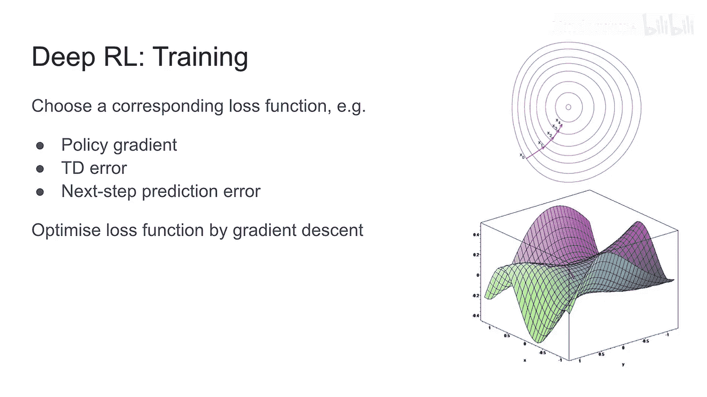

# 025：深度强化学习概述

在本节课中，我们将要学习深度强化学习的基本概念，了解它如何将强化学习的问题框架与深度学习的解决方案相结合，从而解决复杂的决策问题。

## 强化学习与深度学习

上一节我们介绍了课程背景，本节中我们来看看强化学习和深度学习各自的核心思想。

强化学习是一个通用的决策框架。它描述了一个智能体与环境交互的过程：智能体采取行动，行动会影响世界，世界随之变化并给予智能体观察和奖励信号。智能体的目标是选择能最大化其累积奖励的行动。这个框架可以应用于机器人、游戏、金融交易等广泛领域。

深度学习则是一个通用的表示学习框架。给定一个目标，深度学习提供了一种构建表示的方法，以最小的先验知识来达成该目标。系统从输入（如图像）开始，逐步构建特征来理解输入，最终做出决策（例如，判断图像中是猫还是狗）。

## 深度强化学习的结合

上一节我们分别介绍了强化学习和深度学习，本节中我们来看看如何将它们结合起来。

深度强化学习是两者的结合。我们的终极目标是寻求一个能解决任何人类级别任务的智能体。强化学习定义了这个问题，而深度学习可能提供了实现目标的机制。因此，强化学习是问题，深度学习更像是解决方案。

一个重要的猜想是：**强化学习 + 深度学习** 为我们提供了一条可能实现宏大目标的路径。

## 深度学习基础：神经网络

为了理解深度强化学习，我们需要先理解深度学习的核心——神经网络。

神经网络，特别是深度神经网络，可以看作是一个多层复合函数。以下是其主要组成部分：

*   **输入**：系统的初始数据，例如一张图像。
*   **权重**：函数中的参数，决定了函数的具体行为。
*   **层与特征**：输入经过一系列函数处理，形成内部状态或特征。
*   **输出**：经过所有计算层后，系统产生的最终结果，例如分类判断。
*   **损失函数**：一个标量值，用于衡量系统表现的好坏，例如分类正确为1，错误为0。

神经网络的关键特性是**反向传播**。我们不仅可以前向计算输出，还可以反向追溯信息流，利用微积分中的链式法则计算整个系统关于参数的梯度。这让我们能理解调整参数会如何影响最终的损失。

训练深度神经网络的核心思想就是利用这个梯度来调整参数。我们计算损失相对于参数的梯度，这个梯度指示了在参数构成的“地形图”上，哪个方向是“下坡”（即降低错误的方向）。我们通过沿梯度方向移动参数来不断降低损失，这就是深度学习的核心理念。

## 强化学习智能体的构成

理解了深度学习的基础后，让我们回到强化学习，看看如何将两者结合。

理解强化学习智能体的构成非常有用。一个智能体可能包含以下一个或多个核心组件，这定义了智能体的类型：

*   **策略**：决定智能体行为的函数。基于此构建的方法称为**基于策略的强化学习**。
*   **价值函数**：智能体对未来累积奖励的预测函数。基于此构建的方法称为**基于价值的强化学习**。
*   **模型**：智能体对环境动态的理解，用于预测接下来会发生什么。基于此构建的方法称为**基于模型的强化学习**。

## 深度强化学习的实现方法

上一节我们介绍了强化学习智能体的三大组件，本节中我们来看看如何用深度学习技术来实现它们。

我们可以将深度学习与强化学习结合，本质上是使用深度神经网络作为**函数逼近器**。这个函数逼近器可以用来表示强化学习中三大组件的任何一个：

*   它可以用来表示**策略**。
*   它可以用来表示**价值函数**。
*   它可以用来表示**模型**。

为了训练这个系统，核心思想是必须选择一个损失函数，即一个目标，来描述我们在对应强化学习算法家族中真正想要优化的东西：

*   对于**基于策略**的强化学习，我们可能选择遵循**策略梯度**。
*   对于**基于价值**的强化学习，我们可能选择最小化**时序差分误差**。
*   对于**基于模型**的强化学习，我们可能选择最小化**下一步预测误差**。

算法非常简单，就像在深度学习中一样：我们只需要通过**梯度下降**来优化那个损失函数，沿着“地形图”不断向下，直到损失越来越低，性能越来越好。

## 应用与成就

将上述内容结合起来，就为我们提供了一套在强化学习中实现各种有趣成果的配方。近年来一些激动人心的成功案例就源于此：

以下是深度强化学习的一些应用实例：
*   **游戏**：智能体能在围棋、国际象棋等游戏中击败人类世界冠军；能玩50多种不同的雅达利游戏；甚至能挑战《星际争霸》这类对人类而言极具挑战性的视频游戏。
*   **机器人操控**：智能体可以学习以高度的灵活性操纵物体。
*   **化学合成**：通过称为“逆合成”的方法解决化学合成问题。
*   **金融交易**：智能体能在现实世界中进行算法交易。

## 总结

本节课中我们一起学习了深度强化学习的核心概念。我们了解到，通过将强化学习的问题框架与深度学习的解决方案相结合，并利用深度学习方法作为强大的函数逼近工具，我们获得了一种非常灵活且强大的方法。这种方法让我们在解决人工智能中许多重要问题的道路上迈出了一大步。